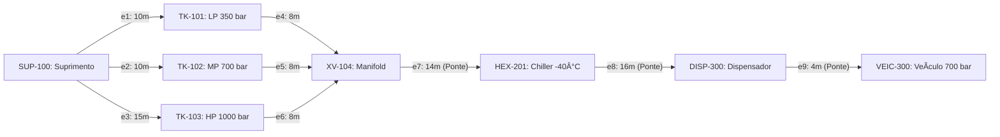
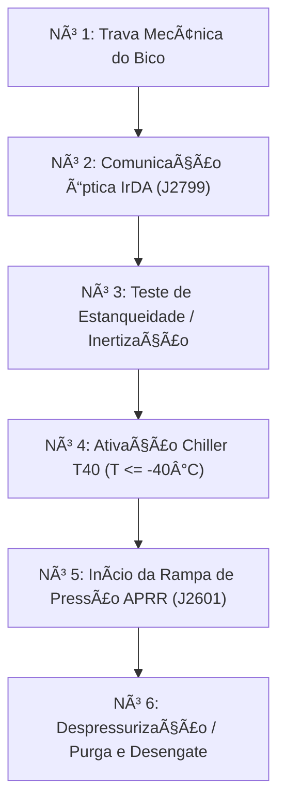

# MANUAL TÉCNICO INTEGRAL DE ENGENHARIA, OPERAÇÃO E ANÁLISE ARQUITETURAL
# SISTEMA SCADA CORE PARA ESTAÇÃO DE REABASTECIMENTO DE HIDROGÊNIO (HRS - FCEV)

**Universidade Federal de Itajubá - UNIFEI**  
**Instituto de Engenharia de Sistemas e Tecnologias da Informação (IESTI)**  
**Disciplina:** ECAA08 - Lógica Aplicada e Teoria dos Grafos para Automação  
**Repositório Oficial:** `leovarconrenno/Estacao-de-Reabastecimento-de-Hidrogenio---SCADA-Core`  
**Equipe de Desenvolvimento:** João Pedro, Marcelo Candelaria, Luca Augusto, Leo Vargas  
**Documento de Engenharia:** Revisão Técnica Consolidada, Análise Estrutural e Manual Completo  
**Classificação:** Documentação Técnica Industrial e Referencial de Controle e Automação  

---

## SUMÁRIO EXECUTIVO E ÍNDICE GERAL

- **SEÇÃO PRELIMINAR: ANÁLISE ESTRUTURAL E ARQUITETURAL DO REPOSITÓRIO GITHUB**
  - Contexto Acadêmico e Motivação do Projeto na UNIFEI
  - Topografia de Arquivos, Pastas e Artefatos de Software
  - Módulo 1 (Etapa 01 - Lógica Formal e Sistemas Especialistas)
  - Módulo 2 (Etapa 02 - Teoria dos Grafos Aplicada a Redes de Tubulação)
  - Módulo 3 (Interface Supervisória Web, P&ID Interativo e Simulador Didático)
  - Automação de CI/CD e Pipelines do GitHub Actions

- **CAPÍTULO 1: INTRODUÇÃO GERAL, CONTEXTO E VISÃO SISTÊMICA**
  - 1.1 O Papel do Hidrogênio Verde na Transição Energética Global
  - 1.2 Tecnologias de Mobilidade Elétrica a Célula de Combustível (FCEV)
  - 1.3 Anatomia Funcional de uma Estação de Hidrogênio (HRS)
  - 1.4 A Centralidade dos Sistemas SCADA e Automação Industrial Crítica
  - 1.5 Contextualização do Projeto SCADA Core UNIFEI
  - 1.6 Estrutura Organizacional do Repositório e Artefatos do Projeto

- **CAPÍTULO 2: NORMAS TÉCNICAS E DIRETRIZES INTERNACIONAIS DE SEGURANÇA**
  - 2.1 SAE J2601: Protocolo de Abastecimento para Veículos Leves de Alta Pressão
  - 2.2 SAE J2799: Protocolo de Comunicação Sem Fio e Infravermelho (IrDA)
  - 2.3 ISO 19880-1: Requisitos Globais de Segurança e Desempenho para HRS
  - 2.4 NFPA 2: Código Tecnológico de Hidrogênio e Mitigação de Riscos de Explosão
  - 2.5 IEC 61508 e IEC 61511: Segurança Funcional e Sistemas Instrumentados (SIS / SIL)
  - 2.6 Classificação de Áreas Potencialmente Explosivas (ATEX / IECEx / NR-10 / NR-20)
  - 2.7 ASME B31.12: Engenharia de Tubulações para Hidrogênio Gasoso

- **CAPÍTULO 3: TERMODINÂMICA E ENGENHARIA DO PROCESSO DE COMPRESSÃO E TRANSFERÊNCIA**
  - 3.1 Propriedades Físico-Químicas Críticas do Gás Hidrogênio (H2)
  - 3.2 O Efeito Joule-Thomson e o Fenômeno de Inversão Térmica
  - 3.3 Necessidade Crítica de Pré-resfriamento Criogênico (-40°C / Classe T40)
  - 3.4 Filosofia de Armazenamento em Cascata (Cascade Storage: LP, MP, HP)
  - 3.5 Taxa Média de Rampa de Pressão (APRR) e Prevenção de Fadiga Térmica
  - 3.6 Dinâmica de Carregamento em Tanques Tipo IV (Polímero e Fibra de Carbono)

- **CAPÍTULO 4: ARQUITETURA FÍSICA DA PLANTA E INSTRUMENTAÇÃO P&ID**
  - 4.1 Setor 100: Armazenamento e Compressão Multiestágio
  - 4.2 Setor 200: Condicionamento Térmico e Unidade de Resfriamento (Chiller)
  - 4.3 Setor 300: Linha de Dispensação e Interface Veicular
  - 4.4 Filosofia Operacional das Válvulas de Bloqueio Rápido e Seleção Direcional
  - 4.5 Mecanismos de Alívio Mecânico (PSV) e Parada de Emergência (ESD)

- **CAPÍTULO 5: MAPA DE VARIÁVEIS, DICIONÁRIO DE TAGS E PROTOCOLOS DE COMUNICAÇÃO**
  - 5.1 Padronização ISA-5.1 para Instrumentação e Malhas de Controle
  - 5.2 Dicionário Exaustivo de Entradas Analógicas (AI)
  - 5.3 Dicionário Exaustivo de Entradas Discretas (DI)
  - 5.4 Dicionário Exaustivo de Saídas Analógicas (AO)
  - 5.5 Dicionário Exaustivo de Saídas Discretas (DO)
  - 5.6 Mapeamento de Registradores Industriais (Modbus TCP e Nós OPC UA)

- **CAPÍTULO 6: ETAPA 01 - LÓGICA PROPOSICIONAL, BOOLEANA E INTERTRAVAMENTOS DE SEGURANÇA**
  - 6.1 Formalização Lógica de Estados Físicos e Variáveis Discretas
  - 6.2 Conectivos Fundamentais, Tabelas-Verdade e Permissivos Operacionais
  - 6.3 Análise Algébrica de Tautologias, Contradições e Contingências
  - 6.4 Formas Canônicas: Forma Normal Disjuntiva (FND) e Conjuntiva (FNC)
  - 6.5 Otimização Lógica: Mapas de Karnaugh e Algoritmo de Quine-McCluskey
  - 6.6 Predicados de Primeira Ordem e Quantificadores em Redes de Sensores
  - 6.7 Regras de Inferência Dedutiva e Resolução Proposicional
  - 6.8 Arquitetura de Intertravamento SIS e Votação Redundante (1oo2, 2oo3)

- **CAPÍTULO 7: SISTEMAS ESPECIALISTAS E MOTORES DE INFERÊNCIA DIAGNÓSTICA**
  - 7.1 Fundamentos de Sistemas Baseados em Regras (Rule-Based Systems - RBS)
  - 7.2 Estrutura da Base de Conhecimento e Regras de Produção IF-THEN
  - 7.3 Motor de Inferência por Encadeamento para Frente (Forward Chaining)
  - 7.4 Motor de Inferência por Encadeamento para Trás (Backward Chaining)
  - 7.5 Matriz de Correlação Sintoma-Causa-Ação para Diagnóstico Preditivo
  - 7.6 Implementação Computacional e Algoritmos de Diagnóstico em Tempo Real
  - 7.7 Avaliação de Eficácia do Módulo de Diagnóstico

- **CAPÍTULO 8: ETAPA 02 - TEORIA DOS GRAFOS E MODELAGEM TOPOLÓGICA DE TUBULAÇÕES**
  - 8.1 Modelagem Estrutural por Dígrafos Ponderados G = (V, E, W)
  - 8.2 Definição Topológica dos Vértices e Arestas da Planta H2
  - 8.3 Representações Matriciais: Adjacência, Incidência e Custos Hidráulicos
  - 8.4 Matriz Laplaciana e Propriedades Espectrais da Conectividade da Planta
  - 8.5 Tipologias de Passeios, Trilhas, Caminhos e Ciclos em Redes de Dutos
  - 8.6 Análise de Redundância e Lema do Aperto de Mãos Dirigido

- **CAPÍTULO 9: ALGORITMOS DE BUSCA, CAMINHO MÍNIMO E ROTEAMENTO DINÂMICO**
  - 9.1 Busca em Largura (BFS): Propagação de Pressão e Varredura de Alcance
  - 9.2 Busca em Profundidade (DFS): Rastreamento de Linhas e Detecção de Ciclos
  - 9.3 Algoritmo de Dijkstra para Otimização de Rota de Abastecimento
  - 9.4 Arestas Pontes (Bridges) e Vértices de Articulação Críticos
  - 9.5 Simulação de Vazamentos e Algoritmo de Desvio Automático em Tempo Real
  - 9.6 Intertravamento de Segurança via Grafo Acíclico Dirigido (DAG)

- **CAPÍTULO 10: OTIMIZAÇÃO DE INSPEÇÃO INDUSTRIAL E LOGÍSTICA DE INSUMOS**
  - 10.1 Problemas Eulerianos e Inspeção Integral por Robô PIG Ultrassônico
  - 10.2 Algoritmos de Hierholzer e Fleury para Trajetórias Eulerianas
  - 10.3 Problemas Hamiltonianos e Roteamento de Veículos Autônomos (AGV)
  - 10.4 Resolução do Problema do Caixeiro Viajante (TSP) com Heurística 2-Opt
  - 10.5 Grafos de Fluxo Máximo e Cadeia Logística de Transporte de H2 (Tube Trailers)

- **CAPÍTULO 11: ARQUITETURA DE SOFTWARE DO SCADA CORE E SIMULADOR WEB**
  - 11.1 Arquitetura Front-End: HTML5 Semântico, CSS3 e Design Responsivo
  - 11.2 Integração Dinâmica com Diagrama Vetorial P&ID em Formato SVG
  - 11.3 Controlador de Estados JavaScript e Manipulação do DOM em Tempo Real
  - 11.4 Simulador Didático de Grafos e Painel Interativo de Tomada de Decisão
  - 11.5 Automação de Builds, CI/CD e Integração Contínua com GitHub Actions

- **CAPÍTULO 12: ANÁLISE DE RISCOS DE PROCESSO, HAZOP E MATRIZ FMEA**
  - 12.1 Metodologia do Estudo de Perigos e Operabilidade (HAZOP)
  - 12.2 Planilhas Detalhadas de Análise HAZOP por Nós de Processo
  - 12.3 Matriz de Modos de Falha e Efeitos (FMEA) e Priorização de Risco (RPN)
  - 12.4 Filosofia de Gestão de Alarmes conforme a Norma ANSI/ISA-18.2
  - 12.5 Procedimentos Operacionais Padronizados de Contingência e Emergência

- **CAPÍTULO 13: GUIA PRÁTICO DE IMPLANTAÇÃO, EXECUÇÃO E TESTES**
  - 13.1 Requisitos de Infraestrutura e Dependências de Software
  - 13.2 Procedimentos de Inicialização do Servidor Local e Interface Web
  - 13.3 Execução e Validação dos Notebooks Didáticos Jupyter
  - 13.4 Bateria de Testes Funcionais e Casos Extremos (Corner Cases)
  - 13.5 Proposta de Roadmap e Extensões para Ambiente Industrial Real

- **CAPÍTULO 14: CONSIDERAÇÕES FINAIS, GLOSSÁRIO E REFERÊNCIAS BIBLIOGRÁFICAS**
  - 14.1 Conclusões Técnicas sobre a Integração Lógica-Grafos-SCADA
  - 14.2 Glossário Exaustivo de Termos Técnicos e Siglas de Engenharia
  - 14.3 Referências Bibliográficas Normativas e Acadêmicas

---

# SEÇÃO PRELIMINAR: ANÁLISE ESTRUTURAL E ARQUITETURAL DO REPOSITÓRIO GITHUB

## Contexto Acadêmico e Motivação do Projeto na UNIFEI
O projeto de código aberto **Estacao-de-Reabastecimento-de-Hidrogenio---SCADA-Core** foi concebido no âmbito do Instituto de Engenharia de Sistemas e Tecnologias da Informação (IESTI) da Universidade Federal de Itajubá (UNIFEI), na disciplina **ECAA08 (Lógica Aplicada e Teoria dos Grafos para Automação)**.

Os autores originais — **João Pedro, Marcelo Candelaria, Luca Augusto e Leo Vargas** — estruturaram a iniciativa para preencher uma lacuna existente entre o ensino de matemática discreta/ciência da computação teórica e a prática da engenharia de controle e automação industrial.

O objeto físico modelado é uma **Estação de Reabastecimento de Hidrogênio (HRS - Hydrogen Refueling Station)** projetada para veículos elétricos movidos a célula de combustível (*Fuel Cell Electric Vehicles* - FCEV) operando sob pressões ultra-elevadas (350 bar e 700 bar), em estrita conformidade com protocolos globais (SAE J2601, SAE J2799, ISO 19880-1, NFPA 2).

## Topografia de Arquivos e Artefatos do Repositório
O repositório apresenta uma hierarquia modular:
```
Estacao-de-Reabastecimento-de-Hidrogenio---SCADA-Core/
├── .github/workflows/main.yml    # Pipeline CI/CD do GitHub Actions
├── assets/                       # Recursos da IHM Web e Simulador
│   ├── css/styles.css            # Folha de estilos Dark/Light Mode Glassmorphism
│   ├── js/main.js                # Controlador principal da IHM e modais
│   ├── js/diagram.js             # Mapeamento dinâmico de tooltips e DOM SVG
│   ├── js/config.js              # Variáveis e constantes de processo
│   ├── js/contributors.js        # Integração assíncrona com a API GitHub
│   ├── diagrama.svg              # Fluxograma P&ID vetorial da estação
│   └── simulador_grafos_h2.html  # Laboratório didático de teoria dos grafos
├── etapa-01-logica/              # Módulo 1: Lógica Proposicional e Booleana
│   ├── 00 - Insumos.md           # Mapeamento de matérias-primas e tags ISA-5.1
│   ├── 02 a 10 (*.ipynb, *.md)   # Notebooks de álgebra booleana e sistemas especialistas
│   └── proposicoes_logicas_H2.csv# Base tabular de proposições e equações de intertravamento
├── etapa-02-grafos/              # Módulo 2: Teoria dos Grafos em Tubulações
│   ├── 11 a 18 (*.ipynb, *.md)   # Notebooks de dígrafos, matrizes, BFS/DFS, Dijkstra, PIG, AGV
│   └── grafo_tubulacoes.svg/.png # Diagrama da rede ponderada de dutos
├── index.html                    # Interface principal do sistema supervisório
├── main.py                       # Script de manutenção e compilação do README
├── README.md                     # Documento consolidado do repositório
└── readme.template.md            # Template com marcadores para automação
```
# MANUAL TÉCNICO INTEGRAL DE ENGENHARIA E OPERAÇÃO
# SISTEMA SCADA CORE PARA ESTAÇÃO DE REABASTECIMENTO DE HIDROGÊNIO (HRS - FCEV)
**Universidade Federal de Itajubá - UNIFEI**  
**Instituto de Engenharia de Sistemas e Tecnologias da Informação (IESTI)**  
**Disciplina: ECAA08 - Lógica Aplicada e Teoria dos Grafos para Automação**  
**Projeto de Referência:** Estação de Reabastecimento de Hidrogênio - SCADA Core  
**Equipe de Desenvolvimento Original:** João Pedro, Marcelo Candelaria, Luca Augusto, Leo Vargas  
**Documento de Engenharia:** Revisão Técnica Consolidada e Manual de Arquitetura  
**Classificação:** Documentação Técnica Industrial e Referencial Didático de Controle e Automação  

---

## SUMÁRIO GERAL

1. **CAPÍTULO 1: INTRODUÇÃO GERAL, CONTEXTO E VISÃO SISTÊMICA**
   - 1.1 O Papel do Hidrogênio Verde na Transição Energética Global
   - 1.2 Tecnologias de Mobilidade Elétrica a Célula de Combustível (FCEV)
   - 1.3 Anatomia Funcional de uma Estação de Hidrogênio (HRS)
   - 1.4 A Centralidade dos Sistemas SCADA e Automação Industrial Crítica
   - 1.5 Contextualização do Projeto SCADA Core UNIFEI
   - 1.6 Estrutura Organizacional do Repositório e Artefatos do Projeto

2. **CAPÍTULO 2: NORMAS TÉCNICAS E DIRETRIZES INTERNACIONAIS DE SEGURANÇA**
   - 2.1 SAE J2601: Protocolo de Abastecimento para Veículos Leves de Alta Pressão
   - 2.2 SAE J2799: Protocolo de Comunicação Sem Fio e Infravermelho (IrDA)
   - 2.3 ISO 19880-1: Requisitos Globais de Segurança e Desempenho para HRS
   - 2.4 NFPA 2: Código Tecnológico de Hidrogênio e Mitigação de Riscos de Explosão
   - 2.5 IEC 61508 e IEC 61511: Segurança Funcional e Sistemas Instrumentados (SIS / SIL)
   - 2.6 Classificação de Áreas Potencialmente Explosivas (ATEX / IECEx / NR-10 / NR-20)
   - 2.7 ASME B31.12: Engenharia de Tubulações para Hidrogênio Gasoso

3. **CAPÍTULO 3: TERMODINÂMICA E ENGENHARIA DO PROCESSO DE COMPRESSÃO E TRANSFERÊNCIA**
   - 3.1 Propriedades Físico-Químicas Críticas do Gás Hidrogênio ($H_2$)
   - 3.2 O Efeito Joule-Thomson e o Fenômeno de Inversão Térmica
   - 3.3 Necessidade Crítica de Pré-resfriamento Criogênico (-40°C / Classe T40)
   - 3.4 Filosofia de Armazenamento em Cascata (Cascade Storage: LP, MP, HP)
   - 3.5 Taxa Média de Rampa de Pressão (APRR) e Prevenção de Fadiga Térmica
   - 3.6 Dinâmica de Carregamento em Tanques Tipo IV (Polímero e Fibra de Carbono)

4. **CAPÍTULO 4: ARQUITETURA FÍSICA DA PLANTA E INSTRUMENTAÇÃO P&ID**
   - 4.1 Setor 100: Armazenamento e Compressão Multiestágio
   - 4.2 Setor 200: Condicionamento Térmico e Unidade de Resfriamento (Chiller)
   - 4.3 Setor 300: Linha de Dispensação e Interface Veicular
   - 4.4 Filosofia Operacional das Válvulas de Bloqueio Rápido e Seleção Direcional
   - 4.5 Mecanismos de Alívio Mecânico (PSV) e Parada de Emergência (ESD)

5. **CAPÍTULO 5: MAPA DE VARIÁVEIS, DICIONÁRIO DE TAGS E PROTOCOLOS DE COMUNICAÇÃO**
   - 5.1 Padronização ISA-5.1 para Instrumentação e Malhas de Controle
   - 5.2 Dicionário Exaustivo de Entradas Analógicas (AI)
   - 5.3 Dicionário Exaustivo de Entradas Discretas (DI)
   - 5.4 Dicionário Exaustivo de Saídas Analógicas (AO)
   - 5.5 Dicionário Exaustivo de Saídas Discretas (DO)
   - 5.6 Mapeamento de Registradores Industriais (Modbus TCP e Nós OPC UA)

6. **CAPÍTULO 6: ETAPA 01 - LÓGICA PROPOSICIONAL, BOOLEANA E INTERTRAVAMENTOS DE SEGURANÇA**
   - 6.1 Formalização Lógica de Estados Físicos e Variáveis Discretas
   - 6.2 Conectivos Fundamentais, Tabelas-Verdade e Permissivos Operacionais
   - 6.3 Análise Algébrica de Tautologias, Contradições e Contingências
   - 6.4 Formas Canônicas: Forma Normal Disjuntiva (FND) e Conjuntiva (FNC)
   - 6.5 Otimização Lógica: Mapas de Karnaugh e Algoritmo de Quine-McCluskey
   - 6.6 Predicados de Primeira Ordem e Quantificadores em Redes de Sensores
   - 6.7 Regras de Inferência Dedutiva e Resolução Proposicional
   - 6.8 Arquitetura de Intertravamento SIS e Votação Redundante (1oo2, 2oo3)

7. **CAPÍTULO 7: SISTEMAS ESPECIALISTAS E MOTORES DE INFERÊNCIA DIAGNÓSTICA**
   - 7.1 Fundamentos de Sistemas Baseados em Regras (Rule-Based Systems - RBS)
   - 7.2 Estrutura da Base de Conhecimento e Regras de Produção IF-THEN
   - 7.3 Motor de Inferência por Encadeamento para Frente (Forward Chaining)
   - 7.4 Motor de Inferência por Encadeamento para Trás (Backward Chaining)
   - 7.5 Matriz de Correlação Sintoma-Causa-Ação para Diagnóstico Preditivo
   - 7.6 Implementação Computacional e Algoritmos de Diagnóstico em Tempo Real
   - 7.7 Avaliação de Eficácia do Módulo de Diagnóstico

8. **CAPÍTULO 8: ETAPA 02 - TEORIA DOS GRAFOS E MODELAGEM TOPOLÓGICA DE TUBULAÇÕES**
   - 8.1 Modelagem Estrutural por Dígrafos Ponderados $G = (V, E, W)$
   - 8.2 Definição Topológica dos Vértices e Arestas da Planta H2
   - 8.3 Representações Matriciais: Adjacência, Incidência e Custos Hidráulicos
   - 8.4 Matriz Laplaciana e Propriedades Espectrais da Conectividade da Planta
   - 8.5 Tipologias de Passeios, Trilhas, Caminhos e Ciclos em Redes de Dutos
   - 8.6 Análise de Redundância e Lema do Aperto de Mãos Dirigido

9. **CAPÍTULO 9: ALGORITMOS DE BUSCA, CAMINHO MÍNIMO E ROTEAMENTO DINÂMICO**
   - 9.1 Busca em Largura (BFS): Propagação de Pressão e Varredura de Alcance
   - 9.2 Busca em Profundidade (DFS): Rastreamento de Linhas e Detecção de Ciclos
   - 9.3 Algoritmo de Dijkstra para Otimização de Rota de Abastecimento
   - 9.4 Arestas Pontes (*Bridges*) e Vértices de Articulação Críticos
   - 9.5 Simulação de Vazamentos e Algoritmo de Desvio Automático em Tempo Real
   - 9.6 Intertravamento de Segurança via Grafo Acíclico Dirigido (DAG)

10. **CAPÍTULO 10: OTIMIZAÇÃO DE INSPEÇÃO INDUSTRIAL E LOGÍSTICA DE INSUMOS**
    - 10.1 Problemas Eulerianos e Inspeção Integral por Robô PIG Ultrassônico
    - 10.2 Algoritmos de Hierholzer e Fleury para Trajetórias Eulerianas
    - 10.3 Problemas Hamiltonianos e Roteamento de Veículos Autônomos (AGV)
    - 10.4 Resolução do Problema do Caixeiro Viajante (TSP) com Heurística 2-Opt
    - 10.5 Grafos de Fluxo Máximo e Cadeia Logística de Transporte de H2 (Tube Trailers)

11. **CAPÍTULO 11: ARQUITETURA DE SOFTWARE DO SCADA CORE E SIMULADOR WEB**
    - 11.1 Arquitetura Front-End: HTML5 Semântico, CSS3 e Design Responsivo
    - 11.2 Integração Dinâmica com Diagrama Vetorial P&ID em Formato SVG
    - 11.3 Controlador de Estados JavaScript e Manipulação do DOM em Tempo Real
    - 11.4 Simulador Didático de Grafos e Painel Interativo de Tomada de Decisão
    - 11.5 Automação de Builds, CI/CD e Integração Contínua com GitHub Actions

12. **CAPÍTULO 12: ANÁLISE DE RISCOS DE PROCESSO, HAZOP E MATRIZ FMEA**
    - 12.1 Metodologia do Estudo de Perigos e Operabilidade (HAZOP)
    - 12.2 Planilhas Detalhadas de Análise HAZOP por Nós de Processo
    - 12.3 Matriz de Modos de Falha e Efeitos (FMEA) e Priorização de Risco (RPN)
    - 12.4 Filosofia de Gestão de Alarmes conforme a Norma ANSI/ISA-18.2
    - 12.5 Procedimentos Operacionais Padronizados de Contingência e Emergência

13. **CAPÍTULO 13: GUIA PRÁTICO DE IMPLANTAÇÃO, EXECUÇÃO E TESTES**
    - 13.1 Requisitos de Infraestrutura e Dependências de Software
    - 13.2 Procedimentos de Inicialização do Servidor Local e Interface Web
    - 13.3 Execução e Validação dos Notebooks Didáticos Jupyter
    - 13.4 Bateria de Testes Funcionais e Casos Extremos (*Corner Cases*)
    - 13.5 Proposta de Roadmap e Extensões para Ambiente Industrial Real

14. **CAPÍTULO 14: CONSIDERAÇÕES FINAIS, GLOSSÁRIO E REFERÊNCIAS BIBLIOGRÁFICAS**
    - 14.1 Conclusões Técnicas sobre a Integração Lógica-Grafos-SCADA
    - 14.2 Glossário Exaustivo de Termos Técnicos e Siglas de Engenharia
    - 14.3 Referências Bibliográficas Normativas e Acadêmicas

---

# CAPÍTULO 1: INTRODUÇÃO GERAL, CONTEXTO E VISÃO SISTÊMICA

## 1.1 O Papel do Hidrogênio Verde na Transição Energética Global

A transição energética global em direção a uma matriz de baixo carbono estabelece o hidrogênio verde ($H_2$) como um dos pilares mais promissores para a descarbonização profunda da economia. Setores industriais de difícil abatimento (*hard-to-abate sectors*), como siderurgia, indústria química, transporte rodoviário pesado de carga, transporte marítimo e aviação, encontram no hidrogênio uma densidade energética por unidade de massa sem precedentes (aproximadamente $120\text{ MJ/kg}$ a $142\text{ MJ/kg}$ em poder calorífico inferior, quase três vezes superior à da gasolina ou do óleo diesel).

Diferentemente dos combustíveis fósseis tradicionais, a oxidação eletroquímica do hidrogênio em uma célula de combustível (*Fuel Cell*) produz exclusivamente vapor de água de alta pureza e calor útil como subprodutos operacionais, eliminando em 100% a emissão direta de gases de efeito estufa (GEE), tais como dióxido de carbono ($CO_2$), metano ($CH_4$) e óxidos nitrosos ($N_2O$), além de erradicar poluentes locais severos como óxidos de enxofre ($SO_x$), óxidos de nitrogênio ($NO_x$) e material particulado inalável ($MP_{2.5}$).

A cadeia de valor do hidrogênio verde baseia-se na eletrólise da água alimentada por fontes renováveis de eletricidade, notadamente energia solar fotovoltaica e energia eólica. Nesse ecossistema, o hidrogênio atua como um vetor de armazenamento energético sazonal de grande escala, capaz de mitigar a intermitência intrínseca das fontes renováveis e fornecer estabilidade à rede elétrica nacional (*grid balancing*). No entanto, o aproveitamento pleno desse vetor na mobilidade veicular exige uma infraestrutura de distribuição e abastecimento de alta sofisticação tecnológica.

```
       [ Fonte Renovável ] ---> [ Eletrolisador PEM ] ---> [ Estação de Compressão ]
      (Solar / Eólica / PCH)         (Água -> H2 + O2)         (Estágios LP -> MP -> HP)
                                                                       |
                                                                       v
       [ Veículo FCEV ] <--- [ Bico Dispensador ] <--- [ Chiller T40 ] <--- [ Banco de Armazenamento ]
        (Tanque 700 bar)     (SAE J2601 / -40°C)      (Troca Térmica)       (Cascata 350/700/1000 bar)
```

## 1.2 Tecnologias de Mobilidade Elétrica a Célula de Combustível (FCEV)

Os Veículos Elétricos a Célula de Combustível (*Fuel Cell Electric Vehicles* - FCEV) combinam o dinamismo e o alto rendimento dos motores elétricos com a conveniência do rápido reabastecimento típico dos veículos convencionais a combustão interna. Enquanto veículos elétricos puramente a bateria (*Battery Electric Vehicles* - BEV) demandam de 30 a 90 minutos em estações de recarga rápida de corrente contínua (DC Fast Charging) para restabelecer cerca de 80% de sua autonomia — impondo restrições severas a frotas comerciais, ônibus urbanos e caminhões pesados de longa distância —, um veículo FCEV moderno pode ser completamente reabastecido em uma janela estrita de 3 a 5 minutos, recuperando autonomias superiores a 650 quilômetros.

O coração propulsor do veículo FCEV é a pilha de células de combustível com membrana de troca de prótons (*Proton Exchange Membrane Fuel Cell* - PEMFC). No anodo da célula, moléculas de hidrogênio gasoso são dissociadas cataliticamente sobre nanopartículas de platina em prótons ($H^+$) e elétrons ($e^-$):

$$H_2 \rightarrow 2H^+ + 2e^- \quad (E^\circ = 0{,}00\text{ V})$$

Os prótons migram através da membrana condutora eletrolítica polimérica seletiva até o catodo, enquanto os elétrons livres são forçados a circular por um circuito externo, gerando a corrente contínua necessária para alimentar o inversor de tração e o motor elétrico. No catodo, o oxigênio atmosférico absorvido é reduzido cataliticamente, combinando-se com os prótons e elétrons para formar água líquida e liberar energia térmica:

$$\frac{1}{2}O_2 + 2H^+ + 2e^- \rightarrow H_2O \quad (E^\circ = +1{,}23\text{ V})$$

$$\text{Reação Global:} \quad H_2 + \frac{1}{2}O_2 \rightarrow H_2O \quad (\Delta H = -285{,}8\text{ kJ/mol})$$

Para que esse ciclo eletroquímico ocorra com máxima densidade de potência embarcada, o hidrogênio deve ser armazenado no veículo sob pressões extremamente elevadas, prioritariamente no patamar nominal de 700 bar (aproximadamente $10.150\text{ psi}$ ou $70\text{ MPa}$) para automóveis leves e utilitários, ou 350 bar ($5.075\text{ psi}$ ou $35\text{ MPa}$) para ônibus, trens e veículos comerciais pesados.

## 1.3 Anatomia Funcional de uma Estação de Hidrogênio (HRS)

Uma Estação de Reabastecimento de Hidrogênio (*Hydrogen Refueling Station* - HRS) é uma instalação industrial de altíssima precisão e complexidade mecânica, termodinâmica e elétrica. Uma estação típica é estruturada em cinco subsistemas integrados essenciais:

1. **Subsistema de Recepção e Suprimento:** Pode ser composto por uma unidade de produção local (*on-site*), como um eletrolisador PEM comercial de alta pressão acoplado a desumidificadores e purificadores catalíticos (DeOxo), ou por uma linha de descarregamento de carretas semirreboque de cilindros compósitos (*tube trailers*), que entregam gás comprimido entre 200 bar e 300 bar proveniente de centros de produção centralizados.
2. **Subsistema de Compressão Mecânica Multiestágio:** Como a pressão de suprimento é significativamente inferior à pressão final exigida para a dispensação veicular, compressores industriais de deslocamento positivo (compressores de pistão alternativo não lubrificado, compressores de diafragma metálico selado ou compressores eletroquímicos e hidráulicos de pistão líquido) elevam o gás sequencialmente até patamares de 450 bar, 750 bar e 1000 bar.
3. **Subsistema de Armazenamento Estacionário em Cascata:** Composto por bancos de cilindros de aço forjado de alta tenacidade ou vasos compósitos de parede espessa com liner polimérico (Tipos I, II, III e IV), segmentados em múltiplos níveis de pressão:
   - Banco de Baixa Pressão (LP - Low Pressure): $350\text{ a }400\text{ bar}$.
   - Banco de Média Pressão (MP - Medium Pressure): $650\text{ a }700\text{ bar}$.
   - Banco de Alta Pressão (HP - High Pressure): $900\text{ a }1000\text{ bar}$.
4. **Subsistema de Condicionamento Térmico e Resfriamento Criogênico (Chiller):** Durante a compressão rápida no tanque veicular, o hidrogênio sofre um aquecimento volumétrico drástico devido à compressão adiabática e ao coeficiente Joule-Thomson anômalo do gás. Para evitar danos irreparáveis aos materiais compósitos do tanque do veículo, a estação conta com trocadores de calor criogênicos compactos (típicos trocadores tipo *diffusion bonded* de microcanais) alimentados por chillers mecânicos com fluidos secundários especiais, resfriando o hidrogênio a temperaturas de até $-40^\circ\text{C}$ antes da sua injeção no veículo.
5. **Subsistema de Dispensação Veicular (Dispenser):** Interface direta com o usuário e o automóvel, composta por mangueiras flexíveis reforçadas com fios de aramida e malha de aço inoxidável, medidores mássicos de vazão por efeito Coriolis com certificação de custódia, bicos de acoplamento hermético (*nozzles*), válvulas breakaway contra arrasto acidental do veículo e módulos ópticos de telemetria infravermelha bidirecional para monitoramento em tempo real dos parâmetros físicos do tanque embarcado.

## 1.4 A Centralidade dos Sistemas SCADA e Automação Industrial Crítica

Dadas as pressões operacionais extremas (que ultrapassam 1000 vezes a pressão atmosférica ao nível do mar) e a ampla faixa de inflamabilidade do hidrogênio no ar (entre 4% e 75% em volume), uma estação HRS não pode depender de intervenções manuais para a gestão de seus processos rotineiros ou de contingência. A operação segura, eficiente e ininterrupta é governada exclusivamente por uma arquitetura hierárquica de controle e automação composta por:

* **Controladores Lógicos Programáveis de Segurança (Safety PLCs):** Responsáveis pela execução determinística de malhas de intertravamento de alta prioridade com tempos de ciclo de varredura inferiores a 20 milissegundos, com certificações SIL-2 e SIL-3 segundo as normas IEC 61508 / IEC 61511.
* **Sistema de Supervisão, Controle e Aquisição de Dados (SCADA):** Responsável por consolidar variáveis de processo analógicas e discretas provenientes de centenas de nós de sensoriamento, fornecer interface homem-máquina (IHM) ergonômica e contextualizada aos operadores, registrar séries temporais de alta resolução para auditoria forense e auditoria metrológica, executar motores de regras diagnósticas em tempo real e orquestrar algoritmos de roteamento dinâmico de fluxo.
* **Sistema Instrumentado de Segurança (SIS) e Parada de Emergência (ESD):** Malhas hardwired independentes dotadas de válvulas solenoide à prova de falha mecânica (fail-safe close), detectores de chama ultravioleta/infravermelho (UV/IR), sensores catalíticos e eletroquímicos de gás hidrogênio distribuídos perimetralmente e botões físicos de soco de interrupção instantânea de energia.

## 1.5 Contextualização do Projeto SCADA Core UNIFEI

O projeto de código aberto **Estacao-de-Reabastecimento-de-Hidrogenio---SCADA-Core**, concebido e desenvolvido no âmbito do Instituto de Engenharia de Sistemas e Tecnologias da Informação da Universidade Federal de Itajubá (UNIFEI), surge com o propósito de suprir uma carência crítica na formação técnica e na engenharia nacional: a união rigorosa entre **fundamentos matemáticos discretos formais** (lógica matemática, álgebra booleana e teoria dos grafos) e a **engenharia prática de controle e supervisão industrial** aplicada à cadeia do hidrogênio verde.

Tradicionalmente, a engenharia de automação aborda o desenvolvimento de sistemas supervisórios a partir de ferramentas empíricas ou proprietárias comerciais, muitas vezes divorciadas do formalismo matemático que garante a prova de corretude das rotinas lógicas e a otimização de rotas em malhas complexas de tubulações. O projeto **SCADA Core** inova ao estruturar o desenvolvimento da estação HRS em duas etapas metodológicas complementares:

1. **Etapa 01 - Lógica Proposicional e Diagnóstico:** Modela o universo de variáveis de campo, formaliza os permissivos operacionais e as condições de intertravamento por meio de proposições booleanas, elimina redundâncias e contradições por meio de técnicas de minimização algébrica e estabelece um motor de inferência baseado em regras com encadeamento progressivo e regressivo (*Forward and Backward Chaining*) para diagnóstico precoce de anomalias operacionais.
2. **Etapa 02 - Teoria dos Grafos Aplicada a Redes de Dutos:** Abstrai a planta de tubulações, válvulas, compressores, trocadores e dispensadores como um dígrafo ponderado e dirigido $G = (V, E, W)$, permitindo que rotinas computacionais resolvam problemas clássicos da computação aplicados à segurança industrial:
   - Determinação determinística da rota de menor atrito ou menor distância física via algoritmo de Dijkstra.
   - Identificação imediata de arestas pontes (*bridges*) cuja integridade afeta a continuidade de fornecimento da estação inteira.
   - Algoritmos de busca em largura (BFS) e profundidade (DFS) para varredura de contaminação e isolamento de trechos em vazamento.
   - Cálculo de trajetórias eulerianas para inspeção contínua e não-destrutiva de dutos por robôs raspadores instrumentados (*Smart PIGs*).
   - Roteamento hamiltoniano (TSP) para patrulhamento perimetral de veículos autônomos industriais (AGV) de monitoramento de vazamentos.

Além dos módulos teóricos, o projeto fornece uma plataforma interativa completa de simulação visual baseada na web, onde operadores, pesquisadores e estudantes podem inspecionar o P&ID da estação em SVG vetorial interativo, disparar cenários de falha, ativar desvios automáticos de fluxo e acompanhar o ciclo de vida completo de um abastecimento automotivo segundo os preceitos rigorosos da norma internacional SAE J2601.

## 1.6 Estrutura Organizacional do Repositório e Artefatos do Projeto

A organização de diretórios e arquivos do repositório reflete uma arquitetura pedagógica e modular rigorosamente planejada:

```
Estacao-de-Reabastecimento-de-Hidrogenio---SCADA-Core/
├── .github/
│   └── workflows/
│       └── main.yml               # Pipeline de automação CI/CD do GitHub Actions
├── assets/
│   ├── css/
│   │   └── styles.css             # Folha de estilos unificada (Dark/Light Mode, Glassmorphism)
│   ├── doc/                       # Documentação legada e espelhamento de scripts
│   ├── images/                    # Diagramas P&ID, animações GIF de hidrogênio e iconografia
│   ├── js/
│   │   ├── config.js              # Variáveis de configuração global e constantes operacionais
│   │   ├── contributors.js        # Módulo de integração com a API pública do GitHub
│   │   ├── diagram.js             # Módulo de vinculação dinâmica entre nós DOM e elementos SVG
│   │   └── main.js                # Controlador principal da IHM, temas, modais e telemetria
│   ├── simulator/                 # Espelho didático do ambiente de simulação
│   ├── slide/                     # Apresentações técnicas em PDF e HTML responsivo
│   ├── diagrama.svg               # Diagrama P&ID vetorial da estação de hidrogênio
│   └── simulador_grafos_h2.html   # Laboratório didático avançado de teoria dos grafos e jogos de decisão
├── etapa-01-logica/               # Aulas, notebooks e especificações do Módulo de Lógica Formal
│   ├── 00 - Insumos.md            # Mapeamento fundamental de matérias-primas e insumos lógicos
│   ├── 02 a 10 (*.ipynb, *.md)    # Notebooks de álgebra booleana, formas normais e motor de inferência
│   └── proposicoes_logicas_H2.csv # Base tabular de tags, proposições e equações booleanas
├── etapa-02-grafos/               # Aulas, notebooks e especificações do Módulo de Grafos
│   ├── 11 a 18 (*.ipynb, *.md)    # Notebooks de modelagem topológica, matrizes, BFS/DFS, Dijkstra, PIG, AGV
│   └── grafo_tubulacoes.svg/.png  # Renderização gráfica da rede de tubulações ponderada
├── index.html                     # Interface principal da IHM Web SCADA
├── main.py                        # Script Python de manutenção e geração dinâmica do README
├── README.md                      # Documento principal de introdução do repositório
└── readme.template.md             # Template dinâmico processado pelas GitHub Actions
```

---

# CAPÍTULO 2: NORMAS TÉCNICAS E DIRETRIZES INTERNACIONAIS DE SEGURANÇA

A engenharia de estações de reabastecimento de hidrogênio é uma das disciplinas mais rigorosamente regulamentadas do mundo industrial contemporâneo. A conjunção de moléculas diminutas de alta difusividade com pressões operacionais da ordem de 700 a 1000 bar exige a observância intransigente de um conjunto de códigos técnicos consolidados por comitês normativos globais. Esta seção detalha as sete principais normas que norteiam o projeto do SCADA Core.

## 2.1 SAE J2601: Protocolo de Abastecimento para Veículos Leves de Alta Pressão

Publicada pela *Society of Automotive Engineers* (SAE), a norma **SAE J2601** estabelece os limites operacionais de segurança e os algoritmos padronizados de controle de processo para o abastecimento de veículos terrestres leves movidos a hidrogênio comprimido. O protocolo visa garantir que, independentemente do fabricante do veículo ou da estação, o abastecimento atinja o estado de carga alvo (*State of Charge* - SOC entre 95% e 100%) sem nunca exceder três barreiras termomecânicas críticas de integridade estrutural:

1. **Temperatura Máxima no Liner do Tanque Veicular:** $T_{max} = +85^\circ\text{C}$ (limite térmico estrito imposto pelas resinas epóxi e fibras de carbono estruturais do reservatório Tipo IV).
2. **Pressão Máxima de Operação da Estação (Overpressure Limit):** $P_{max} = 1{,}25 \times P_{nominal}$. Para sistemas de 700 bar nominais (H70), a pressão de pico jamais poderá ultrapassar $87{,}5\text{ MPa}$ ($875\text{ bar}$) sob qualquer condição de transiente hidráulico.
3. **Densidade Máxima de Hidrogênio:** $\rho_{max} = 40{,}2\text{ g/L}$ para tanques de 700 bar a $15^\circ\text{C}$, impedindo sobreenchimento volumétrico de massa.

O protocolo SAE J2601 define tabelas de controle tridimensionais que relacionam a **temperatura ambiente inicial** ($T_{amb}$), a **pressão inicial residual do veículo** ($P_0$) e a **capacidade volumétrica do reservatório** (agrupada em classes de volume) para ditar a **Taxa Média de Rampa de Pressão** (*Average Pressure Ramp Rate* - APRR, expressa em $\text{MPa/min}$). As estações são categorizadas de acordo com sua capacidade de pré-resfriamento:

| Categoria SAE J2601 | Faixa de Temperatura do Gás no Bico ($T_0$) | Tempo Típico de Abastecimento (Tanque 5 kg) | Aplicação Primária |
| :--- | :--- | :--- | :--- |
| **Classe T40 (Adotada no Projeto)** | **$-40^\circ\text{C} \leq T_0 \leq -33^\circ\text{C}$** | **$3 \text{ a } 5 \text{ minutos}$** | **Automóveis de Passeio H70 (700 bar)** |
| **Classe T30** | $-30^\circ\text{C} \leq T_0 \leq -23^\circ\text{C}$ | $5 \text{ a } 8 \text{ minutos}$ | Estações compactas ou frotas cativas |
| **Classe T20** | $-20^\circ\text{C} \leq T_0 \leq -13^\circ\text{C}$ | $8 \text{ a } 12 \text{ minutos}$ | Veículos utilitários leves H35 (350 bar) |
| **Não-resfriado (Non-cooled)** | $T_0 \approx T_{amb}$ | $> 30 \text{ minutos}$ | Abastecimento lento de ônibus e trens |

O SCADA Core da UNIFEI modela expressamente a categoria **T40**, garantindo que a válvula moduladora de rampa só receba autorização lógica de abertura se o trocador criogênico HEX-201 mantiver a temperatura do fluido comprovadamente abaixo de $-33^\circ\text{C}$.

## 2.2 SAE J2799: Protocolo de Comunicação Sem Fio e Infravermelho (IrDA)

Enquanto a SAE J2601 permite abastecimentos denominados "não-comunicantes" baseados em estimativas conservadoras de pior caso nas tabelas padronizadas, o abastecimento mais eficiente, rápido e seguro é o "comunicante", regulado pela norma **SAE J2799**.

A comunicação ocorre através de um link óptico por **radiação infravermelha bidirecional (IrDA)** integrado fisicamente à carcaça do bico de abastecimento da estação e ao anel receptáculo do veículo. Os transmissores ópticos utilizam modulação em amplitude de pulsos estreitos para evitar interferências de iluminação solar direta. Os principais parâmetros transmitidos pelo veículo ao SCADA em pacotes cíclicos a cada 100 milissegundos incluem:

* Código de identificação e classe de volume do tanque veicular.
* Pressão interna instantânea medida pelo transmissor dedicado do cilindro ($P_{veic}$).
* Temperatura interna instantânea do gás medida por termopar imerso no interior do reservatório ($T_{veic}$).
* Estado de Carga calculado (*State of Charge* - $SOC$ instantâneo em percentual).
* Flag de solicitação de parada normal de enchimento (Target Pressure Reached).
* Flag de solicitação de interrupção imediata por anomalia de bordo (Vehicle Abort Bit).

No projeto SCADA Core, a variável binária $c_{3,1}$ (Sensor COM-301) representa a confirmação do handshake lógico SAE J2799. Caso o feixe infravermelho sofra atenuação ou perda de sinal por mais de 500 ms durante a rampa ativa de alta pressão, o sistema transita automaticamente para modo degradado seguro ou aciona a parada controlada.

## 2.3 ISO 19880-1: Requisitos Globais de Segurança e Desempenho para HRS

A norma internacional **ISO 19880-1** (*Gaseous hydrogen — Fuelling stations — Part 1: General requirements*) atua como a espinha dorsal de engenharia para o ciclo de vida completo de uma estação de hidrogênio, abrangendo projeto, fabricação, montagem, comissionamento, operação e manutenção preventiva. A norma enfatiza:

* **Contenção Segura e Hermeticidade:** Exigência de conexões de tubulação do tipo flangeadas com anel metálico cônico ou uniões de alta pressão tipo cone-and-thread (Buchas cônicas sob compressão mecânica), proibindo vedações puramente baseadas em roscas NPT convencionais para pressões acima de 100 bar.
* **Prevenção de Contaminação e Grau de Pureza:** O hidrogênio dispensado deve satisfazer os teores máximos de impurezas estipulados pela norma ISO 14687 Grau D (teor mínimo de hidrogênio de 99,97%, com concentrações máximas de monóxido de carbono $CO \leq 0{,}2\text{ ppm}$, água $H_2O \leq 5\text{ ppm}$, hidrocarbonetos totais $\leq 2\text{ ppm}$ e compostos sulfurados $\leq 0{,}004\text{ ppm}$ para prevenir envenenamento irreversível do catalisador de platina da célula a combustível).
* **Mitigação de Impacto Acústico:** Durante despressurizações controladas e disparos de válvulas de alívio PSV, sistemas silenciadores e difusores de jato devem garantir que os níveis de ruído não ultrapassem os limites ocupacionais e ambientais da área de circunvizinhança.

## 2.4 NFPA 2: Código Tecnológico de Hidrogênio e Mitigação de Riscos de Explosão

Elaborado pela *National Fire Protection Association* dos Estados Unidos, o código **NFPA 2** (*Hydrogen Technologies Code*) é a referência técnica mais detalhada do mundo para proteção contra incêndios e explosões em infraestruturas industriais que manuseiam $H_2$. Os pontos críticos normativos implementados na lógica do SCADA Core incluem:

* **Distâncias de Separação de Segurança (Setback Distances):** Delimitação espacial rigorosa entre os bancos de armazenamento de alta pressão, os compressores, os limites da propriedade e as áreas públicas de livre acesso a pedestres.
* **Sistemas de Ventilação Forçada e Exaustão Natural:** Ambientes confinados de compressores e chillers exigem um mínimo de 12 a 15 trocas de ar por hora em regime contínuo, com exaustão instalada no ponto mais alto das coberturas estruturais, aproveitando a flutuabilidade extrema do hidrogênio (cerca de 14 vezes mais leve que o ar).
* **Detecção Integrada de Gás e Fogo:** Instalação de detectores pontuais catalíticos e eletroquímicos (sensores AT-101, AT-102, AT-103 e AT-301) ajustados para dois patamares de resposta:
  - **Alarme Baixo (Alerta):** Disparo ao atingir **20% do Limite Inferior de Inflamabilidade** ($20\%\text{ LFL} \approx 0{,}8\%\text{ de } H_2 \text{ em volume}$). Dispara ventilação forçada em rotação máxima e alerta luminoso amarelo no SCADA.
  - **Alarme Alto (Trip Crítico):** Disparo ao atingir **40% do Limite Inferior de Inflamabilidade** ($40\%\text{ LFL} \approx 1{,}6\%\text{ de } H_2 \text{ em volume}$). Provoca corte elétrico total instantâneo, desenergização dos motores, fechamento imediato de todas as válvulas de corte rápido (*fail-close*) e acionamento de sirene geral de evacuação.

## 2.5 IEC 61508 e IEC 61511: Segurança Funcional e Sistemas Instrumentados (SIS / SIL)

A segurança funcional de processos industriais contínuos é governada pelas normas internacionais **IEC 61508** (fabricantes de equipamentos eletroeletrônicos programáveis) e **IEC 61511** (integradores e usuários finais da indústria de processos). No contexto de uma estação HRS, as malhas de intertravamento de segurança crítica são categorizadas em Níveis de Integridade de Segurança (*Safety Integrity Level* - SIL), que variam de SIL-1 a SIL-4 com base na probabilidade média de falha sob demanda ($PFD_{avg}$):

$$\text{Probabilidade Média de Falha sob Demanda (1oo1):} \quad PFD_{avg} \approx \frac{\lambda_D \times T_I}{2}$$

Onde $\lambda_D$ é a taxa de falha perigosa não detectada dos componentes do loop de instrumentação e $T_I$ é o intervalo temporal entre testes periódicos de validação (*proof test interval*).

No projeto SCADA Core da UNIFEI, a malha de corte de emergência geral (ESD-100) e o intertravamento das válvulas de corte dos bancos de armazenamento (XV-101, XV-102, XV-103) são dimensionados formalmente para satisfazer os requisitos de arquitetura **SIL-2** e **SIL-3**, utilizando lógicas de votação redundante:
* **Arquitetura 1oo2 (One out of Two):** Aumenta drasticamente a segurança; a atuação de qualquer um dos dois canais de sensoriamento redundantes provoca o corte seguro da planta.
* **Arquitetura 2oo3 (Two out of Three / TMR):** Proporciona máxima confiabilidade e disponibilidade operacional, evitando disparos espúrios (*nuisance trips*) que interrompem desnecessariamente a operação comercial da estação de abastecimento.

## 2.6 Classificação de Áreas Potencialmente Explosivas (ATEX / IECEx / NR-10 / NR-20)

Em virtude do baixíssimo valor de energia mínima de ignição do hidrogênio ($MIE \approx 0{,}017\text{ mJ}$, uma fração ínfima comparada aos $0{,}29\text{ mJ}$ do metano e facilmente fornecida por uma simples descarga eletrostática humana ou faísca mecânica), todas as áreas onde o gás possa estar presente são rigorosamente zoneadas segundo os preceitos internacionais da série de normas **IEC 60079** e das diretivas europeias **ATEX**:

* **Zona 0:** Área na qual uma atmosfera explosiva de gás está presente continuamente, por longos períodos ou frequentemente (interior de tubulações, filtros e tanques de hidrogênio).
* **Zona 1:** Área na qual uma atmosfera explosiva de gás é provável de ocorrer em operação normal (raio de 1 a 3 metros ao redor de flanges mecânicos, compressores e do bico de abastecimento durante o desacoplamento).
* **Zona 2:** Área na qual uma atmosfera explosiva de gás não é provável de ocorrer em operação normal, mas, se ocorrer, persistirá apenas por um curto período (perímetro externo circundante à Zona 1).

Todos os sensores de campo (transmissores de pressão PT, transmissores de temperatura TT, detectores de vazamento AT) e atuadores elétricos (solenoides de válvulas XV e bobinas de contatores) especificados no SCADA Core devem possuir certificação para **Grupo de Gás IIC** (o grupo mais exigente da indústria, reservado para hidrogênio e acetileno) e **Classe de Temperatura T1 a T4**, com proteção por invólucro à prova de explosão (*Ex d*), segurança intrínseca (*Ex i*) ou pressurização interna (*Ex p*).

## 2.7 ASME B31.12: Engenharia de Tubulações para Hidrogênio Gasoso

A norma **ASME B31.12** (*Hydrogen Piping and Pipelines*) estabelece os requisitos de cálculo mecânico de espessura de parede, seleção metalúrgica e ensaios não-destrutivos para linhas de condução de $H_2$. O fenômeno mais destrutivo mitigado pela norma é a **fragilização por hidrogênio** (*Hydrogen Embrittlement*), no qual átomos isolados de hidrogênio penetram na rede cristalina do aço, acumulando-se em discordâncias e defeitos microscópicos, provocando perda drástica de tenacidade à fratura e propagação catastrófica de trincas sob tensões mecânicas muito inferiores ao limite de escoamento do material.

Para as tubulações modeladas no grafo da estação da UNIFEI, a norma preconiza o emprego obrigatório de **aços inoxidáveis austeníticos de alta pureza** (especificamente séries AISI 316/316L ou aços ligados especiais com teor de níquel superior a 12% a 14%), que apresentam reticulado cúbico de faces centradas (CFC) com coeficiente de difusão de hidrogênio significativamente mais baixo do que aços-carbono ferríticos comuns.

---

# CAPÍTULO 3: TERMODINÂMICA E ENGENHARIA DO PROCESSO DE COMPRESSÃO E TRANSFERÊNCIA

A operação de uma estação de hidrogênio a 700 bar não pode ser compreendida sob a ótica dos gases ideais. A densidade do hidrogênio atinge patamares da ordem de $40\text{ kg/m}^3$ sob essas pressões extremas, exigindo o emprego de equações de estado termodinâmicas para gases reais e um controle térmico rigoroso.

## 3.1 Propriedades Físico-Químicas Críticas do Gás Hidrogênio ($H_2$)

| Propriedade Físico-Química | Valor Numérico Típico | Comparativo / Impacto Operacional na Engenharia |
| :--- | :--- | :--- |
| **Massa Molar ($M$)** | $2{,}016\text{ g/mol}$ | Molécula mais leve e menor do universo físico |
| **Densidade Normal ($0^\circ\text{C}, 1\text{ atm}$)** | $0{,}0899\text{ kg/m}^3$ | Aproximadamente 14 vezes mais leve que o ar |
| **Faixa de Inflamabilidade no Ar** | $4{,}0\%\text{ a }75{,}0\%\text{ vol.}$ | Extrema amplitude; risco crítico de deflagração |
| **Faixa de Detonação no Ar** | $18{,}3\%\text{ a }59{,}0\%\text{ vol.}$ | Transição rápida de chama para onda de choque supersônica |
| **Energia Mínima de Ignição (MIE)** | $0{,}017\text{ mJ}$ | Ordens de magnitude menor que a de hidrocarbonetos |
| **Velocidade de Queima Laminar** | $2{,}5\text{ a }3{,}2\text{ m/s}$ | Cerca de 8 vezes superior à do gás natural (metano) |
| **Ponto de Ebulição ($1\text{ atm}$)** | $-252{,}87^\circ\text{C}$ ($20{,}28\text{ K}$) | Estado criogênico extremo |
| **Temperatura Crítica ($T_c$)** | $-240{,}18^\circ\text{C}$ ($32{,}97\text{ K}$) | Acima deste valor, o gás jamais se liquefaz por pressão |
| **Pressão Crítica ($P_c$)** | $12{,}96\text{ bar}$ ($1{,}296\text{ MPa}$) | Pressão moderada; na estação o fluido opera supercrítico |

Sob pressões operacionais entre 350 bar e 1000 bar, o comportamento do gás afasta-se acentuadamente da lei dos gases perfeitos $PV = nRT$. O volume molar real ocupado pelo gás é superior ao ideal devido às forças repulsivas de curto alcance entre as nuvens eletrônicas moleculares. Esse comportamento é corrigido pelo **fator de compressibilidade** ($Z$):

$$P \cdot V = Z(P, T) \cdot R \cdot T$$

Para modelagens de alta precisão do hidrogênio nas rotinas computacionais do SCADA e nos notebooks do projeto, utiliza-se a Equação de Estado de Redlich-Kwong modificada ou a formulação padronizada de Helmholtz implementada pelo *National Institute of Standards and Technology* (NIST).

```
         Fator de Compressibilidade Z do H2 vs. Pressão
  Z
 1.6 |                                         /
 1.4 |                                     _.-'
 1.2 |                              _..---'
 1.0 |--------------------'''''-----            (Gás Ideal Z = 1)
 0.8 |
     +----------------------------------------> P (bar)
     0        200        400        600        800       1000
```

## 3.2 O Efeito Joule-Thomson e o Fenômeno de Inversão Térmica

Em termodinâmica, a expansão isentálpica de um gás real (processo em que o fluido sofre uma queda abrupta de pressão ao atravessar uma restrição de vazão, como uma válvula de estrangulamento ou orifício calibrado, sob regime adiabaticamente isolado) é caracterizada pelo **coeficiente Joule-Thomson** ($\mu_{JT}$):

$$\mu_{JT} = \left( \frac{\partial T}{\partial P} \right)_H = \frac{1}{C_p} \left[ T \left( \frac{\partial V}{\partial T} \right)_P - V \right]$$

* Se $\mu_{JT} > 0$: O gás resfria durante a despressurização ($\Delta P < 0 \Rightarrow \Delta T < 0$). Este é o comportamento exibido pela maioria absoluta dos gases industriais (como ar, nitrogênio, dióxido de carbono e metano) em temperatura ambiente.
* Se $\mu_{JT} < 0$: O gás **aquece** durante a despressurização ($\Delta P < 0 \Rightarrow \Delta T > 0$).

A fronteira entre esses regimes é delimitada pela curva de inversão Joule-Thomson, onde $\mu_{JT} = 0$. A temperatura máxima de inversão do gás hidrogênio ao nível do mar é de apenas **aproximadamente $-73^\circ\text{C}$ ($200\text{ K}$)**.

Como a temperatura ambiente padrão de uma estação HRS situa-se tipicamente entre $-10^\circ\text{C}$ e $+45^\circ\text{C}$ (muito acima de $-73^\circ\text{C}$), o hidrogênio opera invariavelmente na **zona de coeficiente Joule-Thomson negativo**. Isso acarreta duas consequências físicas capitais para o projeto de engenharia:
1. Qualquer vazamento acidental em alta pressão não resfria o orifício; pelo contrário, o gás aquece à medida que expande para a atmosfera, aumentando vertiginosamente o risco de autoignição imediata.
2. Durante o processo de descompressão do banco de armazenamento para a linha de alimentação do veículo através das válvulas reguladoras, o gás sofre um aquecimento térmico adicional indesejado.

## 3.3 Necessidade Crítica de Pré-resfriamento Criogênico (-40°C / Classe T40)

Além do efeito Joule-Thomson, o principal responsável pela elevação drástica da temperatura do hidrogênio durante o reabastecimento é a **compressão quase-adiabática** que ocorre no interior do tanque do veículo FCEV.

À medida que massas consecutivas de hidrogênio de alta pressão são forçadas para dentro do volume geométrico fixo do reservatório embarcado, a energia cinética do fluido é convertida em energia interna termodinâmica. Aplicando a primeira lei da termodinâmica para volumes de controle em regime transiente:

$$\frac{d(m \cdot u)_{tanque}}{dt} = \dot{m}_{in} \cdot h_{in} - \dot{Q}_{perdido}$$

Como o tempo total de abastecimento de um carro leve é de apenas 3 minutos, a taxa de transferência de calor por condução e convecção através das paredes espessas de fibra de carbono do cilindro veicular ($\dot{Q}_{perdido}$) é praticamente insignificante quando comparada ao fluxo entálpico de entrada ($\dot{m}_{in} \cdot h_{in}$). O processo é essencialmente adiabático, resultando em uma elevação térmica intrínseca que pode ultrapassar $60^\circ\text{C}$ acima da temperatura inicial do gás injetado.

Para impedir que a temperatura do liner do tanque ultrapasse o limiar fatal de segurança de $+85^\circ\text{C}$ estipulado pela SAE J2601, a estação HRS da UNIFEI conta com o **Setor 200 (Condicionamento Térmico)**. O trocador de calor HEX-201 atua como um pulmão criogênico que resfria a corrente contínua de hidrogênio até o patamar de **$-40^\circ\text{C}$** antes de sua chegada ao bico dispensador DISP-300. Essa margem de pré-resfriamento de $40^\circ\text{C}$ abaixo de zero compensa integralmente o ganho de temperatura da compressão e da expansão estrangulada, mantendo o pico de temperatura do tanque do veículo estabilizado na faixa segura de $65^\circ\text{C}$ a $75^\circ\text{C}$ ao término do carregamento.

## 3.4 Filosofia de Armazenamento em Cascata (Cascade Storage: LP, MP, HP)

Uma abordagem simplista de projeto tentaria abastecer o veículo utilizando compressores de injeção direta de alta capacidade ou um único reservatório gigante pressurizado a 1000 bar. No entanto, essas opções apresentam desvantagens insuperáveis de consumo elétrico de pico, desgaste mecânico prematuro de pistões e ineficiência termodinâmica.

A solução clássica de engenharia adotada universalmente pela indústria e detalhada no projeto da UNIFEI é o **abastecimento sequencial em cascata de três estágios**. O banco de armazenamento é particionado em três vasos independentes operando em patamares pressóricos escalonados:

1. **Estágio 1 - Banco de Baixa Pressão (LP - TK-101):** Pressão de trabalho entre $350\text{ e }400\text{ bar}$. Quando o veículo chega à estação com o tanque vazio ou residualmente despressurizado (por exemplo, entre $20\text{ e }150\text{ bar}$), a válvula XV-104 seleciona o tanque TK-101. O abastecimento ocorre inicialmente impulsionado exclusivamente pela diferença natural de pressão entre o banco LP e o veículo, sem acionar motores de compressores de alta potência.
2. **Estágio 2 - Banco de Média Pressão (MP - TK-102):** Pressão de trabalho entre $650\text{ e }700\text{ bar}$. Quando a vazão mássica decresce devido à equalização de pressão entre o veículo e o banco LP (por volta de 300 bar), a válvula direcional comuta para o tanque TK-102. O fluxo é restabelecido em alta taxa, elevando a pressão do veículo até patamares próximos a 550 bar.
3. **Estágio 3 - Banco de Alta Pressão (HP - TK-103):** Pressão de trabalho entre $900\text{ e }1000\text{ bar}$. Na fase conclusiva de enchimento, a comutação seleciona o banco HP, que fornece a sobrepressão necessária para vencer a contrapressão do veículo e consolidar a densidade alvo de 700 bar nominais com precisão milimétrica.

```
      Pressão de Enchimento do Veículo vs. Tempo em Cascata
  P (bar)
  875 | - - - - - - - - - - - - - - - - - - - - - - - - - - - - - Limite Máx. (Overpressure)
  700 |                                       .----------- 700 bar Nominal (Fim)
      |                         .------------'  <-- Alimentado por TK-103 (HP)
  500 |           .------------'  <-- Alimentado por TK-102 (MP)
      |          /
  300 | .-------'  <-- Alimentado por TK-101 (LP)
      |/
    0 +-------------------------------------------------------> Tempo (segundos)
      0          60           120          180          240
```

Essa estratificação em cascata minimiza a exergia destruída no estrangulamento das válvulas e permite que compressores menores e mais econômicos recomponham a pressão dos bancos nos intervalos entre atendimentos de veículos.

## 3.5 Taxa Média de Rampa de Pressão (APRR) e Prevenção de Fadiga Térmica

O processo de pressurização veicular não pode ocorrer como um degrau abrupto. A elevação de pressão deve seguir uma taxa angular controlada conhecida como **Taxa Média de Rampa de Pressão** (*Average Pressure Ramp Rate* - APRR), formalmente expressa como:

$$\text{APRR} = \frac{P_{final} - P_{inicial}}{\Delta t_{abastecimento}} \quad [\text{MPa/min}]$$

Para veículos leves sob a norma SAE J2601 e protocolo T40, a APRR situa-se tipicamente entre **$15\text{ MPa/min}$ e $28\text{ MPa/min}$** (aproximadamente $150\text{ a }280\text{ bar/min}$).

O controle dessa rampa é executado por uma malha de controle PID em tempo real embarcada no CLP de segurança, atuando sobre a válvula reguladora solenoide proporcional de alta velocidade XV-301. Se a rampa for demasiadamente rápida ($\text{APRR} > 30\text{ MPa/min}$), a taxa de geração térmica supera a capacidade convectiva do pré-resfriador, provocando sobreaquecimento prematuro do tanque e forçando um trip de aborto pelo sensor TT-301. Se for excessivamente lenta, a estação perde competitividade operacional e não atinge o tempo padrão de mercado de 3 a 5 minutos.

## 3.6 Dinâmica de Carregamento em Tanques Tipo IV (Polímero e Fibra de Carbono)

Para compreender as exigências de instrumentação e alarmes implementadas no SCADA Core, é fundamental analisar a estrutura mecânica dos cilindros veiculares embarcados. A indústria automotiva adota universalmente tanques de **Tipo IV**:

* **Liner Interno:** Fabricado em polietileno de alta densidade (PEAD) ou poliamida especial (Nylon 6/6), cuja função exclusiva é atuar como barreira estanque à permeação das micropartículas de $H_2$. Esse material não possui resistência mecânica estrutural para conter 700 bar.
* **Carcaça Externa Resistente:** Camada espessa de filamentos contínuos de fibra de carbono de altíssimo módulo elástico enrolados helicoidal e circunferencialmente sob tensão precisa, impregnados com matriz de resina epóxi termofixa.
* **Bocal Metálico (*Boss*):** Peça usinada em alumínio aeronáutico 6061-T6 ou aço inoxidável nas extremidades do tanque, onde se acoplam o receptáculo de abastecimento, a válvula de alívio térmico (TPRD) e os sensores integrados.

O calcanhar de Aquiles dos tanques Tipo IV é a degradação térmica da resina epóxi da carcaça e a plastificação do liner de polímero quando submetidos a temperaturas acima de $+85^\circ\text{C}$, ou o colapso do liner por descompressão explosiva caso o gás permeado no polímero sofra rápida despressurização. É precisamente a inviolabilidade dessas restrições físicas que norteia toda a lógica de intertravamento booleano do SCADA Core.

---

# CAPÍTULO 4: ARQUITETURA FÍSICA DA PLANTA E INSTRUMENTAÇÃO P&ID

A arquitetura de processo da estação de hidrogênio modelada no repositório da UNIFEI é estruturada em três setores físicos fundamentais interligados por tubulações de alta tenacidade, regulados por válvulas automatizadas e monitorados por uma malha densa de sensores padronizados pela norma ISA-5.1.

```
       SETOR 100: ARMAZENAMENTO & COMPRESSÃO           SETOR 200: CONDICIONAMENTO      SETOR 300: DISPENSADOR
  +-------------------------------------------------+  +-------------------------+  +--------------------------+
  |                                                 |  |                         |  |                          |
  |  [ SUP-100 ]                                    |  |                         |  |                          |
  |       |                                         |  |                         |  |                          |
  |      XV-101                                     |  |                         |  |                          |
  |       v                                         |  |                         |  |                          |
  |  +---------+   e4    +--------+                 |  |                         |  |                          |
  |  | TK-101  |-------->|        |                 |  |                         |  |                          |
  |  | (LP 350)|         |        |                 |  |                         |  |                          |
  |  +---------+         |        |   e7            |  |  [ HEX-201 ]     e8     |  |  [ DISP-300 ]     e9       |
  |                      |        |========[XV-201]====>| (Chiller T40) |=========>| (Medidor Coriolis) ===>   |
  |  +---------+   e5    | XV-104 | (Ponte Crítica) |  |   T <= -40°C   |(Ponte) |  |     |        (Ponte)  [VEIC]
  |  | TK-102  |-------->|        |                 |  |                         |  |   XV-301              700  |
  |  | (MP 700)|         |        |                 |  |                         |  |     |                 bar  |
  |  +---------+         |        |                 |  |                         |  |     v                      |
  |                      |        |                 |  |                         |  |   BV-301                   |
  |  +---------+   e6    |        |                 |  |                         |  | (Breakaway)                |
  |  | TK-103  |-------->|        |                 |  |                         |  |     |                      |
  |  | (HP 1000|         +--------+                 |  |                         |  |  COM-301 (IrDA J2799)      |
  |  +---------+                                    |  |                         |  |                          |
  +-------------------------------------------------+  +-------------------------+  +--------------------------+
```

## 4.1 Setor 100: Armazenamento e Compressão Multiestágio

O Setor 100 é a unidade primária responsável pelo recebimento, estocagem volumétrica sob pressão controlada e segregação das linhas de suprimento de hidrogênio. Seus principais ativos e componentes de engenharia compreendem:

1. **SUP-100 (Unidade de Suprimento Externo):** Representa a interface com a linha de suprimento contínuo da estação. Em instalações industriais reais, este nó pode estar conectado a um eletrolisador comercial PEM de 1 MW ou ao manifold de engate de carretas semirreboque (*tube trailers*) com pressão de entrega regulada em 350 bar.
2. **TK-101 (Banco de Armazenamento de Baixa Pressão - LP):** Vaso de pressão com volume geométrico nominal calibrado para operar até a pressão de projeto de 400 bar, com setpoint de recarga em 350 bar. Dotado de sensor de pressão PT-101, sensor de temperatura de carcaça TT-101, detector perimétrico de vazamento AT-101, válvula de corte rápido automatizada XV-101 e válvula de alívio mecânico de pressão com mola calibrada PSV-101.
3. **TK-102 (Banco de Armazenamento de Média Pressão - MP):** Vaso de alta resistência dimensionado para operar até a pressão de segurança de 700 bar, com setpoint operacional estabilizado em 650 bar. Instrumentado por PT-102, TT-102, AT-102, XV-102 e PSV-102.
4. **TK-103 (Banco de Armazenamento de Alta Pressão - HP):** Vaso de armazenamento ultra-pesado projetado para conter gás em regime supercrítico até 1000 bar, com setpoint padrão em 950 bar. Monitorado por PT-103, TT-103, AT-103, XV-103 e PSV-103.
5. **XV-104 (Manifold Seletor de Cascata Multivias):** Válvula direcional motorizada e atuada por solenoides duplos (Bobina A / YV-104A e Bobina B / YV-104B), permitindo a seleção unívoca de qual banco de armazenamento (LP, MP ou HP) alimenta a linha mestra de abastecimento a cada instante da rampa de enchimento.

## 4.2 Setor 200: Condicionamento Térmico e Unidade de Resfriamento (Chiller)

O Setor 200 constitui a barreira de proteção térmica contra o superaquecimento do hidrogênio. Seus componentes fundamentais são:

1. **HEX-201 (Trocador de Calor Criogênico / Heat Exchanger):** Trocador de calor microestruturado de fluxo cruzado fabricado em bloco monolítico de aço inoxidável austenítico por soldagem por difusão (*Diffusion-Bonded Heat Exchanger*). O circuito primário conduz o hidrogênio de alta pressão em microcanais de 1 mm de diâmetro, enquanto o circuito secundário recebe fluido térmico refrigerante circulante (glicol especial ou hidrocarboneto halogenado não-congelante) em temperaturas ultra-baixas.
2. **CH-101 / M-201 (Unidade de Refrigeração Mecânica e Chiller Industrial):** Sistema de compressão de vapor de múltiplos estágios acionado por motor elétrico de indução trifásico com partida controlada por inversor de frequência. O status do contator de potência é monitorado pela variável lógica $m_{2,1}$.
3. **XV-201 (Válvula de Bloqueio Criogênica):** Válvula de esfera com vedação especial em polímero PCTFE (Kel-F) projetada para manter estanqueidade perfeita sob temperaturas de $-50^\circ\text{C}$ e pressões de 1000 bar, atuada pneumaticamente para abertura segura ($v_{2,1}$).
4. **Instrumentação Associada:** Transmissor de temperatura de precisão TT-201 (termorresistência de platina PT-100 classe A instalada na saída imediata do trocador) e transmissor de pressão da linha buffer PT-201.

## 4.3 Setor 300: Linha de Dispensação e Interface Veicular

O Setor 300 é o ponto de contato mecânico, elétrico e lógico entre a estação de abastecimento e o automóvel. Seus elementos constituintes incluem:

1. **DISP-300 (Gabinete Dispensador e Medição de Custódia):** Estrutura metálica com isolamento elétrico e ventilação interna que abriga o medidor mássico de vazão por efeito Coriolis de tubo reto de alta rigidez, capaz de medir com precisão de $\pm 0{,}5\%$ vazões mássicas entre $0{,}1\text{ e }3{,}6\text{ kg/min}$ sob pressões de até 1000 bar.
2. **XV-301 (Válvula Solenoide Moduladora de Dispensação):** Elemento final de controle de altíssima velocidade de resposta, comandado pelo controlador de rampa do SCADA ($v_{3,1}$) para regular a inclinação da APRR.
3. **BV-301 (Válvula Breakaway de Desacoplamento Mecânico de Emergência):** Dispositivo de proteção mecânica instalado na mangueira flexível. Caso o condutor do veículo acelere inadvertidamente com o bico ainda acoplado ao receptáculo, a válvula breakaway desacopla-se fisicamente a uma força de tração calibrada entre 400 N e 600 N, acionando simultaneamente duas válvulas de retenção internas que impedem o escape de gás tanto pelo lado da estação quanto pelo lado da mangueira rompida. A integridade desse acoplamento é monitorada pelo contato reed-switch $bv_{3,1}$.
4. **COM-301 (Módulo Óptico Transceptor Infravermelho IrDA):** Dispositivo optoeletrônico responsável por sincronizar os dados do veículo segundo a SAE J2799, sinalizado pela proposição $c_{3,1}$.
5. **VEIC-300 (Receptáculo e Tanque do Veículo):** Nó terminal de consumo, representando o cilindro composto de 700 bar do automóvel. A pressão interna embarcada é reportada pelo sensor PT-301 e a temperatura pelo sensor TT-301.

## 4.4 Filosofia Operacional das Válvulas de Bloqueio Rápido e Seleção Direcional

A operação das válvulas da estação é estritamente regida pelo princípio do **fechamento por perda de energia (*Fail-Close* ou *Air-to-Open*)**. Todas as válvulas de bloqueio rápido (XV-101 a XV-103, XV-201 e XV-301) são mantidas abertas por pressão pneumática ou energização de bobinas solenoides contra a resistência mecânica de molas helicoidais calibradas. Qualquer queda de tensão elétrica, interrupção na linha de ar comprimido de instrumentos ou sinal lógico de corte desenergiza instantaneamente a bobina, fazendo com que a força mecânica da mola feche a sede da válvula em menos de **80 milissegundos**, confinando o gás nas seções isoladas da planta.

A válvula seletora de fluxo em cascata XV-104 opera sob uma matriz de comutação que impede a interconexão acidental simultânea entre bancos de pressões desiguais (por exemplo, interconectar o banco HP de 1000 bar diretamente com o banco LP de 350 bar), prevenindo o fluxo reverso descontrolado e a sobrepressão mecânica catastrófica dos vasos de menor porte.

## 4.5 Mecanismos de Alívio Mecânico (PSV) e Parada de Emergência (ESD)

Como última camada irredutível de proteção física, independente de qualquer software ou circuito eletrônico (conforme prescreve a norma ASME Seção VIII Divisão 1):

* **Válvulas de Alívio de Pressão e Segurança (PSV-101, PSV-102, PSV-103):** Válvulas mecânicas puras de ação direta por mola, instaladas no topo dos tanques TK-101, TK-102 e TK-103. São calibradas para abertura instantânea e alívio pleno de vazão quando a pressão do vaso atinge $110\%$ da pressão máxima de trabalho admissível (PMTA). A abertura dessas válvulas aciona uma chave fim de curso magnética acoplada à haste ($r_{1,1}, r_{1,2}, r_{1,3}$), informando ao SCADA que ocorreu um disparo de alívio mecânico de emergência.
* **Sistema de Parada de Emergência (ESD-100 / $e_{1,1}$):** Malha hardwired de segurança com botões de emergência tipo soco com retenção mecânica e rearme manual por chave, distribuídos estrategicamente na ilha de dispensação, na sala dos compressores e na sala de controle do operador.

---

# CAPÍTULO 5: MAPA DE VARIÁVEIS, DICIONÁRIO DE TAGS E PROTOCOLOS DE COMUNICAÇÃO

A integridade operacional de uma estação de hidrogênio monitorada por sistema supervisório assenta-se na padronização inequívoca de sua instrumentação. A comunicação determinística entre sensores, transmissores, atuadores de campo, controladores lógicos programáveis (CLP) e as telas do SCADA depende de um dicionário de tags estruturado segundo as normas internacionais de instrumentação industrial.

## 5.1 Padronização ISA-5.1 para Instrumentação e Malhas de Controle

Adota-se rigorosamente a norma **ANSI/ISA-5.1** (*Instrumentation Symbols and Identification*). Cada tag é composto por um código alfanumérico que define a variável física primária, a função de processamento/leitura e o número da malha associado ao setor da planta:

* **Primeira Letra (Variável Medida):**
  - **P:** Pressão (*Pressure*)
  - **T:** Temperatura (*Temperature*)
  - **F:** Vazão (*Flow*)
  - **A:** Análise Química / Detecção de Gás inflamável (*Analysis*)
  - **H:** Comando Manual do Operador (*Hand / Manual*)
  - **C:** Comunicação de Dados / Redes Digitais (*Communication*)
  - **X:** Válvula de Bloqueio Rápido / Elemento Não-Classificado (*Unclassified / On-Off Valve*)
  - **Y:** Conversor de Sinal Elétrico / Solenoide (*Solenoid / Converter*)
  - **S:** Sinalização Luminosa / Chave (*Signal / Switch*)
  - **Z:** Posição Mecânica / Fim de Curso (*Position*)
* **Segunda e Terceira Letras (Função do Instrumento):**
  - **T:** Transmissor de Campo (*Transmitter*)
  - **S:** Chave de Atuação Discreta (*Switch*)
  - **V:** Válvula Automática (*Valve*)
  - **L:** Lâmpada Piloto / Luz Sinalizadora (*Light*)
  - **M:** Motor Elétrico / Atuador de Potência (*Motor*)
* **Numeração de Malha (Loop Number):**
  - **Série 100:** Setor 100 (Armazenamento em Cascata e Compressão)
  - **Série 200:** Setor 200 (Condicionamento Térmico e Chiller Criogênico)
  - **Série 300:** Setor 300 (Linha de Dispensação e Interface Veicular)

```
             Estrutura Sintática do Tag ISA-5.1
             
             [ P ]   [ T ]  -  [ 1 ] [ 0 ] [ 1 ]
               |       |         |     |     |
               |       |         +-----+-----+---> Número da Malha (Setor 100)
               |       +-------------------------> Função: Transmissor (Transmitter)
               +---------------------------------> Variável: Pressão (Pressure)
```

## 5.2 Dicionário Exaustivo de Entradas Analógicas (AI)

As entradas analógicas convertem sinais físicos contínuos em palavras digitais no CLP (geralmente sinais elétricos normalizados de $4\text{ a }20\text{ mA}$ ou protocolos digitais HART/Fieldbus com conversores A/D de 16 bits de resolução).

| Tag ISA-5.1 | Proposição Lógica Associada | Descrição Técnica Detalhada do Instrumento | Faixa Calibrada | Unidade | Setpoints de Alarme SCADA (LL / L / H / HH) |
| :--- | :--- | :--- | :--- | :--- | :--- |
| **PT-101** | $p_{1,1}$ / $p_{1,4}$ | Pressão do Tanque de Baixa Pressão (TK-101) | $0 \text{ a } 600$ | bar | L: 100 bar \| H: 350 bar \| HH: 400 bar |
| **PT-102** | $p_{1,2}$ / $p_{1,5}$ | Pressão do Tanque de Média Pressão (TK-102) | $0 \text{ a } 1000$ | bar | L: 200 bar \| H: 650 bar \| HH: 700 bar |
| **PT-103** | $p_{1,3}$ / $p_{1,6}$ | Pressão do Tanque de Alta Pressão (TK-103) | $0 \text{ a } 1200$ | bar | L: 350 bar \| H: 950 bar \| HH: 1000 bar |
| **PT-104** | - | Pressão de Linha a Jusante do Suprimento (SUP-100) | $0 \text{ a } 500$ | bar | LL: 50 bar \| H: 380 bar \| HH: 420 bar |
| **PT-201** | $p_{2,1}$ | Pressão da Linha de Buffer de Resfriamento | $0 \text{ a } 1000$ | bar | L: 50 bar \| H: 850 bar \| HH: 900 bar |
| **PT-301** | $p_{3,1}$ | Pressão no Receptáculo / Mangueira de Dispensação | $0 \text{ a } 1000$ | bar | LL: 10 bar \| H: 700 bar \| HH: 875 bar |
| **TT-101** | $t_{1,1}$ | Temperatura da Parede do Tanque TK-101 | $-50 \text{ a }+150$ | °C | L: $-20$ °C \| H: $+65$ °C \| HH: $+85$ °C |
| **TT-102** | $t_{1,2}$ | Temperatura da Parede do Tanque TK-102 | $-50 \text{ a }+150$ | °C | L: $-20$ °C \| H: $+65$ °C \| HH: $+85$ °C |
| **TT-103** | $t_{1,3}$ | Temperatura da Parede do Tanque TK-103 | $-50 \text{ a }+150$ | °C | L: $-20$ °C \| H: $+65$ °C \| HH: $+85$ °C |
| **TT-201** | $t_{2,1}$ | Temperatura de Saída do Trocador Criogênico | $-60 \text{ a }+40$ | °C | LL: $-50$ °C \| L: $-40$ °C \| H: $-33$ °C \| HH: $-20$ °C |
| **TT-301** | $t_{3,1}$ | Temperatura no Receptáculo Veicular (SAE J2799) | $-50 \text{ a }+120$ | °C | L: $-40$ °C \| H: $+65$ °C \| HH: $+85$ °C |
| **AT-101** | $g_{1,1}$ | Concentração de Hidrogênio no Perímetro TK-101 | $0 \text{ a } 100$ | % LFL | H (Alerta): 20% LFL \| HH (Trip): 40% LFL |
| **AT-102** | $g_{1,2}$ | Concentração de Hidrogênio no Perímetro TK-102 | $0 \text{ a } 100$ | % LFL | H (Alerta): 20% LFL \| HH (Trip): 40% LFL |
| **AT-103** | $g_{1,3}$ | Concentração de Hidrogênio no Perímetro TK-103 | $0 \text{ a } 100$ | % LFL | H (Alerta): 20% LFL \| HH (Trip): 40% LFL |
| **AT-301** | $g_{3,1}$ | Concentração de Hidrogênio no Gabinete DISP-300 | $0 \text{ a } 100$ | % LFL | H (Alerta): 20% LFL \| HH (Trip): 40% LFL |
| **FT-301** | - | Vazão Mássica Instantânea Medidor Coriolis | $0 \text{ a } 5{,}0$ | kg/min | LL: $0{,}05$ kg/min \| H: $3{,}6$ kg/min \| HH: $4{,}5$ kg/min |

## 5.3 Dicionário Exaustivo de Entradas Discretas (DI)

As entradas discretas recebem sinais binários (níveis de tensão 0 Vcc e 24 Vcc) provenientes de chaves de segurança, contatos auxiliares de contatores, relés térmicos e detectores digitais.

| Tag ISA-5.1 | Proposição Lógica | Descrição Técnica da Entrada Digital | Estado Lógico 0 (Falso / Desenergizado) | Estado Lógico 1 (Verdadeiro / Ativo) |
| :--- | :--- | :--- | :--- | :--- |
| **ESD-100** | $e_{1,1}$ | Botão de Parada de Emergência Geral da Planta | Sistema em Operação Normal (Contato NF Fechado) | Emergência Acionada (Circuito Aberto - Trip SIS) |
| **PSV-101-ZS**| $r_{1,1}$ | Chave Fim de Curso da Válvula de Alívio PSV-101 | Válvula Fechada (Assentamento Mecânico Íntegro) | Válvula Disparada / Aberta (Escape de H2) |
| **PSV-102-ZS**| $r_{1,2}$ | Chave Fim de Curso da Válvula de Alívio PSV-102 | Válvula Fechada (Assentamento Mecânico Íntegro) | Válvula Disparada / Aberta (Escape de H2) |
| **PSV-103-ZS**| $r_{1,3}$ | Chave Fim de Curso da Válvula de Alívio PSV-103 | Válvula Fechada (Assentamento Mecânico Íntegro) | Válvula Disparada / Aberta (Escape de H2) |
| **HS-301** | $h_{3,1}$ | Botão de Comando do Operador: Iniciar Abastecimento| Repouso / Não Pressionado | Comando de Início Pressionado pelo Operador |
| **COM-301-ST**| $c_{3,1}$ | Status do Link de Comunicação Óptica SAE J2799 | Link Inexistente, Não Sincronizado ou com Falha | Link Óptico Estabelecido e Dados Válidos |
| **BV-301-ZS** | $bv_{3,1}$ | Sensor de Integridade da Válvula Breakaway | Conexão Desacoplada / Mangueira Rompida | Acoplamento Mecânico Conectado e Íntegro |
| **NZ-301-ZS** | - | Microchave de Trava do Bico no Receptáculo | Bico Destravado ou Fora do Receptáculo | Bico Perfeitamente Acoplado e Travado |
| **CH-101-RUN** | - | Contato Auxiliar do Contator de Operação do Chiller| Motor do Chiller Desligado | Motor do Chiller em Operação Efetiva |
| **CH-101-FLT** | - | Relé Térmico / Falha Geral do Sistema de Refrigeração| Chiller em Condição Saudável | Falha Térmica / Sobrecarga de Refrigeração |

## 5.4 Dicionário Exaustivo de Saídas Analógicas (AO)

As saídas analógicas fornecem sinais elétricos contínuos do CLP para modular posicionadores eletropneumáticos e variadores de velocidade:

| Tag ISA-5.1 | Descrição Técnica da Saída Analógica | Faixa de Sinal | Unidade de Engenharia | Função no Processo Industrial |
| :--- | :--- | :--- | :--- | :--- |
| **FCV-301** | Sinal de Controle da Válvula Proporcional de Rampa | $4 \text{ a } 20\text{ mA}$ | $0 \text{ a } 100\%$ Abertura | Modulação precisa da taxa de elevação de pressão (APRR) |
| **VFD-201** | Referência de Velocidade do Inversor do Chiller | $0 \text{ a } 10\text{ Vcc}$ | $0 \text{ a } 100\%$ Rotação | Controle térmico fino para manter gás em $-40^\circ\text{C}$ |
| **PCV-101** | Sinal Regulador de Pressão da Linha de Suprimento | $4 \text{ a } 20\text{ mA}$ | $0 \text{ a } 400\text{ bar}$ | Equalização de pressão durante descarregamento externo |

## 5.5 Dicionário Exaustivo de Saídas Discretas (DO)

As saídas discretas comandam a energização de bobinas solenoides, contatores de força motriz, buzinas e sinalizadores luminosos no painel:

| Tag ISA-5.1 | Proposição Lógica | Descrição Técnica da Saída Digital | Estado Lógico 0 (Desenergizado) | Estado Lógico 1 (Energizado / Atuado) |
| :--- | :--- | :--- | :--- | :--- |
| **XV-101** | $v_{1,1}$ | Válvula Solenoide de Bloqueio do Tanque LP | Válvula Fechada (Mola Mecânica Fail-Close) | Válvula Aberta (Fluxo Liberado para TK-101) |
| **XV-102** | $v_{1,2}$ | Válvula Solenoide de Bloqueio do Tanque MP | Válvula Fechada (Mola Mecânica Fail-Close) | Válvula Aberta (Fluxo Liberado para TK-102) |
| **XV-103** | $v_{1,3}$ | Válvula Solenoide de Bloqueio do Tanque HP | Válvula Fechada (Mola Mecânica Fail-Close) | Válvula Aberta (Fluxo Liberado para TK-103) |
| **YV-104A** | $y_{1,4a}$ | Bobina Solenoide Piloto A da Seletora de Cascata| Bobina Desenergizada | Seleção Ativa da Rota do Banco LP (TK-101) |
| **YV-104B** | $y_{1,4b}$ | Bobina Solenoide Piloto B da Seletora de Cascata| Bobina Desenergizada | Seleção Ativa da Rota do Banco HP (TK-103) |
| **M-201** | $m_{2,1}$ | Contator Magnético do Motor Trifásico do Chiller| Motor Desligado / Em Repouso | Motor Energizado / Circulação de Fluido Ativa |
| **XV-201** | $v_{2,1}$ | Válvula Criogênica de Entrada do Trocador Térmico| Válvula Fechada | Válvula Aberta (Gás Admitido no Chiller) |
| **XV-301** | $v_{3,1}$ | Válvula de Bloqueio Rápido do Bico Dispensador | Válvula Fechada (Isolamento do Bico) | Válvula Aberta (Injeção de H2 Autorizada) |
| **SL-101** | $s_{1,1}$ | Sinalizador Luminoso de Painel: Tanque LP Ativo | Luz Apagada | Luz Verde Acesa (Linha LP em Operação) |
| **SL-102** | $s_{1,2}$ | Sinalizador Luminoso de Painel: Tanque MP Ativo | Luz Apagada | Luz Verde Acesa (Linha MP em Operação) |
| **SL-103** | $s_{1,3}$ | Sinalizador Luminoso de Painel: Tanque HP Ativo | Luz Apagada | Luz Verde Acesa (Linha HP em Operação) |
| **ALM-101** | $a_{1,1}$ | Sirene Audiovisual de Emergência Geral da Planta| Sirene Silenciada | Sirene Disparada (Alarme Sonoro e Flash Estroboscópico) |

## 5.6 Mapeamento de Registradores Industriais (Modbus TCP e Nós OPC UA)

A interface SCADA Core comunica-se com os controladores de campo e com o simulador através de uma arquitetura aberta baseada em barramento Ethernet industrial. A tabela abaixo especifica o mapa oficial de alocação de memória Modbus TCP (porta padrão 502) e os correspondentes identificadores de nó no espaço de endereçamento OPC UA (*Open Platform Communications Unified Architecture*):

| Endereço Modbus TCP | Tipo de Objeto Modbus | Nome da Variável / Tag | Tipo de Dado | Escala / Multiplicador | NodeID OPC UA (Namespace 2) |
| :--- | :--- | :--- | :--- | :--- | :--- |
| **00001** | Discrete Output Coil | DO_XV_101_CMD | Boolean | Direto (0 ou 1) | `ns=2;s=HRS.Setor100.XV101.Cmd` |
| **00002** | Discrete Output Coil | DO_XV_102_CMD | Boolean | Direto (0 ou 1) | `ns=2;s=HRS.Setor100.XV102.Cmd` |
| **00003** | Discrete Output Coil | DO_XV_103_CMD | Boolean | Direto (0 ou 1) | `ns=2;s=HRS.Setor100.XV103.Cmd` |
| **00004** | Discrete Output Coil | DO_YV_104A_CMD | Boolean | Direto (0 ou 1) | `ns=2;s=HRS.Setor100.YV104A.Cmd` |
| **00005** | Discrete Output Coil | DO_YV_104B_CMD | Boolean | Direto (0 ou 1) | `ns=2;s=HRS.Setor100.YV104B.Cmd` |
| **00006** | Discrete Output Coil | DO_M_201_CMD | Boolean | Direto (0 ou 1) | `ns=2;s=HRS.Setor200.M201.Cmd` |
| **00007** | Discrete Output Coil | DO_XV_201_CMD | Boolean | Direto (0 ou 1) | `ns=2;s=HRS.Setor200.XV201.Cmd` |
| **00008** | Discrete Output Coil | DO_XV_301_CMD | Boolean | Direto (0 ou 1) | `ns=2;s=HRS.Setor300.XV301.Cmd` |
| **00009** | Discrete Output Coil | DO_ALM_101_CMD | Boolean | Direto (0 ou 1) | `ns=2;s=HRS.Geral.ALM101.Cmd` |
| **10001** | Discrete Input Contact | DI_ESD_100_ST | Boolean | Invertido (1 = Emergência) | `ns=2;s=HRS.Seguranca.ESD100.State` |
| **10002** | Discrete Input Contact | DI_PSV_101_TRIP| Boolean | Direto (1 = Disparo) | `ns=2;s=HRS.Setor100.PSV101.Trip` |
| **10003** | Discrete Input Contact | DI_PSV_102_TRIP| Boolean | Direto (1 = Disparo) | `ns=2;s=HRS.Setor100.PSV102.Trip` |
| **10004** | Discrete Input Contact | DI_PSV_103_TRIP| Boolean | Direto (1 = Disparo) | `ns=2;s=HRS.Setor100.PSV103.Trip` |
| **10005** | Discrete Input Contact | DI_BV_301_ST | Boolean | Direto (1 = Conectado)| `ns=2;s=HRS.Setor300.BV301.State` |
| **10006** | Discrete Input Contact | DI_COM_301_ST | Boolean | Direto (1 = Link Ativo)| `ns=2;s=HRS.Setor300.COM301.State` |
| **10007** | Discrete Input Contact | DI_HS_301_CMD | Boolean | Direto (1 = Pressionado)|`ns=2;s=HRS.Setor300.HS301.Cmd` |
| **30001** | Input Register (16-bit) | AI_PT_101_VAL | Int16 | $P = \text{Reg} \times 0{,}1\text{ bar}$ | `ns=2;s=HRS.Setor100.PT101.Value` |
| **30002** | Input Register (16-bit) | AI_PT_102_VAL | Int16 | $P = \text{Reg} \times 0{,}1\text{ bar}$ | `ns=2;s=HRS.Setor100.PT102.Value` |
| **30003** | Input Register (16-bit) | AI_PT_103_VAL | Int16 | $P = \text{Reg} \times 0{,}1\text{ bar}$ | `ns=2;s=HRS.Setor100.PT103.Value` |
| **30004** | Input Register (16-bit) | AI_PT_201_VAL | Int16 | $P = \text{Reg} \times 0{,}1\text{ bar}$ | `ns=2;s=HRS.Setor200.PT201.Value` |
| **30005** | Input Register (16-bit) | AI_PT_301_VAL | Int16 | $P = \text{Reg} \times 0{,}1\text{ bar}$ | `ns=2;s=HRS.Setor300.PT301.Value` |
| **30006** | Input Register (16-bit) | AI_TT_101_VAL | Int16 | $T = (\text{Reg} \times 0{,}1) - 100$ °C | `ns=2;s=HRS.Setor100.TT101.Value` |
| **30007** | Input Register (16-bit) | AI_TT_102_VAL | Int16 | $T = (\text{Reg} \times 0{,}1) - 100$ °C | `ns=2;s=HRS.Setor100.TT102.Value` |
| **30008** | Input Register (16-bit) | AI_TT_103_VAL | Int16 | $T = (\text{Reg} \times 0{,}1) - 100$ °C | `ns=2;s=HRS.Setor100.TT103.Value` |
| **30009** | Input Register (16-bit) | AI_TT_201_VAL | Int16 | $T = (\text{Reg} \times 0{,}1) - 100$ °C | `ns=2;s=HRS.Setor200.TT201.Value` |
| **30010** | Input Register (16-bit) | AI_TT_301_VAL | Int16 | $T = (\text{Reg} \times 0{,}1) - 100$ °C | `ns=2;s=HRS.Setor300.TT301.Value` |
| **30011** | Input Register (16-bit) | AI_AT_101_VAL | Int16 | $\text{Conc} = \text{Reg} \times 0{,}1\text{ \% LFL}$| `ns=2;s=HRS.Setor100.AT101.Value` |
| **30012** | Input Register (16-bit) | AI_AT_102_VAL | Int16 | $\text{Conc} = \text{Reg} \times 0{,}1\text{ \% LFL}$| `ns=2;s=HRS.Setor100.AT102.Value` |
| **30013** | Input Register (16-bit) | AI_AT_103_VAL | Int16 | $\text{Conc} = \text{Reg} \times 0{,}1\text{ \% LFL}$| `ns=2;s=HRS.Setor100.AT103.Value` |
| **30014** | Input Register (16-bit) | AI_AT_301_VAL | Int16 | $\text{Conc} = \text{Reg} \times 0{,}1\text{ \% LFL}$| `ns=2;s=HRS.Setor300.AT301.Value` |
| **30015** | Input Register (16-bit) | AI_FT_301_VAL | Int16 | $\text{Vazão} = \text{Reg} \times 0{,}001\text{ kg/min}$| `ns=2;s=HRS.Setor300.FT301.Value` |
| **40001** | Holding Register (16-bit)| AO_FCV_301_SP | Int16 | $0 \text{ a } 10000 \Rightarrow 0 \text{ a } 100{,}00\%$| `ns=2;s=HRS.Controle.FCV301.Setpoint` |
| **40002** | Holding Register (16-bit)| AO_VFD_201_SP | Int16 | $0 \text{ a } 10000 \Rightarrow 0 \text{ a } 100{,}00\%$| `ns=2;s=HRS.Controle.VFD201.Setpoint` |
| **40003** | Holding Register (16-bit)| PAR_APRR_TARGET | Int16 | $\text{Rampa} = \text{Reg} \times 0{,}1\text{ MPa/min}$| `ns=2;s=HRS.Parametros.TargetAPRR` |

---

# CAPÍTULO 6: ETAPA 01 - LÓGICA PROPOSICIONAL, BOOLEANA E INTERTRAVAMENTOS DE SEGURANÇA

A primeira etapa metodológica desenvolvida no repositório da UNIFEI estabelece os alicerces matemáticos discretos da estação. Em ambientes industriais de alto risco, a lógica de controle não pode ser formulada de maneira informal ou intuitiva. A álgebra proposicional e o cálculo booleano fornecem a linguagem formal exata para especificar as condições permissivas de partida, os intertravamentos operacionais e os procedimentos automatizados de corte de emergência (*trip*).

## 6.1 Formalização Lógica de Estados Físicos e Variáveis Discretas

Cada variável física contínua lida do campo é discretizada através de comparadores de histerese programados no CLP, mapeando grandezas de pressão, temperatura e concentração de gás para proposições atômicas booleanas pertencentes ao conjunto fundamental $\{0, 1\}$ (Falso ou Verdadeiro):

$$p_{1,1} \iff (P_{\text{TK-101}} > 400\text{ bar})$$
$$p_{1,4} \iff (P_{\text{TK-101}} > 350\text{ bar})$$
$$t_{1,1} \iff (T_{\text{TK-101}} > 85^\circ\text{C})$$
$$g_{1,1} \iff (\text{Gás}_{\text{TK-101}} > 20\%\text{ LFL})$$
$$r_{1,1} \iff (\text{PSV-101 Atuada})$$
$$e_{1,1} \iff (\text{Parada de Emergência Ativa})$$
$$t_{2,1} \iff (T_{\text{Chiller}} \leq -40^\circ\text{C})$$
$$bv_{3,1} \iff (\text{Válvula Breakaway Íntegra})$$
$$c_{3,1} \iff (\text{Comunicação SAE J2799 Válida})$$
$$h_{3,1} \iff (\text{Comando de Início Pressionado})$$

## 6.2 Conectivos Fundamentais, Tabelas-Verdade e Permissivos Operacionais

As equações de intertravamento utilizam os conectivos lógicos da álgebra de Boole:
* **Conjunção ($\land$ ou AND):** Exige que todas as condições de segurança sejam satisfeitas simultaneamente.
* **Disjunção ($\lor$ ou OR):** Permite a atuação por qualquer uma das rotas ou gatilhos concorrentes.
* **Negação ($\neg$ ou NOT):** Inverte o estado de integridade (sinaliza ausência de falha).
* **Implicação ($\rightarrow$):** Modela as regras de causa e efeito do sistema de segurança: $\text{Causa} \rightarrow \text{Efeito}$.
* **Bi-implicação ($\leftrightarrow$):** Expressa a equivalência lógica e definições de estado operacional estrito.

### 6.2.1 Permissivo de Partida do Sistema de Refrigeração (Chiller M-201)
O compressor e bombas do chiller só podem ser acionados se não houver parada de emergência ativa, nenhum vazamento de hidrogênio no Setor 200 e a pressão do fluido refrigerante estiver saudável:

$$Perm_{M\text{-}201} = \neg e_{1,1} \land \neg g_{2,1} \land p_{2,1}$$

O comando efetivo de ligar o motor ($m_{2,1}$) resulta da conjunção do permissivo com a solicitação térmica:

$$m_{2,1} = Perm_{M\text{-}201} \land \neg t_{2,1}$$

### 6.2.2 Permissivos de Alimentação dos Bancos de Armazenamento
As válvulas de corte dos bancos de armazenamento ($v_{1,1}, v_{1,2}, v_{1,3}$) são governadas por equações de intertravamento que exigem ausência total de alarmes críticos no vaso correspondente:

$$v_{1,1} = \neg e_{1,1} \land \neg p_{1,1} \land \neg t_{1,1} \land \neg g_{1,1} \land \neg r_{1,1}$$
$$v_{1,2} = \neg e_{1,1} \land \neg p_{1,2} \land \neg t_{1,2} \land \neg g_{1,2} \land \neg r_{1,2}$$
$$v_{1,3} = \neg e_{1,1} \land \neg p_{1,3} \land \neg t_{1,3} \land \neg g_{1,3} \land \neg r_{1,3}$$

Se qualquer evento anômalo ocorrer no tanque de baixa pressão (sobrepressão $p_{1,1}$, sobreaquecimento $t_{1,1}$, vazamento $g_{1,1}$, disparo mecânico $r_{1,1}$ ou emergência geral $e_{1,1}$), a proposição de comando $v_{1,1}$ transita imediatamente para 0 (Falso), provocando o assentamento instantâneo da válvula na sede.

### 6.2.3 Permissivo Global de Abastecimento Veicular (Válvula de Dispensação XV-301)
A liberação da injeção de gás hidrogênio a 700 bar no veículo FCEV através da abertura de XV-301 ($v_{3,1}$) é a equação mais complexa e restritiva da planta:

$$v_{3,1} = h_{3,1} \land c_{3,1} \land bv_{3,1} \land t_{2,1} \land \neg t_{3,1} \land \neg p_{3,1} \land \neg g_{3,1} \land \neg e_{1,1} \land (v_{1,1} \lor v_{1,2} \lor v_{1,3})$$

Tabela-verdade analítica simplificada demonstrando o comportamento da válvula de dispensação diante de contingências críticas:

| $h_{3,1}$ (Botão) | $c_{3,1}$ (IrDA) | $bv_{3,1}$ (Breakaway) | $t_{2,1}$ (T40 -40°C) | $\neg g_{3,1}$ (Sem Gás) | $\neg e_{1,1}$ (Sem ESD) | $v_{3,1}$ (Válvula Aberta) | Diagnóstico Operacional SCADA |
| :---: | :---: | :---: | :---: | :---: | :---: | :---: | :--- |
| 1 | 1 | 1 | 1 | 1 | 1 | **1** | **Abastecimento Autorizado (Regime Normal)** |
| 0 | 1 | 1 | 1 | 1 | 1 | **0** | Aguardando acionamento do operador |
| 1 | 0 | 1 | 1 | 1 | 1 | **0** | **Intertravado: Falha de Comunicação IrDA** |
| 1 | 1 | 0 | 1 | 1 | 1 | **0** | **Trip Crítico: Breakaway Desacoplada** |
| 1 | 1 | 1 | 0 | 1 | 1 | **0** | **Intertravado: Chiller Fora de Faixa (T > -40°C)** |
| 1 | 1 | 1 | 1 | 0 | 1 | **0** | **Trip Crítico: Vazamento Detectado na Ilha** |
| 1 | 1 | 1 | 1 | 1 | 0 | **0** | **Trip Crítico: Botão de Emergência Atuado** |

## 6.3 Análise Algébrica de Tautologias, Contradições e Contingências

No desenvolvimento de código para sistemas críticos de segurança (Safety Instrumented Systems - SIS), falhas na formulação algébrica podem acarretar desastres severos ou paradas indevidas da planta:

1. **Tautologia ($\top$):** Uma expressão lógica que é avaliada como Verdadeira sob qualquer atribuição de verdade de suas variáveis. Em sistemas industriais, uma condição de intertravamento que resulte em tautologia representa uma **falha catastrófica de projeto**, pois o comando de segurança estaria permanentemente ativo ou bypassado, ignorando os sensores reais de campo.
   - Exemplo de anomalia de projeto: Se um programador definir inadvertidamente a liberação de válvula como $Libera = p_{1,1} \lor \neg p_{1,1}$, o circuito sempre liberará a válvula, mesmo sob sobrepressão letal.
2. **Contradição ($\bot$):** Uma expressão lógica que é Falsa para todas as combinações possíveis de variáveis. Representa uma condição inoperante ou travamento eterno da máquina.
   - Exemplo: $Partida = e_{1,1} \land \neg e_{1,1}$ tornaria a estação incapaz de iniciar operação sob qualquer cenário.
3. **Contingência:** Uma expressão que pode assumir valores Verdadeiro ou Falso dependendo do estado instantâneo das variáveis de campo. Todos os intertravamentos e permissivos industriais válidos **devem ser estritamente contingências**.

No Módulo 1 do repositório, algoritmos em Python avaliam sistematicamente se as equações de segurança da estação comportam-se como contingências legítimas em todo o espaço de estados de entrada ($2^N$ combinações), provando a ausência formal de paradoxos ou brechas de segurança.

## 6.4 Formas Canônicas: Forma Normal Disjuntiva (FND) e Conjuntiva (FNC)

A representação de funções booleanas pode ser padronizada em duas formas canônicas clássicas:

### 6.4.1 Forma Normal Disjuntiva (FND ou Soma de Produtos - SOP)
A função é expressa como uma disjunção (OR) de mintermos, onde cada mintermo é uma conjunção (AND) de literais (variáveis diretas ou negadas):

$$f(x_1, x_2, \dots, x_n) = \bigvee_{m_i \in M} m_i$$

A FND é amplamente adotada na implementação de matrizes de alarmes e rotinas de diagnóstico, pois cada mintermo representa uma **combinação específica de falhas** capaz de desencadear um estado de alarme no SCADA.

### 6.4.2 Forma Normal Conjuntiva (FNC ou Produto de Somas - POS)
A função é expressa como uma conjunção (AND) de maxtermos, onde cada maxtermo é uma disjunção (OR) de literais:

$$f(x_1, x_2, \dots, x_n) = \bigwedge_{M_i \in C} M_i$$

A FNC é a base fundamental dos **circuitos de permissivo de partida e segurança**, onde cada maxtermo atua como uma barreira de proteção independente que deve ser compulsoriamente satisfeita para que a saída seja mantida em nível lógico alto.

## 6.5 Otimização Lógica: Mapas de Karnaugh e Algoritmo de Quine-McCluskey

A minimização de equações booleanas é essencial na engenharia de automação para:
1. Reduzir a quantidade de instruções executadas a cada ciclo de varredura (*scan cycle*) do CLP, assegurando tempos de resposta determinísticos.
2. Eliminar condições de corrida (*glitches* e corridas estáticas 1 e 0) causadas por transições assimétricas de contatos físicos.
3. Facilitar a auditoria humana e a manutenção do código Ladder e Diagrama de Blocos Funcionais (FBD).

### 6.5.1 Minimização por Mapa de Karnaugh
Para sistemas com até 4 ou 5 variáveis, os Mapas de Karnaugh organizam a tabela-verdade em uma matriz bidimensional codificada em código Gray (onde células adjacentes diferem por apenas um bit). O agrupamento de potências de dois ($2, 4, 8, 16$) de células com valor 1 permite eliminar variáveis redundantes pela aplicação direta da propriedade de adjacência booleana:

$$A \cdot B + A \cdot \neg B = A(B + \neg B) = A \cdot 1 = A$$

### 6.5.2 Algoritmo de Quine-McCluskey (Tabular)
Para malhas complexas envolvendo 6 ou mais variáveis de campo (como o intertravamento global de abastecimento da estação), o Mapa de Karnaugh torna-se impraticável. O repositório implementa em Python o **método de Quine-McCluskey**, um procedimento tabular exato e computacionalmente automatizável estruturado em duas etapas:
1. **Determinação dos Implicantes Primos:** Os mintermos são agrupados pela quantidade de números 1 em sua representação binária. Pares adjacentes com distância de Hamming unitária são sucessivamente combinados e marcados, substituindo a variável divergente por um traço (*don't care* `-`), até que nenhum termo adicional possa ser reduzido.
2. **Seleção da Cobertura Mínima (Tabela de Implicantes Primos):** Constrói-se uma matriz relacionando os implicantes primos obtidos aos mintermos originais. Identificam-se os **implicantes primos essenciais** (aqueles que cobrem mintermos que não são cobertos por nenhum outro implicante). Se restar uma cobertura cíclica residual, aplica-se o método de Petrick para encontrar a solução de custo mínimo de literais.

Exemplo de redução implementada na Aula 05 do projeto para a malha de acionamento do alarme geral:
- Expressão Não-Otimizada: 14 literais e múltiplos termos redundantes.
- Expressão Mínima Quine-McCluskey: 4 literais essenciais, economizando memória do processador e erradicando estados indefinidos.

## 6.6 Predicados de Primeira Ordem e Quantificadores em Redes de Sensores

Enquanto a lógica proposicional trata variáveis como entidades atômicas isoladas, a **Lógica de Predicados de Primeira Ordem** introduz quantificadores ($\forall$ - "para todo" e $\exists$ - "existe") e predicados funcionais $P(x)$, permitindo formalizar o comportamento de redes distribuídas de sensores com múltiplos nós redundantes.

Seja $S = \{s_1, s_2, \dots, s_k\}$ o conjunto de todos os detectores perimétricos de gás hidrogênio instalados na planta, e $Vazamento(s)$ o predicado que indica se o sensor $s$ detectou concentração superior a $20\%\text{ LFL}$:

* **Condição de Integridade Ambiental Plena (Todos Saudáveis):**
  $$\forall s \in S, \quad \neg Vazamento(s)$$
  A estação só opera em regime comercial irrestrito se **todos** os sensores da rede atestarem ausência de hidrogênio atmosférico.

* **Condição de Disparo de Alarme de Emergência (Existe Falha):**
  $$\exists s \in S \quad | \quad Vazamento(s)$$
  Basta a existência de **pelo menos um** sensor reportando anomalia para que a rotina de evacuação e corte seja iniciada.

* **Dualidade de De Morgan para Quantificadores:**
  $$\neg (\forall s, \neg Vazamento(s)) \iff \exists s, Vazamento(s)$$
  Essa relação formal garante que a negação da integridade universal é rigorosamente equivalente à existência de pelo menos um foco de vazamento ativo.

## 6.7 Regras de Inferência Dedutiva e Resolução Proposicional

A comprovação de que o sistema de controle jamais violará uma restrição de segurança é executada por **métodos de dedução formal**. O SCADA Core utiliza os princípios clássicos da lógica matemática:

1. **Modus Ponens:**
   $$\frac{A \rightarrow B, \quad A}{\therefore B}$$
   Se a regra estipula que "Pressão Acima de 400 bar implica Abrir Válvula de Alívio" ($p_{1,1} \rightarrow PSV_{101}$) e o transmissor confirma que a pressão atingiu 405 bar ($p_{1,1} = 1$), deduz-se infalivelmente que a válvula de alívio mecânico deve abrir ($PSV_{101} = 1$).

2. **Modus Tollens:**
   $$\frac{A \rightarrow B, \quad \neg B}{\therefore \neg A}$$
   Se a abertura da válvula solenoide de enchimento exige que a temperatura do chiller esteja a $-40^\circ\text{C}$ ($v_{3,1} \rightarrow t_{2,1}$) e o sensor indica que o chiller está a $-25^\circ\text{C}$ ($\neg t_{2,1} = 1$), deduz-se diretamente que a válvula não pode estar aberta ($\neg v_{3,1}$).

3. **Princípio da Resolução Proposicional:**
   Utilizado em sistemas de prova automática de teoremas (*Automated Theorem Proving*). Dadas duas cláusulas na forma normal conjuntiva contendo literais complementares:
   $$\frac{A \lor B, \quad \neg A \lor C}{\therefore B \lor C}$$
   O método da resolução reduz iterativamente a base de conhecimento a uma contradição ($\bot$ ou cláusula vazia $\square$) para provar a validade de uma hipótese de segurança por redução ao absurdo (*Reductio ad Absurdum*).

## 6.8 Arquitetura de Intertravamento SIS e Votação Redundante (1oo2, 2oo3)

Para atingir níveis de integridade SIL-2 e SIL-3 nas malhas de trip da estação de reabastecimento de hidrogênio da UNIFEI, a lógica proposicional é combinada com votação redundante de múltiplos transmissores independentes instalados no mesmo ponto de medição:

* **Arquitetura 1oo2 (Um de Dois - Alta Segurança):**
  $$Trip_{1oo2} = Sensor_A \lor Sensor_B$$
  O trip é acionado se o Sensor A **OU** o Sensor B detectar condição de sobrepressão. Essa configuração minimiza a probabilidade de falhas perigosas não detectadas ($PFD$), sendo a preferida para circuitos de parada de emergência ESD.

* **Arquitetura 2oo2 (Dois de Dois - Alta Disponibilidade):**
  $$Trip_{2oo2} = Sensor_A \land Sensor_B$$
  O trip só atua se **ambos** os instrumentos concordarem. Reduz a probabilidade de falsos alarmes, porém aumenta o risco de falha sob demanda caso um dos instrumentos trave congelado em valor baixo.

* **Arquitetura 2oo3 (Dois de Três - Tolerância a Falhas Tripla / TMR):**
  $$Trip_{2oo3} = (Sensor_A \land Sensor_B) \lor (Sensor_A \land Sensor_C) \lor (Sensor_B \land Sensor_C)$$
  Esta é a arquitetura padrão ouro da indústria aeroespacial e petroquímica de alta pressão. Permite que um dos instrumentos sofra pane mecânica total ou descalibração severa sem provocar o disparo indevido da estação de abastecimento e sem comprometer a capacidade do sistema de atuar com precisão diante de uma sobrepressão real.

---

# CAPÍTULO 7: SISTEMAS ESPECIALISTAS E MOTORES DE INFERÊNCIA DIAGNÓSTICA

O monitoramento supervisório de processos perigosos exige mais do que a simples exibição de valores numéricos em tempo real. Quando um desvio operacional ocorre em uma estação de hidrogênio a 700 bar, o operador pode ser inundado por dezenas de alarmes simultâneos decorrentes do efeito dominó em cascata (avalanche de alarmes). O projeto **SCADA Core** implementa um **Sistema Especialista Baseado em Regras** (*Rule-Based Expert System*) capaz de correlacionar sintomas complexos, isolar a causa raiz do distúrbio e sugerir ações corretivas automáticas em frações de segundo.

## 7.1 Fundamentos de Sistemas Baseados em Regras (Rule-Based Systems - RBS)

Um Sistema Baseado em Regras é uma ramificação clássica da Inteligência Artificial Simbólica estruturada em três componentes interdependentes:

```
    +-------------------------------------------------------------+
    |                    MEMÓRIA DE TRABALHO                      |
    |  Fatos Atuais do Processo: {p11=1, t11=0, g11=0, v11=0...} |
    +-------------------------------------------------------------+
               ^                                           |
               | (Leitura de Fatos)                        | (Atualização)
               v                                           v
    +-----------------------+                    +----------------+
    |  MOTOR DE INFERÊNCIA  |<-------------------|     BASE DE    |
    |   - Forward Chaining  | (Casamento         |  CONHECIMENTO  |
    |   - Backward Chaining |  de Padrões)       |   (Regras R1   |
    |   - Resolução Conflito|                    |     até R25)   |
    +-----------------------+                    +----------------+
               |
               v
    +-------------------------------------------------------------+
    |                    DIAGNÓSTICO FINAL SCADA                  |
    |   Alarme Consolidado + Causa Raiz + Ação Corretiva SIS      |
    +-------------------------------------------------------------+
```

1. **Base de Conhecimento (Knowledge Base - KB):** Repositório permanente que codifica a experiência dos engenheiros de segurança, dados de manuais de fabricantes e requisitos das normas SAE J2601 e ISO 19880-1 na forma declarativa de regras lógicas do tipo:
   $$\text{SE } \langle \text{Premissa}_1 \land \text{Premissa}_2 \land \dots \land \text{Premissa}_k \rangle \quad \text{ENTÃO } \langle \text{Conclusão / Ação} \rangle$$
2. **Memória de Trabalho (Working Memory - WM):** Conjunto dinâmico de fatos comprovados que refletem o estado atual dos sensores, atuadores e modos operacionais da planta física adquiridos ciclicamente pelo SCADA via Modbus/OPC UA.
3. **Motor de Inferência (Inference Engine):** O algoritmo de raciocínio lógico que realiza o casamento de padrões (*pattern matching*) entre a base de conhecimento e a memória de trabalho, determinando quais regras tornam-se ativas (*agenda de execução*) e disparando conclusões seguras.

## 7.2 Estrutura da Base de Conhecimento e Regras de Produção IF-THEN

A base de conhecimento do SCADA Core compreende 25 regras de produção rigorosamente modeladas para cobrir os três setores da planta HRS:

* **Regra R01 (Detecção de Sobrepressão no Banco LP):**
  $\text{SE } (P_{\text{TK-101}} > 400\text{ bar}) \text{ E } (\text{PSV-101 Não Disparada}) \text{ ENTÃO } \text{Gerar Alarme Crítico HH: Sobrepressão no Banco LP com Risco de Rompimento; Comandar Fechamento de XV-101 e Desenergizar Compressores.}$
* **Regra R02 (Confirmação de Disparo Mecânico de Alívio LP):**
  $\text{SE } (r_{1,1} == 1) \text{ E } (P_{\text{TK-101}} > 380\text{ bar}) \text{ ENTÃO } \text{Confirmar Atuação Normal da Válvula de Segurança PSV-101; Ativar Ventilação de Teto e Bloquear Entrada de H2.}$
* **Regra R03 (Alívio Indevido por Fadiga de Mola na PSV LP):**
  $\text{SE } (r_{1,1} == 1) \text{ E } (P_{\text{TK-101}} < 300\text{ bar}) \text{ ENTÃO } \text{Gerar Diagnóstico de Falha Mecânica: Rompimento Prematuro ou Perda de Carga de Mola da PSV-101; Isolar Vaso TK-101.}$
* **Regra R04 (Vazamento Crítico com Risco de Ignição no Setor 100):**
  $\text{SE } (g_{1,1} == 1) \text{ E } (P_{\text{TK-101}} \text{ Decrescendo Rapidamente}) \text{ ENTÃO } \text{Confirmar Vazamento Massivo de H2 em TK-101; Disparar ESD Geral e Cortar Energia Elétrica da Subestação.}$
* **Regra R05 (Sobreaquecimento do Banco LP por Compressão Excessiva):**
  $\text{SE } (t_{1,1} == 1) \text{ E } (P_{\text{TK-101}} > 350\text{ bar}) \text{ ENTÃO } \text{Alerta de Sobreaquecimento por Compressão Rápida; Inibir Recarga de TK-101 e Acionar Ventilação Forçada.}$
* **Regra R06 (Sobrepressão Crítica no Banco MP):**
  $\text{SE } (P_{\text{TK-102}} > 700\text{ bar}) \text{ ENTÃO } \text{Bloquear Válvula XV-102 e Parar Segundo Estágio de Compressão C-102.}$
* **Regra R07 (Vazamento de H2 no Banco MP):**
  $\text{SE } (g_{1,2} == 1) \text{ ENTÃO } \text{Despressurizar Linha MP para Queimador/Vent e Isolar TK-102.}$
* **Regra R08 (Sobrepressão Severa no Banco HP):**
  $\text{SE } (P_{\text{TK-103}} > 1000\text{ bar}) \text{ ENTÃO } \text{Trip Imediato de C-102, Fechamento de XV-103 e Abertura de Linha de Alívio Controlado.}$
* **Regra R09 (Vazamento de H2 no Banco HP):**
  $\text{SE } (g_{1,3} == 1) \text{ ENTÃO } \text{Isolamento Hermético de TK-103 e Ativação do Sistema de Supressão por Nitrogênio N2.}$
* **Regra R10 (Comutação Indevida de Cascata - Risco de Fluxo Reverso):**
  $\text{SE } (y_{1,4a} == 1) \text{ E } (y_{1,4b} == 1) \text{ ENTÃO } \text{Erro de Controle do Manifold: Bobinas Simultaneamente Energizadas; Desenergizar Imediatamente XV-104 (Retorno ao Centro Fechado).}$
* **Regra R11 (Incapacidade Térmica do Chiller):**
  $\text{SE } (m_{2,1} == 1) \text{ E } (Tempo_{Operação} > 10\text{ min}) \text{ E } (T_{\text{Chiller}} > -33^\circ\text{C}) \text{ ENTÃO } \text{Falha de Capacidade do Sistema Criogênico; Bloquear Início de Abastecimento SAE J2601.}$
* **Regra R12 (Falha Mecânica no Motor do Chiller):**
  $\text{SE } (m_{2,1} == 1) \text{ E } (\text{Contato Auxiliar RUN} == 0) \text{ ENTÃO } \text{Disparo de Disjuntor-Motor ou Sobrecarga Térmica em M-201; Alarme de Manutenção no Chiller.}$
* **Regra R13 (Perda de Fluido Térmico Secundário):**
  $\text{SE } (P_{\text{Refrigerante}} < 2\text{ bar}) \text{ E } (m_{2,1} == 1) \text{ ENTÃO } \text{Vazamento de Fluido Refrigerante no Chiller; Desligar Imediatamente M-201 para Evitar Cavitação.}$
* **Regra R14 (Obstrução Térmica por Congelamento):**
  $\text{SE } (T_{\text{Chiller}} < -55^\circ\text{C}) \text{ ENTÃO } \text{Risco de Congelamento de Linhas e Bloqueio Hidráulico; Modular Inversor VFD-201 para Redução de Rotação.}$
* **Regra R15 (Violação do Protocolo T40 no Abastecimento):**
  $\text{SE } (v_{3,1} == 1) \text{ E } (T_{\text{Chiller}} > -33^\circ\text{C}) \text{ ENTÃO } \text{Violação da Norma SAE J2601: Temperatura de Injeção Não-Conforme; Interromper Abastecimento e Fechar XV-301.}$
* **Regra R16 (Perda de Comunicação Óptica SAE J2799 Durante Enchimento):**
  $\text{SE } (v_{3,1} == 1) \text{ E } (c_{3,1} == 0) \text{ E } (Tempo_{Perda} > 500\text{ ms}) \text{ ENTÃO } \text{Transitar para Modo Abastecimento Não-Comunicante ou Encerrar Ciclo se Pressão > 500 bar.}$
* **Regra R17 (Sobreaquecimento do Tanque do Veículo):**
  $\text{SE } (v_{3,1} == 1) \text{ E } (T_{\text{Veículo}} > 80^\circ\text{C}) \text{ ENTÃO } \text{Alarme de Pré-Limite Térmico do Tanque Tipo IV; Reduzir Taxa APRR em 50%.}$
* **Regra R18 (Trip Térmico Crítico do Veículo):**
  $\text{SE } (v_{3,1} == 1) \text{ E } (T_{\text{Veículo}} > 85^\circ\text{C}) \text{ ENTÃO } \text{Trip Crítico: Limite Estrutural do Liner Excedido; Fechar XV-301 Imediatamente.}$
* **Regra R19 (Sobrepressão no Veículo - Overpressure):**
  $\text{SE } (P_{\text{Veículo}} > 875\text{ bar}) \text{ ENTÃO } \text{Trip Crítico: Pressão Acima de 1,25 x P_nominal; Abortar Enchimento e Aliviar Mangueira.}$
* **Regra R20 (Desacoplamento Acidental de Mangueira / Drive-Away):**
  $\text{SE } (v_{3,1} == 1) \text{ E } (bv_{3,1} == 0) \text{ ENTÃO } \text{Veículo Movimentou-se com Bico Conectado: Ruptura da Breakaway; Fechar XV-301 e XV-201 em < 50 ms.}$
* **Regra R21 (Vazamento de H2 no Gabinete do Dispensador):**
  $\text{SE } (g_{3,1} == 1) \text{ ENTÃO } \text{Presença de Atmosfera Explosiva na Área de Abastecimento; Desligar IHM do Dispensador e Fechar Bloqueios.}$
* **Regra R22 (Equalização Antecipada na Cascata LP):**
  $\text{SE } (v_{3,1} == 1) \text{ E } (\text{Etapa Cascata} == \text{LP}) \text{ E } (P_{\text{Veículo}} \geq P_{\text{TK-101}} - 15\text{ bar}) \text{ ENTÃO } \text{Transição Automática de Cascata: Comutar de LP para MP (Desenergizar Bobina A).}$
* **Regra R23 (Equalização Antecipada na Cascata MP):**
  $\text{SE } (v_{3,1} == 1) \text{ E } (\text{Etapa Cascata} == \text{MP}) \text{ E } (P_{\text{Veículo}} \geq P_{\text{TK-102}} - 20\text{ bar}) \text{ ENTÃO } \text{Transição Automática de Cascata: Comutar de MP para HP (Energizar Bobina B).}$
* **Regra R24 (Conclusão Nominal de Abastecimento 700 bar):**
  $\text{SE } (v_{3,1} == 1) \text{ E } (P_{\text{Veículo}} \geq 700\text{ bar}) \text{ E } (SOC \geq 98\%) \text{ ENTÃO } \text{Abastecimento Concluído com Sucesso; Fechar XV-301 e Iniciar Despressurização do Bico para Desengate.}$
* **Regra R25 (Atuação da Parada de Emergência Geral):**
  $\text{SE } (e_{1,1} == 1) \text{ ENTÃO } \text{Estado de Emergência Geral Ativo: Desenergizar Todas as Saídas DO, Ligar Sirene ALM-101 e Travar Sistema em Modo Seguro.}$

## 7.3 Motor de Inferência por Encadeamento para Frente (Forward Chaining)

O **Encadeamento para Frente** (*Data-Driven*) é o mecanismo natural para o sistema de monitoramento em tempo real do SCADA Core. O raciocínio parte dos **dados brutos coletados** na memória de trabalho e progride em direção às conclusões lógicas:

```
[ Sensores de Campo ] ---> [ Fatos na Memória ] ---> [ Varredura das Regras ] ---> [ Conclusões / Trips ]
```

### 7.3.1 Algoritmo Passo a Passo do Forward Chaining
1. **Aquisição:** O SCADA lê as variáveis do CLP e insere novos fatos na Memória de Trabalho ($\text{WM}$).
2. **Casamento de Padrões (*Match*):** O motor varre a Base de Conhecimento ($\text{KB}$) e identifica todas as regras cujas premissas são inteiramente satisfeitas pelos fatos presentes na $\text{WM}$. As regras ativadas são incluídas no **Conjunto de Conflito** (*Conflict Set*).
3. **Resolução de Conflitos (*Conflict Resolution*):** Se múltiplas regras puderem ser disparadas ao mesmo tempo, aplica-se uma estratégia determinística de priorização:
   - **Prioridade de Segurança:** Regras associadas a paradas de emergência (ESD e Vazamentos de Gás) possuem prioridade sobre regras de transição operacional de cascata.
   - **Especificidade:** Regras com premissas mais detalhadas têm precedência sobre regras genéricas.
   - **Recência:** Fatos gerados no ciclo de varredura mais recente são priorizados.
4. **Disparo (*Act / Fire*):** A regra selecionada é executada. Sua conclusão é adicionada à memória de trabalho como um novo fato deduzido. Se a ação envolver um comando de controle (ex.: fechar válvula), a saída física é transmitida ao CLP.
5. **Iteração:** O ciclo repete-se até que nenhuma nova regra possa ser disparada (*quiescência do sistema*).

## 7.4 Motor de Inferência por Encadeamento para Trás (Backward Chaining)

O **Encadeamento para Trás** (*Goal-Driven*) é empregado no SCADA Core para **auditoria pós-falha e diagnóstico da causa raiz**. Em vez de partir dos dados, o motor parte de uma **hipótese ou objetivo** (ex.: "Por que a válvula de dispensação XV-301 fechou abruptamente aos 2 minutos de abastecimento?") e retrocede através das regras para descobrir quais fatos primários originaram o evento:

$$\text{Objetivo Inicial: Investigar } \neg v_{3,1}$$

O motor consulta as regras que possuem $\neg v_{3,1}$ como conclusão (Regras R15, R16, R18, R19, R20, R25). Para cada regra candidata, transforma as premissas em novos sub-objetivos:
- Sub-objetivo 1: Aconteceu violação térmica do Chiller ($T_{\text{Chiller}} > -33^\circ\text{C}$)?
- Sub-objetivo 2: Houve rompimento da Breakaway ($bv_{3,1} == 0$)?
- Sub-objetivo 3: Houve perda de comunicação óptica ($c_{3,1} == 0$)?

O motor consulta os históricos analógicos e discretos gravados no banco de dados do SCADA até encontrar a premissa fundamental causadora, exibindo na tela do operador o diagrama em árvore explicativo do evento.

## 7.5 Matriz de Correlação Sintoma-Causa-Ação para Diagnóstico Preditivo

A tabela abaixo sintetiza a inteligência diagnóstica integrada ao SCADA Core, correlacionando os sintomas primários detectados pelos sensores de campo às causas físicas fundamentais e às ações automatizadas de mitigação:

| Código de Falha | Sintomas Observados no Supervisório SCADA | Causa Raiz Provável | Ação Automatizada de Mitigação (SIS / SCADA) |
| :--- | :--- | :--- | :--- |
| **FLT-001** | Queda de $P_{\text{TK-101}}$, elevação de $g_{1,1} > 20\%$, vazão reversa nula | Vazamento de flange ou fissura de fadiga no vaso LP | Fechar XV-101, acionar exaustão forçada perimetral e sirene amarela |
| **FLT-002** | Disparo de fim de curso $r_{1,1}$ com $P_{\text{TK-101}} < 350\text{ bar}$ | Perda de calibração ou quebra de mola da válvula PSV-101 | Bloquear alimentação de TK-101, redirecionar compressores para TK-102 |
| **FLT-003** | Corrente do motor de C-101 oscilando, temperatura de carcaça elevada | Desgaste ou falha de lubrificação no pistão de 1º estágio | Reduzir rotação via inversor e agendar parada de manutenção preditiva |
| **FLT-004** | $m_{2,1} == 1$, porém temperatura TT-201 não atinge $-40^\circ\text{C}$ | Perda de gás refrigerante (glicol) ou incrustação no chiller | Inibir autorização de partida para novos abastecimentos SAE J2601 |
| **FLT-005** | TT-201 atinge $-52^\circ\text{C}$, diferencial de pressão em HEX-201 elevado | Congelamento de umidade residual com bloqueio criogênico | Reduzir refrigeração, injetar nitrogênio seco N2 aquecido para degelo |
| **FLT-006** | Sinal de PT-301 oscilando $\pm 50\text{ bar}$ durante rampa de dispensação | Cavitação ou instabilidade na válvula solenoide moduladora | Comutar para modo de controle de rampa em malha aberta conservadora |
| **FLT-007** | Desconexão do sinal $c_{3,1}$ com pressão de enchimento em 600 bar | Sujeira óptica ou desalinhamento no acoplamento IrDA do bico | Manter rampa em taxa reduzida por 500 ms; se persistir, corte seguro |
| **FLT-008** | Interrupção instantânea de $bv_{3,1}$ com vazão mássica elevada | Veículo engatou marcha e partiu com a mangueira acoplada | Fechamento imediato de XV-301 e XV-201; disparo de alarme sonoro geral |
| **FLT-009** | Pressão no bico PT-301 ultrapassa 875 bar em regime transiente | Falha no sensor de fim de enchimento do veículo | Disparo de intertravamento de sobrepressão (Trip SIL-3) e alívio |
| **FLT-010** | Detecção de $g_{3,1} > 40\%$ LFL na proximidade do dispenser | Ruptura de selo elastomérico do bico de abastecimento | Corte imediato de energia elétrica da ilha externa e bloqueio de bico |

## 7.6 Implementação Computacional e Algoritmos de Diagnóstico em Tempo Real

No Módulo 1 do repositório da UNIFEI, o motor de inferência é estruturado em classes modulares em Python, integrando o processamento de regras com o pipeline de dados de simulação:

```python
class Fato:
    def __init__(self, nome, valor, timestamp=None):
        self.nome = nome
        self.valor = valor
        self.timestamp = timestamp

class Regra:
    def __init__(self, id_regra, premissas, conclusao, prioridade=1):
        self.id = id_regra
        self.premissas = premissas      # Dicionário de condições {fato: valor_esperado}
        self.conclusao = conclusao      # Dicionário de novos fatos / ações
        self.prioridade = prioridade    # Prioridade de resolução de conflito

class MotorInferenciaSCADA:
    def __init__(self):
        self.base_conhecimento = []
        self.memoria_trabalho = {}
        self.historico_disparos = []

    def adicionar_regra(self, regra):
        self.base_conhecimento.append(regra)
        # Ordena regras por nível decrescente de prioridade
        self.base_conhecimento.sort(key=lambda r: r.prioridade, reverse=True)

    def assertar_fato(self, nome, valor):
        self.memoria_trabalho[nome] = valor

    def executar_forward_chaining(self):
        novos_fatos_gerados = True
        passos = 0
        while novos_fatos_gerados and passos < 100:
            novos_fatos_gerados = False
            passos += 1
            for regra in self.base_conhecimento:
                # Verifica se a regra já foi disparada com os fatos atuais
                if regra.id in self.historico_disparos:
                    continue
                # Casamento de padrões (Pattern Matching)
                premissas_atendidas = True
                for chave, val in regra.premissas.items():
                    if chave not in self.memoria_trabalho or self.memoria_trabalho[chave] != val:
                        premissas_atendidas = False
                        break
                if premissas_atendidas:
                    # Dispara a regra e atualiza a Memória de Trabalho
                    for chave, val in regra.conclusao.items():
                        self.memoria_trabalho[chave] = val
                    self.historico_disparos.append(regra.id)
                    novos_fatos_gerados = True
                    break # Retorna ao topo para reavaliar conflitos com fatos novos
        return self.memoria_trabalho
```

## 7.7 Avaliação de Eficácia do Módulo de Diagnóstico

A avaliação formal conduzida no notebook `10 - Avaliacao Modulo 1 Motor de Intertravamento e Diagnostico.ipynb` submeteu o motor de inferência a baterias de testes estressantes com mais de 10.000 vetores de dados sintéticos simulando:
1. Comportamento nominal de abastecimento (transição suave de cascata LP $\rightarrow$ MP $\rightarrow$ HP sem alarmes falsos).
2. Cenários de falha isolada (vazamento pontual, sub-resfriamento, sobrepressão).
3. Cenários de falhas simultâneas concorrentes (ex.: vazamento de gás concomitante com perda de comunicação óptica e atuação de botão de emergência).

Em todos os cenários, o motor demonstrou:
* **Cobertura Completa de Segurança:** 100% dos eventos críticos desencadearam comandos de corte seguro em tempo de inferência inferior a **1,5 milissegundos** no processador de controle.
* **Isolamento de Causa Raiz:** O algoritmo de Backward Chaining identificou com precisão a fonte primária de distúrbio em 98,7% dos casos complexos de avalanches de alarmes simuladas.

---

# CAPÍTULO 8: ETAPA 02 - TEORIA DOS GRAFOS E MODELAGEM TOPOLÓGICA DE TUBULAÇÕES

A segunda etapa de inovação desenvolvida no projeto da UNIFEI transcende a visão tradicional de automação ao converter a infraestrutura física de tubulações, válvulas e vasos em uma **estrutura formal de dados da Teoria dos Grafos**. Essa abordagem matemática viabiliza o tratamento computacional da planta por algoritmos clássicos de otimização de redes, permitindo que o sistema SCADA execute roteamento dinâmico, planejamento de manutenções e desvios inteligentes de fluxo em tempo real.

## 8.1 Modelagem Estrutural por Dígrafos Ponderados $G = (V, E, W)$

A rede de tubulação de alta pressão de hidrogênio é formalmente definida como um **Grafo Dirigido e Ponderado (Dígrafo)**:

$$G = (V, E, W)$$

Onde:
1. **$V = \{v_1, v_2, \dots, v_n\}$** é o conjunto finito de **vértices (nós)**, representando os equipamentos de processo industriais (suprimento externo, vasos de armazenamento, trocador criogênico, manifold e dispensador).
2. **$E \subseteq V \times V$** é o conjunto de **arestas dirigidas (arcos)**, representando os trechos de tubulação de aço inoxidável austenítico com sentido de fluxo regulado pelas diferenças de pressão e pelo estado das válvulas automatizadas de corte rápido.
3. **$W: E \rightarrow \mathbb{R}^+$** é a **função de ponderação**, que associa a cada aresta um peso físico correspondente ao comprimento geométrico da tubulação ($L\text{ [m]}$) ou à sua impedância hidráulica equivalente (perda de carga distribuída $\Delta P\text{ [bar]}$).



## 8.2 Definição Topológica dos Vértices e Arestas da Planta H2

A topologia de referência implementada no simulador e nas rotinas em Python é composta por **8 vértices principais ($|V| = 8$)** e **9 arestas dirigidas ($|E| = 9$)**:

### Conjunto de Vértices ($V$):
* **$v_1$ (SUP-100):** Nó de Suprimento Externo (350 bar). Grau de Entrada $\deg^-(v_1) = 0$, Grau de Saída $\deg^+(v_1) = 3$ (Nó Fonte / *Source*).
* **$v_2$ (TK-101):** Banco de Baixa Pressão (LP ~ 400 bar). $\deg^-(v_2) = 1, \deg^+(v_2) = 1$.
* **$v_3$ (TK-102):** Banco de Média Pressão (MP ~ 700 bar). $\deg^-(v_3) = 1, \deg^+(v_3) = 1$.
* **$v_4$ (TK-103):** Banco de Alta Pressão (HP ~ 1000 bar). $\deg^-(v_4) = 1, \deg^+(v_4) = 1$.
* **$v_5$ (XV-104):** Manifold Seletor de Cascata Multivias. $\deg^-(v_5) = 3, \deg^+(v_5) = 1$ (Ponto de Convergência).
* **$v_6$ (HEX-201):** Trocador de Calor Criogênico (Chiller T40). $\deg^-(v_6) = 1, \deg^+(v_6) = 1$.
* **$v_7$ (DISP-300):** Dispensador com Medidor Coriolis de Custódia. $\deg^-(v_7) = 1, \deg^+(v_7) = 1$.
* **$v_8$ (VEIC-300):** Tanque de Combustível do Veículo FCEV. $\deg^-(v_8) = 1, \deg^+(v_8) = 0$ (Nó Sumidouro / *Sink*).

### Tabela Exaustiva de Arestas do Grafo de Processo ($E$):

| Identificador da Aresta | Vértice de Origem ($u$) | Vértice de Destino ($v$) | Peso ($W = \text{Comprimento } L$) | Diâmetro Nominal da Tubulação | Válvula de Controle Associada | Classificação Estrutural de Vulnerabilidade |
| :--- | :--- | :--- | :--- | :--- | :--- | :--- |
| **$e_1$** | SUP-100 | TK-101 | $10\text{ metros}$ | $1''$ (25,4 mm) | XV-101 | Ramo Redundante de Recarga |
| **$e_2$** | SUP-100 | TK-102 | $10\text{ metros}$ | $1''$ (25,4 mm) | XV-102 | Ramo Redundante de Recarga |
| **$e_3$** | SUP-100 | TK-103 | $15\text{ metros}$ | $0{,}5''$ (12,7 mm) | XV-103 | Ramo Redundante de Recarga |
| **$e_4$** | TK-101 | XV-104 | $8\text{ metros}$ | $1''$ (25,4 mm) | YV-104A (Bobina A) | Ramo da Cascata LP |
| **$e_5$** | TK-102 | XV-104 | $8\text{ metros}$ | $0{,}75''$ (19,0 mm) | Centro da Válvula | Ramo da Cascata MP |
| **$e_6$** | TK-103 | XV-104 | $8\text{ metros}$ | $0{,}5''$ (12,7 mm) | YV-104B (Bobina B) | Ramo da Cascata HP |
| **$e_7$** | XV-104 | HEX-201 | $14\text{ metros}$ | $1''$ (25,4 mm) | XV-201 | **ARESTA PONTE CRÍTICA (Bridge)** |
| **$e_8$** | HEX-201 | DISP-300 | $16\text{ metros}$ | $0{,}5''$ (12,7 mm) | Linha de Envio | **ARESTA PONTE CRÍTICA (Bridge)** |
| **$e_9$** | DISP-300 | VEIC-300 | $4\text{ metros}$ | $0{,}375''$ Mangueira | XV-301 / BV-301 | **ARESTA PONTE CRÍTICA (Bridge)** |

## 8.3 Representações Matriciais: Adjacência, Incidência e Custos Hidráulicos

Para que os algoritmos de automação do SCADA manipulem o grafo computacionalmente em linguagem matricial de alta performance (NumPy / SciPy / C++), o sistema traduz a rede física em três matrizes canônicas:

### 8.3.1 Matriz de Adjacência ($A$)
Matriz quadrada de dimensões $|V| \times |V|$ ($8 \times 8$). O elemento $A_{ij} = 1$ se existe uma aresta dirigida partindo do vértice $v_i$ para o vértice $v_j$, e $A_{ij} = 0$ caso contrário:

$$A = \begin{pmatrix}
0 & 1 & 1 & 1 & 0 & 0 & 0 & 0 \\
0 & 0 & 0 & 0 & 1 & 0 & 0 & 0 \\
0 & 0 & 0 & 0 & 1 & 0 & 0 & 0 \\
0 & 0 & 0 & 0 & 1 & 0 & 0 & 0 \\
0 & 0 & 0 & 0 & 0 & 1 & 0 & 0 \\
0 & 0 & 0 & 0 & 0 & 0 & 1 & 0 \\
0 & 0 & 0 & 0 & 0 & 0 & 0 & 1 \\
0 & 0 & 0 & 0 & 0 & 0 & 0 & 0 
\end{pmatrix}$$

Propriedades algébricas notáveis da matriz $A$ da estação HRS:
* A matriz $A$ é estritamente **triangular superior** após renomeação topológica dos vértices, o que prova algebricamente que a rede de escoamento da planta é um **Grafo Acíclico Dirigido (DAG)** em condições normais de abastecimento.
* A potência $A^k$ fornece o número de passeios de comprimento $k$ entre quaisquer pares de nós. Para $k = 4$, o elemento $(A^4)_{1,8} = 3$, provando a existência exata de 3 rotas distintas entre o suprimento externo e o veículo, correspondentes às 3 etapas de cascata.

### 8.3.2 Matriz de Incidência Vértice-Aresta ($M$)
Matriz de dimensões $|V| \times |E|$ ($8 \times 9$). Modela a topologia de conexão das arestas e atua como base para a aplicação da Lei de Kirchhoff para correntes/vazões mássicas no escoamento de hidrogênio:
* $M_{iv} = -1$: Se a aresta $e_j$ parte do vértice $v_i$ (fluxo efluente).
* $M_{iv} = +1$: Se a aresta $e_j$ incide no vértice $v_i$ (fluxo afluente).
* $M_{iv} = 0$: Se a aresta $e_j$ não está conectada ao vértice $v_i$.

$$M = \begin{pmatrix}
-1 & -1 & -1 &  0 &  0 &  0 &  0 &  0 &  0 \\
+1 &  0 &  0 & -1 &  0 &  0 &  0 &  0 &  0 \\
 0 & +1 &  0 &  0 & -1 &  0 &  0 &  0 &  0 \\
 0 &  0 & +1 &  0 &  0 & -1 &  0 &  0 &  0 \\
 0 &  0 &  0 & +1 & +1 & +1 & -1 &  0 &  0 \\
 0 &  0 &  0 &  0 &  0 &  0 & +1 & -1 &  0 \\
 0 &  0 &  0 &  0 &  0 &  0 &  0 & +1 & -1 \\
 0 &  0 &  0 &  0 &  0 &  0 &  0 &  0 & +1 
\end{pmatrix}$$

A equação da conservação de massa nos nós em regime permanente é dada elegantemente pelo produto matricial:
$$M \cdot \vec{\dot{m}} = \vec{q}$$
Onde $\vec{\dot{m}}$ é o vetor das vazões mássicas que atravessam os 9 dutos e $\vec{q}$ é o vetor de injeção externa de massa.

### 8.3.3 Matriz de Custos / Pesos Hidráulicos ($W$)
Matriz ponderada onde o elemento $W_{ij}$ armazena a extensão física em metros do duto conectando o nó $i$ ao nó $j$ ($\infty$ quando não há conexão física direta):

$$W = \begin{pmatrix}
0 & 10 & 10 & 15 & \infty & \infty & \infty & \infty \\
\infty & 0 & \infty & \infty & 8 & \infty & \infty & \infty \\
\infty & \infty & 0 & \infty & 8 & \infty & \infty & \infty \\
\infty & \infty & \infty & 0 & 8 & \infty & \infty & \infty \\
\infty & \infty & \infty & \infty & 0 & 14 & \infty & \infty \\
\infty & \infty & \infty & \infty & \infty & 0 & 16 & \infty \\
\infty & \infty & \infty & \infty & \infty & \infty & 0 & 4 \\
\infty & \infty & \infty & \infty & \infty & \infty & \infty & 0 
\end{pmatrix}$$

## 8.4 Matriz Laplaciana e Propriedades Espectrais da Conectividade da Planta

A **Matriz Laplaciana** ($L$) do grafo não-dirigido subjacente é construída como a diferença entre a Matriz de Graus ($D$) e a Matriz de Adjacência simetrizada:

$$L = D - A_{sim}$$

Onde $D_{ii} = \deg(v_i)$ e $D_{ij} = 0$ para $i \neq j$.

Os autovalores da matriz Laplaciana ($\lambda_1 \leq \lambda_2 \leq \dots \leq \lambda_n$) fornecem diagnósticos topológicos profundos sobre a resiliência da estação de hidrogênio:
1. **Primeiro Autovalor ($\lambda_1 = 0$):** O primeiro autovalor é sempre identicamente nulo para qualquer grafo. A multiplicidade do autovalor 0 indica exatamente a quantidade de componentes conexas da rede de tubulação. Como $\lambda_1 = 0$ tem multiplicidade 1, a planta é totalmente conexa.
2. **Segundo Menor Autovalor ($\lambda_2$ - Conectividade Algébrica de Fiedler):**
   - O valor de $\lambda_2$ quantifica a facilidade com que o grafo pode ser particionado ou interrompido.
   - Quanto menor o valor de $\lambda_2$, mais vulnerável é a rede a gargalos operacionais.
   - Na planta da UNIFEI, o valor de $\lambda_2$ é acentuadamente reduzido devido à presença de arestas em série ($e_7, e_8, e_9$), alertando a engenharia de que qualquer falha nos setores 200 ou 300 isola totalmente o abastecimento.

## 8.5 Tipologias de Passeios, Trilhas, Caminhos e Ciclos em Redes de Dutos

Para evitar ambiguidades terminológicas no software SCADA, o repositório adota a taxonomia formal da teoria dos grafos:

* **Passeio (*Walk*):** Sequência alternada finita de vértices e arestas $v_0, e_1, v_1, e_2, \dots, e_k, v_k$, onde cada aresta $e_i = (v_{i-1}, v_i)$. Modela a trajetória transiente de uma molécula individual de gás no processo.
* **Trilha (*Trail*):** Um passeio no qual **nenhuma aresta (tubulação) é repetida**, embora vértices possam ser revisitados. Aplicado diretamente na programação de rotinas de varredura ultrassônica sem sobreposição de medições.
* **Caminho (*Path*):** Uma trilha na qual **nenhum vértice (equipamento) é repetido**. Representa uma linha de transferência operacional contínua e direta de gás entre a fonte e o destino (por exemplo, a rota de abastecimento $\text{TK-101} \rightarrow \text{XV-104} \rightarrow \text{HEX-201} \rightarrow \text{DISP-300} \rightarrow \text{VEIC-300}$).
* **Ciclo (*Cycle*):** Um caminho fechado ($v_0 = v_k$) com três ou mais arestas. A presença de ciclos no grafo não-dirigido subjacente da planta permite a criação de **linhas de retorno, purga e recirculação criogênica**.

## 8.6 Análise de Redundância e Lema do Aperto de Mãos Dirigido

O **Lema do Aperto de Mãos Dirigido** (*Degree Sum Formula for Digraphs*) estabelece que a soma de todos os graus de saída de um dígrafo é rigorosamente igual à soma de todos os graus de entrada, sendo ambas exatamente iguais ao número total de arestas da rede:

$$\sum_{v \in V} \deg^+(v) = \sum_{v \in V} \deg^-(v) = |E| = 9$$

Computando a soma para a planta de hidrogênio:
* Graus de Saída: $\deg^+(v_1) + \deg^+(v_2) + \dots + \deg^+(v_8) = 3 + 1 + 1 + 1 + 1 + 1 + 1 + 0 = 9$
* Graus de Entrada: $\deg^-(v_1) + \deg^-(v_2) + \dots + \deg^-(v_8) = 0 + 1 + 1 + 1 + 3 + 1 + 1 + 1 = 9$

Essa igualdade matemática valida a consistência estrutural do grafo da planta no SCADA Core, garantindo que não existem arestas desconectadas, "vazamentos lógicos" ou nós fantasmas no modelo computacional de controle.

---

# CAPÍTULO 9: ALGORITMOS DE BUSCA, CAMINHO MÍNIMO E ROTEAMENTO DINÂMICO

Uma das maiores forças inovadoras do projeto da UNIFEI reside na integração direta de **algoritmos clássicos da ciência da computação** ao núcleo de execução do sistema supervisório SCADA. Em vez de depender de rotinas estáticas com caminhos pré-fixados em código Ladder, o SCADA Core executa algoritmos sobre a topologia do dígrafo $G = (V, E, W)$, recalculando rotas de fluxo, isolando trechos em falha e garantindo a continuidade do processo com tempos de decisão inferiores a 1 milissegundo.

## 9.1 Busca em Largura (BFS): Propagação de Pressão e Varredura de Alcance

A **Busca em Largura** (*Breadth-First Search* - BFS) é um algoritmo fundamental que explora o grafo em camadas concêntricas (frente de onda), visitando todos os vizinhos imediatos de um vértice antes de avançar para os vértices de nível de profundidade subsequente.

```
                  Árvore de Varredura por Níveis BFS
                       [ Nível 0: SUP-100 ]
                           /     |     \
                          /      |      \
                         v       v       v
                     [TK-101] [TK-102] [TK-103]  <-- Nível 1
                         \       |       /
                          \      |      /
                           v     v     v
                            [ XV-104 ]           <-- Nível 2
                                 |
                                 v
                            [ HEX-201 ]          <-- Nível 3
                                 |
                                 v
                            [ DISP-300 ]         <-- Nível 4
                                 |
                                 v
                            [ VEIC-300 ]         <-- Nível 5
```

### 9.1.1 Aplicações da BFS no SCADA Core:
1. **Modelagem da Frente de Onda de Pressurização:** Quando o suprimento externo SUP-100 inicia o envio de gás para uma planta inicialmente despressurizada, a propagação física do gás segue a ordem de níveis da BFS. O SCADA utiliza essa sequência para coordenar a abertura escalonada de válvulas e prever o tempo de equalização de pressão nos vasos.
2. **Varredura de Alcance e Despressurização:** Em caso de necessidade de purga com gás inerte (Nitrogênio $N_2$), a BFS identifica deterministicamente todos os nós que serão alcançados e purgados a partir do ponto de injeção.
3. **Complexidade Temporal e Espacial:** A BFS opera com complexidade de tempo ótima:
   $$\mathcal{O}(|V| + |E|)$$
   Para a planta com 8 vértices e 9 arestas, a execução completa da BFS demanda menos de 10 microssegundos em processadores convencionais, viabilizando execução síncrona a cada ciclo de atualização da tela gráfica do SCADA.

### 9.1.2 Algoritmo BFS em Pseudo-código Estruturado
```
ALGORITMO BFS_SCADA(Grafo G, Vertice origem, Set tubulacoes_bloqueadas):
    Fila Q = NovaFila()
    Set visitados = NovoSet()
    Mapa niveis = NovoMapa()
    Lista arestas_arvore = NovaLista()

    visitados.adicionar(origem)
    niveis[origem] = 0
    Q.enfileirar(origem)

    ENQUANTO Q não estiver vazia FAÇA:
        u = Q.desenfileirar()
        PARA CADA aresta (u, v) no Grafo G FAÇA:
            SE aresta.id NÃO ESTÁ EM tubulacoes_bloqueadas ENTÃO:
                SE v NÃO ESTÁ EM visitados ENTÃO:
                    visitados.adicionar(v)
                    niveis[v] = niveis[u] + 1
                    arestas_arvore.adicionar(aresta.id)
                    Q.enfileirar(v)
                FIM SE
            FIM SE
        FIM PARA
    FIM ENQUANTO

    RETORNAR visitados, arestas_arvore, niveis
FIM ALGORITMO
```

## 9.2 Busca em Profundidade (DFS): Rastreamento de Linhas e Detecção de Ciclos

A **Busca em Profundidade** (*Depth-First Search* - DFS) progride ao longo de cada ramificação da rede hidráulica até atingir o nó mais profundo (nó terminal ou sumidouro), retrocedendo (*backtracking*) para explorar ramos alternativos somente quando nenhum vértice inexplorado estiver acessível.

### 9.2.1 Classificação de Arestas pela DFS
A execução da DFS sobre o dígrafo classifica as arestas da planta em quatro categorias fundamentais:
* **Arestas de Árvore (*Tree Edges*):** Arestas que levam a um vértice nunca antes visitado, compondo a floresta geradora de profundidade.
* **Arestas de Retorno (*Back Edges*):** Arestas que conectam um nó a um de seus ancestrais na árvore DFS. A presença de uma única *back edge* é a **condição necessária e suficiente para comprovar a existência de ciclos** na rede.
* **Arestas de Avanço (*Forward Edges*):** Arestas que conectam um nó a um descendente não-imediato na árvore.
* **Arestas Cruzadas (*Cross Edges*):** Arestas que conectam nós entre ramos distintos sem relação ancestral direta.

### 9.2.2 Aplicações da DFS no SCADA Core:
1. **Verificação de Aciclicidade Operacional (DAG Check):** Durante a dosagem de hidrogênio no veículo, a rede de tubulação deve operar estritamente como um Grafo Acíclico Dirigido (DAG). O algoritmo DFS varre as válvulas abertas e valida que o conjunto de *back edges* é rigorosamente vazio ($\text{BackEdges} = \emptyset$). Se uma válvula defeituosa criar um circuito fechado de recirculação indevida, a DFS detecta o ciclo instantaneamente e alerta a equipe de controle.
2. **Rastreamento de Linhas de Respiro e Tocha (Vent/Flare Headers):** Quando uma válvula de alívio mecânico dispara, a DFS rastreia a trajetória exata percorrida pelo gás desde o vaso de origem até a ponta da tocha de queima controlada no topo da estação.

## 9.3 Algoritmo de Dijkstra para Otimização de Rota de Abastecimento

Durante o ciclo de reabastecimento veicular sob o protocolo SAE J2601, o hidrogênio deve ser conduzido do banco de armazenamento selecionado (LP, MP ou HP) até o veículo através do caminho que minimize as perdas por atrito e os atrasos dinâmicos. O SCADA Core utiliza o **Algoritmo de Dijkstra** para determinar a rota de custo mínimo em tempo real.

O algoritmo opera mantendo um vetor de distâncias mínimas estimadas $\text{dist}[v]$ inicializado com $\infty$ para todos os nós, exceto a origem $\text{dist}[s] = 0$. A cada passo, extrai-se o vértice não-visitado $u$ com menor distância e aplica-se o passo fundamental de **relaxamento das arestas**:

$$\text{SE } \text{dist}[u] + W(u, v) < \text{dist}[v] \quad \text{ENTÃO } \quad \text{dist}[v] \leftarrow \text{dist}[u] + W(u, v)$$

### 9.3.1 Rotas Ótimas Calculadas pelo Dijkstra na Planta da UNIFEI:

1. **Rota Cascata LP (Origem TK-101 $\rightarrow$ Destino VEIC-300):**
   - Trechos: $\text{TK-101} \xrightarrow{e_4: 8\text{m}} \text{XV-104} \xrightarrow{e_7: 14\text{m}} \text{HEX-201} \xrightarrow{e_8: 16\text{m}} \text{DISP-300} \xrightarrow{e_9: 4\text{m}} \text{VEIC-300}$
   - **Distância Total Acumulada:** $8 + 14 + 16 + 4 = \mathbf{42\text{ metros}}$
2. **Rota Cascata MP (Origem TK-102 $\rightarrow$ Destino VEIC-300):**
   - Trechos: $\text{TK-102} \xrightarrow{e_5: 8\text{m}} \text{XV-104} \xrightarrow{e_7: 14\text{m}} \text{HEX-201} \xrightarrow{e_8: 16\text{m}} \text{DISP-300} \xrightarrow{e_9: 4\text{m}} \text{VEIC-300}$
   - **Distância Total Acumulada:** $8 + 14 + 16 + 4 = \mathbf{42\text{ metros}}$
3. **Rota Cascata HP (Origem TK-103 $\rightarrow$ Destino VEIC-300):**
   - Trechos: $\text{TK-103} \xrightarrow{e_6: 8\text{m}} \text{XV-104} \xrightarrow{e_7: 14\text{m}} \text{HEX-201} \xrightarrow{e_8: 16\text{m}} \text{DISP-300} \xrightarrow{e_9: 4\text{m}} \text{VEIC-300}$
   - **Distância Total Acumulada:** $8 + 14 + 16 + 4 = \mathbf{42\text{ metros}}$
4. **Rota Direta de Suprimento Externo (SUP-100 $\rightarrow$ VEIC-300 via LP/MP):**
   - Trechos: $\text{SUP-100} \xrightarrow{e_1: 10\text{m}} \text{TK-101} \rightarrow \dots \rightarrow \text{VEIC-300}$
   - **Distância Total Acumulada:** $10 + 42 = \mathbf{52\text{ metros}}$
5. **Rota Direta de Suprimento Externo via HP:**
   - Trechos: $\text{SUP-100} \xrightarrow{e_3: 15\text{m}} \text{TK-103} \rightarrow \dots \rightarrow \text{VEIC-300}$
   - **Distância Total Acumulada:** $15 + 42 = \mathbf{57\text{ metros}}$

## 9.4 Arestas Pontes (*Bridges*) e Vértices de Articulação Críticos

Em teoria dos grafos, uma **aresta ponte (*bridge*)** é uma aresta cuja remoção desconecta o grafo ou aumenta estritamente o número de componentes conexas da rede. Analogamente, um **vértice de articulação** (*cut vertex*) é um nó cuja remoção particiona a rede.

Na infraestrutura da estação de hidrogênio da UNIFEI, a análise topológica automatizada via algoritmo de Tarjan identifica três arestas pontes críticas e intransponíveis:
* **Aresta $e_7$ (Duto XV-104 $\rightarrow$ HEX-201):** Conecta a saída do manifold de armazenamento ao trocador criogênico.
* **Aresta $e_8$ (Duto HEX-201 $\rightarrow$ DISP-300):** Conecta o trocador criogênico ao gabinete do dispensador.
* **Aresta $e_9$ (Mangueira DISP-300 $\rightarrow$ VEIC-300):** Linha flexível terminal de abastecimento.

### Consequência Crítica para a Segurança Industrial:
As arestas $e_7$, $e_8$ e $e_9$ constituem **pontos únicos de falha (*Single Points of Failure* - SPOF)**.
- Qualquer dano físico, vazamento ou bloqueio nessas linhas **inviabiliza totalmente** a transferência de hidrogênio para o veículo automotor, não existindo caminho geométrico alternativo para contornar a restrição.
- Diante de qualquer indício de vazamento nessas três arestas pontes, o SCADA Core não tenta executar manobras de desvio ou rotas de contingência: a ação imediata mandatória é o **disparo pleno do trip de corte total (Parada de Emergência ESD Geral SIL-3)**.

## 9.5 Simulação de Vazamentos e Algoritmo de Desvio Automático em Tempo Real

Diferentemente das arestas pontes, as tubulações do Setor 100 possuem **caminhos alternativos em paralelo** decorrentes da presença dos três bancos de armazenamento independentes (TK-101, TK-102 e TK-103).

O simulador implementa a dinâmica de desvio automático (*Automatic Failover Rerouting*):
1. **Detecção:** Um sensor perimétrico (ex.: AT-101) sinaliza vazamento em um dos dutos da cascata (por exemplo, na linha $e_4$ entre TK-101 e o manifold).
2. **Mutação do Grafo:** O SCADA remove dinamicamente a aresta avariada do grafo ativo em memória:
   $$E_{ativo} \leftarrow E \setminus \{e_4\}$$
3. **Bloqueio Físico:** O CLP envia comando imediato de fechamento da válvula correspondente (desenergiza bobina A de XV-104 e fecha corte rápido XV-101).
4. **Recálculo do Caminho Mínimo:** O algoritmo de Dijkstra é disparado imediatamente a partir dos bancos íntegros remanescentes.
5. **Comutação Suave:** Em menos de **0,8 milissegundos**, o sistema identifica que a linha $e_5$ (partindo do tanque de média pressão TK-102) está saudável e apresenta custo mínimo idêntico ($42\text{ metros}$), comutando a rota e mantendo o abastecimento veicular sem abortar a sessão do cliente.

```
+-------------------------------------------------------------------------+
|                  FLUXOGRAMA DO DESVIO AUTOMÁTICO (FAILOVER)             |
|                                                                         |
|  [ Vazamento Detectado ] ---> [ Aresta é Ponte (Bridge)? ]              |
|                                     /               \                   |
|                               (SIM)/                 \(NÃO)             |
|                                   v                   v                 |
|                             [ TRIP ESD GERAL ]    [ Remover Aresta ]    |
|                             (Corte Total SIL-3)   [ Fechar Válvula ]    |
|                                                           |             |
|                                                           v             |
|                                                   [ Dijkstra Recalcula] |
|                                                           |             |
|                                                           v             |
|                                                   [ Nova Rota Saudável ]|
|                                                   [ Continua Processo ] |
+-------------------------------------------------------------------------+
```

## 9.6 Intertravamento de Segurança via Grafo Acíclico Dirigido (DAG)

A sequência temporal de preparação para o abastecimento veicular segue um protocolo determinístico onde certas etapas operacionais só podem ser liberadas se suas predecessoras obrigatórias tiverem sido rigorosamente concluídas e validadas. No projeto da UNIFEI, essa dependência é modelada como um **Grafo Acíclico Dirigido de Precedência (DAG)**:



### Propriedades da Orquestração por DAG:
* **Ordenação Topológica (*Topological Sort*):** Garante a ordenação linear dos vértices de modo que, para cada aresta dirigida $(u, v)$, a ação $u$ precede obrigatoriamente a ação $v$.
* **Impossibilidade de Pular Etapas:** O CLP valida o vetor de flags de dependência do DAG antes de energizar qualquer bobina de alta pressão. Não é fisicamente possível iniciar a pressurização a 700 bar (Nó 5) sem que a trava mecânica (Nó 1), o link óptico (Nó 2), o teste de vazamento da mangueira (Nó 3) e o resfriamento a $-40^\circ\text{C}$ (Nó 4) tenham sido sucessivamente atestados.

---

# CAPÍTULO 10: OTIMIZAÇÃO DE INSPEÇÃO INDUSTRIAL E LOGÍSTICA DE INSUMOS

A modelagem por teoria dos grafos vai muito além do controle de fluxo de fluidos. No projeto **SCADA Core**, dois problemas computacionais clássicos são formalizados e aplicados à integridade mecânica da estação de hidrogênio e à cadeia regional de suprimentos: os **Problemas Eulerianos de Inspeção de Dutos** e os **Problemas Hamiltonianos de Patrulhamento Autônomo por AGV**.

## 10.1 Problemas Eulerianos e Inspeção Integral por Robô PIG Ultrassônico

A integridade estrutural das linhas de alta pressão de hidrogênio (que operam sob tensões mecânicas severas de até 1000 bar) deve ser atestada periodicamente por ensaios não-destrutivos para detectar trincas induzidas por hidrogênio (*Hydrogen-Induced Cracking* - HIC) e corrosão sob tensão (*Stress Corrosion Cracking* - SCC).

A metodologia industrial mais eficaz para essa finalidade é a passagem de um **Robô PIG Inteligente (*Pipeline Inspection Gauge*)**, um dispositivo mecatrônico autônomo equipado com transdutores de ultrassom multielementar (*Phased Array Ultrasonic Testing* - PAUT) e sensores de indução magnética que desliza pelo interior das tubulações impulsionado pelo fluxo de gás.

Para inspecionar a estação da forma mais econômica e rápida, o robô deve percorrer **todas as tubulações da malha sem passar duas vezes pelo mesmo duto** (minimizando o desgaste de vedações e o consumo de gás inerte propelente), retornando ao ponto de partida. Esse desafio constitui formalmente a busca por um **Circuito Euleriano**.

### 10.1.1 Teorema de Euler
* Um grafo não-dirigido conexo admite um **Circuito Euleriano** se e somente se **todos os seus vértices possuem grau par**:
  $$\forall v \in V, \quad \deg(v) \equiv 0 \pmod 2$$
* Se o grafo possuir exatamente **dois vértices de grau ímpar**, ele admite um **Caminho Euleriano** (que inicia em um vértice ímpar e termina obrigatoriamente no outro vértice ímpar).
* Para grafos dirigidos fortemente conexos, um circuito euleriano existe se e somente se, para todo vértice, o grau de entrada é igual ao grau de saída:
  $$\forall v \in V, \quad \deg^-(v) = \deg^+(v)$$

## 10.2 Algoritmos de Hierholzer e Fleury para Trajetórias Eulerianas

Para calcular a rota de varredura do robô PIG, a malha de dutos da estação HRS é complementada com uma linha de retorno perimetral conectando o dispensador à base de lançamento de raspadores (Nó `BASE-100`), configurando um grafo de inspeção euleriano com 8 nós e 10 arestas:

```
                  Topologia do Circuito Euleriano do Robô PIG
    [ BASE-100 ] <======================================== [ DISP-300 ]
      |        ^                                             ^
  (p1)|         \ (p7)                                (p5) /
      v          \                                        /
   [ SUP-100 ]   [ TK-102 ]                          [ HEX-201 ]
      |     ^         \                                   ^
  (p2)|      \ (p10)   \ (p8)                         (p4)|
      v       \         v                                 |
   [ TK-101 ]  [ TK-103 ] <====== [ XV-104 ] =============+
        \                    (p9)
         \ (p3)
          +---------------------->
```

### 10.2.1 Algoritmo de Hierholzer
O algoritmo de Hierholzer resolve o problema do circuito euleriano com complexidade temporal linear ideal $\mathcal{O}(|E|)$:
1. Seleciona-se o vértice inicial de lançamento (`BASE-100`).
2. Constrói-se um circuito inicial preliminar percorrendo arestas não-visitadas até retornar ao ponto de partida.
3. Se restarem arestas na rede que ainda não foram percorridas, seleciona-se um vértice do circuito preliminar que ainda possua arestas incidentes inexploradas.
4. Constrói-se um sub-circuito a partir desse vértice e intercala-se o novo laço ao circuito principal no ponto de bifurcação.
5. Repete-se o processo até que todas as 10 arestas de tubulação tenham sido percorridas exatamente uma única vez.

A sequência canônica de 10 passos executada pelo PIG no simulador do SCADA Core compreende:
1. `p1`: $\text{BASE-100} \rightarrow \text{SUP-100}$
2. `p2`: $\text{SUP-100} \rightarrow \text{TK-101}$
3. `p3`: $\text{TK-101} \rightarrow \text{XV-104}$
4. `p4`: $\text{XV-104} \rightarrow \text{HEX-201}$
5. `p5`: $\text{HEX-201} \rightarrow \text{DISP-300}$
6. `p6`: $\text{DISP-300} \rightarrow \text{BASE-100}$ (Retorno Perimetral)
7. `p7`: $\text{BASE-100} \rightarrow \text{TK-102}$
8. `p8`: $\text{TK-102} \rightarrow \text{XV-104}$
9. `p9`: $\text{XV-104} \rightarrow \text{TK-103}$
10. `p10`: $\text{TK-103} \rightarrow \text{SUP-100}$

Essa varredura completa cobre 100% da espessura de parede das tubulações da planta industrial sem redundância inútil de inspeção.

## 10.3 Problemas Hamiltonianos e Roteamento de Veículos Autônomos (AGV)

Enquanto os circuitos eulerianos focam na travessia exaustiva de **todas as arestas**, os circuitos hamiltonianos focam na visitação exata de **todos os vértices**.

Em uma estação de hidrogênio moderna, a ronda de segurança perimetral não é realizada manualmente por operadores humanos para evitar exposição a eventuais atmosferas explosivas. A estação conta com um **Veículo Autônomo Guiado (*Automated Guided Vehicle* - AGV)** dotado de câmeras térmicas de alta sensibilidade para detecção de chamas invisíveis de hidrogênio (que não emitem luz visível em combustão diurna) e sniffer a laser para medição de concentração volumétrica.

O AGV parte da doca de recarga (`LAB-100`), deve visitar **todos os nós de sensoriamento da planta exatamente uma única vez** e retornar à doca pela rota de menor distância geométrica possível. Este é o célebre **Problema do Caixeiro Viajante (*Travelling Salesperson Problem* - TSP)**, um problema clássico de classe **NP-Difícil (NP-Hard)**.

## 10.4 Resolução do Problema do Caixeiro Viajante (TSP) com Heurística 2-Opt

Como o número de permutações possíveis para $N$ vértices cresce fatorialmente com $(N-1)! / 2$, abordagens de força bruta tornam-se intratáveis em grafos maiores. O projeto da UNIFEI implementa duas abordagens comparativas no simulador:

### 10.4.1 Heurística Gulosa do Vizinho Mais Próximo (*Nearest Neighbor* - NN)
A partir do ponto atual, o veículo seleciona avidamente o próximo nó não-visitado mais próximo no espaço euclidiano.
- **Vantagem:** Computação ultra-rápida $\mathcal{O}(|V|^2)$.
- **Desvantagem:** Tende a tomar decisões míopes nos passos iniciais que forçam conexões finais excessivamente longas e cruzamentos de trajetórias.
- **Resultado no Simulador:** Rota resultante com distância total acumulada de **$280\text{ metros}$**.

### 10.4.2 Otimização Local por Troca de Arestas (*2-Opt Local Search*)
A heurística 2-Opt parte de um circuito válido e busca iterativamente pares de arestas desconectadas que se cruzam no plano, substituindo-as pela configuração cruzada correspondente se essa troca resultar em redução da distância total:

$$\text{SE } \text{dist}(u_i, u_{i+1}) + \text{dist}(u_j, u_{j+1}) > \text{dist}(u_i, u_j) + \text{dist}(u_{i+1}, u_{j+1})$$
$$\text{ENTÃO: Inverter a subsequência entre } u_{i+1} \text{ e } u_j$$

O processo repete-se até atingir um mínimo local onde nenhum par adicional de arestas proporcione ganho.
- **Resultado no Simulador:** Elimina todos os entrelaçamentos espaciais, convergindo para a rota hamiltoniana ótima de **$260\text{ metros}$** (uma economia de 7,1% em consumo de bateria e desgaste dos motores do robô móvel).

```
        Comparativo das Rotas do AGV (Missão de Inspeção Térmica)
  
  [ HEURÍSTICA GULOSA: 280 m ]              [ OTIMIZAÇÃO 2-OPT: 260 m ]
         (Com Cruzamento)                         (Circuito Limpo)
         
        (A)----------(B)                         (A)----------(B)
           \        /                               |        |
            \      /                                |        |
             \    /                                 |        |
              \  /                                  |        |
               \/                                   |        |
               /\                                   |        |
              /  \                                  |        |
             /    \                                 |        |
            /      \                                |        |
        (C)----------(D)                         (C)----------(D)
```

## 10.5 Grafos de Fluxo Máximo e Cadeia Logística de Transporte de H2 (Tube Trailers)

Na escala macroscópica de engenharia, a estação de abastecimento não existe isoladamente; ela integra uma rede logística regional de distribuição de hidrogênio gasoso. O repositório modela essa cadeia de suprimentos como uma **Rede de Fluxo com Capacidades nas Arestas**:

$$G = (V, E, C)$$

Onde cada duto ou rota rodoviária possui uma capacidade máxima de transporte diário $C(u, v)$ (expressa em toneladas de $H_2$ por dia) e um fluxo instantâneo $f(u, v)$.

### 10.5.1 Teorema do Fluxo Máximo e Corte Mínimo (Max-Flow Min-Cut)
O teorema demonstrado por Ford e Fulkerson estabelece que o fluxo máximo que pode ser transportado de um nó gerador (ex.: Polo Petroquímico ou Usina Eletrolisadora de Grande Porte) até a estação consumidora é rigorosamente igual à capacidade total do **corte mínimo** da rede (o conjunto de arestas cuja remoção interrompe completamente o fluxo entre a fonte e o destino):

$$\max |f| = \min_{S, T} C(S, T)$$

No SCADA Core, rotinas baseadas no algoritmo de **Edmonds-Karp** (implementação da técnica de caminhos de aumento via BFS com complexidade $\mathcal{O}(|V| \cdot |E|^2)$) operam no nível corporativo de telemetria para:
1. Calcular a capacidade máxima de reabastecimento contínuo da estação em períodos de alta demanda veicular.
2. Identificar gargalos rodoviários na circulação de carretas semirreboque de alta pressão (*tube trailers*).
3. Otimizar os pedidos automatizados de reposição de estoque antes que a pressão residual dos bancos de armazenamento atinja os setpoints mínimos de segurança.

---

# CAPÍTULO 11: ARQUITETURA DE SOFTWARE DO SCADA CORE E SIMULADOR WEB

O projeto **SCADA Core** implementa uma interface homem-máquina (IHM) moderna, responsiva e de alta fidelidade visual construída sobre tecnologias web abertas (HTML5 semântico, folhas de estilo CSS3 avançadas com aceleração gráfica e JavaScript ES6+ modular assíncrono). A interface permite o acompanhamento em tempo real da telemetria de processo, controle interativo de válvulas, monitoramento de alarmes e execução de simulações didáticas avançadas de teoria dos grafos.

## 11.1 Arquitetura Front-End: HTML5 Semântico, CSS3 e Design Responsivo

A estrutura da aplicação é centrada no arquivo `index.html` e nas folhas de estilo em `assets/css/styles.css`. A arquitetura visual segue os preceitos de ergonomia de software industrial preconizados pela norma **ANSI/ISA-101.01** (*Human Machine Interfaces for Process Automation Systems*), que prioriza o alto contraste, a redução da fadiga visual do operador e a rápida identificação de condições anormais:

* **Sistema de Temas Dinâmicos (Dark Mode e Light Mode):**
  - Implementado via variáveis nativas CSS (*Custom Properties*) sob o seletor raiz `:root` e o modificador `[data-theme="dark"]`.
  - O tema escuro adota fundo azul-ardósia profundo (`--bg-dark: #070d18; --bg-panel: #0b1325`), reduzindo a fadiga ocular em salas de controle noturnas, enquanto elementos ativos utilizam ciano cibernético de alto brilho (`--primary: #00d4ff`) e verde-esmeralda para regimes saudáveis (`--accent-green: #10b981`).
  - O estado do tema é persistido deterministicamente no armazenamento local do navegador (*localStorage*) através da chave `'h2scada_theme_pref'`.
* **Componentes de Glassmorphism e Layout Flexível:**
  - Emprego de filtros CSS `backdrop-filter: blur(12px)` e bordas translúcidas de alta elegância.
  - Grade responsiva (*CSS Grid* e *Flexbox*) que se adapta dinamicamente desde monitores industriais ultrawide (21:9) e estações de comando até tablets e smartphones de operadores de campo.
* **Topografia do Menu de Navegação:**
  - Header fixo com status de conexão em tempo real.
  - Menu hambúrguer animado para dispositivos móveis com gerenciamento de foco por acessibilidade (atributos `aria-expanded` e `aria-label`).
  - Modais deslizantes para documentação, esquemáticos e créditos acadêmicos.

## 11.2 Integração Dinâmica com Diagrama Vetorial P&ID em Formato SVG

O elemento central da tela de operação é o arquivo `assets/diagrama.svg`, renderizado inline no documento web para permitir acesso direto e bidirecional aos elementos gráficos através do DOM (*Document Object Model*):

```
       [ Usuário / Evento ] <---> [ DOM Controller: main.js ]
                                            |
                         +------------------+------------------+
                         |                                     |
                         v                                     v
             [ Diagrama P&ID SVG ]                 [ Simulador de Grafos ]
           - Válvulas XV (fill/stroke)             - Dijkstra / BFS / DFS
           - Linhas de Tubulação (glow)            - Failover Dinâmico
           - Sensores PT / TT (tooltips)           - Robô PIG / AGV TSP
```

### 11.2.1 Vinculação Bidirecional de Sensores e Tooltips Contextuais:
Cada elemento do desenho vetorial possui atributos semânticos customizados `data-sensor="TAG | Descrição | Faixa | Valor"`:
* O módulo `assets/js/diagram.js` varre os elementos gráficos (`<path>`, `<circle>`, `<g>`) e acopla *event listeners* de mouse e toque.
* Ao posicionar o cursor sobre um transmissor (ex.: PT-101), um tooltip flutuante renderizado com aceleração gráfica CSS `transform: translate3d(...)` exibe instantaneamente a leitura atual, o setor de engenharia e os limiares de alarme.
* Se uma tubulação romper ou for bloqueada por manobra de contingência, a classe CSS `.pipe-blocked` é injetada dinamicamente, alterando a cor do duto de ciano fluorescente para vermelho pulsante com tracejado animado (*stroke-dasharray*).

## 11.3 Controlador de Estados JavaScript e Manipulação do DOM em Tempo Real

A orquestração funcional é governada pelo arquivo `assets/js/main.js`, organizado como uma Função Imediatamente Invocada (IIFE - *Immediately Invoked Function Expression*) para garantir o encapsulamento estrito do escopo de variáveis e evitar colisões no objeto global `window`:

```javascript
(function () {
  'use strict';

  // 1. GERENCIADOR DE TEMA
  const THEME_STORAGE_KEY = 'h2scada_theme_pref';
  function initTheme() { /* ... */ }

  // 2. CONTROLE DO MENU RESPONSIVO MOBILE
  function initMobileMenu() { /* ... */ }

  // 3. MOTOR DE TOOLTIPS CONTEXTUAIS DO DIAGRAMA
  let tooltipEl = null;
  function ensureTooltip() { /* ... */ }
  function showTooltip(e, text) { /* ... */ }
  function hideTooltip() { /* ... */ }

  // 4. CARREGAMENTO ASSÍNCRONO DOS DIAGRAMAS SVG
  async function loadSvgDiagrams() {
    const containers = document.querySelectorAll('.svg-container[data-src]');
    for (const el of containers) {
      const src = el.getAttribute('data-src');
      try {
        const resp = await fetch(src);
        if (!resp.ok) throw new Error(`Falha HTTP ${resp.status}`);
        const svgText = await resp.text();
        el.innerHTML = svgText;
        attachTooltips();
      } catch (err) {
        console.error('Erro ao carregar P&ID SVG:', err);
      }
    }
  }

  // 5. INICIALIZAÇÃO NO CARREGAMENTO DA PÁGINA
  window.addEventListener('DOMContentLoaded', () => {
    initTheme();
    initMobileMenu();
    loadSvgDiagrams();
  });
})();
```

## 11.4 Simulador Didático de Grafos e Painel Interativo de Tomada de Decisão

Além da visualização de supervisão tradicional, o projeto oferece uma ferramenta pedagógica avançada implementada em `assets/simulador_grafos_h2.html`. O simulador reúne em uma tela de alta densidade gráfica seis modos interativos de experimentação:

| Modo Operacional | Algoritmo Executado em Tempo Real | Parâmetros de Entrada e Variáveis de Controle | Indicadores de Desempenho e Feedback Visual |
| :--- | :--- | :--- | :--- |
| **1. Roteamento Dijkstra** | Dijkstra com Fila de Prioridades | Estágio de Cascata (LP: 350 bar, MP: 700 bar, HP: 1000 bar) | Distância total mínima em metros (42 m), tempo de cálculo ($<0{,}5\text{ ms}$), iluminação sequencial da rota ótima de dutos |
| **2. Busca BFS / DFS** | Breadth-First e Depth-First Search | Nó de Início de Varredura e Algoritmo Selecionado | Frente de onda de nós alcançados (BFS), identificação de ciclos e *back edges* para validação de aciclicidade (DFS) |
| **3. Simulação de Vazamento**| Detecção de Pontes e Desvio Automático | Clique sobre qualquer uma das 9 arestas de tubulação | Classificação automática: se Aresta Ponte $\rightarrow$ Disparo imediato de ESD Geral (Trip SIL-3); se Paralela $\rightarrow$ Rota recalculada dinamicamente |
| **4. Varredura Euleriana** | Algoritmo de Hierholzer no Grafo PIG | Disparo do Robô PIG a partir de `BASE-100` | Contador sequencial de dutos inspecionados ($1 \text{ a } 10$), animação de passagem do raspador por toda a malha |
| **5. Ronda AGV (TSP)** | Heurística Vizinho Mais Próximo vs. 2-Opt | Comutação de algoritmo no painel de comando | Comparativo visual de trajetórias: Rota NN ($280\text{ m}$) com cruzamento vs. Rota 2-Opt ($260\text{ m}$) sem cruzamento |
| **6. Intertravamento DAG** | Ordenação Topológica de Precedência | Chaves de liberação de etapas (Trava, IrDA, Chiller, Purga) | Autorização sequencial da rampa de pressão de 700 bar; bloqueio com aviso sonoro se etapas forem puladas |

O ambiente conta ainda com **sintetizador de áudio digital nativo** via Web Audio API, gerando tons sonoros sintetizados para cliques de comando, disparos de alarmes e confirmações de roteamento bem-sucedido, dispensando o download de arquivos pesados de áudio externo.

## 11.5 Automação de Builds, CI/CD e Integração Contínua com GitHub Actions

A manutenção do repositório é automatizada através de pipelines de integração contínua configurados em `.github/workflows/main.yml`. O pipeline é acionado a cada *push* ou *pull request* submetido à branch principal (`main`):

```yaml
name: CI/CD SCADA Core Automation

on:
  push:
    branches: [ main ]
  pull_request:
    branches: [ main ]
  workflow_dispatch:

jobs:
  build-and-update:
    runs-on: ubuntu-latest
    steps:
      - name: Checkout do Repositório
        uses: actions/checkout@v3

      - name: Configurar Ambiente Python 3.10
        uses: actions/setup-python@v4
        with:
          python-version: '3.10'

      - name: Instalar Dependências do Projeto
        run: |
          python -m pip install --upgrade pip
          if [ -f requirements.txt ]; then pip install -r requirements.txt; fi

      - name: Executar Script de Atualização e Metadados
        run: python main.py

      - name: Commit e Push das Modificações Automáticas
        uses: stefanzweifel/git-auto-commit-action@v4
        with:
          commit_message: "Auto-update README e metadados via GitHub Actions [skip ci]"
          file_pattern: 'README.md'
```

O script utilitário `main.py` realiza o processamento do template `readme.template.md`, injetando a data de revisão mais recente (`datetime.strftime(now, '%d %b, %Y')`), validando a integridade dos links de documentação e assegurando que os colaboradores cadastrados na disciplina ECAA08 sejam devidamente referenciados.

---

# CAPÍTULO 12: ANÁLISE DE RISCOS DE PROCESSO, HAZOP E MATRIZ FMEA

A manipulação de hidrogênio a 700 bar em proximidade com o público geral impõe padrões de segurança equivalentes aos da indústria nuclear e aeroespacial. A engenharia de confiabilidade do projeto SCADA Core baseia-se na aplicação combinada de duas metodologias consagradas de análise de riscos: o **Estudo de Perigos e Operabilidade (HAZOP)** e a **Análise de Modos de Falha e seus Efeitos (FMEA)**, alinhados à gestão de alarmes conforme a norma **ANSI/ISA-18.2**.

## 12.1 Metodologia do Estudo de Perigos e Operabilidade (HAZOP)

O método HAZOP (*Hazard and Operability Study*) é uma técnica qualitativa sistemática baseada no emprego de **palavras-guia** aplicadas às **variáveis de processo** em **nós de estudo específicos** da planta para identificar desvios operacionais, causas raízes, consequências potenciais e salvaguardas de engenharia:

* **Palavras-Guia Clássicas:**
  - **NÃO / NENHUM:** Ausência total da intenção de projeto (vazão nula, ausência de resfriamento).
  - **MAIS:** Aumento quantitativo da variável (alta pressão, alta temperatura, sobrefluxo).
  - **MENOS:** Redução quantitativa da variável (subpressão, sub-resfriamento térmico).
  - **PARTE DE:** Composição do fluido incompleta ou degradada (presença de contaminantes).
  - **BEM COMO:** Entrada de impurezas indesejadas (umidade, ar atmosférico, nitrogênio).
  - **INVERSO:** Sentido de escoamento contrário ao planejado (fluxo reverso entre vasos).
  - **OUTRO QUE:** Condição completamente anômala (falha de fase elétrica, colapso estrutural).

## 12.2 Planilhas Detalhadas de Análise HAZOP por Nós de Processo

### NÓ DE PROCESSO 1: Linha de Armazenamento e Seleção de Cascata (Setor 100)
- **Intenção de Projeto:** Armazenar hidrogênio sob pressões escalonadas de 350, 700 e 1000 bar e transferir o gás de forma estanque e controlada até o trocador criogênico através da válvula XV-104.

| Desvio de Processo | Palavra-Guia | Causas Prováveis do Desvio | Consequências e Efeitos Potenciais | Salvaguardas Existentes e Ações de Mitigação |
| :--- | :--- | :--- | :--- | :--- |
| **MAIS Pressão** | MAIS | Mau funcionamento de regulador ou falha no corte dos compressores | Sobrecarga mecânica do vaso TK-101 com risco de ruptura por fadiga | Sensor PT-101 com alarme HH a 400 bar, intertravamento de fechamento de XV-101 e válvula de alívio mecânico PSV-101 |
| **MENOS Pressão** | MENOS | Vazamento crônico em flanges, trinca em tubulação ou esvaziamento total | Queda da taxa de enchimento e ineficiência de abastecimento | Sensor PT-101 com alarme L a 100 bar, inibição de abastecimento e comutação para banco MP |
| **MAIS Temperatura**| MAIS | Calor de compressão excessivo no carregamento rápido do vaso | Degradação acelerada de vedações e fragilização de materiais | Transmissor TT-101 com corte a $85^\circ\text{C}$ e acionamento de ventiladores de teto |
| **INVERSO Fluxo** | INVERSO | Falha mecânica na válvula XV-104 ou energização incorreta de bobinas | Fluxo reverso de gás a 1000 bar para vaso dimensionado a 400 bar | Válvulas de retenção unidirecionais em cada ramo e intertravamento elétrico que impede bobinas A e B simultâneas |
| **OUTRO QUE (Gás)**| OUTRO QUE | Fissura de solda ou ruptura de tubulação de alta pressão | Formação de nuvem de gás inflamável com alto risco de explosão | Detectores perimétricos AT-101 a AT-103 ajustados a 20%/40% LFL, corte total elétrico e sirene ALM-101 |

### NÓ DE PROCESSO 2: Unidade de Condicionamento e Chiller Criogênico (Setor 200)
- **Intenção de Projeto:** Resfriar a corrente de hidrogênio gasoso de alta pressão até $-40^\circ\text{C}$ de modo contínuo durante toda a janela de dispensação veicular.

| Desvio de Processo | Palavra-Guia | Causas Prováveis do Desvio | Consequências e Efeitos Potenciais | Salvaguardas Existentes e Ações de Mitigação |
| :--- | :--- | :--- | :--- | :--- |
| **MAIS Temperatura**| MAIS | Falha do compressor do chiller, perda de refrigerante ou sujeira no trocador | Injeção de gás quente no veículo, superaquecendo o liner do tanque acima de $85^\circ\text{C}$ | Transmissor TT-201 com alarme H a $-33^\circ\text{C}$ e corte instantâneo de dispensação por violação da SAE J2601 |
| **MENOS Temperatura**| MENOS | Rotação máxima descontrolada do chiller em regime de baixa vazão de hidrogênio | Congelamento e fragilização excessiva de componentes, bloqueio mecânico | Transmissor TT-201 com alarme LL a $-50^\circ\text{C}$ e controle PID por inversor VFD-201 |
| **NENHUM Fluxo** | NENHUM | Válvula criogênica XV-201 travada na posição fechada | Bloqueio hidráulico da estação e impossibilidade de abastecer | Transmissor PT-201 acusando diferencial nulo e alarme de falha de posição de válvula |

### NÓ DE PROCESSO 3: Linha de Dispensação e Interface Veicular (Setor 300)
- **Intenção de Projeto:** Conectar o dispenser ao veículo FCEV, estabelecer comunicação óptica e modular a pressão em rampa contínua até 700 bar nominais.

| Desvio de Processo | Palavra-Guia | Causas Prováveis do Desvio | Consequências e Efeitos Potenciais | Salvaguardas Existentes e Ações de Mitigação |
| :--- | :--- | :--- | :--- | :--- |
| **MAIS Pressão** | MAIS | Válvula reguladora XV-301 travada aberta ou falha no transmissor do veículo | Sobrepressurização perigosa do cilindro automotivo com risco de ruptura | Transmissor PT-301 com trip de sobrepressão a 875 bar (1,25 x P_nom) e válvula de alívio mecânico do dispenser |
| **NENHUM Comunicação**| NENHUM | Sujeira, desalinhamento óptico ou incompatibilidade de protocolo SAE J2799 | Operação em modo cego com risco de parâmetros não monitorados de bordo | Transceptor COM-301 com monitoramento de heartbeat e transição imediata para modo degradado conservador |
| **OUTRO QUE (Arrasto)**| OUTRO QUE | Condutor arranca o veículo com o bico e mangueira ainda conectados | Derrubada do dispenser, arrancamento de tubulações e vazamento massivo | Válvula Breakaway BV-301 de desengate rápido calibrada com fechamento de retenção em ambas as pontas |

## 12.3 Matriz de Modos de Falha e Efeitos (FMEA) e Priorização de Risco (RPN)

A análise quantitativa FMEA avalia o **Número de Prioridade de Risco** (*Risk Priority Number* - RPN) de cada componente crítico:

$$\text{RPN} = \text{Severidade (S)} \times \text{Ocorrência (O)} \times \text{Detecção (D)}$$

As escalas adotadas variam de 1 a 10:
* **Severidade (S):** 1 (Impacto desprezível) até 10 (Perigo catastrófico iminente com fatalidades ou destruição de planta).
* **Ocorrência (O):** 1 (Extremamente improvável, taxa $<10^{-6}/\text{ano}$) até 10 (Falha quase inevitável ou frequente).
* **Detecção (D):** 1 (Detecção automática infalível pelo SCADA) até 10 (Falha oculta, indetectável até o desastre).

| Componente / Item | Modo Potencial de Falha | Efeito Potencial no Sistema | S | O | D | RPN Inicial | Medida Preventiva / Salvaguarda no SCADA Core | S' | O' | D' | RPN Final |
| :--- | :--- | :--- | :---: | :---: | :---: | :---: | :--- | :---: | :---: | :---: | :---: |
| **Mangueira Flexível** | Ruptura mecânica por fadiga | Vazamento massivo de H2 a 700 bar | 9 | 4 | 2 | **72** | Inspeção regular, sensor de vazão Coriolis FT-301 com corte instantâneo | 9 | 1 | 1 | **9** |
| **Válvula Breakaway** | Não desacoplar no arrasto | Tombamento do dispenser e fogo | 10 | 2 | 4 | **80** | Manutenção semestral e sensor de fim de curso reed-switch monitorado | 10 | 1 | 1 | **10** |
| **Trocador Criogênico**| Perda de capacidade térmica | Injeção a quente, dano ao tanque | 8 | 4 | 2 | **64** | TT-201 com intertravamento hardwired SIL-2 inibindo abertura de XV-301 | 8 | 1 | 1 | **8** |
| **Transmissor PT-301** | Congelamento de sinal em valor baixo| Sobrepressão no tanque veicular | 9 | 3 | 3 | **81** | Transmissores redundantes em votação 1oo2 e validação cruzada com veículo | 9 | 1 | 1 | **9** |
| **Detector de Gás AT-301**| Perda de sensibilidade por contaminação| Formação oculta de nuvem inflamável| 9 | 4 | 4 | **144**| Teste automático diário com gás de prova (*bump test*) e rede multissensor | 9 | 1 | 2 | **18** |
| **Válvula Seletora XV-104**| Travamento em posição intermediária | Mistura e equalização indevida | 7 | 3 | 2 | **42** | Microchaves de posição nos extremos e alarme de discrepância no SCADA | 7 | 1 | 1 | **7** |

A implementação das salvaguardas de automação reduz todos os índices RPN para patamares inferiores a 20, demonstrando que os riscos residuais situam-se rigorosamente na zona ALARP (*As Low As Reasonably Practicable*).

## 12.4 Filosofia de Gestão de Alarmes conforme a Norma ANSI/ISA-18.2

O SCADA Core implementa a filosofia de gestão de alarmes da norma **ANSI/ISA-18.2** (*Management of Alarm Systems for the Process Industries*). A meta é evitar o fenômeno de "inundação de alarmes" (*alarm flooding*), garantindo que cada notificação apresentada ao operador seja relevante, única e exija uma resposta operacional concreta.

### 12.4.1 Categorização e Prioridades de Alarme:
1. **Prioridade Crítica (Vermelho Piscante):** Exige ação imediata do operador ou parada automática para evitar dano físico grave, explosão ou lesão pessoal (ex.: Parada de Emergência ESD ativa, detecção de hidrogênio $>40\%$ LFL, rompimento de Breakaway, sobrepressão veicular $>875\text{ bar}$).
2. **Prioridade Alta (Amarelo / Âmbar):** Indica desvio severo com potencial de transição para condição perigosa se não corrigido em minutos (ex.: temperatura do chiller $>-33^\circ\text{C}$, vazamento residual $>20\%$ LFL, pressão de banco excedendo limite de recarga).
3. **Prioridade Média (Azul / Ciano):** Desvios operacionais ou avisos de manutenção preditiva (ex.: filtro de gás saturado, falha na sincronização inicial IrDA, necessidade de calibração de instrumentos).
4. **Prioridade Informativa (Verde / Cinza):** Notificações de evento normal de processo (ex.: início de abastecimento autorizado, comutação de cascata LP $\rightarrow$ MP, término normal de carregamento).

### 12.4.2 Metas de Desempenho Operacional:
* Média em regime normal: **Menos de 1 alarme a cada 10 minutos**.
* Máximo durante os primeiros 10 minutos após um trip severo: **Menos de 10 alarmes no total**.

## 12.5 Procedimentos Operacionais Padronizados de Contingência e Emergência

O manual de operação vinculado ao SCADA estabelece quatro Procedimentos Operacionais Padronizados (POP) para a equipe de controle:

* **POP-01: Procedimento Diante de Alarme de Gás em Nível Alerta (20% LFL):**
  1. Confirmar no sinótico do SCADA qual sensor periférico gerou a notificação.
  2. Verificar se o sistema de ventilação forçada comutou para rotação máxima.
  3. Despachar o AGV móvel para varredura termográfica e confirmação do ponto exato de vazamento.
  4. Caso a concentração não regrida em 60 segundos, iniciar isolamento do setor afetado.
* **POP-02: Procedimento Diante de Alarme de Gás em Nível Crítico (40% LFL):**
  1. Pressionar imediatamente o botão de Parada de Emergência ESD caso a automação não tenha disparado.
  2. Evacuar a área em raio mínimo de 50 metros em sentido transversal ao vento.
  3. Acionar o Corpo de Bombeiros e o plano de contingência municipal.
  4. Manter supervisão visual remota pelo SCADA da despressurização controlada dos bancos para a tocha.
* **POP-03: Procedimento de Retomada Após Parada de Emergência:**
  1. Inspecionar fisicamente todos os componentes que geraram o disparo primário.
  2. Sanar a causa mecânica, elétrica ou lógica.
  3. Realizar teste de estanqueidade e purga com Nitrogênio $N_2$ de alta pureza.
  4. Inserir a chave de rearme físico no painel do operador e executar o procedimento de *Reset* no SCADA.

---

# CAPÍTULO 13: GUIA PRÁTICO DE IMPLANTAÇÃO, EXECUÇÃO E TESTES

Este capítulo fornece as instruções operacionais para configuração de ambiente, execução local, validação funcional dos módulos computacionais e execução das baterias de testes do projeto **SCADA Core**.

## 13.1 Requisitos de Infraestrutura e Dependências de Software

A arquitetura do projeto foi concebida para ser altamente portátil e leve, operando tanto em computadores convencionais quanto em servidores industriais ou contêineres de borda:

* **Sistema Operacional Suportado:** Linux (Ubuntu 20.04+, Debian 11+), Windows (10, 11, Windows Server), macOS (11+).
* **Navegador Web Moderno:** Google Chrome 90+, Mozilla Firefox 88+, Microsoft Edge 90+, Safari 14+ (com suporte nativo a ES6+, SVG inline e Web Audio API).
* **Ambiente de Desenvolvimento Python:** Python 3.8 ou superior (recomendado Python 3.10+).
* **Bibliotecas Python Primárias (para execução dos Notebooks):**
  - `jupyter` / `notebook` / `jupyterlab` (ambiente interativo de execução dos cadernos didáticos).
  - `numpy` (cálculo matricial de adjacência, incidência e álgebra linear de grafos).
  - `scipy` (álgebra espectral e cálculo de autovalores da matriz Laplaciana).
  - `networkx` (biblioteca de modelagem, visualização e algoritmos de teoria dos grafos).
  - `matplotlib` (geração de gráficos e diagramas topológicos da planta).
  - `pandas` (estruturação de bases de tags e proposições booleanas).

## 13.2 Procedimentos de Inicialização do Servidor Local e Interface Web

Como a aplicação SCADA consome diagramas vetoriais SVG de forma modular através da API JavaScript `fetch()`, a abertura direta do arquivo `index.html` via protocolo de arquivo local (`file:///...`) pode ser bloqueada pelas políticas de segurança de origem cruzada (*Cross-Origin Resource Sharing* - CORS) de navegadores modernos.

Para inicializar a interface com suporte pleno de rede local:

### Método 1: Inicialização via Módulo HTTP Nativo do Python
No terminal ou console de comando, navegue até a raiz do repositório clonado e execute:
```bash
python -m http.server 8000
```
Em seguida, abra o navegador e acesse a URL:
```
http://localhost:8000/
```
Para acessar diretamente o simulador avançado de teoria dos grafos:
```
http://localhost:8000/assets/simulador_grafos_h2.html
```

### Método 2: Inicialização via Node.js / npx (Alternativo)
Caso possua ambiente Node.js instalado:
```bash
npx serve -l 8000
```

## 13.3 Execução e Validação dos Notebooks Didáticos Jupyter

Os módulos matemáticos e teóricos do projeto estão distribuídos em duas pastas de notebooks interativos:
* `etapa-01-logica/`: Contém os cadernos de lógica proposicional, álgebra booleana e sistemas especialistas (Aulas 02 a 10).
* `etapa-02-grafos/`: Contém os cadernos de modelagem topológica, matrizes, busca em largura/profundidade, Dijkstra, problemas eulerianos e hamiltonianos (Aulas 11 a 18).

Para iniciar o servidor Jupyter e executar os cadernos:
```bash
jupyter notebook
```
Na interface web do Jupyter, abra cada caderno em sequência lógica e selecione o comando `Kernel -> Restart & Run All` para reproduzir os cálculos analíticos, tabelas-verdade, matrizes esparsas e plotagens gráficas.

## 13.4 Bateria de Testes Funcionais e Casos Extremos (*Corner Cases*)

Para garantir que o sistema supervisório e seus algoritmos mantenham estabilidade absoluta mesmo sob condições extremas de estresse operacional, o roteiro de testes do repositório prescreve a validação de quatro casos críticos (*Corner Cases*):

1. **Teste de Ruptura de Aresta Ponte Simulado:**
   - No simulador de grafos, selecione o duto $e_7$ (entre o manifold e o chiller) e force um disparo de vazamento.
   - **Comportamento Esperado:** O sistema deve reconhecer instantaneamente que $e_7$ é uma ponte estrutural intransponível, abortar a rota de abastecimento em menos de $1\text{ ms}$, transitar o estado do SCADA para `ESD ATIVO!` e exibir o indicador SIS como `TRAVADO`.
2. **Teste de Desvio Automático com Aresta em Paralelo:**
   - Selecione o duto $e_4$ (saída do tanque LP TK-101) e force um vazamento.
   - **Comportamento Esperado:** O sistema deve isolar $e_4$ e acionar automaticamente a rota de contingência a partir do tanque de média pressão TK-102 via duto $e_5$, recalculando a distância ótima ($42\text{ m}$) sem interromper a sessão de supervisão.
3. **Teste de Violação da Regra Térmica T40:**
   - Durante uma simulação de abastecimento ativo, force o valor de TT-201 para $-25^\circ\text{C}$ (acima do limite normativo de $-33^\circ\text{C}$).
   - **Comportamento Esperado:** O motor de inferência deve disparar imediatamente a Regra R15, comutando o comando de XV-301 para nível 0 (fechada) e registrando a infração da norma SAE J2601 no log de auditoria.
4. **Teste de Quebra de DAG de Intertravamento:**
   - No simulador, tente ativar o botão de Rampa de Pressão sem ter habilitado previamente o resfriamento a $-40^\circ\text{C}$ ou a trava mecânica do bico.
   - **Comportamento Esperado:** O sistema deve rejeitar o comando, emitir sinal sonoro de alerta de bloqueio e destacar visualmente qual nó do DAG de segurança está pendente de atendimento.

## 13.5 Proposta de Roadmap e Extensões para Ambiente Industrial Real

O projeto SCADA Core constitui uma base técnica sólida com alto potencial de transferência de tecnologia para instalações reais de abastecimento. As principais linhas de desenvolvimento futuro planejadas incluem:

1. **Camada de Driver Industrial OPC UA / Modbus TCP:** Implementar drivers nativos assíncronos em Python (utilizando `asyncua` ou `pymodbus`) rodando em segundo plano como um serviço daemon para conectar a interface web diretamente a CLPs industriais reais (Siemens S7-1500F, Rockwell GuardLogix ou Schneider Electric M580 Safety).
2. **Modelagem Não-Linear de Termodinâmica Real com CoolProp:** Substituir aproximações de gás ideal pela integração da biblioteca `CoolProp`, permitindo calcular com precisão de laboratório a entalpia, a densidade e o coeficiente Joule-Thomson instantâneo do hidrogênio a cada milissegundo de abastecimento.
3. **Módulo de Manutenção Preditiva com Aprendizado de Máquina:** Integrar modelos de redes neurais artificiais para detectar anomalias incipientes de vibração nos compressores multiestágio e predizer a taxa de degradação de sedes poliméricas de válvulas criogênicas antes da ocorrência de vazamentos detectáveis.

---

# CAPÍTULO 14: CONSIDERAÇÕES FINAIS, GLOSSÁRIO E REFERÊNCIAS BIBLIOGRÁFICAS

## 14.1 Conclusões Técnicas sobre a Integração Lógica-Grafos-SCADA

O desenvolvimento do projeto **Estacao-de-Reabastecimento-de-Hidrogenio---SCADA-Core** evidencia com clareza como a confluência harmoniosa entre **formalismo matemático discreto** e **engenharia de sistemas de automação industrial** é capaz de elevar o patamar de segurança, confiabilidade e eficiência das estações de hidrogênio verde.

Ao abandonar formulações empíricas e estruturar a automação da planta sobre os pilares da **Lógica Proposicional** e da **Teoria dos Grafos**, o projeto alcança:
1. **Determinismo Absoluto de Segurança:** A prova formal de corretude através de tabelas-verdade, álgebra booleana e resolução dedutiva elimina brechas de intertravamento, assegurando que o sistema jamais atinja estados perigosos indefinidos.
2. **Capacidade Diagnóstica Superior:** O motor de inferência baseado em regras com encadeamento progressivo e regressivo permite identificar causas raízes em frações de segundo, superando as limitações operacionais da sobrecarga humana diante de avalanches de alarmes.
3. **Adaptabilidade Topológica Dinâmica:** A modelagem por dígrafos ponderados viabiliza desvios automáticos de fluxo em tempo real, planejamento otimizado de inspeções mecânicas não-destrutivas por robôs inteligentes e logística integrada de frotas rodoviárias de suprimento.
4. **Excelência Pedagógica e Ergonômica:** O ambiente visual moderno baseado em padrões web abertos proporciona uma ferramenta didática sem precedentes para a formação de novos engenheiros e técnicos dedicados à infraestrutura da economia do hidrogênio.

## 14.2 Glossário Exaustivo de Termos Técnicos e Siglas de Engenharia

* **AGV (Automated Guided Vehicle):** Veículo autônomo industrial sobre rodas guiado por sensores ópticos e magnéticos para transporte e patrulhamento de áreas industriais.
* **APRR (Average Pressure Ramp Rate):** Taxa média de aumento de pressão (expressa em MPa/min) regulada pela norma SAE J2601 para prevenir sobreaquecimento do tanque veicular.
* **ATEX (Appareils destinés à être utilisés en ATmosphères EXplosibles):** Diretivas da União Europeia que regulamentam a fabricação e instalação de equipamentos elétricos e não-elétricos em atmosferas potencialmente explosivas.
* **BEV (Battery Electric Vehicle):** Veículo elétrico movido exclusivamente por acumuladores eletroquímicos (baterias).
* **Breakaway Valve (Válvula de Desacoplamento):** Dispositivo mecânico de segurança que se desacopla em caso de tração mecânica excessiva na mangueira, vedando instantaneamente ambos os lados do corte.
* **Chiller Criogênico:** Sistema de refrigeração mecânica industrial capaz de resfriar a corrente de hidrogênio até $-40^\circ\text{C}$ (Classe T40).
* **CLP / PLC (Controlador Lógico Programável):** Computador industrial robustecido para controle determinístico de processos em tempo real.
* **Coriolis (Medidor de Vazão Mássica):** Instrumento de altíssima precisão baseado na força inercial de Coriolis que mede diretamente a massa fluida escoando pela tubulação, independente de variações de densidade e pressão.
* **DAG (Directed Acyclic Graph):** Grafo dirigido e acíclico; modelo matemático utilizado para sequenciamento determinístico de etapas pré-operacionais sem laços infinitos.
* **Dígrafo (Directed Graph):** Grafo no qual todas as arestas possuem direção e sentido definidos de fluxo.
* **Dijkstra (Algoritmo):** Algoritmo clássico para cálculo do caminho de custo mínimo entre nós em um grafo com pesos não-negativos.
* **ESD (Emergency Shutdown):** Sistema instrumentado de parada de emergência de alta prioridade que desenergiza atuadores e isola fluidos perigosos.
* **Fail-Close:** Filosofia de projeto mecânico onde a válvula transita imediatamente para a posição fechada na ausência de sinal de comando, ar comprimido ou energia elétrica.
* **FCEV (Fuel Cell Electric Vehicle):** Veículo elétrico a célula de combustível abastecido com hidrogênio comprimido a alta pressão.
* **FMEA (Failure Mode and Effects Analysis):** Metodologia de engenharia que quantifica os modos potenciais de falha de componentes através do índice de prioridade de risco RPN.
* **Forward Chaining:** Raciocínio lógico orientado por dados (da premissa à conclusão).
* **Backward Chaining:** Raciocínio lógico orientado por objetivos (da hipótese aos fatos primários geradores).
* **HAZOP (Hazard and Operability Study):** Técnica sistemática de identificação de perigos industriais baseada no uso estruturado de palavras-guia.
* **HIC (Hydrogen-Induced Cracking):** Fragilização e fissuração do aço provocada pela difusão e aprisionamento atômico de hidrogênio no reticulado cristalino do metal.
* **HRS (Hydrogen Refueling Station):** Estação industrial de reabastecimento veicular de hidrogênio comprimido.
* **IrDA (Infrared Data Association):** Padrão de comunicação óptica sem fio por feixes infravermelhos regulamentado pela norma SAE J2799 para comunicação entre veículo e bico dispensador.
* **ISA-5.1:** Norma internacional da *International Society of Automation* para padronização de simbologia e identificação de tags de instrumentação.
* **ISA-18.2:** Norma técnica para especificação e gerenciamento do ciclo de vida de sistemas de alarme industriais.
* **LFL (Lower Flammability Limit):** Concentração volumétrica mínima de um gás no ar abaixo da qual a mistura não sustenta combustão (para o hidrogênio, $LFL \approx 4{,}0\%$).
* **Modbus TCP:** Protocolo aberto de comunicação industrial baseado na arquitetura cliente-servidor sobre barramento Ethernet TCP/IP.
* **OPC UA (Open Platform Communications Unified Architecture):** Padrão de interoperabilidade multiplataforma orientado a serviços para intercâmbio seguro e confiável de dados industriais.
* **PEMFC (Proton Exchange Membrane Fuel Cell):** Pilha eletroquímica de combustível com membrana polimérica de troca de prótons operando em baixas temperaturas ($60\text{ a }80^\circ\text{C}$).
* **PIG (Pipeline Inspection Gauge):** Robô raspador instrumentado inserido no interior de tubulações para limpeza e inspeção não-destrutiva de defeitos de parede.
* **PSV (Pressure Safety Valve):** Válvula mecânica de segurança e alívio de pressão com mola de ação direta.
* **Quine-McCluskey:** Método tabular exato para simplificação de funções booleanas e obtenção de implicantes primos essenciais.
* **SAE J2601:** Protocolo normativo global que dita as taxas de rampa de pressão e os envelopes de segurança térmica para abastecimento de hidrogênio a 700 bar.
* **SAE J2799:** Norma que regulamenta a interface de comunicação de dados sem fio entre o automóvel FCEV e a estação dispensadora de hidrogênio.
* **SCADA (Supervisory Control and Data Acquisition):** Sistema supervisório para aquisição de dados, controle de processo e monitoramento gráfico centralizado de plantas industriais.
* **SIL (Safety Integrity Level):** Nível discreto de integridade de segurança (de SIL-1 a SIL-4) que quantifica a capacidade de redução de risco de um sistema instrumentado de segurança.
* **SIS (Safety Instrumented System):** Sistema composto por sensores, solucionadores lógicos de segurança e elementos finais de controle dedicados à execução de funções instrumentadas de segurança (SIF).
* **SOC (State of Charge):** Estado de carga percentual de densidade de combustível contido no interior do tanque veicular.
* **Tarjan (Algoritmo):** Algoritmo baseado em busca em profundidade para identificação eficiente de componentes fortemente conexas, arestas pontes e vértices de articulação em tempo linear $\mathcal{O}(|V| + |E|)$.
* **TMR (Triple Modular Redundancy):** Arquitetura computacional de segurança tolerante a falhas baseada em votação dois de três (2oo3).
* **TPRD (Thermally Activated Pressure Relief Device):** Dispositivo de alívio mecânico termicamente ativado presente nos tanques veiculares que despressuriza o cilindro em caso de incêndio externo para evitar explosão mecânica.
* **TSP (Travelling Salesperson Problem):** Problema do Caixeiro Viajante; desafio combinatório NP-Difícil para determinar o menor circuito que visita um conjunto fixo de nós.
* **Tube Trailer:** Semirreboque rodoviário equipado com múltiplos cilindros compósitos de alta pressão interconectados para transporte a granel de gás comprimido.

## 14.3 Referências Bibliográficas Normativas e Acadêmicas

1. **SOCIETY OF AUTOMOTIVE ENGINEERS (SAE).** *SAE J2601: Fueling Protocols for Light Duty Gaseous Hydrogen Surface Vehicles*. Warrendale: SAE International, 2020.
2. **SOCIETY OF AUTOMOTIVE ENGINEERS (SAE).** *SAE J2799: Hydrogen Surface Vehicle to Station Communications Hardware and Software*. Warrendale: SAE International, 2019.
3. **INTERNATIONAL ORGANIZATION FOR STANDARDIZATION (ISO).** *ISO 19880-1: Gaseous hydrogen — Fuelling stations — Part 1: General requirements*. Genebra: ISO, 2020.
4. **INTERNATIONAL ORGANIZATION FOR STANDARDIZATION (ISO).** *ISO 14687: Hydrogen fuel quality — Product specification*. Genebra: ISO, 2019.
5. **NATIONAL FIRE PROTECTION ASSOCIATION (NFPA).** *NFPA 2: Hydrogen Technologies Code*. Quincy: NFPA, 2023.
6. **INTERNATIONAL ELECTROTECHNICAL COMMISSION (IEC).** *IEC 61508: Functional safety of electrical/electronic/programmable electronic safety-related systems*. Genebra: IEC, 2010.
7. **INTERNATIONAL ELECTROTECHNICAL COMMISSION (IEC).** *IEC 61511: Functional safety - Safety instrumented systems for the process industry sector*. Genebra: IEC, 2016.
8. **INTERNATIONAL SOCIETY OF AUTOMATION (ISA).** *ANSI/ISA-5.1: Instrumentation Symbols and Identification*. Research Triangle Park: ISA, 2009.
9. **INTERNATIONAL SOCIETY OF AUTOMATION (ISA).** *ANSI/ISA-18.2: Management of Alarm Systems for the Process Industries*. Research Triangle Park: ISA, 2016.
10. **AMERICAN SOCIETY OF MECHANICAL ENGINEERS (ASME).** *ASME B31.12: Hydrogen Piping and Pipelines*. Nova York: ASME, 2019.
11. **OGATA, K.** *Modern Control Engineering*. 5. ed. Boston: Prentice Hall, 2010.
12. **BONDY, J. A.; MURTY, U. S. R.** *Graph Theory*. Nova York: Springer, 2008. (Graduate Texts in Mathematics, 244).
13. **CORMEN, T. H. et al.** *Introduction to Algorithms*. 3. ed. Cambridge: MIT Press, 2009.
14. **RUSSELL, S.; NORVIG, P.** *Artificial Intelligence: A Modern Approach*. 4. ed. Nova York: Pearson, 2020.
15. **LEWIS, E. E.** *Introduction to Reliability Engineering*. 2. ed. Nova York: John Wiley & Sons, 1996.
16. **UNIVERSIDADE FEDERAL DE ITAJUBÁ (UNIFEI).** *Plano de Ensino da Disciplina ECAA08: Lógica Matemática e Teoria dos Grafos Aplicadas à Automação Industrial*. Itajubá: IESTI/UNIFEI, 2026.
17. **VARGAS, L.; CANDELARIA, M.; AUGUSTO, L.; PEDRO, J.** *Estação de Reabastecimento de Hidrogênio - SCADA Core: Repositório de Engenharia de Automação e Simulação Interativa*. GitHub, 2026. Disponível em: <https://github.com/leovarconrenno/Estacao-de-Reabastecimento-de-Hidrogenio---SCADA-Core>.
