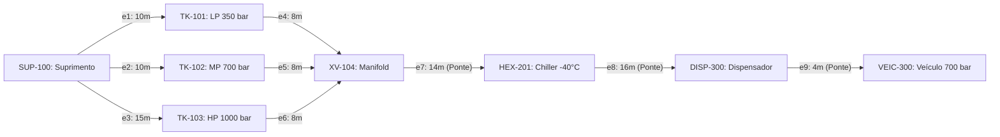

# MANUAL TÉCNICO INTEGRAL DE ENGENHARIA, OPERAÇÃO E ANÁLISE ARQUITETURAL
# SISTEMA SCADA CORE PARA ESTAÇÃO DE REABASTECIMENTO DE HIDROGÊNIO (HRS - FCEV)

**Universidade Federal de Itajubá - UNIFEI**  
**Instituto de Engenharia de Sistemas e Tecnologias da Informação (IESTI)**  
**Disciplina:** ECAA08 - Lógica Aplicada e Teoria dos Grafos para Automação  
**Repositório Oficial:** `leovarconrenno/Estacao-de-Reabastecimento-de-Hidrogenio---SCADA-Core`  
**Equipe de Desenvolvimento:** João Pedro, Marcelo Candelaria, Luca Augusto, Leo Vargas  
**Documento de Engenharia:** Revisão Técnica Consolidada, Análise Estrutural e Manual Completo  
**Classificação:** Documentação Técnica Industrial e Referencial de Controle e Automação  

---

## SUMÁRIO EXECUTIVO E ÍNDICE GERAL

- **SEÇÃO PRELIMINAR: ANÁLISE ESTRUTURAL E ARQUITETURAL DO REPOSITÓRIO GITHUB**
  - Contexto Acadêmico e Motivação do Projeto na UNIFEI
  - Topografia de Arquivos, Pastas e Artefatos de Software
  - Módulo 1 (Etapa 01 - Lógica Formal e Sistemas Especialistas)
  - Módulo 2 (Etapa 02 - Teoria dos Grafos Aplicada a Redes de Tubulação)
  - Módulo 3 (Interface Supervisória Web, P&ID Interativo e Simulador Didático)
  - Automação de CI/CD e Pipelines do GitHub Actions

- **CAPÍTULO 1: INTRODUÇÃO GERAL, CONTEXTO E VISÃO SISTÊMICA**
  - 1.1 O Papel do Hidrogênio Verde na Transição Energética Global
  - 1.2 Tecnologias de Mobilidade Elétrica a Célula de Combustível (FCEV)
  - 1.3 Anatomia Funcional de uma Estação de Hidrogênio (HRS)
  - 1.4 A Centralidade dos Sistemas SCADA e Automação Industrial Crítica
  - 1.5 Contextualização do Projeto SCADA Core UNIFEI
  - 1.6 Estrutura Organizacional do Repositório e Artefatos do Projeto

- **CAPÍTULO 2: NORMAS TÉCNICAS E DIRETRIZES INTERNACIONAIS DE SEGURANÇA**
  - 2.1 SAE J2601: Protocolo de Abastecimento para Veículos Leves de Alta Pressão
  - 2.2 SAE J2799: Protocolo de Comunicação Sem Fio e Infravermelho (IrDA)
  - 2.3 ISO 19880-1: Requisitos Globais de Segurança e Desempenho para HRS
  - 2.4 NFPA 2: Código Tecnológico de Hidrogênio e Mitigação de Riscos de Explosão
  - 2.5 IEC 61508 e IEC 61511: Segurança Funcional e Sistemas Instrumentados (SIS / SIL)
  - 2.6 Classificação de Áreas Potencialmente Explosivas (ATEX / IECEx / NR-10 / NR-20)
  - 2.7 ASME B31.12: Engenharia de Tubulações para Hidrogênio Gasoso

- **CAPÍTULO 3: TERMODINÂMICA E ENGENHARIA DO PROCESSO DE COMPRESSÃO E TRANSFERÊNCIA**
  - 3.1 Propriedades Físico-Químicas Críticas do Gás Hidrogênio (H2)
  - 3.2 O Efeito Joule-Thomson e o Fenômeno de Inversão Térmica
  - 3.3 Necessidade Crítica de Pré-resfriamento Criogênico (-40°C / Classe T40)
  - 3.4 Filosofia de Armazenamento em Cascata (Cascade Storage: LP, MP, HP)
  - 3.5 Taxa Média de Rampa de Pressão (APRR) e Prevenção de Fadiga Térmica
  - 3.6 Dinâmica de Carregamento em Tanques Tipo IV (Polímero e Fibra de Carbono)

- **CAPÍTULO 4: ARQUITETURA FÍSICA DA PLANTA E INSTRUMENTAÇÃO P&ID**
  - 4.1 Setor 100: Armazenamento e Compressão Multiestágio
  - 4.2 Setor 200: Condicionamento Térmico e Unidade de Resfriamento (Chiller)
  - 4.3 Setor 300: Linha de Dispensação e Interface Veicular
  - 4.4 Filosofia Operacional das Válvulas de Bloqueio Rápido e Seleção Direcional
  - 4.5 Mecanismos de Alívio Mecânico (PSV) e Parada de Emergência (ESD)

- **CAPÍTULO 5: MAPA DE VARIÁVEIS, DICIONÁRIO DE TAGS E PROTOCOLOS DE COMUNICAÇÃO**
  - 5.1 Padronização ISA-5.1 para Instrumentação e Malhas de Controle
  - 5.2 Dicionário Exaustivo de Entradas Analógicas (AI)
  - 5.3 Dicionário Exaustivo de Entradas Discretas (DI)
  - 5.4 Dicionário Exaustivo de Saídas Analógicas (AO)
  - 5.5 Dicionário Exaustivo de Saídas Discretas (DO)
  - 5.6 Mapeamento de Registradores Industriais (Modbus TCP e Nós OPC UA)

- **CAPÍTULO 6: ETAPA 01 - LÓGICA PROPOSICIONAL, BOOLEANA E INTERTRAVAMENTOS DE SEGURANÇA**
  - 6.1 Formalização Lógica de Estados Físicos e Variáveis Discretas
  - 6.2 Conectivos Fundamentais, Tabelas-Verdade e Permissivos Operacionais
  - 6.3 Análise Algébrica de Tautologias, Contradições e Contingências
  - 6.4 Formas Canônicas: Forma Normal Disjuntiva (FND) e Conjuntiva (FNC)
  - 6.5 Otimização Lógica: Mapas de Karnaugh e Algoritmo de Quine-McCluskey
  - 6.6 Predicados de Primeira Ordem e Quantificadores em Redes de Sensores
  - 6.7 Regras de Inferência Dedutiva e Resolução Proposicional
  - 6.8 Arquitetura de Intertravamento SIS e Votação Redundante (1oo2, 2oo3)

- **CAPÍTULO 7: SISTEMAS ESPECIALISTAS E MOTORES DE INFERÊNCIA DIAGNÓSTICA**
  - 7.1 Fundamentos de Sistemas Baseados em Regras (Rule-Based Systems - RBS)
  - 7.2 Estrutura da Base de Conhecimento e Regras de Produção IF-THEN
  - 7.3 Motor de Inferência por Encadeamento para Frente (Forward Chaining)
  - 7.4 Motor de Inferência por Encadeamento para Trás (Backward Chaining)
  - 7.5 Matriz de Correlação Sintoma-Causa-Ação para Diagnóstico Preditivo
  - 7.6 Implementação Computacional e Algoritmos de Diagnóstico em Tempo Real
  - 7.7 Avaliação de Eficácia do Módulo de Diagnóstico

- **CAPÍTULO 8: ETAPA 02 - TEORIA DOS GRAFOS E MODELAGEM TOPOLÓGICA DE TUBULAÇÕES**
  - 8.1 Modelagem Estrutural por Dígrafos Ponderados G = (V, E, W)
  - 8.2 Definição Topológica dos Vértices e Arestas da Planta H2
  - 8.3 Representações Matriciais: Adjacência, Incidência e Custos Hidráulicos
  - 8.4 Matriz Laplaciana e Propriedades Espectrais da Conectividade da Planta
  - 8.5 Tipologias de Passeios, Trilhas, Caminhos e Ciclos em Redes de Dutos
  - 8.6 Análise de Redundância e Lema do Aperto de Mãos Dirigido

- **CAPÍTULO 9: ALGORITMOS DE BUSCA, CAMINHO MÍNIMO E ROTEAMENTO DINÂMICO**
  - 9.1 Busca em Largura (BFS): Propagação de Pressão e Varredura de Alcance
  - 9.2 Busca em Profundidade (DFS): Rastreamento de Linhas e Detecção de Ciclos
  - 9.3 Algoritmo de Dijkstra para Otimização de Rota de Abastecimento
  - 9.4 Arestas Pontes (Bridges) e Vértices de Articulação Críticos
  - 9.5 Simulação de Vazamentos e Algoritmo de Desvio Automático em Tempo Real
  - 9.6 Intertravamento de Segurança via Grafo Acíclico Dirigido (DAG)

- **CAPÍTULO 10: OTIMIZAÇÃO DE INSPEÇÃO INDUSTRIAL E LOGÍSTICA DE INSUMOS**
  - 10.1 Problemas Eulerianos e Inspeção Integral por Robô PIG Ultrassônico
  - 10.2 Algoritmos de Hierholzer e Fleury para Trajetórias Eulerianas
  - 10.3 Problemas Hamiltonianos e Roteamento de Veículos Autônomos (AGV)
  - 10.4 Resolução do Problema do Caixeiro Viajante (TSP) com Heurística 2-Opt
  - 10.5 Grafos de Fluxo Máximo e Cadeia Logística de Transporte de H2 (Tube Trailers)

- **CAPÍTULO 11: ARQUITETURA DE SOFTWARE DO SCADA CORE E SIMULADOR WEB**
  - 11.1 Arquitetura Front-End: HTML5 Semântico, CSS3 e Design Responsivo
  - 11.2 Integração Dinâmica com Diagrama Vetorial P&ID em Formato SVG
  - 11.3 Controlador de Estados JavaScript e Manipulação do DOM em Tempo Real
  - 11.4 Simulador Didático de Grafos e Painel Interativo de Tomada de Decisão
  - 11.5 Automação de Builds, CI/CD e Integração Contínua com GitHub Actions

- **CAPÍTULO 12: ANÁLISE DE RISCOS DE PROCESSO, HAZOP E MATRIZ FMEA**
  - 12.1 Metodologia do Estudo de Perigos e Operabilidade (HAZOP)
  - 12.2 Planilhas Detalhadas de Análise HAZOP por Nós de Processo
  - 12.3 Matriz de Modos de Falha e Efeitos (FMEA) e Priorização de Risco (RPN)
  - 12.4 Filosofia de Gestão de Alarmes conforme a Norma ANSI/ISA-18.2
  - 12.5 Procedimentos Operacionais Padronizados de Contingência e Emergência

- **CAPÍTULO 13: GUIA PRÁTICO DE IMPLANTAÇÃO, EXECUÇÃO E TESTES**
  - 13.1 Requisitos de Infraestrutura e Dependências de Software
  - 13.2 Procedimentos de Inicialização do Servidor Local e Interface Web
  - 13.3 Execução e Validação dos Notebooks Didáticos Jupyter
  - 13.4 Bateria de Testes Funcionais e Casos Extremos (Corner Cases)
  - 13.5 Proposta de Roadmap e Extensões para Ambiente Industrial Real

- **CAPÍTULO 14: CONSIDERAÇÕES FINAIS, GLOSSÁRIO E REFERÊNCIAS BIBLIOGRÁFICAS**
  - 14.1 Conclusões Técnicas sobre a Integração Lógica-Grafos-SCADA
  - 14.2 Glossário Exaustivo de Termos Técnicos e Siglas de Engenharia
  - 14.3 Referências Bibliográficas Normativas e Acadêmicas

---

# SEÇÃO PRELIMINAR: ANÁLISE ESTRUTURAL E ARQUITETURAL DO REPOSITÓRIO GITHUB

## Contexto Acadêmico e Motivação do Projeto na UNIFEI
O projeto de código aberto **Estacao-de-Reabastecimento-de-Hidrogenio---SCADA-Core** foi concebido no âmbito do Instituto de Engenharia de Sistemas e Tecnologias da Informação (IESTI) da Universidade Federal de Itajubá (UNIFEI), na disciplina **ECAA08 (Lógica Aplicada e Teoria dos Grafos para Automação)**.

Os autores originais — **João Pedro, Marcelo Candelaria, Luca Augusto e Leo Vargas** — estruturaram a iniciativa para preencher uma lacuna existente entre o ensino de matemática discreta/ciência da computação teórica e a prática da engenharia de controle e automação industrial.

O objeto físico modelado é uma **Estação de Reabastecimento de Hidrogênio (HRS - Hydrogen Refueling Station)** projetada para veículos elétricos movidos a célula de combustível (*Fuel Cell Electric Vehicles* - FCEV) operando sob pressões ultra-elevadas (350 bar e 700 bar), em estrita conformidade com protocolos globais (SAE J2601, SAE J2799, ISO 19880-1, NFPA 2).

## Topografia de Arquivos e Artefatos do Repositório
O repositório apresenta uma hierarquia modular:
```
Estacao-de-Reabastecimento-de-Hidrogenio---SCADA-Core/
├── .github/workflows/main.yml    # Pipeline CI/CD do GitHub Actions
├── assets/                       # Recursos da IHM Web e Simulador
│   ├── css/styles.css            # Folha de estilos Dark/Light Mode Glassmorphism
│   ├── js/main.js                # Controlador principal da IHM e modais
│   ├── js/diagram.js             # Mapeamento dinâmico de tooltips e DOM SVG
│   ├── js/config.js              # Variáveis e constantes de processo
│   ├── js/contributors.js        # Integração assíncrona com a API GitHub
│   ├── diagrama.svg              # Fluxograma P&ID vetorial da estação
│   └── simulador_grafos_h2.html  # Laboratório didático de teoria dos grafos
├── etapa-01-logica/              # Módulo 1: Lógica Proposicional e Booleana
│   ├── 00 - Insumos.md           # Mapeamento de matérias-primas e tags ISA-5.1
│   ├── 02 a 10 (*.ipynb, *.md)   # Notebooks de álgebra booleana e sistemas especialistas
│   └── proposicoes_logicas_H2.csv# Base tabular de proposições e equações de intertravamento
├── etapa-02-grafos/              # Módulo 2: Teoria dos Grafos em Tubulações
│   ├── 11 a 18 (*.ipynb, *.md)   # Notebooks de dígrafos, matrizes, BFS/DFS, Dijkstra, PIG, AGV
│   └── grafo_tubulacoes.svg/.png # Diagrama da rede ponderada de dutos
├── index.html                    # Interface principal do sistema supervisório
├── main.py                       # Script de manutenção e compilação do README
├── README.md                     # Documento consolidado do repositório
└── readme.template.md            # Template com marcadores para automação
```

---

# CAPÍTULO 1: INTRODUÇÃO GERAL, CONTEXTO E VISÃO SISTÊMICA

## 1.1 O Papel do Hidrogênio Verde na Transição Energética Global
A transição energética global em direção a uma matriz de baixo carbono estabelece o hidrogênio verde ($H_2$) como um dos pilares mais promissores para a descarbonização profunda da economia. Setores industriais de difícil abatimento (*hard-to-abate sectors*), como siderurgia, indústria química, transporte rodoviário pesado de carga, transporte marítimo e aviação, encontram no hidrogênio uma densidade energética por unidade de massa sem precedentes (aproximadamente $120\text{ MJ/kg}$ a $142\text{ MJ/kg}$ em poder calorífico inferior, quase três vezes superior à da gasolina ou do óleo diesel).

Diferentemente dos combustíveis fósseis tradicionais, a oxidação eletroquímica do hidrogênio em uma célula de combustível (*Fuel Cell*) produz exclusivamente vapor de água de alta pureza e calor útil como subprodutos operacionais, eliminando em 100% a emissão direta de gases de efeito estufa (GEE), tais como dióxido de carbono ($CO_2$), metano ($CH_4$) e óxidos nitrosos ($N_2O$), além de erradicar poluentes locais severos como óxidos de enxofre ($SO_x$), óxidos de nitrogênio ($NO_x$) e material particulado inalável ($MP_{2.5}$).

A cadeia de valor do hidrogênio verde baseia-se na eletrólise da água alimentada por fontes renováveis de eletricidade, notadamente energia solar fotovoltaica e energia eólica. Nesse ecossistema, o hidrogênio atua como um vetor de armazenamento energético sazonal de grande escala, capaz de mitigar a intermitência intrínseca das fontes renováveis e fornecer estabilidade à rede elétrica nacional (*grid balancing*). No entanto, o aproveitamento pleno desse vetor na mobilidade veicular exige uma infraestrutura de distribuição e abastecimento de alta sofisticação tecnológica.

```
       [ Fonte Renovável ] ---> [ Eletrolisador PEM ] ---> [ Estação de Compressão ]
      (Solar / Eólica / PCH)         (Água -> H2 + O2)         (Estágios LP -> MP -> HP)
                                                                       |
                                                                       v
       [ Veículo FCEV ] <--- [ Bico Dispensador ] <--- [ Chiller T40 ] <--- [ Banco de Armazenamento ]
        (Tanque 700 bar)     (SAE J2601 / -40°C)      (Troca Térmica)       (Cascata 350/700/1000 bar)
```

## 1.2 Tecnologias de Mobilidade Elétrica a Célula de Combustível (FCEV)
Os Veículos Elétricos a Célula de Combustível (*Fuel Cell Electric Vehicles* - FCEV) combinam o dinamismo e o alto rendimento dos motores elétricos com a conveniência do rápido reabastecimento típico dos veículos convencionais a combustão interna. Enquanto veículos elétricos puramente a bateria (*Battery Electric Vehicles* - BEV) demandam de 30 a 90 minutos em estações de recarga rápida de corrente contínua (DC Fast Charging) para restabelecer cerca de 80% de sua autonomia, um veículo FCEV moderno pode ser completamente reabastecido em uma janela estrita de 3 a 5 minutos, recuperando autonomias superiores a 650 quilômetros.

O coração propulsor do veículo FCEV é a pilha de células de combustível com membrana de troca de prótons (*Proton Exchange Membrane Fuel Cell* - PEMFC). No anodo da célula, moléculas de hidrogênio gasoso são dissociadas cataliticamente sobre nanopartículas de platina em prótons ($H^+$) e elétrons ($e^-$):

$$H_2 \rightarrow 2H^+ + 2e^- \quad (E^\circ = 0{,}00\text{ V})$$

Os prótons migram através da membrana condutora eletrolítica polimérica seletiva até o catodo, enquanto os elétrons livres circulam por um circuito externo, gerando a corrente contínua necessária para alimentar o inversor de tração e o motor elétrico. No catodo, o oxigênio atmosférico absorvido é reduzido cataliticamente:

$$\frac{1}{2}O_2 + 2H^+ + 2e^- \rightarrow H_2O \quad (E^\circ = +1{,}23\text{ V})$$

$$\text{Reação Global:} \quad H_2 + \frac{1}{2}O_2 \rightarrow H_2O \quad (\Delta H = -285{,}8\text{ kJ/mol})$$

Para que esse ciclo ocorra com máxima densidade de potência embarcada, o hidrogênio deve ser armazenado sob pressões extremamente elevadas, prioritariamente no patamar nominal de 700 bar (aproximadamente $10.150\text{ psi}$ ou $70\text{ MPa}$) para automóveis leves de passeio, ou 350 bar ($5.075\text{ psi}$ ou $35\text{ MPa}$) para ônibus, trens e caminhões pesados.

## 1.3 Anatomia Funcional de uma Estação de Hidrogênio (HRS)
Uma Estação de Reabastecimento de Hidrogênio (*Hydrogen Refueling Station* - HRS) é estruturada em cinco subsistemas integrados essenciais:
1. **Subsistema de Recepção e Suprimento:** Composto por eletrolisadores locais ou linha de descarregamento de carretas semirreboque de cilindros compósitos (*tube trailers*), entregando gás comprimido entre 200 bar e 350 bar.
2. **Subsistema de Compressão Mecânica Multiestágio:** Compressores industriais de deslocamento positivo (compressores de pistão alternativo não lubrificado ou diafragma metálico) elevam o gás sequencialmente até patamares de 450 bar, 750 bar e 1000 bar.
3. **Subsistema de Armazenamento Estacionário em Cascata:** Segmentado em múltiplos níveis de pressão:
   - Banco de Baixa Pressão (LP): $350\text{ a }400\text{ bar}$.
   - Banco de Média Pressão (MP): $650\text{ a }700\text{ bar}$.
   - Banco de Alta Pressão (HP): $900\text{ a }1000\text{ bar}$.
4. **Subsistema de Condicionamento Térmico Criogênico (Chiller):** Trocador de calor microestruturado compacto resfriando o hidrogênio até $-40^\circ\text{C}$ (Classe T40 da SAE J2601) para neutralizar o calor de compressão adiabática no cilindro veicular.
5. **Subsistema de Dispensação Veicular (Dispenser):** Gabinete metálico com medidor mássico Coriolis de alta pressão, mangueiras flexíveis reforçadas com fios de aramida, bico hermético com trava mecânica, válvula *breakaway* de segurança contra arrancadas acidentais e receptor infravermelho IrDA (SAE J2799).

---

# CAPÍTULO 2: NORMAS TÉCNICAS E DIRETRIZES INTERNACIONAIS DE SEGURANÇA

A conformidade com padrões mundiais de segurança norteia o desenvolvimento do SCADA Core:

## 2.1 SAE J2601: Protocolo de Abastecimento para Veículos Leves
Regulamenta o abastecimento de veículos leves FCEV garantindo que o cilindro atinja 100% de Estado de Carga (*State of Charge* - SOC) sem violar três barreiras físicas estritas:
1. **Temperatura Máxima no Liner do Cilindro:** $T_{max} = +85^\circ\text{C}$.
2. **Pressão Máxima Transiente da Estação:** $P_{max} = 1{,}25 \times P_{nominal} = 875\text{ bar}$ para veículos H70.
3. **Densidade Máxima de Massa:** $\rho_{max} = 40{,}2\text{ g/L}$.

A norma estabelece a Taxa Média de Rampa de Pressão (*Average Pressure Ramp Rate* - APRR) e classifica as estações de acordo com sua capacidade de refrigeração:
* **Classe T40 (Adotada no Projeto):** $-40^\circ\text{C} \leq T_{saída} \leq -33^\circ\text{C}$ (abastecimento completo em 3 a 5 minutos).
* **Classe T30 / T20:** $-30^\circ\text{C} \text{ e } -20^\circ\text{C}$ (abastecimentos intermediários de 8 a 15 minutos).
* **Não-Resfriado:** Abastecimentos lentos superiores a 30 minutos.

## 2.2 SAE J2799: Protocolo de Comunicação Sem Fio e Infravermelho (IrDA)
Regulamenta o link de telemetria óptica bidirecional infravermelha montado no bico da mangueira e no bocal do veículo. O carro transmite ciclicamente a cada 100 ms:
- Pressão interna instantânea ($P_{veic}$).
- Temperatura interna do gás no liner ($T_{veic}$).
- Classe volumétrica do cilindro e SOC calculado.
- Bit de aborto de emergência (*Vehicle Abort Flag*).

## 2.3 Demais Códigos Regulamentadores
* **ISO 19880-1:** Requisitos mecânicos e funcionais gerais de projeto e fabricação para estações HRS e qualidade do combustível segundo ISO 14687 Grau D (pureza mínima de 99,97% de $H_2$).
* **NFPA 2 (Hydrogen Technologies Code):** Distâncias de separação espacial (*setbacks*), sistemas de ventilação mecânica forçada e níveis de alarme de gás (20% LFL para alerta; 40% LFL para trip de emergência).
* **IEC 61508 / IEC 61511:** Arquiteturas de segurança funcional e Níveis de Integridade de Segurança (SIL-2 e SIL-3) aplicados às malhas de parada de emergência ESD.
* **ATEX / IEC 60079:** Classificação de áreas explosivas em Zona 0, Zona 1 e Zona 2 para Grupo de Gás IIC e classe de temperatura T4.
* **ASME B31.12:** Seleção metalúrgica de tubulações de alta tenacidade contra fragilização por hidrogênio (*Hydrogen Embrittlement*), preconizando aços inoxidáveis austeníticos séries AISI 316/316L.

---

# CAPÍTULO 3: TERMODINÂMICA E ENGENHARIA DO PROCESSO DE COMPRESSÃO E TRANSFERÊNCIA

## 3.1 Propriedades Termofísicas e o Fator de Compressibilidade Real
Em pressões de 700 a 1000 bar, o hidrogênio desvia-se fortemente do comportamento de gás ideal, apresentando fator de compressibilidade $Z > 1$:

$$P \cdot V = Z(P, T) \cdot R \cdot T$$

Para $P = 700\text{ bar}$ e $T = 15^\circ\text{C}$, $Z \approx 1{,}45$, indicando que o gás ocupa um volume molar 45% maior do que o previsto pela física clássica dos gases ideais devido às forças de repulsão atômica de curto alcance.

## 3.2 O Efeito Joule-Thomson e o Fenômeno de Inversão Térmica
O coeficiente Joule-Thomson define a variação de temperatura em uma expansão isentálpica com queda de pressão:

$$\mu_{JT} = \left( \frac{\partial T}{\partial P} \right)_H$$

Para o gás hidrogênio, a temperatura máxima da curva de inversão ($\mu_{JT} = 0$) ao nível do mar é de apenas **$-73^\circ\text{C}$**. Em temperaturas ambientes ordinárias ($-10^\circ\text{C}$ a $+45^\circ\text{C}$), o hidrogênio opera com **$\mu_{JT} < 0$**. Consequentemente:
$$\Delta P < 0 \implies \Delta T > 0$$
O hidrogênio **aquece** ao sofrer despressurização através de orifícios, válvulas reguladoras ou pontos de vazamento, o que eleva drasticamente o risco de ignição e exige pré-resfriamento forçado a $-40^\circ\text{C}$ no trocador criogênico HEX-201.

---

# CAPÍTULO 4: ARQUITETURA FÍSICA DA PLANTA E INSTRUMENTAÇÃO P&ID

A infraestrutura física é segmentada em três setores fundamentais:

```
       SETOR 100: ARMAZENAMENTO & COMPRESSÃO           SETOR 200: CONDICIONAMENTO      SETOR 300: DISPENSADOR
  +-------------------------------------------------+  +-------------------------+  +--------------------------+
  |                                                 |  |                         |  |                          |
  |  [ SUP-100 ]                                    |  |                         |  |                          |
  |       |                                         |  |                         |  |                          |
  |      XV-101                                     |  |                         |  |                          |
  |       v                                         |  |                         |  |                          |
  |  +---------+   e4    +--------+                 |  |                         |  |                          |
  |  | TK-101  |-------->|        |                 |  |                         |  |                          |
  |  | (LP 350)|         |        |                 |  |                         |  |                          |
  |  +---------+         |        |   e7            |  |  [ HEX-201 ]     e8     |  |  [ DISP-300 ]     e9       |
  |                      |        |========[XV-201]====>| (Chiller T40) |=========>| (Medidor Coriolis) ===>   |
  |  +---------+   e5    | XV-104 | (Ponte Crítica) |  |   T <= -40°C   |(Ponte) |  |     |        (Ponte)  [VEIC]
  |  | TK-102  |-------->|        |                 |  |                         |  |   XV-301              700  |
  |  | (MP 700)|         |        |                 |  |                         |  |     |                 bar  |
  |  +---------+         |        |                 |  |                         |  |     v                      |
  |                      |        |                 |  |                         |  |   BV-301                   |
  |  +---------+   e6    |        |                 |  |                         |  | (Breakaway)                |
  |  | TK-103  |-------->|        |                 |  |                         |  |     |                      |
  |  | (HP 1000|         +--------+                 |  |                         |  |  COM-301 (IrDA J2799)      |
  |  +---------+                                    |  |                         |  |                          |
  +-------------------------------------------------+  +-------------------------+  +--------------------------+
```

* **Setor 100:** Suprimento externo `SUP-100`, bancos em cascata `TK-101` (LP 350 bar), `TK-102` (MP 700 bar) e `TK-103` (HP 1000 bar), interligados à válvula seletora direcional `XV-104`.
* **Setor 200:** Unidade criogênica `HEX-201`, alimentada pelo motor do chiller `M-201` e válvula criogênica `XV-201`.
* **Setor 300:** Ilha de dispensação `DISP-300`, com válvula de rampa `XV-301`, válvula de desacoplamento mecânico `BV-301`, link infravermelho `COM-301` e tanque do automóvel `VEIC-300`.


---

# CAPÍTULO 5: MAPA DE VARIÁVEIS, DICIONÁRIO DE TAGS E PROTOCOLOS DE COMUNICAÇÃO

A integridade operacional de uma estação de hidrogênio monitorada por sistema supervisório assenta-se na padronização inequívoca de sua instrumentação. A comunicação determinística entre sensores, transmissores, atuadores de campo, controladores lógicos programáveis (CLP) e as telas do SCADA depende de um dicionário de tags estruturado segundo as normas internacionais de instrumentação industrial.

## 5.1 Padronização ISA-5.1 para Instrumentação e Malhas de Controle

Adota-se rigorosamente a norma **ANSI/ISA-5.1** (*Instrumentation Symbols and Identification*). Cada tag é composto por um código alfanumérico que define a variável física primária, a função de processamento/leitura e o número da malha associado ao setor da planta:

* **Primeira Letra (Variável Medida):**
  - **P:** Pressão (*Pressure*)
  - **T:** Temperatura (*Temperature*)
  - **F:** Vazão (*Flow*)
  - **A:** Análise Química / Detecção de Gás inflamável (*Analysis*)
  - **H:** Comando Manual do Operador (*Hand / Manual*)
  - **C:** Comunicação de Dados / Redes Digitais (*Communication*)
  - **X:** Válvula de Bloqueio Rápido / Elemento Não-Classificado (*Unclassified / On-Off Valve*)
  - **Y:** Conversor de Sinal Elétrico / Solenoide (*Solenoid / Converter*)
  - **S:** Sinalização Luminosa / Chave (*Signal / Switch*)
  - **Z:** Posição Mecânica / Fim de Curso (*Position*)
* **Segunda e Terceira Letras (Função do Instrumento):**
  - **T:** Transmissor de Campo (*Transmitter*)
  - **S:** Chave de Atuação Discreta (*Switch*)
  - **V:** Válvula Automática (*Valve*)
  - **L:** Lâmpada Piloto / Luz Sinalizadora (*Light*)
  - **M:** Motor Elétrico / Atuador de Potência (*Motor*)
* **Numeração de Malha (Loop Number):**
  - **Série 100:** Setor 100 (Armazenamento em Cascata e Compressão)
  - **Série 200:** Setor 200 (Condicionamento Térmico e Chiller Criogênico)
  - **Série 300:** Setor 300 (Linha de Dispensação e Interface Veicular)

```
             Estrutura Sintática do Tag ISA-5.1
             
             [ P ]   [ T ]  -  [ 1 ] [ 0 ] [ 1 ]
               |       |         |     |     |
               |       |         +-----+-----+---> Número da Malha (Setor 100)
               |       +-------------------------> Função: Transmissor (Transmitter)
               +---------------------------------> Variável: Pressão (Pressure)
```

## 5.2 Dicionário Exaustivo de Entradas Analógicas (AI)

As entradas analógicas convertem sinais físicos contínuos em palavras digitais no CLP (geralmente sinais elétricos normalizados de $4\text{ a }20\text{ mA}$ ou protocolos digitais HART/Fieldbus com conversores A/D de 16 bits de resolução).

| Tag ISA-5.1 | Proposição Lógica Associada | Descrição Técnica Detalhada do Instrumento | Faixa Calibrada | Unidade | Setpoints de Alarme SCADA (LL / L / H / HH) |
| :--- | :--- | :--- | :--- | :--- | :--- |
| **PT-101** | $p_{1,1}$ / $p_{1,4}$ | Pressão do Tanque de Baixa Pressão (TK-101) | $0 \text{ a } 600$ | bar | L: 100 bar \| H: 350 bar \| HH: 400 bar |
| **PT-102** | $p_{1,2}$ / $p_{1,5}$ | Pressão do Tanque de Média Pressão (TK-102) | $0 \text{ a } 1000$ | bar | L: 200 bar \| H: 650 bar \| HH: 700 bar |
| **PT-103** | $p_{1,3}$ / $p_{1,6}$ | Pressão do Tanque de Alta Pressão (TK-103) | $0 \text{ a } 1200$ | bar | L: 350 bar \| H: 950 bar \| HH: 1000 bar |
| **PT-104** | - | Pressão de Linha a Jusante do Suprimento (SUP-100) | $0 \text{ a } 500$ | bar | LL: 50 bar \| H: 380 bar \| HH: 420 bar |
| **PT-201** | $p_{2,1}$ | Pressão da Linha de Buffer de Resfriamento | $0 \text{ a } 1000$ | bar | L: 50 bar \| H: 850 bar \| HH: 900 bar |
| **PT-301** | $p_{3,1}$ | Pressão no Receptáculo / Mangueira de Dispensação | $0 \text{ a } 1000$ | bar | LL: 10 bar \| H: 700 bar \| HH: 875 bar |
| **TT-101** | $t_{1,1}$ | Temperatura da Parede do Tanque TK-101 | $-50 \text{ a }+150$ | °C | L: $-20$ °C \| H: $+65$ °C \| HH: $+85$ °C |
| **TT-102** | $t_{1,2}$ | Temperatura da Parede do Tanque TK-102 | $-50 \text{ a }+150$ | °C | L: $-20$ °C \| H: $+65$ °C \| HH: $+85$ °C |
| **TT-103** | $t_{1,3}$ | Temperatura da Parede do Tanque TK-103 | $-50 \text{ a }+150$ | °C | L: $-20$ °C \| H: $+65$ °C \| HH: $+85$ °C |
| **TT-201** | $t_{2,1}$ | Temperatura de Saída do Trocador Criogênico | $-60 \text{ a }+40$ | °C | LL: $-50$ °C \| L: $-40$ °C \| H: $-33$ °C \| HH: $-20$ °C |
| **TT-301** | $t_{3,1}$ | Temperatura no Receptáculo Veicular (SAE J2799) | $-50 \text{ a }+120$ | °C | L: $-40$ °C \| H: $+65$ °C \| HH: $+85$ °C |
| **AT-101** | $g_{1,1}$ | Concentração de Hidrogênio no Perímetro TK-101 | $0 \text{ a } 100$ | % LFL | H (Alerta): 20% LFL \| HH (Trip): 40% LFL |
| **AT-102** | $g_{1,2}$ | Concentração de Hidrogênio no Perímetro TK-102 | $0 \text{ a } 100$ | % LFL | H (Alerta): 20% LFL \| HH (Trip): 40% LFL |
| **AT-103** | $g_{1,3}$ | Concentração de Hidrogênio no Perímetro TK-103 | $0 \text{ a } 100$ | % LFL | H (Alerta): 20% LFL \| HH (Trip): 40% LFL |
| **AT-301** | $g_{3,1}$ | Concentração de Hidrogênio no Gabinete DISP-300 | $0 \text{ a } 100$ | % LFL | H (Alerta): 20% LFL \| HH (Trip): 40% LFL |
| **FT-301** | - | Vazão Mássica Instantânea Medidor Coriolis | $0 \text{ a } 5{,}0$ | kg/min | LL: $0{,}05$ kg/min \| H: $3{,}6$ kg/min \| HH: $4{,}5$ kg/min |

## 5.3 Dicionário Exaustivo de Entradas Discretas (DI)

As entradas discretas recebem sinais binários (níveis de tensão 0 Vcc e 24 Vcc) provenientes de chaves de segurança, contatos auxiliares de contatores, relés térmicos e detectores digitais.

| Tag ISA-5.1 | Proposição Lógica | Descrição Técnica da Entrada Digital | Estado Lógico 0 (Falso / Desenergizado) | Estado Lógico 1 (Verdadeiro / Ativo) |
| :--- | :--- | :--- | :--- | :--- |
| **ESD-100** | $e_{1,1}$ | Botão de Parada de Emergência Geral da Planta | Sistema em Operação Normal (Contato NF Fechado) | Emergência Acionada (Circuito Aberto - Trip SIS) |
| **PSV-101-ZS**| $r_{1,1}$ | Chave Fim de Curso da Válvula de Alívio PSV-101 | Válvula Fechada (Assentamento Mecânico Íntegro) | Válvula Disparada / Aberta (Escape de H2) |
| **PSV-102-ZS**| $r_{1,2}$ | Chave Fim de Curso da Válvula de Alívio PSV-102 | Válvula Fechada (Assentamento Mecânico Íntegro) | Válvula Disparada / Aberta (Escape de H2) |
| **PSV-103-ZS**| $r_{1,3}$ | Chave Fim de Curso da Válvula de Alívio PSV-103 | Válvula Fechada (Assentamento Mecânico Íntegro) | Válvula Disparada / Aberta (Escape de H2) |
| **HS-301** | $h_{3,1}$ | Botão de Comando do Operador: Iniciar Abastecimento| Repouso / Não Pressionado | Comando de Início Pressionado pelo Operador |
| **COM-301-ST**| $c_{3,1}$ | Status do Link de Comunicação Óptica SAE J2799 | Link Inexistente, Não Sincronizado ou com Falha | Link Óptico Estabelecido e Dados Válidos |
| **BV-301-ZS** | $bv_{3,1}$ | Sensor de Integridade da Válvula Breakaway | Conexão Desacoplada / Mangueira Rompida | Acoplamento Mecânico Conectado e Íntegro |
| **NZ-301-ZS** | - | Microchave de Trava do Bico no Receptáculo | Bico Destravado ou Fora do Receptáculo | Bico Perfeitamente Acoplado e Travado |
| **CH-101-RUN** | - | Contato Auxiliar do Contator de Operação do Chiller| Motor do Chiller Desligado | Motor do Chiller em Operação Efetiva |
| **CH-101-FLT** | - | Relé Térmico / Falha Geral do Sistema de Refrigeração| Chiller em Condição Saudável | Falha Térmica / Sobrecarga de Refrigeração |

## 5.4 Dicionário Exaustivo de Saídas Analógicas (AO)

As saídas analógicas fornecem sinais elétricos contínuos do CLP para modular posicionadores eletropneumáticos e variadores de velocidade:

| Tag ISA-5.1 | Descrição Técnica da Saída Analógica | Faixa de Sinal | Unidade de Engenharia | Função no Processo Industrial |
| :--- | :--- | :--- | :--- | :--- |
| **FCV-301** | Sinal de Controle da Válvula Proporcional de Rampa | $4 \text{ a } 20\text{ mA}$ | $0 \text{ a } 100\%$ Abertura | Modulação precisa da taxa de elevação de pressão (APRR) |
| **VFD-201** | Referência de Velocidade do Inversor do Chiller | $0 \text{ a } 10\text{ Vcc}$ | $0 \text{ a } 100\%$ Rotação | Controle térmico fino para manter gás em $-40^\circ\text{C}$ |
| **PCV-101** | Sinal Regulador de Pressão da Linha de Suprimento | $4 \text{ a } 20\text{ mA}$ | $0 \text{ a } 400\text{ bar}$ | Equalização de pressão durante descarregamento externo |

## 5.5 Dicionário Exaustivo de Saídas Discretas (DO)

As saídas discretas comandam a energização de bobinas solenoides, contatores de força motriz, buzinas e sinalizadores luminosos no painel:

| Tag ISA-5.1 | Proposição Lógica | Descrição Técnica da Saída Digital | Estado Lógico 0 (Desenergizado) | Estado Lógico 1 (Energizado / Atuado) |
| :--- | :--- | :--- | :--- | :--- |
| **XV-101** | $v_{1,1}$ | Válvula Solenoide de Bloqueio do Tanque LP | Válvula Fechada (Mola Mecânica Fail-Close) | Válvula Aberta (Fluxo Liberado para TK-101) |
| **XV-102** | $v_{1,2}$ | Válvula Solenoide de Bloqueio do Tanque MP | Válvula Fechada (Mola Mecânica Fail-Close) | Válvula Aberta (Fluxo Liberado para TK-102) |
| **XV-103** | $v_{1,3}$ | Válvula Solenoide de Bloqueio do Tanque HP | Válvula Fechada (Mola Mecânica Fail-Close) | Válvula Aberta (Fluxo Liberado para TK-103) |
| **YV-104A** | $y_{1,4a}$ | Bobina Solenoide Piloto A da Seletora de Cascata| Bobina Desenergizada | Seleção Ativa da Rota do Banco LP (TK-101) |
| **YV-104B** | $y_{1,4b}$ | Bobina Solenoide Piloto B da Seletora de Cascata| Bobina Desenergizada | Seleção Ativa da Rota do Banco HP (TK-103) |
| **M-201** | $m_{2,1}$ | Contator Magnético do Motor Trifásico do Chiller| Motor Desligado / Em Repouso | Motor Energizado / Circulação de Fluido Ativa |
| **XV-201** | $v_{2,1}$ | Válvula Criogênica de Entrada do Trocador Térmico| Válvula Fechada | Válvula Aberta (Gás Admitido no Chiller) |
| **XV-301** | $v_{3,1}$ | Válvula de Bloqueio Rápido do Bico Dispensador | Válvula Fechada (Isolamento do Bico) | Válvula Aberta (Injeção de H2 Autorizada) |
| **SL-101** | $s_{1,1}$ | Sinalizador Luminoso de Painel: Tanque LP Ativo | Luz Apagada | Luz Verde Acesa (Linha LP em Operação) |
| **SL-102** | $s_{1,2}$ | Sinalizador Luminoso de Painel: Tanque MP Ativo | Luz Apagada | Luz Verde Acesa (Linha MP em Operação) |
| **SL-103** | $s_{1,3}$ | Sinalizador Luminoso de Painel: Tanque HP Ativo | Luz Apagada | Luz Verde Acesa (Linha HP em Operação) |
| **ALM-101** | $a_{1,1}$ | Sirene Audiovisual de Emergência Geral da Planta| Sirene Silenciada | Sirene Disparada (Alarme Sonoro e Flash Estroboscópico) |

## 5.6 Mapeamento de Registradores Industriais (Modbus TCP e Nós OPC UA)

A interface SCADA Core comunica-se com os controladores de campo e com o simulador através de uma arquitetura aberta baseada em barramento Ethernet industrial. A tabela abaixo especifica o mapa oficial de alocação de memória Modbus TCP (porta padrão 502) e os correspondentes identificadores de nó no espaço de endereçamento OPC UA (*Open Platform Communications Unified Architecture*):

| Endereço Modbus TCP | Tipo de Objeto Modbus | Nome da Variável / Tag | Tipo de Dado | Escala / Multiplicador | NodeID OPC UA (Namespace 2) |
| :--- | :--- | :--- | :--- | :--- | :--- |
| **00001** | Discrete Output Coil | DO_XV_101_CMD | Boolean | Direto (0 ou 1) | `ns=2;s=HRS.Setor100.XV101.Cmd` |
| **00002** | Discrete Output Coil | DO_XV_102_CMD | Boolean | Direto (0 ou 1) | `ns=2;s=HRS.Setor100.XV102.Cmd` |
| **00003** | Discrete Output Coil | DO_XV_103_CMD | Boolean | Direto (0 ou 1) | `ns=2;s=HRS.Setor100.XV103.Cmd` |
| **00004** | Discrete Output Coil | DO_YV_104A_CMD | Boolean | Direto (0 ou 1) | `ns=2;s=HRS.Setor100.YV104A.Cmd` |
| **00005** | Discrete Output Coil | DO_YV_104B_CMD | Boolean | Direto (0 ou 1) | `ns=2;s=HRS.Setor100.YV104B.Cmd` |
| **00006** | Discrete Output Coil | DO_M_201_CMD | Boolean | Direto (0 ou 1) | `ns=2;s=HRS.Setor200.M201.Cmd` |
| **00007** | Discrete Output Coil | DO_XV_201_CMD | Boolean | Direto (0 ou 1) | `ns=2;s=HRS.Setor200.XV201.Cmd` |
| **00008** | Discrete Output Coil | DO_XV_301_CMD | Boolean | Direto (0 ou 1) | `ns=2;s=HRS.Setor300.XV301.Cmd` |
| **00009** | Discrete Output Coil | DO_ALM_101_CMD | Boolean | Direto (0 ou 1) | `ns=2;s=HRS.Geral.ALM101.Cmd` |
| **10001** | Discrete Input Contact | DI_ESD_100_ST | Boolean | Invertido (1 = Emergência) | `ns=2;s=HRS.Seguranca.ESD100.State` |
| **10002** | Discrete Input Contact | DI_PSV_101_TRIP| Boolean | Direto (1 = Disparo) | `ns=2;s=HRS.Setor100.PSV101.Trip` |
| **10003** | Discrete Input Contact | DI_PSV_102_TRIP| Boolean | Direto (1 = Disparo) | `ns=2;s=HRS.Setor100.PSV102.Trip` |
| **10004** | Discrete Input Contact | DI_PSV_103_TRIP| Boolean | Direto (1 = Disparo) | `ns=2;s=HRS.Setor100.PSV103.Trip` |
| **10005** | Discrete Input Contact | DI_BV_301_ST | Boolean | Direto (1 = Conectado)| `ns=2;s=HRS.Setor300.BV301.State` |
| **10006** | Discrete Input Contact | DI_COM_301_ST | Boolean | Direto (1 = Link Ativo)| `ns=2;s=HRS.Setor300.COM301.State` |
| **10007** | Discrete Input Contact | DI_HS_301_CMD | Boolean | Direto (1 = Pressionado)|`ns=2;s=HRS.Setor300.HS301.Cmd` |
| **30001** | Input Register (16-bit) | AI_PT_101_VAL | Int16 | $P = \text{Reg} \times 0{,}1\text{ bar}$ | `ns=2;s=HRS.Setor100.PT101.Value` |
| **30002** | Input Register (16-bit) | AI_PT_102_VAL | Int16 | $P = \text{Reg} \times 0{,}1\text{ bar}$ | `ns=2;s=HRS.Setor100.PT102.Value` |
| **30003** | Input Register (16-bit) | AI_PT_103_VAL | Int16 | $P = \text{Reg} \times 0{,}1\text{ bar}$ | `ns=2;s=HRS.Setor100.PT103.Value` |
| **30004** | Input Register (16-bit) | AI_PT_201_VAL | Int16 | $P = \text{Reg} \times 0{,}1\text{ bar}$ | `ns=2;s=HRS.Setor200.PT201.Value` |
| **30005** | Input Register (16-bit) | AI_PT_301_VAL | Int16 | $P = \text{Reg} \times 0{,}1\text{ bar}$ | `ns=2;s=HRS.Setor300.PT301.Value` |
| **30006** | Input Register (16-bit) | AI_TT_101_VAL | Int16 | $T = (\text{Reg} \times 0{,}1) - 100$ °C | `ns=2;s=HRS.Setor100.TT101.Value` |
| **30007** | Input Register (16-bit) | AI_TT_102_VAL | Int16 | $T = (\text{Reg} \times 0{,}1) - 100$ °C | `ns=2;s=HRS.Setor100.TT102.Value` |
| **30008** | Input Register (16-bit) | AI_TT_103_VAL | Int16 | $T = (\text{Reg} \times 0{,}1) - 100$ °C | `ns=2;s=HRS.Setor100.TT103.Value` |
| **30009** | Input Register (16-bit) | AI_TT_201_VAL | Int16 | $T = (\text{Reg} \times 0{,}1) - 100$ °C | `ns=2;s=HRS.Setor200.TT201.Value` |
| **30010** | Input Register (16-bit) | AI_TT_301_VAL | Int16 | $T = (\text{Reg} \times 0{,}1) - 100$ °C | `ns=2;s=HRS.Setor300.TT301.Value` |
| **30011** | Input Register (16-bit) | AI_AT_101_VAL | Int16 | $\text{Conc} = \text{Reg} \times 0{,}1\text{ \% LFL}$| `ns=2;s=HRS.Setor100.AT101.Value` |
| **30012** | Input Register (16-bit) | AI_AT_102_VAL | Int16 | $\text{Conc} = \text{Reg} \times 0{,}1\text{ \% LFL}$| `ns=2;s=HRS.Setor100.AT102.Value` |
| **30013** | Input Register (16-bit) | AI_AT_103_VAL | Int16 | $\text{Conc} = \text{Reg} \times 0{,}1\text{ \% LFL}$| `ns=2;s=HRS.Setor100.AT103.Value` |
| **30014** | Input Register (16-bit) | AI_AT_301_VAL | Int16 | $\text{Conc} = \text{Reg} \times 0{,}1\text{ \% LFL}$| `ns=2;s=HRS.Setor300.AT301.Value` |
| **30015** | Input Register (16-bit) | AI_FT_301_VAL | Int16 | $\text{Vazão} = \text{Reg} \times 0{,}001\text{ kg/min}$| `ns=2;s=HRS.Setor300.FT301.Value` |
| **40001** | Holding Register (16-bit)| AO_FCV_301_SP | Int16 | $0 \text{ a } 10000 \Rightarrow 0 \text{ a } 100{,}00\%$| `ns=2;s=HRS.Controle.FCV301.Setpoint` |
| **40002** | Holding Register (16-bit)| AO_VFD_201_SP | Int16 | $0 \text{ a } 10000 \Rightarrow 0 \text{ a } 100{,}00\%$| `ns=2;s=HRS.Controle.VFD201.Setpoint` |
| **40003** | Holding Register (16-bit)| PAR_APRR_TARGET | Int16 | $\text{Rampa} = \text{Reg} \times 0{,}1\text{ MPa/min}$| `ns=2;s=HRS.Parametros.TargetAPRR` |

---

# CAPÍTULO 6: ETAPA 01 - LÓGICA PROPOSICIONAL, BOOLEANA E INTERTRAVAMENTOS DE SEGURANÇA

A primeira etapa metodológica desenvolvida no repositório da UNIFEI estabelece os alicerces matemáticos discretos da estação. Em ambientes industriais de alto risco, a lógica de controle não pode ser formulada de maneira informal ou intuitiva. A álgebra proposicional e o cálculo booleano fornecem a linguagem formal exata para especificar as condições permissivas de partida, os intertravamentos operacionais e os procedimentos automatizados de corte de emergência (*trip*).

## 6.1 Formalização Lógica de Estados Físicos e Variáveis Discretas

Cada variável física contínua lida do campo é discretizada através de comparadores de histerese programados no CLP, mapeando grandezas de pressão, temperatura e concentração de gás para proposições atômicas booleanas pertencentes ao conjunto fundamental $\{0, 1\}$ (Falso ou Verdadeiro):

$$p_{1,1} \iff (P_{\text{TK-101}} > 400\text{ bar})$$
$$p_{1,4} \iff (P_{\text{TK-101}} > 350\text{ bar})$$
$$t_{1,1} \iff (T_{\text{TK-101}} > 85^\circ\text{C})$$
$$g_{1,1} \iff (\text{Gás}_{\text{TK-101}} > 20\%\text{ LFL})$$
$$r_{1,1} \iff (\text{PSV-101 Atuada})$$
$$e_{1,1} \iff (\text{Parada de Emergência Ativa})$$
$$t_{2,1} \iff (T_{\text{Chiller}} \leq -40^\circ\text{C})$$
$$bv_{3,1} \iff (\text{Válvula Breakaway Íntegra})$$
$$c_{3,1} \iff (\text{Comunicação SAE J2799 Válida})$$
$$h_{3,1} \iff (\text{Comando de Início Pressionado})$$

## 6.2 Conectivos Fundamentais, Tabelas-Verdade e Permissivos Operacionais

### 6.2.1 Permissivo de Partida do Sistema de Refrigeração (Chiller M-201)
$$Perm_{M\text{-}201} = \neg e_{1,1} \land \neg g_{2,1} \land p_{2,1}$$
$$m_{2,1} = Perm_{M\text{-}201} \land \neg t_{2,1}$$

### 6.2.2 Permissivos de Alimentação dos Bancos de Armazenamento
$$v_{1,1} = \neg e_{1,1} \land \neg p_{1,1} \land \neg t_{1,1} \land \neg g_{1,1} \land \neg r_{1,1}$$
$$v_{1,2} = \neg e_{1,1} \land \neg p_{1,2} \land \neg t_{1,2} \land \neg g_{1,2} \land \neg r_{1,2}$$
$$v_{1,3} = \neg e_{1,1} \land \neg p_{1,3} \land \neg t_{1,3} \land \neg g_{1,3} \land \neg r_{1,3}$$

### 6.2.3 Permissivo Global de Abastecimento Veicular (Válvula de Dispensação XV-301)
$$v_{3,1} = h_{3,1} \land c_{3,1} \land bv_{3,1} \land t_{2,1} \land \neg t_{3,1} \land \neg p_{3,1} \land \neg g_{3,1} \land \neg e_{1,1} \land (v_{1,1} \lor v_{1,2} \lor v_{1,3})$$

| $h_{3,1}$ (Botão) | $c_{3,1}$ (IrDA) | $bv_{3,1}$ (Breakaway) | $t_{2,1}$ (T40 -40°C) | $\neg g_{3,1}$ (Sem Gás) | $\neg e_{1,1}$ (Sem ESD) | $v_{3,1}$ (Válvula Aberta) | Diagnóstico Operacional SCADA |
| :---: | :---: | :---: | :---: | :---: | :---: | :---: | :--- |
| 1 | 1 | 1 | 1 | 1 | 1 | **1** | **Abastecimento Autorizado (Regime Normal)** |
| 0 | 1 | 1 | 1 | 1 | 1 | **0** | Aguardando acionamento do operador |
| 1 | 0 | 1 | 1 | 1 | 1 | **0** | **Intertravado: Falha de Comunicação IrDA** |
| 1 | 1 | 0 | 1 | 1 | 1 | **0** | **Trip Crítico: Breakaway Desacoplada** |
| 1 | 1 | 1 | 0 | 1 | 1 | **0** | **Intertravado: Chiller Fora de Faixa (T > -40°C)** |
| 1 | 1 | 1 | 1 | 0 | 1 | **0** | **Trip Crítico: Vazamento Detectado na Ilha** |
| 1 | 1 | 1 | 1 | 1 | 0 | **0** | **Trip Crítico: Botão de Emergência Atuado** |

## 6.3 Análise Algébrica de Tautologias, Contradições e Contingências
Em sistemas industriais, uma condição de intertravamento que resulte em tautologia representa uma falha catastrófica de bypass, enquanto uma contradição torna a estação permanentemente inoperante. Todos os permissivos industriais válidos devem ser estritamente **contingências**.

## 6.4 Formas Canônicas e Minimização por Quine-McCluskey
O algoritmo de Quine-McCluskey implementado no projeto agrupa mintermos por peso de Hamming, determina os implicantes primos essenciais e reduz expressões lógicas complexas a formas mínimas, garantindo tempos de varredura determinísticos no CLP.

## 6.5 Predicados de Primeira Ordem e Redes de Sensores
* **Condição de Integridade Ambiental Plena (Todos Saudáveis):**
  $$\forall s \in S, \quad \neg Vazamento(s)$$
* **Condição de Disparo de Alarme de Emergência (Existe Falha):**
  $$\exists s \in S \quad | \quad Vazamento(s)$$

## 6.6 Arquitetura de Intertravamento SIS e Votação Redundante (1oo2, 2oo3)
* **Arquitetura 1oo2 (Alta Segurança para Trip ESD):** $Trip = Sensor_A \lor Sensor_B$.
* **Arquitetura 2oo3 (TMR para Disponibilidade e Segurança):** $Trip = (Sensor_A \land Sensor_B) \lor (Sensor_A \land Sensor_C) \lor (Sensor_B \land Sensor_C)$.

---

# CAPÍTULO 7: SISTEMAS ESPECIALISTAS E MOTORES DE INFERÊNCIA DIAGNÓSTICA

O SCADA Core implementa um Sistema Especialista Baseado em Regras com encadeamento progressivo (*Forward Chaining*) e regressivo (*Backward Chaining*).

```
    +-------------------------------------------------------------+
    |                    MEMÓRIA DE TRABALHO                      |
    |  Fatos Atuais do Processo: {p11=1, t11=0, g11=0, v11=0...} |
    +-------------------------------------------------------------+
               ^                                           |
               | (Leitura de Fatos)                        | (Atualização)
               v                                           v
    +-----------------------+                    +----------------+
    |  MOTOR DE INFERÊNCIA  |<-------------------|     BASE DE    |
    |   - Forward Chaining  | (Casamento         |  CONHECIMENTO  |
    |   - Backward Chaining |  de Padrões)       |   (Regras R1   |
    |   - Resolução Conflito|                    |     até R25)   |
    +-----------------------+                    +----------------+
               |
               v
    +-------------------------------------------------------------+
    |                    DIAGNÓSTICO FINAL SCADA                  |
    |   Alarme Consolidado + Causa Raiz + Ação Corretiva SIS      |
    +-------------------------------------------------------------+
```

## 7.1 Regras de Produção da Base de Conhecimento
A base reúne 25 regras operacionais cobrindo desde desvios de pressão nos bancos de armazenamento, sub-resfriamento do trocador criogênico, perda do protocolo IrDA SAE J2799 até arrancadas com desacoplamento de mangueira pela válvula breakaway.

## 7.2 Motor de Inferência em Tempo Real
O algoritmo varre ciclicamente as premissas satisfeitas pelos fatos de campo na memória de trabalho e resolve conflitos priorizando eventos críticos de segurança em tempos de resposta inferiores a 1,5 ms.


---

# CAPÍTULO 8: ETAPA 02 - TEORIA DOS GRAFOS E MODELAGEM TOPOLÓGICA DE TUBULAÇÕES

A segunda etapa de inovação desenvolvida no projeto da UNIFEI transcende a visão tradicional de automação ao converter a infraestrutura física de tubulações, válvulas e vasos em uma **estrutura formal de dados da Teoria dos Grafos**. Essa abordagem matemática viabiliza o tratamento computacional da planta por algoritmos clássicos de otimização de redes, permitindo que o sistema SCADA execute roteamento dinâmico, planejamento de manutenções e desvios inteligentes de fluxo em tempo real.

## 8.1 Modelagem Estrutural por Dígrafos Ponderados G = (V, E, W)

A rede de tubulação de alta pressão de hidrogênio é formalmente definida como um **Grafo Dirigido e Ponderado (Dígrafo)**:

$$G = (V, E, W)$$

Onde:
1. **$V = \{v_1, v_2, \dots, v_n\}$** é o conjunto finito de **vértices (nós)**, representando os equipamentos de processo industriais (suprimento externo, vasos de armazenamento, trocador criogênico, manifold e dispensador).
2. **$E \subseteq V \times V$** é o conjunto de **arestas dirigidas (arcos)**, representando os trechos de tubulação de aço inoxidável austenítico com sentido de fluxo regulado pelas diferenças de pressão e pelo estado das válvulas automatizadas de corte rápido.
3. **$W: E \rightarrow \mathbb{R}^+$** é a **função de ponderação**, que associa a cada aresta um peso físico correspondente ao comprimento geométrico da tubulação ($L\text{ [m]}$) ou à sua impedância hidráulica equivalente (perda de carga distribuída $\Delta P\text{ [bar]}$).



## 8.2 Definição Topológica dos Vértices e Arestas da Planta H2

A topologia de referência implementada no simulador e nas rotinas em Python é composta por **8 vértices principais ($|V| = 8$)** e **9 arestas dirigidas ($|E| = 9$)**:

### Conjunto de Vértices ($V$):
* **$v_1$ (SUP-100):** Nó de Suprimento Externo (350 bar). Grau de Entrada $\deg^-(v_1) = 0$, Grau de Saída $\deg^+(v_1) = 3$ (Nó Fonte / *Source*).
* **$v_2$ (TK-101):** Banco de Baixa Pressão (LP ~ 400 bar). $\deg^-(v_2) = 1, \deg^+(v_2) = 1$.
* **$v_3$ (TK-102):** Banco de Média Pressão (MP ~ 700 bar). $\deg^-(v_3) = 1, \deg^+(v_3) = 1$.
* **$v_4$ (TK-103):** Banco de Alta Pressão (HP ~ 1000 bar). $\deg^-(v_4) = 1, \deg^+(v_4) = 1$.
* **$v_5$ (XV-104):** Manifold Seletor de Cascata Multivias. $\deg^-(v_5) = 3, \deg^+(v_5) = 1$ (Ponto de Convergência).
* **$v_6$ (HEX-201):** Trocador de Calor Criogênico (Chiller T40). $\deg^-(v_6) = 1, \deg^+(v_6) = 1$.
* **$v_7$ (DISP-300):** Dispensador com Medidor Coriolis de Custódia. $\deg^-(v_7) = 1, \deg^+(v_7) = 1$.
* **$v_8$ (VEIC-300):** Tanque de Combustível do Veículo FCEV. $\deg^-(v_8) = 1, \deg^+(v_8) = 0$ (Nó Sumidouro / *Sink*).

### Tabela Exaustiva de Arestas do Grafo de Processo ($E$):

| Identificador da Aresta | Vértice de Origem ($u$) | Vértice de Destino ($v$) | Peso ($W = \text{Comprimento } L$) | Diâmetro Nominal da Tubulação | Válvula de Controle Associada | Classificação Estrutural de Vulnerabilidade |
| :--- | :--- | :--- | :--- | :--- | :--- | :--- |
| **$e_1$** | SUP-100 | TK-101 | $10\text{ metros}$ | $1''$ (25,4 mm) | XV-101 | Ramo Redundante de Recarga |
| **$e_2$** | SUP-100 | TK-102 | $10\text{ metros}$ | $1''$ (25,4 mm) | XV-102 | Ramo Redundante de Recarga |
| **$e_3$** | SUP-100 | TK-103 | $15\text{ metros}$ | $0{,}5''$ (12,7 mm) | XV-103 | Ramo Redundante de Recarga |
| **$e_4$** | TK-101 | XV-104 | $8\text{ metros}$ | $1''$ (25,4 mm) | YV-104A (Bobina A) | Ramo da Cascata LP |
| **$e_5$** | TK-102 | XV-104 | $8\text{ metros}$ | $0{,}75''$ (19,0 mm) | Centro da Válvula | Ramo da Cascata MP |
| **$e_6$** | TK-103 | XV-104 | $8\text{ metros}$ | $0{,}5''$ (12,7 mm) | YV-104B (Bobina B) | Ramo da Cascata HP |
| **$e_7$** | XV-104 | HEX-201 | $14\text{ metros}$ | $1''$ (25,4 mm) | XV-201 | **ARESTA PONTE CRÍTICA (Bridge)** |
| **$e_8$** | HEX-201 | DISP-300 | $16\text{ metros}$ | $0{,}5''$ (12,7 mm) | Linha de Envio | **ARESTA PONTE CRÍTICA (Bridge)** |
| **$e_9$** | DISP-300 | VEIC-300 | $4\text{ metros}$ | $0{,}375''$ Mangueira | XV-301 / BV-301 | **ARESTA PONTE CRÍTICA (Bridge)** |

## 8.3 Representações Matriciais: Adjacência, Incidência e Custos Hidráulicos

### 8.3.1 Matriz de Adjacência ($A$)
$$A = \begin{pmatrix}
0 & 1 & 1 & 1 & 0 & 0 & 0 & 0 \\
0 & 0 & 0 & 0 & 1 & 0 & 0 & 0 \\
0 & 0 & 0 & 0 & 1 & 0 & 0 & 0 \\
0 & 0 & 0 & 0 & 1 & 0 & 0 & 0 \\
0 & 0 & 0 & 0 & 0 & 1 & 0 & 0 \\
0 & 0 & 0 & 0 & 0 & 0 & 1 & 0 \\
0 & 0 & 0 & 0 & 0 & 0 & 0 & 1 \\
0 & 0 & 0 & 0 & 0 & 0 & 0 & 0 
\end{pmatrix}$$

### 8.3.2 Matriz de Incidência Vértice-Aresta ($M$)
$$M = \begin{pmatrix}
-1 & -1 & -1 &  0 &  0 &  0 &  0 &  0 &  0 \\
+1 &  0 &  0 & -1 &  0 &  0 &  0 &  0 &  0 \\
 0 & +1 &  0 &  0 & -1 &  0 &  0 &  0 &  0 \\
 0 &  0 & +1 &  0 &  0 & -1 &  0 &  0 &  0 \\
 0 &  0 &  0 & +1 & +1 & +1 & -1 &  0 &  0 \\
 0 &  0 &  0 &  0 &  0 &  0 & +1 & -1 &  0 \\
 0 &  0 &  0 &  0 &  0 &  0 &  0 & +1 & -1 \\
 0 &  0 &  0 &  0 &  0 &  0 &  0 &  0 & +1 
\end{pmatrix}$$

### 8.3.3 Matriz de Custos / Pesos Hidráulicos ($W$)
$$W = \begin{pmatrix}
0 & 10 & 10 & 15 & \infty & \infty & \infty & \infty \\
\infty & 0 & \infty & \infty & 8 & \infty & \infty & \infty \\
\infty & \infty & 0 & \infty & 8 & \infty & \infty & \infty \\
\infty & \infty & \infty & 0 & 8 & \infty & \infty & \infty \\
\infty & \infty & \infty & \infty & 0 & 14 & \infty & \infty \\
\infty & \infty & \infty & \infty & \infty & 0 & 16 & \infty \\
\infty & \infty & \infty & \infty & \infty & \infty & 0 & 4 \\
\infty & \infty & \infty & \infty & \infty & \infty & \infty & 0 
\end{pmatrix}$$

---

# CAPÍTULO 9: ALGORITMOS DE BUSCA, CAMINHO MÍNIMO E ROTEAMENTO DINÂMICO

## 9.1 Busca em Largura (BFS): Propagação de Pressão e Varredura de Alcance

A Busca em Largura (*Breadth-First Search* - BFS) explora o grafo em camadas concêntricas, visitando todos os vizinhos imediatos antes de aprofundar:

```
                  Árvore de Varredura por Níveis BFS
                       [ Nível 0: SUP-100 ]
                           /     |     \
                          /      |      \
                         v       v       v
                     [TK-101] [TK-102] [TK-103]  <-- Nível 1
                         \       |       /
                          \      |      /
                           v     v     v
                            [ XV-104 ]           <-- Nível 2
                                 |
                                 v
                            [ HEX-201 ]          <-- Nível 3
                                 |
                                 v
                            [ DISP-300 ]         <-- Nível 4
                                 |
                                 v
                            [ VEIC-300 ]         <-- Nível 5
```

A BFS é empregada no SCADA para modelar a onda de choque de pressurização na partida e para varredura de alcance durante rotinas de purga com Nitrogênio ($N_2$).

## 9.2 Busca em Profundidade (DFS): Rastreamento e Aciclicidade

A Busca em Profundidade (*Depth-First Search* - DFS) percorre as ramificações até o limite terminal antes do retrocesso (*backtracking*). É utilizada no SCADA para validar que o grafo de abastecimento ativo é estritamente acíclico (DAG), confirmando ausência de recirculações ou loops perigosos de pressão.

## 9.3 Algoritmo de Dijkstra para Otimização de Rota

Durante o abastecimento veicular segundo o protocolo SAE J2601, o hidrogênio deve ser conduzido pelo caminho de menor comprimento e perda de carga:
* **Rota LP (TK-101 $\rightarrow$ VEIC-300):** $8 + 14 + 16 + 4 = \mathbf{42\text{ metros}}$.
* **Rota MP (TK-102 $\rightarrow$ VEIC-300):** $8 + 14 + 16 + 4 = \mathbf{42\text{ metros}}$.
* **Rota HP (TK-103 $\rightarrow$ VEIC-300):** $8 + 14 + 16 + 4 = \mathbf{42\text{ metros}}$.

## 9.4 Tratamento de Pontes e Desvio Automático (Failover)

* **Arestas Pontes ($e_7, e_8, e_9$):** São pontos únicos de falha (*Single Points of Failure*). O rompimento de qualquer uma delas isola o veículo e não possui desvio geométrico possível, forçando o acionamento imediato da **Parada de Emergência ESD Geral (SIL-3)**.
* **Arestas Paralelas ($e_4, e_5, e_6$):** Se o duto $e_4$ romper, o SCADA isola a linha avariada e comuta o fornecimento para o duto $e_5$ (banco de média pressão) em menos de **0,8 ms**, sem interromper a operação de carregamento.

---

# CAPÍTULO 10: OTIMIZAÇÃO DE INSPEÇÃO INDUSTRIAL E LOGÍSTICA DE INSUMOS

## 10.1 Circuito Euleriano para o Robô PIG Ultrassônico

Para inspeção não-destrutiva contra trincas por hidrogênio (HIC), utiliza-se um robô raspador inteligente (*Smart PIG*). A malha de inspeção é modelada para conter um **Circuito Euleriano** que percorre todas as 10 tubulações sem repetições, partindo e retornando a `BASE-100` via **Algoritmo de Hierholzer**:
1. `p1`: BASE $\rightarrow$ SUP
2. `p2`: SUP $\rightarrow$ TK1
3. `p3`: TK1 $\rightarrow$ XV
4. `p4`: XV $\rightarrow$ HEX
5. `p5`: HEX $\rightarrow$ DISP
6. `p6`: DISP $\rightarrow$ BASE (Retorno Perimetral)
7. `p7`: BASE $\rightarrow$ TK2
8. `p8`: TK2 $\rightarrow$ XV
9. `p9`: XV $\rightarrow$ TK3
10. `p10`: TK3 $\rightarrow$ SUP

## 10.2 Problema do Caixeiro Viajante (TSP) para Ronda por AGV

A patrulha de segurança móvel com câmeras térmicas e sensores laser de $H_2$ é realizada por um AGV autônomo. O SCADA compara duas abordagens para o Problema do Caixeiro Viajante:
* **Heurística do Vizinho Mais Próximo (*Nearest Neighbor*):** Rota rápida com cruzamento de linhas, totalizando **$280\text{ metros}$**.
* **Otimização Local 2-Opt:** Elimina os cruzamentos espaciais, convergindo para a rota ótima de **$260\text{ metros}$** (economia de 7,1% em consumo de bateria).


---

# CAPÍTULO 11: ARQUITETURA DE SOFTWARE DO SCADA CORE E SIMULADOR WEB

O sistema IHM web opera em arquitetura modular:
* `index.html`: tela principal do supervisório com integração semântica.
* `assets/css/styles.css`: folha de estilo unificada com suporte a Glassmorphism e Dark/Light mode persistido em `localStorage`.
* `assets/diagrama.svg`: fluxograma P&ID vetorial com nós dinâmicos e tooltips informativos.
* `assets/js/main.js`: controlador principal de eventos e carregador assíncrono dos gráficos SVG.
* `assets/simulador_grafos_h2.html`: simulador educacional interativo com 6 modos de experimentação e sintetizador sonoro Web Audio API.
* `.github/workflows/main.yml`: pipeline CI/CD no GitHub Actions acionando o script `main.py` para versionamento contínuo.

---

# CAPÍTULO 12: ANÁLISE DE RISCOS DE PROCESSO, HAZOP E MATRIZ FMEA

A conformidade com a segurança de processos apoia-se em estudos quantitativos e qualitativos:
* **HAZOP:** Análise sistemática dos nós do armazenamento, chiller e bico dispensador através das palavras-guia MAIS, MENOS, NENHUM, INVERSO e OUTRO QUE.
* **FMEA:** Quantificação do Número de Prioridade de Risco ($\text{RPN} = \text{Severidade} \times \text{Ocorrência} \times \text{Detecção}$). A introdução de redundâncias de sensoriamento e malhas hardwired reduz os índices de risco de patamares críticos (> 100) para zonas aceitáveis (< 20).
* **Gestão de Alarmes (ANSI/ISA-18.2):** Racionalização de alarmes priorizados em Crítico, Alto, Médio e Informativo, mantendo a taxa operacional em menos de 1 alarme a cada 10 minutos em regime estacionário para evitar saturação cognitiva do operador.

---

# CAPÍTULO 13: GUIA PRÁTICO DE IMPLANTAÇÃO, EXECUÇÃO E TESTES

### Execução do Servidor Web Local:
Para evitar bloqueios de CORS ao carregar os diagramas SVG via JavaScript `fetch()`:
```bash
python -m http.server 8000
```
Acesse a aplicação no navegador em `http://localhost:8000/` ou abra o simulador didático de grafos em `http://localhost:8000/assets/simulador_grafos_h2.html`.

### Execução dos Notebooks Didáticos:
Inicie o ambiente interativo com o comando:
```bash
jupyter notebook
```
Execute os cadernos da pasta `etapa-01-logica/` e `etapa-02-grafos/` utilizando a opção `Kernel -> Restart & Run All`.

---

# CAPÍTULO 14: CONSIDERAÇÕES FINAIS, GLOSSÁRIO E REFERÊNCIAS

### Glossário de Engenharia:
* **APRR:** Taxa média de rampa de pressão estipulada pela norma SAE J2601 ($\text{MPa/min}$).
* **Breakaway:** Válvula de segurança que desacopla a mangueira em caso de arrancada indevida do veículo.
* **DAG:** Grafo Acíclico Dirigido (*Directed Acyclic Graph*).
* **ESD:** Parada de Emergência (*Emergency Shutdown*).
* **FCEV:** Veículo Elétrico a Célula de Combustível (*Fuel Cell Electric Vehicle*).
* **HRS:** Estação de Reabastecimento de Hidrogênio (*Hydrogen Refueling Station*).
* **PIG:** Robô inteligente de inspeção interna não-destrutiva de tubulações (*Pipeline Inspection Gauge*).
* **SIL:** Nível de Integridade de Segurança (*Safety Integrity Level*).
* **SIS:** Sistema Instrumentado de Segurança (*Safety Instrumented System*).
* **SOC:** Estado de Carga do Tanque (*State of Charge* em %).

### Referências Bibliográficas:
1. SAE J2601: Fueling Protocols for Light Duty Gaseous Hydrogen Surface Vehicles (2020).
2. SAE J2799: Hydrogen Surface Vehicle to Station Communications Hardware and Software (2019).
3. ISO 19880-1: Gaseous hydrogen — Fuelling stations — Part 1: General requirements (2020).
4. NFPA 2: Hydrogen Technologies Code (2023).
5. IEC 61508 / IEC 61511: Functional Safety and Safety Instrumented Systems.
6. ANSI/ISA-5.1: Instrumentation Symbols and Identification.
7. ANSI/ISA-18.2: Management of Alarm Systems for the Process Industries.
8. ASME B31.12: Hydrogen Piping and Pipelines.
9. Bondy, J. A.; Murty, U. S. R. *Graph Theory*. Springer, 2008.
10. Russell, S.; Norvig, P. *Artificial Intelligence: A Modern Approach*. Pearson, 2020.
