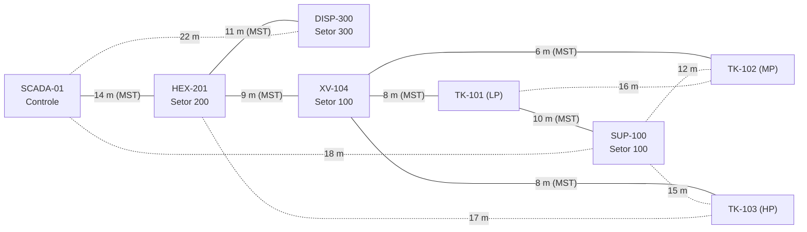

# Aula 19: Otimização de Infraestrutura com Algoritmos de Kruskal e Prim

## 1. Situação-Problema

Nas Etapas 01 e 02, estruturamos a **Estação de Reabastecimento de Hidrogênio — SCADA Core** em três setores operacionais integrados à Sala de Controle:
* **Setor 100 (Suprimento e Armazenamento em Cascata):** Manifold de entrada `SUP-100` (*Inlet Header*), bancos de cilindros `TK-101` (LP — $400\text{ bar}$), `TK-102` (MP — $700\text{ bar}$), `TK-103` (HP — $1000\text{ bar}$) e válvula direcional 4/3 vias `XV-104`.
* **Setor 200 (Condicionamento Térmico):** Trocador criogênico / chiller `HEX-201` (`M-201`, mantendo `TT-201 <= -40 °C`).
* **Setor 300 (Dispensação Veicular):** Dispensador `DISP-300` (protocolo SAE J2601, `BV-301`, `COM-301`).
* **Supervisão Central:** Painel `SCADA-01` na sala de controle.

Para interligar fisicamente todos esses módulos com eletrodutos de instrumentação (sinais $4\text{–}20\text{ mA}$ / Modbus) e bandejamento de utilidades usando o **menor comprimento linear possível** e **sem formar laços fechados redundantes**, modelamos a planta como um grafo não-direcionado ponderado e buscamos sua **Árvore Geradora Mínima (MST — *Minimum Spanning Tree*)**.

---

## 2. Fundamentos Teóricos: Árvore Geradora Mínima (MST)

Dado um grafo conexo, não-direcionado e ponderado $G = (V, E, w)$ com $\vert V \vert = 8$ equipamentos e $\vert E \vert = 13$ rotas viáveis de leito de cabos/tubulação, uma árvore geradora $T = (V, E_T)$ conecta todos os vértices com exatamente $\vert E_T \vert = \vert V \vert - 1 = 7$ arestas, minimizando:
$$W(T) = \sum_{e \in E_T} w(e)$$

### 2.1. Algoritmo de Kruskal (Foco em Arestas + *Union-Find*)
Ordena todas as arestas em ordem crescente de distância $w(e)$ e seleciona iterativamente a menor aresta que conecte dois componentes ainda disjuntos (verificado em tempo quase constante $\mathcal{O}(\alpha(V))$ via estrutura *Disjoint Set Union* com compressão de caminho). Complexidade: $\mathcal{O}(\vert E \vert \log \vert E \vert)$.

### 2.2. Algoritmo de Prim (Foco em Vértices + *Min-Heap*)
Inicia no nó raiz `SCADA-01` (Sala de Controle) e expande uma única árvore contínua, sempre escolhendo na fila de prioridades a aresta de menor peso que liga um equipamento já conectado a um equipamento ainda fora da árvore. Complexidade: $\mathcal{O}(\vert E \vert \log \vert V \vert)$ com *heap* binário.

---

## 3. Modelagem da Rede dos Setores 100, 200 e 300

### 3.1. Vértices ($V$) da Planta HRS

| Vértice | Tag na Planta | Setor | Função Principal |
| :---: | :--- | :---: | :--- |
| $v_1$ | `SUP-100` | Setor 100 | Manifold de suprimento (*Inlet Header*) |
| $v_2$ | `TK-101` | Setor 100 | Banco de Baixa Pressão (LP — $400\text{ bar}$) |
| $v_3$ | `TK-102` | Setor 100 | Banco de Média Pressão (MP — $700\text{ bar}$) |
| $v_4$ | `TK-103` | Setor 100 | Banco de Alta Pressão (HP — $1000\text{ bar}$) |
| $v_5$ | `XV-104` | Setor 100 | Válvula direcional 4/3 vias de seleção |
| $v_6$ | `HEX-201` | Setor 200 | Chiller criogênico ($-40^\circ\text{C}$) |
| $v_7$ | `DISP-300` | Setor 300 | Dispensador veicular FCEV (SAE J2601) |
| $v_8$ | `SCADA-01` | Controle | Servidor supervisório central |

### 3.2. Execução Passo a Passo (Kruskal)

| Ordem | Trecho ($u \leftrightarrow v$) | Distância | Ciclo? | Decisão |
| :---: | :--- | :---: | :---: | :--- |
| 1 | `TK-102` $\leftrightarrow$ `XV-104` | $6\text{ m}$ | Não | **INCLUÍDA** |
| 2 | `TK-101` $\leftrightarrow$ `XV-104` | $8\text{ m}$ | Não | **INCLUÍDA** |
| 3 | `TK-103` $\leftrightarrow$ `XV-104` | $8\text{ m}$ | Não | **INCLUÍDA** |
| 4 | `XV-104` $\leftrightarrow$ `HEX-201` | $9\text{ m}$ | Não | **INCLUÍDA** |
| 5 | `SUP-100` $\leftrightarrow$ `TK-101` | $10\text{ m}$ | Não | **INCLUÍDA** |
| 6 | `HEX-201` $\leftrightarrow$ `DISP-300` | $11\text{ m}$ | Não | **INCLUÍDA** |
| 7 | `SUP-100` $\leftrightarrow$ `TK-102` | $12\text{ m}$ | Sim (`SUP-100`-`TK-101`-`XV-104`-`TK-102`) | **REJEITADA** |
| 8 | `SCADA-01` $\leftrightarrow$ `HEX-201` | $14\text{ m}$ | Não | **INCLUÍDA** |

Comprimento total mínimo obtido por ambos os algoritmos (Kruskal e Prim a partir de `SCADA-01`):
$$W_{\text{MST}} = 6 + 8 + 8 + 9 + 10 + 11 + 14 = 66\text{ metros}$$

---

## 4. Exemplo Resolvido

**Pergunta:** Por que, na topologia MST acima, `XV-104` concentra grau 4 (conectando `TK-101`, `TK-102`, `TK-103` e `HEX-201`)?

**Resolução:** Na planta real (conforme a Aula 18), `XV-104` é a válvula direcional 4/3 vias que recebe as linhas dos três tanques em cascata e encaminha o fluxo selecionado para o trocador `HEX-201`. Como os trechos até `XV-104` são os mais curtos ($6\text{ m}$ a $9\text{ m}$), tanto Kruskal quanto Prim escolhem `XV-104` como concentrador natural da malha do Setor 100, evitando cabeamentos paralelos redundantes a partir de `SUP-100`.

---

## 5. Atividades de Investigação

1. Execute o notebook e confirme que `kruskal_mst` e `prim_mst` convergem para o mesmo custo total de $66\text{ m}$.
2. Simule a instalação de um segundo dispensador `DISP-301` no Setor 300 a $7\text{ m}$ de `DISP-300` e $16\text{ m}$ de `HEX-201`. Qual aresta entra na MST?
3. Em qual fase do projeto da HRS você aplicaria Kruskal (orçamento global) vs. Prim (lançamento contínuo de cabos a partir de `SCADA-01`)?

---

## 6. Entregável da Aula 19

* **Módulo `kruskal_mst` e `prim_mst` em Python:** Implementação com *Union-Find* e *Min-Heap* aplicada aos Setores 100, 200 e 300 da Estação de Hidrogênio, com tabela de passos e visualização gráfica.
