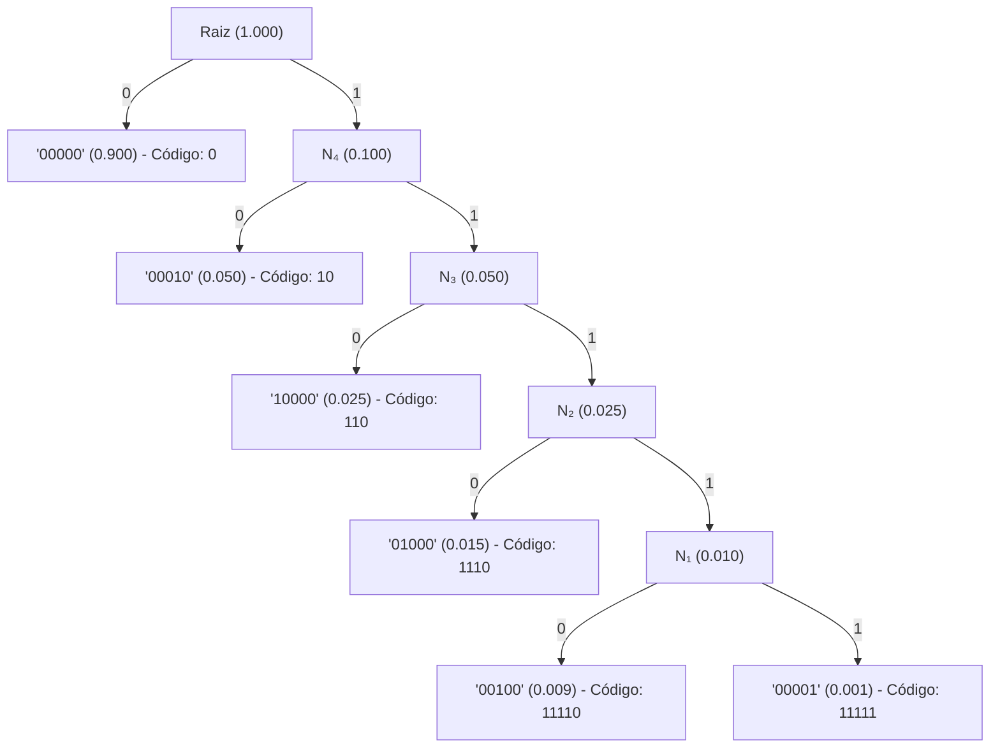

# Compressão de Telemetria via Algoritmo de Huffman no SCADA-Core

## 1. Escopo e Arquitetura do Sistema de Transmissão da Estação de Hidrogênio

O sistema **SCADA-Core** gerencia a telemetria contínua do **Setor 100 (Armazenamento em Cascata e Compressão de Hidrogênio)** e do **Setor 200/300 (Condicionamento Térmico e Dispensação)** de uma Estação de Reabastecimento de Hidrogênio (*Hydrogen Refueling Station* - HRS). A telemetria monitora em tempo real grandezas críticas de processo segundo as diretrizes de segurança da **SAE J2601**, **ISO 19880-1**, **NFPA 2** e **IEC 61511 (SIL-3)**, transmitindo o status operacional por redes de comunicação industrial como Modbus-TCP/RTU, PROFIBUS-DP ou OPC-UA.

Em transmissões convencionais não comprimidas, o estado lógico da instrumentação de campo padronizada pela norma **ANSI/ISA-5.1** é empacotado em palavras binárias de tamanho fixo. Considerando os 5 instrumentos primários da malha de intertravamento de segurança funcional do Setor 100/200:
1. `PT-101`: Transmissor de Pressão do Banco de Baixa Pressão TK-101 (1 = Sobrepressão crítica $\ge 400\text{ bar}$)
2. `TT-101`: Transmissor de Temperatura de Parede do Tanque TK-101 (1 = Sobretemperatura crítica $\ge 85^\circ\text{C}$)
3. `AT-101`: Detector Óptico/Catalítico de Hidrogênio Gasoso (1 = Limite de Alarme Crítico $\ge 40\%\text{ LFL}$)
4. `PT-201`: Transmissor de Pressão da Linha de Buffer Criogênico do Chiller (1 = Alta Pressão Transitória $\ge 850\text{ bar}$)
5. `ESD-100`: Botão de Parada Crítica de Emergência Geral da Planta (1 = Emergência Acionada / Trip SIS)

No formato sem compressão, cada frame de telemetria requer **5 bits fixos** por amostra. Com taxas de varredura industrial (*scan rate*) de $10\text{ ms}$ a $50\text{ ms}$ em enlaces seriais ou canais de rádio/telemetria remota com largura de banda restrita (e.g. $9600\text{ bps}$ a $19200\text{ bps}$), o envio ininterrupto de palavras redundantes causa saturação do barramento e aumento de latência. Como estações de hidrogênio operam em regime nominal seguro e estável durante a maior parte de sua vida útil ($>90\%$ do tempo), a aplicação da **Codificação de Huffman** proporciona compressão estatística sem perdas (*lossless*), otimizando o *throughput* do barramento SCADA sem comprometer o determinismo do processo.

---

## 2. Modelo Probabilístico e Algoritmo de Huffman

O alfabeto discreto de mensagens $S = \{s_1, s_2, \dots, s_6\}$ representa os vetores de estado mais frequentes da instrumentação `[PT-101, TT-101, AT-101, PT-201, ESD-100]`.

### Matriz de Probabilidades Operacionais

| Código do Estado | Instrumentos em Nível Lógico 1 | Condição Operacional da HRS | Probabilidade $P(s_i)$ |
| :---: | :---: | :---: | :---: |
| `00000` | Nenhum | Operação Nominal Estável (Pressão, Temp e Atmosfera Seguras) | $0,900$ ($90,0\%$) |
| `00010` | `PT-201` | Transiente de Alta Pressão no Chiller ($\ge 850\text{ bar}$) | $0,050$ ($5,0\%$) |
| `10000` | `PT-101` | Alarme de Sobrepressão no Tanque TK-101 ($\ge 400\text{ bar}$) | $0,025$ ($2,5\%$) |
| `01000` | `TT-101` | Alarme de Sobretemperatura Térmica ($\ge 85^\circ\text{C}$) | $0,015$ ($1,5\%$) |
| `00100` | `AT-101` | Detecção de Fuga de Hidrogênio Inflamável ($\ge 40\%\text{ LFL}$) | $0,009$ ($0,9\%$) |
| `00001` | `ESD-100` | Botão de Parada de Emergência Geral Acionado | $0,001$ ($0,1\%$) |

### Construção Passo a Passo da Árvore de Huffman

A síntese da árvore binária ótima procede unindo iterativamente os nós de menor probabilidade acumulada:
1. **Combinação 1:** Os dois símbolos de menor probabilidade, `00100` ($0,009$) e `00001` ($0,001$), são unidos no nó intermediário $N_1$ com probabilidade agregada de $0,010$.
2. **Combinação 2:** Une-se $N_1$ ($0,010$) ao símbolo `01000` ($0,015$), gerando o nó intermediário $N_2$ com peso $0,025$.
3. **Combinação 3:** Une-se $N_2$ ($0,025$) ao símbolo `10000` ($0,025$), gerando o nó intermediário $N_3$ com peso $0,050$.
4. **Combinação 4:** Une-se $N_3$ ($0,050$) ao símbolo `00010` ($0,050$), resultando no nó $N_4$ com peso $0,100$.
5. **Combinação 5:** Une-se $N_4$ ($0,100$) ao símbolo de maior prevalência operacional `00000` ($0,900$), formando a raiz da árvore binária com peso $1,000$.

Convencionando-se o bit `0` para a ramificação de maior probabilidade e `1` para a de menor probabilidade, obtém-se o dicionário de códigos prefixados:

| Estado Original (Fixos: 5 bits) | Condição Física no SCADA | Código de Huffman | Comprimento $l(s_i)$ |
| :---: | :---: | :---: | :---: |
| `00000` | Nominal Estável | `0` | 1 bit |
| `00010` | Transiente PT-201 | `10` | 2 bits |
| `10000` | Sobrepressão PT-101 | `110` | 3 bits |
| `01000` | Sobretemperatura TT-101 | `1110` | 4 bits |
| `00100` | Fuga H2 AT-101 | `11110` | 5 bits |
| `00001` | Emergência ESD-100 | `11111` | 5 bits |



### Avaliação de Desempenho e Economia de Banda

* **Entropia Teórica de Shannon ($H(S)$):**

$$H(S) = -\sum_{i=1}^{6} P(s_i) \log_2 P(s_i) \approx 0,6480 \text{ bits/símbolo}$$

* **Comprimento Médio da Palavra-Código ($L$):**

$$L = \sum_{i=1}^{6} P(s_i) \cdot l(s_i) = (0,90 \cdot 1) + (0,05 \cdot 2) + (0,025 \cdot 3) + (0,015 \cdot 4) + (0,009 \cdot 5) + (0,001 \cdot 5) = 1,1850 \text{ bits/símbolo}$$

* **Taxa de Redução de Banda (Taxa de Compressão):**

$$\text{Redução de Banda} = \left( 1 - \frac{L}{L_{\text{fixo}}} \right) \times 100\% = \left( 1 - \frac{1,1850}{5} \right) \times 100\% = 76,30\%$$

---

## 3. Protocolo de Enquadramento e Integração CLP/SCADA

### Estrutura do Pacote de Transmissão em Campo

Para transmissão determinística por enlace serial RS-485 ou soquetes TCP/IP sem perda de sincronismo, os dados comprimidos são encapsulados no quadro industrial:

```
+------------------+-------------------+--------------------+--------------------+
| Header (8 bits)  | Length (8 bits)   | Huffman Payload    | CRC-16 (16 bits)   |
| 0xA5 (Start Byte)| Tamanho do Payload| Bits Codificados   | Verificação Erro   |
+------------------+-------------------+--------------------+--------------------+
```

### Algoritmo de Processamento no CLP e Servidor SCADA

* **Codificação no CLP de Campo:** A cada ciclo de varredura (*scan cycle* de $10\text{ ms}$), o CLP lê os cartões de entrada digital e transmissores analógicos discretizados, mapeia o vetor de 5 bits, busca o código de prefixo na tabela hash pré-alocada e transfere os bits correspondentes para a fila de transmissão circular.
* **Decodificação Determinística no Servidor SCADA:** O servidor recebe o fluxo contínuo de bits e percorre a árvore binária de Huffman a partir da raiz. Por ser um código de prefixo livre de ambiguidades (*prefix-free*), o processo de decodificação possui complexidade $\mathcal{O}(k)$, onde $k$ é a profundidade da folha atingida (máximo de 5 passos por símbolo), garantindo tempos de recuperação inferiores a microssegundos.
* **Integridade e Redundância SIS:** Se o fluxo binário sofrer interferência eletromagnética (EMI dos compressores ou inversores) e atingir um código desalinhado ou folha inexistente, a rotina de validação aciona a checagem CRC-16, descarta o quadro corrompido e mantém o último estado seguro na IHM com flag de diagnóstico operacional em conformidade com a IEC 61511.
