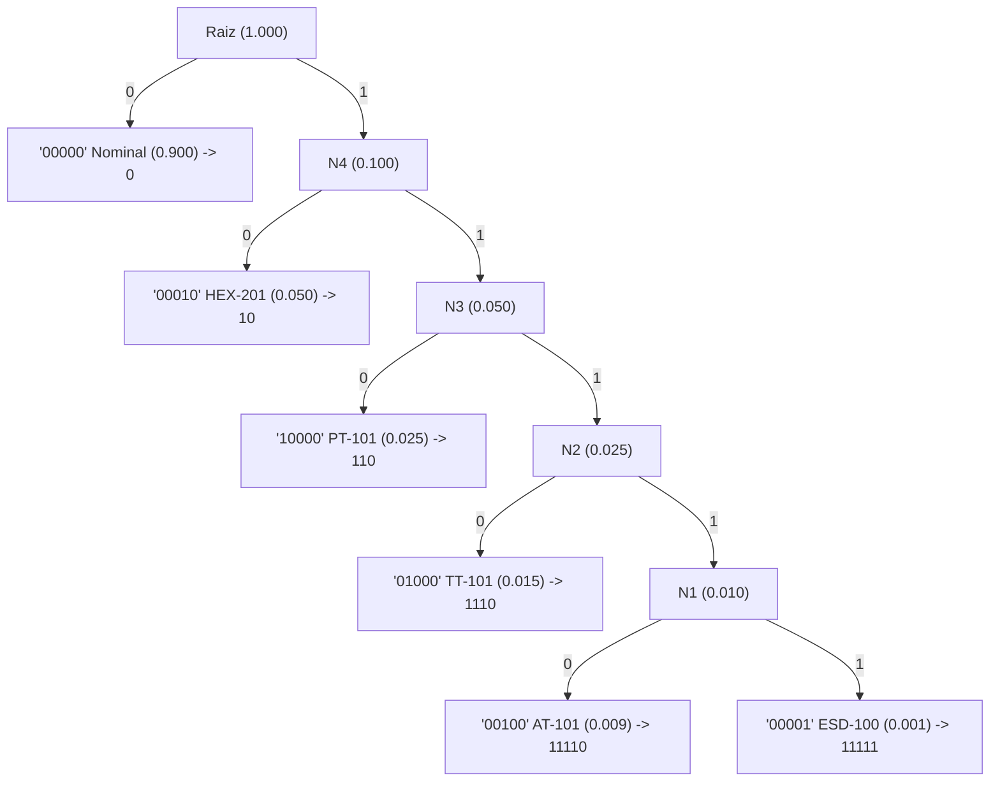

# Aula 20: Compressão de Telemetria via Codificação de Huffman

## 1. Situação-Problema

Na **Estação de Reabastecimento de Hidrogênio — SCADA Core**, os controladores de campo dos Setores 100, 200 e 300 enviam continuamente o vetor de estados críticos de segurança para a sala de controle (`SCADA-01`):
* `PT-101`: Sobrepressão no banco LP `TK-101` ($P > 400\text{ bar}$, proposição $p_{1,1}$ da Etapa 01);
* `TT-101`: Sobretemperatura em `TK-101` ($T > 85^\circ\text{C}$, proposição $t_{1,1}$);
* `AT-101`: Detecção de fuga de $\text{H}_2$ no Setor 100 ($C > 25\%\text{ LIE}$, proposição $g_{1,1}$);
* `TT-201`: Falha térmica no pré-resfriador `HEX-201` (saída acima de $-40^\circ\text{C}$ durante abastecimento);
* `ESD-100`: Acionamento manual de parada geral de emergência ($e_{1,1} = 1$).

Em quadros fixos não comprimidos, cada varredura exige **5 bits**. Como a estação opera em regime nominal seguro (`00000`) na maior parte do tempo ($>90\%$), transmitir palavras fixas desperdiça banda em enlaces seriais RS-485 ou rádio de telemetria. Aplicando a **Codificação de Huffman**, obtemos compressão estatística sem perdas (*lossless*), reduzindo a carga no barramento sem perder determinismo.

---

## 2. Fundamentos Teóricos: Árvore de Prefixos Ótima

Dado um alfabeto discreto $S = \{s_1, \dots, s_n\}$ com probabilidades $P(s_i)$, o algoritmo de Huffman constrói uma árvore binária ótima (*bottom-up* com *min-heap*) unindo iterativamente os dois nós de menor probabilidade:
* **Propriedade Livre de Prefixos (*Prefix-Free*):** Nenhum código é prefixo de outro, permitindo decodificação instantânea em fluxo contínuo com complexidade $\mathcal{O}(l_{\max})$ por símbolo.
* **Limite Inferior de Shannon (Entropia):**
  $$H(S) = -\sum_{i=1}^{n} P(s_i) \log_2 P(s_i)$$
* **Comprimento Médio Esperado:**
  $$L = \sum_{i=1}^{n} P(s_i) \cdot l(s_i) \ge H(S)$$

---

## 3. Modelagem na Estação de Hidrogênio (HRS)

| Vetor `[PT-101, TT-101, AT-101, TT-201, ESD-100]` | Condição Operacional (Etapa 01) | Probabilidade $P(s_i)$ | Código Huffman | Bits |
| :---: | :--- | :---: | :---: | :---: |
| `00000` | Operação Nominal Estável | $0{,}900$ | `0` | 1 |
| `00010` | Alerta Térmico `HEX-201` (`TT-201`) | $0{,}050$ | `10` | 2 |
| `10000` | Sobrepressão `TK-101` (`PT-101 > 400 bar`) | $0{,}025$ | `110` | 3 |
| `01000` | Sobretemperatura `TK-101` (`TT-101 > 85 °C`) | $0{,}015$ | `1110` | 4 |
| `00100` | Fuga de $\text{H}_2$ (`AT-101 > 25% LIE`) | $0{,}009$ | `11110` | 5 |
| `00001` | Emergência Geral (`ESD-100 = 1`) | $0{,}001$ | `11111` | 5 |

* **Entropia de Shannon:** $H(S) \approx 0{,}6480\text{ bits/símbolo}$.
* **Comprimento Médio:** $L = 1{,}1850\text{ bits/símbolo}$ (contra $5\text{ bits}$ fixos).
* **Redução de Banda:** $\left(1 - \frac{1{,}185}{5}\right) \times 100\% = 76{,}30\%$.

---

## 4. Exemplo Resolvido

**Pergunta:** Em um enlace serial de $9600\text{ bps}$ com varredura a cada $20\text{ ms}$ ($50\text{ amostras/s}$), quantos bits por segundo são economizados para a carga útil de estados usando Huffman?

**Resolução:** Sem compressão, são $50 \times 5 = 250\text{ bps}$ de carga útil. Com Huffman ($L = 1{,}185\text{ bits/símbolo}$), a taxa média cai para $50 \times 1{,}185 = 59{,}25\text{ bps}$, economizando **$190{,}75\text{ bps}$** ($76{,}3\%$) sem perder nenhum bit de informação na decodificação no `SCADA-01`.

---

## 5. Atividades de Investigação

1. Execute o notebook e valide a decodificação reversa (*lossless*) de um fluxo sintético de $1.000$ amostras da HRS.
2. O que ocorre com a taxa de compressão se `AT-101 > 25% LIE` passar a ocorrer em $30\%$ das amostras durante um simulado de vazamento?
3. Por que o quadro industrial encapsula o *payload* de Huffman com um cabeçalho e **CRC-16**?

---

## 6. Entregável da Aula 20

* **Codec `HuffmanSCADA` em Python:** Construção da árvore via *min-heap*, codificação/decodificação bit a bit, cálculo de entropia e gráfico comparativo de banda.
