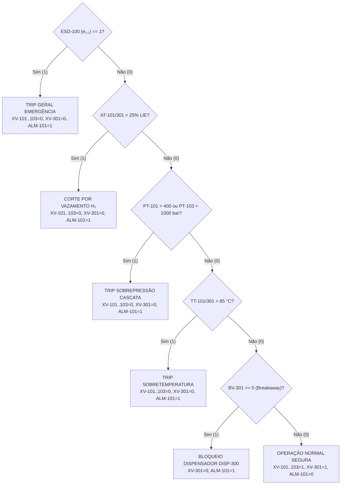

# Aula 21: Árvores Binárias (BDT de Segurança e AVL no Historiador)

## 1. Situação-Problema

No `SCADA-Core` da **Estação de Reabastecimento de Hidrogênio (HRS)**, duas funções críticas exigem estruturas de **Árvores Binárias** com propriedades opostas:
1. **Malha de Intertravamento SIS (Tempo Real $\mathcal{O}(1)$):** Avaliar em curto-circuito os predicados booleanos dos Setores 100, 200 e 300 mapeados na [Aula 02](../etapa-01-logica/02%20-%20Mapeamento%20de%20Variaveis%20de%20Processo.md) (`ESD-100`, `AT-101..301 > 25% LIE`, `PT-101..103`, `TT-101..301`, `BV-301`) e acionar `XV-101..103`, `XV-301` e `ALM-101` em menos de $10\text{ ms}$ (IEC 61511 / SIL-3).
2. **Historiador de Séries Temporais (Busca Dinâmica $\mathcal{O}(\log N)$):** Indexar continuamente amostras de telemetria pelo *timestamp* UNIX ($\tau$) para consultas pontuais e por janela $[\tau_1, \tau_2]$ na IHM e análise de causa raiz (RCA).

---

## 2. Fundamentos Teóricos

### 2.1. Árvore Binária de Decisão (BDT) Estática
Uma BDT é um grafo acíclico orientado $T = (V, E)$ onde cada nó interno testa um predicado booleano binário ($0$ ou $1$) e cada folha define um vetor determinístico de atuação nas válvulas `XV-101..103`, `XV-301` e no alarme `ALM-101`. Por possuir profundidade constante $h = 5$, o pior caso de execução é $\mathcal{O}(h) = \mathcal{O}(1)$.

### 2.2. Árvore Binária de Busca Auto-Balanceada (AVL)
Uma árvore binária de busca degenera para $\mathcal{O}(N)$ quando recebe chaves em ordem estritamente crescente (como *timestamps* $\tau_1 < \tau_2 < \dots < \tau_N$). A **Árvore AVL** (Adelson-Velsky e Landis) mantém a invariante do **Fator de Balanceamento** em todo nó $n$:
$$BF(n) = h(n.\text{dir}) - h(n.\text{esq}) \in \{-1, 0, +1\}$$
Sempre que $|BF(n)| = 2$, rotações locais em $\mathcal{O}(1)$ (**LL**, **RR**, **LR**, **RL**) restauram a altura $\mathcal{O}(\log_2 N)$, garantindo inserções, buscas pontuais em $\mathcal{O}(\log_2 N)$ e consultas por janela $[\tau_1, \tau_2]$ em $\mathcal{O}(\log_2 N + K)$ via percurso *In-Order*.

---

## 3. Modelagem na Estação de Hidrogênio (Setores 100, 200 e 300)

| Estrutura | Uso no `SCADA-Core` | Chave / Predicado | Complexidade Pior Caso |
| :--- | :--- | :--- | :---: |
| **BDT (Estática)** | Intertravamento SIS (Setores 100/200/300) | `ESD-100`, `AT-101..301`, `PT-101..103`, `TT-101..301`, `BV-301` | $\mathcal{O}(1)$ |
| **AVL (Dinâmica)** | Historiador de Séries Temporais | *Timestamp* UNIX $\tau$ ($\text{ms}$) | $\mathcal{O}(\log_2 N)$ |

---

## 4. Exemplo Resolvido

**Pergunta:** Ao inserir $2.000$ amostras sequenciais ($\tau_1 < \tau_2 < \dots < \tau_{2000}$) no Historiador do `SCADA-Core`, qual seria a altura de uma BST comum comparada à Árvore AVL?

**Resolução:** Em uma BST comum sem balanceamento, chaves monotônicas crescentes formam uma lista encadeada degenerada de altura $h = 1999$. Na **Árvore AVL**, as rotações simples à esquerda (`RR`) rebalanceiam a espinha dorsal a cada inserção, mantendo a altura estritamente limitada por $h \le 1{,}44 \log_2(2000) \approx 15$ níveis — reduzindo em mais de $130\times$ o número de comparações por consulta.

---

## 5. Atividades de Investigação

1. Execute o notebook e verifique a altura final da Árvore AVL após inserir $2.000$ amostras cronológicas.
2. Teste uma consulta por janela $[\tau_1, \tau_2]$ cobrindo exatamente o instante de um surto simulado em `AT-101 > 25% LIE` e confirme que a BDT registra `TRIP_VAZAMENTO_H2`.
3. Por que a ordem dos nós na BDT coloca `ESD-100` na raiz e `BV-301` no último nível?

---

## 6. Entregável da Aula 21

* **Módulos `BDTSegurancaHRS` e `HistoriadorAVL` em Python:** Simulação de $2.000$ amostras dos Setores 100, 200 e 300, avaliação SIS em $\mathcal{O}(1)$, indexação AVL com rotações automáticas e gráficos de telemetria.
