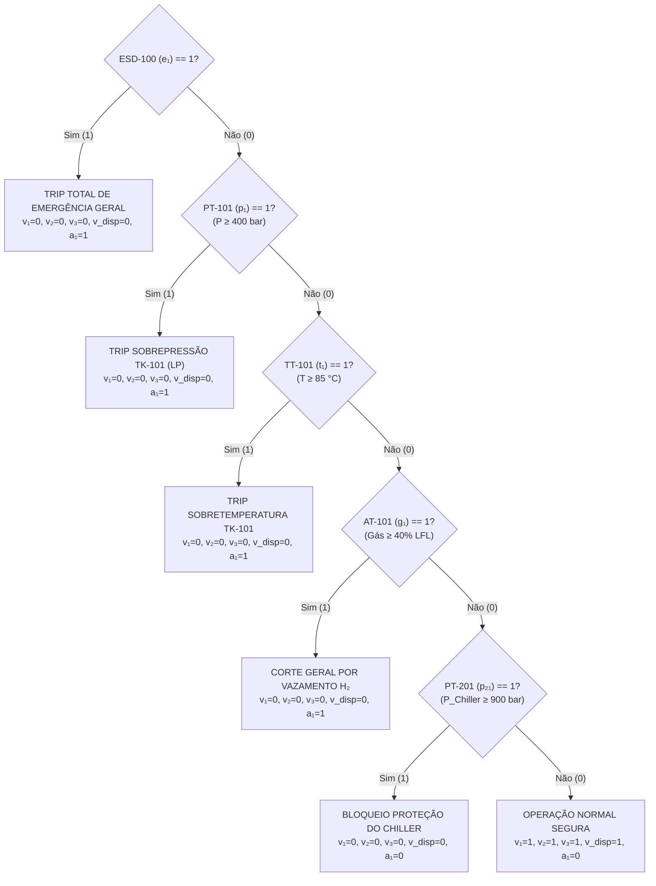
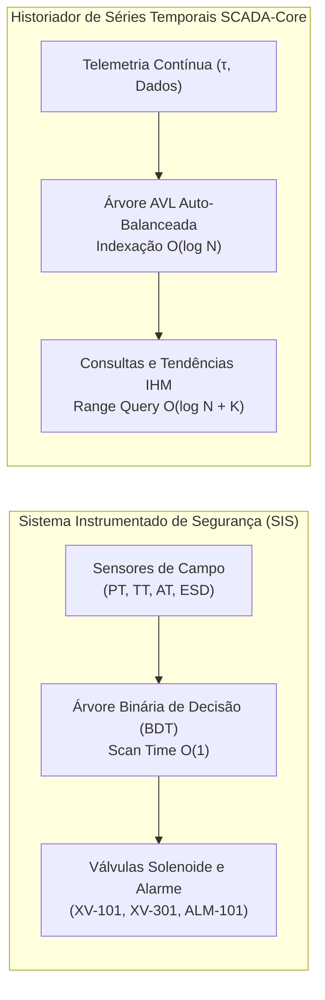

# Aplicações de Árvores Binárias na Estação de Reabastecimento de Hidrogênio (HRS)

---

| Especificação Técnica | Detalhes |
| :--- | :--- |
| **Unidade Operacional** | Estação de Reabastecimento de Hidrogênio (HRS - *Hydrogen Refueling Station*) — Setores 100/200/300 & Historiador SCADA-Core |
| **Domínio de Engenharia** | Engenharia de Automação, Segurança Funcional (IEC 61511 / SIL-3, SAE J2601, ISO 19880-1) e Matemática Discreta |
| **Estruturas de Dados** | Árvores Binárias de Decisão (BDT) e Árvores Binárias de Busca Auto-Balanceadas (AVL) |
| **Status do Documento** | Aprovado para Implementação em Controladores Programáveis (CLP/DCS) e Servidor SCADA |

---

## 1. Árvore Binária de Decisão (BDT) — Sistema Instrumentado de Segurança (SIS) da HRS

### 1.1 Contextualização da Engenharia de Processos de Hidrogênio
A Estação de Reabastecimento de Hidrogênio (HRS) comprime, armazena em cascata e dispensa hidrogênio gasoso ($H_2$) sob altíssimas pressões (até $1000\text{ bar}$) para veículos elétricos a célula de combustível (FCEV). O hidrogênio apresenta características físico-químicas de alto risco: faixa de inflamabilidade extremamente ampla em ar ($4\%\text{ a }75\%\text{ v/v}$), baixíssima energia de ignição ($0{,}017\text{ mJ}$) e efeito Joule-Thomson com coeficiente negativo em temperaturas ambientes ($\mu_{JT} < 0$), o que implica aquecimento térmico durante expansões e vazamentos.

Desvios críticos nas variáveis do processo (sobrepressão nos bancos de estocagem `TK-101/TK-102/TK-103`, superaquecimento na parede dos tanques ou bico dispensador, detecção de fuga de gás inflamável ou falha no resfriamento criogênico a $-40^\circ\text{C}$ da **SAE J2601**) exigem resposta ultra-rápida e determinística do sistema de intertravamento de segurança. Para evitar ignições espontâneas, sobrepressões de ruptura mecânica ou acidentes operacionais, implementa-se uma **Árvore Binária de Decisão (BDT)** de profundidade fixa no firmware do Sistema Instrumentado de Segurança (SIS / SIL-3).

### 1.2 Formalização Matemática da Árvore de Decisão
Define-se a árvore de segurança como um grafo acíclico orientado $T = (V, E)$, em que:

* $V = V_{\text{interno}} \cup V_{\text{folha}}$ é o conjunto de vértices (nós).
* $V_{\text{interno}}$ contém predicados booleanos derivados da instrumentação ISA-5.1 da estação.
* $V_{\text{folha}}$ contém os estados de comando dos atuadores de segurança (válvulas solenoide de bloqueio rápido $v_1, v_2, v_3$, válvula criogênica $v_{2,1}$, válvula do bico $v_{3,1}$ e alarme audiovisual $a_{1,1}$).
* $E$ é o conjunto de arestas direcionadas representando as transições de decisão binária $\{1 = \text{Verdadeiro}, 0 = \text{Falso}\}$.

### 1.3 Topologia da Árvore de Intertravamento SIS (Mermaid)



### 1.4 Mapeamento Determinístico dos Estados dos Instrumentos ISA-5.1

A avaliação ocorre em regime de **curto-circuito booleano** com ordenação por gravidade de risco funcional:

| Nível ($h$) | Nó de Decisão | Tag ISA-5.1 | Condição Lógica Booleana | Atuação nos Atuadores | Estado Funcional |
| :---: | :---: | :---: | :---: | :---: | :---: |
| **0 (Raiz)** | `ESD-100` | Botão de Emergência Geral | $e_1 = 1 \implies \text{Pressionado}$ | $v_{1,1}=0, v_{3,1}=0, a_{1,1}=1$ | Parada Crítica de Emergência Geral |
| **1** | `PT-101` | Transmissor de Pressão TK-101 | $p_1 = 1 \implies P \ge 400\text{ bar}$ | $v_{1,1}=0, v_{3,1}=0, a_{1,1}=1$ | Trip por Sobrepressão em TK-101 |
| **2** | `TT-101` | Transmissor de Temp. Parede | $t_1 = 1 \implies T \ge 85^\circ\text{C}$ | $v_{1,1}=0, v_{3,1}=0, a_{1,1}=1$ | Trip Térmico no Vaso de Pressão |
| **3** | `AT-101` | Detector de Hidrogênio | $g_1 = 1 \implies C_{\text{H}_2} \ge 40\%\text{ LFL}$ | $v_{1,1}=0, v_{3,1}=0, a_{1,1}=1$ | Trip por Fuga de Hidrogênio Gasoso |
| **4** | `PT-201` | Pressão na Entrada Chiller | $p_{2,1} = 1 \implies P \ge 900\text{ bar}$ | $v_{1,1}=0, v_{3,1}=0, a_{1,1}=0$ | Bloqueio Preventivo Linha Resfriamento |
| **5 (Folha)** | Estado Seguro | Todos em conformidade | $e_1=p_1=t_1=g_1=p_{2,1}=0$ | $v_{1,1}=1, v_{3,1}=1, a_{1,1}=0$ | Estação em Operação Normal |

### 1.5 Análise de Complexidade Computacional e Tempo Real
1. **Determinismo Temporal:** Como a árvore de decisão possui profundidade constante $h = 5$, o tempo de varredura (*scan time*) de pior caso no controlador é estritamente limitado por $\mathcal{O}(h) = \mathcal{O}(5) = \mathcal{O}(1)$.
2. **Latência de Segurança:** O ciclo de varredura do SIS garante atuação em menos de $10\text{ ms}$, cumprindo os mandamentos normativos da **IEC 61511** para malhas de proteção SIL-3.

---

## 2. Árvore Binária de Busca Auto-Balanceada (AVL) — Indexador de Séries Temporais do Historiador SCADA-Core

### 2.1 Contextualização da Engenharia de Dados Industriais
O Historiador de Processos (*Process Historian*) do SCADA-Core registra continuamente telemetria de alta frequência (amostragens de $10\text{ ms}$ a $100\text{ ms}$) dos sensores de todos os setores da HRS:
* Setor 100: `PT-101`, `PT-102`, `PT-103`, `TT-101`, `AT-101`
* Setor 200: `PT-201`, `TT-201`
* Setor 300: `PT-301`, `TT-301`, `AT-301`, `FT-301`

Para viabilizar consultas instantâneas na IHM, reconstrução de acidentes (*Root Cause Analysis* - RCA) e auditoria de conformidade com os perfis de rampa de pressão da **SAE J2601** (APRR), os eventos são indexados em memória primária por meio de uma **Árvore AVL** (Adelson-Velsky e Landis).

### 2.2 Estrutura do Nó na Memória
Cada nó $N$ na Árvore AVL armazena o *Timestamp* UNIX ($\tau \in \mathbb{N}$) como chave primária de ordenação e um vetor estruturado de telemetria como *payload*:

$$N = \Big\langle \tau, \; BF, \; \text{Ponteiro}_{\text{Esq}}, \; \text{Ponteiro}_{\text{Dir}}, \; \mathbf{D}(\tau) \Big\rangle$$

Onde a carga útil telemetrada é dada pelo vetor de variáveis contínuas:

$$\mathbf{D}(\tau) = \left[ P_{\text{PT-101}}, \; P_{\text{PT-102}}, \; P_{\text{PT-103}}, \; T_{\text{TT-101}}, \; C_{\text{AT-101}}, \; P_{\text{PT-201}}, \; T_{\text{TT-201}}, \; P_{\text{PT-301}}, \; T_{\text{TT-301}} \right]$$

### 2.3 Topologia e Propriedade de Balanceamento AVL

```
                       [τ = 1772450000 ms]  (BF = 0)
                          /           \
                         /             \
         [τ = 1772449900 ms]         [τ = 1772450100 ms]  (BF = 0)
            (BF = +1)                    /           \
              /                         /             \
    [τ = 1772449850 ms]      [τ = 1772450050 ms]  [τ = 1772450200 ms]
```

### 2.4 Rigor Matemático e Fator de Balanceamento ($BF$)
Para qualquer nó $n \in V$, define-se a altura da subárvore como $h(T)$. O Fator de Balanceamento $BF(n)$ obedece à invariante estrita da árvore AVL:

$$BF(n) = h(T_{\text{direita}}) - h(T_{\text{esquerda}}) \in \{-1, \; 0, \; +1\}$$

Quando uma nova amostra de telemetria desbalanceia um nó com $|BF(n)| > 1$, executa-se o rebalanceamento local em tempo constante $\mathcal{O}(1)$ via rotações de ponteiros:
* **Rotação Simples à Esquerda (RR):** Aplicada quando $BF(n) = +2$ e $BF(\text{filho}_{\text{dir}}) \ge 0$.
* **Rotação Simples à Direita (LL):** Aplicada quando $BF(n) = -2$ e $BF(\text{filho}_{\text{esq}}) \le 0$.
* **Rotação Dupla Direita-Esquerda (RL):** Aplicada quando $BF(n) = +2$ e $BF(\text{filho}_{\text{dir}}) < 0$.
* **Rotação Dupla Esquerda-Direita (LR):** Aplicada quando $BF(n) = -2$ e $BF(\text{filho}_{\text{esq}}) > 0$.

### 2.5 Algoritmo de Percurso e Complexidade Computacional

```
                                COMPLEXIDADE COMPUTACIONAL
┌──────────────────────────────────────┬────────────────────────┬────────────────────────┐
│ Operação de Historiador              │ Caso Médio             │ Pior Caso (Garantido)  │
├──────────────────────────────────────┼────────────────────────┼────────────────────────┤
│ Inserção de Amostra Telemetrada      │ O(log₂ N)              │ O(log₂ N)              │
│ Consulta Ponto a Ponto (Timestamp)   │ O(log₂ N)              │ O(log₂ N)              │
│ Consulta por Janela [τ₁ , τ₂]        │ O(log₂ N + K)          │ O(log₂ N + K)          │
└──────────────────────────────────────┴────────────────────────┴────────────────────────┘
```
*Onde $N$ representa o total de registros temporais indexados e $K$ o número de amostras contidas na janela $[t_{\text{início}}, t_{\text{fim}}]$.*

#### Percurso em Ordem (*In-Order Traversal*) para Geração de Tendências:
A extração de séries temporais para plotagem de curvas de pressão e temperatura no SCADA percorre a subárvore em ordem simétrica:

$$\text{Percurso}(n) = \text{Percurso}(n.\text{esquerda}) \;\longrightarrow\; \text{Processa}(\mathbf{D}(n.\tau)) \;\longrightarrow\; \text{Percurso}(n.\text{direita})$$

Como a árvore binária de busca preserva o ordenamento estrito das chaves temporais $\tau$, esse percurso extrai os dados cronologicamente organizados com complexidade linear adicional $\mathcal{O}(K)$.

---

## 3. Síntese e Comparativo de Aplicação na Estação de Hidrogênio

| Propriedade de Engenharia | Árvore Binária de Decisão (SIS) | Árvore Binária AVL (Historiador) |
| :--- | :--- | :--- |
| **Objetivo Industrial** | Intertravamento e Segurança Funcional (SIL-3) | Armazenamento e Consulta de Séries Temporais |
| **Elemento Chave** | Predicado Booleano dos Sensores ISA-5.1 | Timestamp UNIX ($\tau$) em milissegundos |
| **Modificação Estrutural** | Estática (árvore fixa em tempo de projeto) | Dinâmica (inserções contínuas de telemetria) |
| **Critério de Desempenho** | Tempo de execução determinístico $\mathcal{O}(1)$ | Busca e recuperação logarítmica $\mathcal{O}(\log_2 N)$ |
| **Conformidade Normativa** | IEC 61511 / NFPA 2 / SAE J2601 | Auditoria Operacional e Análise de Falhas (RCA) |


