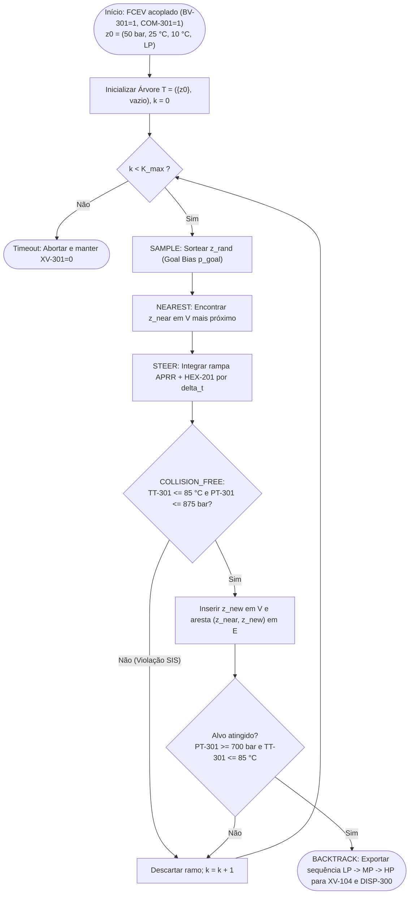

# Aula 22: Planejamento de Trajetórias de Abastecimento com *Rapidly-exploring Random Trees* (RRT)

## 1. Situação-Problema

Na **Estação de Reabastecimento de Hidrogênio — SCADA Core**, o abastecimento de um veículo elétrico a célula de combustível (FCEV) até $700\text{ bar}$ no dispensador `DISP-300` envolve uma dinâmica termodinâmica não linear acoplada ao chaveamento discreto da cascata:

1. **Setor 100 (Armazenamento em Cascata):** Seleção sequencial dos bancos `TK-101` (LP, $400\text{ bar}$), `TK-102` (MP, $700\text{ bar}$) e `TK-103` (HP, $1000\text{ bar}$) por meio da válvula direcional 4/3 vias `XV-104` (bobinas `YV-104A` e `YV-104B`).
2. **Setor 200 (Condicionamento Térmico):** Pré-resfriamento criogênico no trocador `HEX-201` (`M-201`) mantendo `TT-201` $\le -40^\circ\text{C}$ para compensar o aquecimento por compressão adiabática e o efeito Joule-Thomson negativo ($\mu_{\text{JT}} < 0$) do hidrogênio.
3. **Setor 300 (Dispensação `DISP-300`):** Controle da rampa de pressão (APRR — *Average Pressure Ramp Rate*, protocolo **SAE J2601**) respeitando o limite térmico do tanque compósito Tipo IV (`TT-301` $\le 85^\circ\text{C}$) e os intertravamentos da Etapa 01 (`AT-101..301` $\le 25\%\text{ LIE}$, `ESD-100 = 0`).

Discretizar esse espaço contínuo-discreto em uma grade fixa exigiria $\mathcal{O}(k^d)$ estados. O algoritmo **RRT (*Rapidly-exploring Random Tree*)** resolve esse problema construindo incrementalmente uma árvore de trajetórias fisicamente realizáveis e livres de violação de segurança.

---

## 2. Fundamentos Teóricos: RRT em Espaços Híbridos

### 2.1. Definição Formal
Uma RRT é uma árvore direcionada enraizada $\mathcal{T} = (V, E)$ embutida no espaço de estados híbrido $\mathcal{Z} = \mathcal{X} \times \mathcal{Q}$:
* **Subespaço Contínuo ($\mathcal{X} \subset \mathbb{R}^3$):** $\mathbf{x} = [P_{\text{PT-301}}, \; T_{\text{TT-301}}, \; T_{\text{TT-201}}]^T$ (pressão no bico em $\text{bar}$, temperatura no receptáculo veicular em $^\circ\text{C}$ e temperatura de saída do `HEX-201` em $^\circ\text{C}$).
* **Subespaço Discreto ($\mathcal{Q}$):** Estágio ativo na válvula direcional `XV-104` ($q \in \{\text{LP}, \text{MP}, \text{HP}\}$).

### 2.2. Região Proibida ($\mathcal{Z}_{\text{obs}}$) Conectada à Etapa 01
Em vez de obstáculos geométricos, os obstáculos na HRS são as **barreiras de intertravamento booleano** mapeadas na [Aula 02](../etapa-01-logica/02%20-%20Mapeamento%20de%20Variaveis%20de%20Processo.md):
$$\mathcal{Z}_{\text{obs}} = \left\{ \mathbf{z} \in \mathcal{Z} \;\middle\vert{}\; t_{3,1}(\mathbf{z}) \lor p_{\text{sobre}}(\mathbf{z}) \lor g_{3,1}(\mathbf{z}) \lor e_{1,1}(\mathbf{z}) = 1 \right\}$$
onde $t_{3,1}$ representa `TT-301 > 85 °C`, $p_{\text{sobre}}$ representa `PT-301 > 875 bar` ($1{,}25 \times \text{NWP}$), $g_{3,1}$ representa `AT-301 > 25% LIE` e $e_{1,1}$ representa `ESD-100 = 1`.

### 2.3. Viés de Voronoi (*Voronoi Bias*) e Primitivas do Algoritmo
A eficiência exploratória da RRT advém da partição de Voronoi gerada pelos vértices $V$: nós na fronteira da árvore possuem células de Voronoi maiores, sendo escolhidos com maior probabilidade quando um estado $\mathbf{z}_{\text{rand}}$ é sorteado.

| Primitiva | Operação Matemática | Significado Físico no `SCADA-Core` |
| :--- | :--- | :--- |
| `SAMPLE` | Sorteio misto com *Goal Bias* $p_{\text{goal}}$ | Alterna exploração do envelope SAE J2601 com direcionamento ao alvo ($700\text{ bar}$). |
| `NEAREST` | Minimização de $d(\mathbf{z}_a, \mathbf{z}_b) = \Vert\mathbf{x}_a - \mathbf{x}_b\Vert_W + \lambda \mathbb{I}(q_a \neq q_b)$ | Seleciona o estado já atingido mais próximo, penalizando chaveamentos desnecessários de `XV-104`. |
| `STEER` | Seleção de controle $\mathbf{u} = [\text{APRR}, \; T_{\text{sp,HEX-201}}]$ e integração por $\Delta t$ | Determina a abertura de `XV-301` e a carga térmica de `M-201` no chiller `HEX-201`. |
| `COLLISION_FREE` | Checagem em subpassos: $\mathbf{z}(\tau) \notin \mathcal{Z}_{\text{obs}}$ | Garante `TT-301 <= 85 °C` e `PT-301 <= 875 bar` durante todo o transitório. |
| `BACKTRACK` | Retorno pelos ponteiros-pai até a raiz $\mathbf{z}_0$ | Extrai a curva determinística de *setpoint* para o CLP de dispensação. |

---

## 3. Fluxograma Operacional na HRS

---

## 4. Exemplo Resolvido

**Pergunta:** Durante a simulação de um abastecimento rápido iniciando com o chiller `HEX-201` ainda em $10^\circ\text{C}$, por que a RRT descarta ramos iniciais com rampa $\text{APRR} = 6{,}0\text{ bar/s}$ e seleciona primeiro rampas moderadas enquanto `TT-201` converge para $-40^\circ\text{C}$?

**Resolução:** Nos primeiros segundos, como `TT-201` ainda não atingiu $-40^\circ\text{C}$, uma rampa agressiva de $6{,}0\text{ bar/s}$ eleva rapidamente `TT-301` acima de $85^\circ\text{C}$ por compressão adiabática, violando o predicado $t_{3,1}$ (`COLLISION_FREE` retorna `False`). A RRT automaticamente rejeita esses ramos e expande apenas trajetórias que combinam resfriamento ativo em `HEX-201` (`M-201 = 1`) com rampas compatíveis, escalando de `TK-101` (LP) para `TK-102` (MP) e `TK-103` (HP) com segurança.

---

## 5. Atividades de Investigação

1. Execute o notebook e observe quantos ramos foram descartados pela barreira `TT-301 > 85 °C`.
2. Altere a temperatura ambiente inicial do tanque do veículo para $45^\circ\text{C}$ (dia quente). Como o tempo total de abastecimento e o número de iterações da RRT se comportam?
3. Simule uma falha parcial do chiller limitando `T_sp_HEX201 = -10 °C` em vez de `-40 °C`. A RRT ainda consegue atingir $700\text{ bar}$ sem violar `TT-301 <= 85 °C`?

---

## 6. Entregável da Aula 22

* **Planejador `executar_rrt_hrs` em Python:** Síntese de trajetória híbrida (`PT-301`, `TT-301`, `TT-201` + estágio `XV-104`) respeitando os limites da Etapa 01 e do protocolo SAE J2601.
