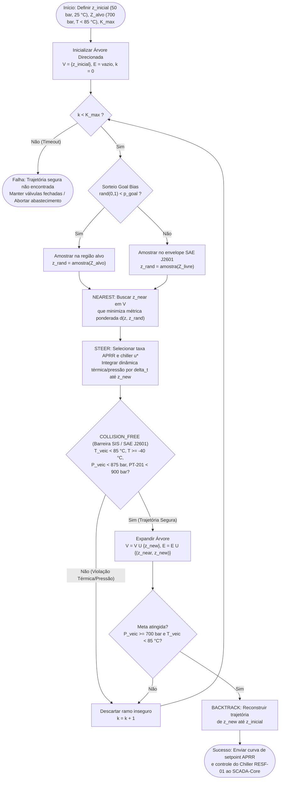

# Síntese de Trajetórias de Abastecimento Seguro com *Rapidly-exploring Random Trees* (RRT)
## Estação de Reabastecimento de Hidrogênio (HRS) • SCADA-Core (SAE J2601)

O **RRT (Árvore Aleatória de Exploração Rápida)** é um algoritmo probabilístico de planejamento de trajetórias usado para encontrar um caminho seguro entre um estado inicial e um estado alvo em espaços contínuos ou híbridos de alta dimensão, desviando de regiões proibidas — como o crescimento de raízes contornando obstáculos no solo.

Para compreender sua estrutura na prática:

* **Árvore (*Tree*):** Parte do estado inicial da estação (o "tronco") e constrói ramificações viáveis sem formar ciclos.
* **Aleatória (*Random*):** Em vez de discretizar todo o espaço termodinâmico em uma grade fixa (sujeita à maldição da dimensionalidade $\mathcal{O}(k^d)$), o algoritmo sorteia estados candidatos no espaço operacional.
* **Exploração Rápida (*Rapidly-exploring*):** Pontos sorteados em regiões ainda inexploradas "puxam" os ramos da fronteira da árvore rapidamente pelo espaço de operação seguro.

**Passo a passo intuitivo:**
1. **Estado inicial:** Marca-se a condição inicial do abastecimento (ex.: tanque do veículo FCEV a $50\text{ bar}$ e $25^\circ\text{C}$).
2. **Sorteio com *Goal Bias*:** Sorteia-se um estado aleatório no envelope operacional (com probabilidade $p_{\text{goal}}$, sorteia-se diretamente na região alvo de $700\text{ bar}$).
3. **Vizinho mais próximo:** Identifica-se o vértice já existente na árvore mais próximo do ponto sorteado.
4. **Integração física:** Aplica-se uma ação de controle admissível (abertura da válvula proporcional do dispenser `DISP-01` e potência do chiller `RESF-01`) por um intervalo $\Delta t$.
5. **Verificação de segurança (SIS):** Verifica-se se toda a trajetória respeita os limites da norma **SAE J2601** e do Sistema Instrumentado de Segurança (**IEC 61511**). Se violar qualquer barreira, o ramo é descartado; caso contrário, é incorporado à árvore.
6. **Repetição:** O ciclo se repete até atingir o estado final ($P_{\text{veic}} \ge 700\text{ bar}$, $\text{SOC} \ge 95\%$), permitindo reconstruir a rampa ótima de pressão e pré-resfriamento.

---

## 1. Interpretação Teórica na Estação de Reabastecimento de Hidrogênio (HRS)

No contexto do **Setor 200/300 (Chiller `RESF-01`, Banco de Alta Pressão `TK-AP` e Dispenser `DISP-01`)**, o hidrogênio apresenta efeito Joule-Thomson negativo em temperatura ambiente ($\mu_{\text{JT}} < 0$), aquecendo-se durante a expansão e compressão rápida no tanque compósito (Tipo IV) do veículo FCEV. Uma rampa de pressão agressiva sem pré-resfriamento adequado eleva a temperatura interna acima de $85^\circ\text{C}$, comprometendo a integridade da resina polimérica do cilindro veicular.

O algoritmo RRT atua como um **sintetizador de trajetórias de abastecimento rápido e seguro**, operando sobre um **Espaço de Estados Híbrido** $\mathcal{Z} = \mathcal{X} \times \mathcal{Q}$:

* **Subespaço Contínuo ($\mathcal{X} \subset \mathbb{R}^4$):** Representa as variáveis termodinâmicas da malha de abastecimento:
  $$\mathbf{x} = \begin{bmatrix} P_{\text{veic}} & T_{\text{veic}} & P_{\text{linha}} & T_{\text{chiller}} \end{bmatrix}^T$$
  onde $P_{\text{veic}}$ é a pressão no tanque do veículo ($\text{bar}$), $T_{\text{veic}}$ é a temperatura do gás no tanque ($^\circ\text{C}$), $P_{\text{linha}}$ é a pressão na linha de alta pressão ($\text{bar}$) e $T_{\text{chiller}}$ é a temperatura de saída do trocador criogênico `RESF-01` ($^\circ\text{C}$).
* **Subespaço Discreto ($\mathcal{Q} \subset \{0, 1\}^m$):** Representa o estado lógico dos atuadores da cascata e segurança (`XV-101` banco BP, `XV-201` banco AP, `COMP-01` compressor e `RESF-01` chiller).

### Espaço de Obstáculos ($\mathcal{Z}_{\text{obs}}$) e Região Segura ($\mathcal{Z}_{\text{livre}}$)

Os obstáculos correspondem às **barreiras termodinâmicas e de segurança funcional** definidas pela norma **SAE J2601** e pelo SIS da estação:

$$\mathcal{Z}_{\text{obs}} = \left\{ \mathbf{z} \in \mathcal{Z} \;\middle\vert{}\; \Phi_{\text{SIS}}(\mathbf{z}) = p_{\text{veic,max}} \lor t_{\text{veic,max}} \lor t_{\text{min}} \lor p_{201} \lor g_{1} \lor e_{1} = 1 \right\}$$

Onde:
* $p_{\text{veic,max}}$: Sobrepressão no tanque FCEV ($P_{\text{veic}} \ge 875\text{ bar}$, equivalente a $1{,}25 \times \text{NWP}$).
* $t_{\text{veic,max}}$: Sobretemperatura crítica no tanque Tipo IV ($T_{\text{veic}} \ge 85^\circ\text{C}$).
* $t_{\text{min}}$: Subtemperatura extrema na mangueira/bico ($T_{\text{veic}} < -40^\circ\text{C}$ ou $T_{\text{chiller}} < -45^\circ\text{C}$).
* $p_{201}$: Sobrepressão na linha do chiller `PT-201` ($\ge 900\text{ bar}$).
* $g_1, e_1$: Vazamento de $\text{H}_2$ (`AT-101` $\ge 40\%\text{ LFL}$) ou acionamento de emergência (`ESD-100`).

O RRT garante que toda a rampa de abastecimento permaneça estritamente contida em $\mathcal{Z}_{\text{livre}} = \mathcal{Z} \setminus \mathcal{Z}_{\text{obs}}$.

### Viés de Voronoi (*Voronoi Bias*) e Direção Cinodinâmica (*Kinodynamic Steering*)

* **Viés de Voronoi:** A probabilidade de seleção de um vértice $\mathbf{z}_{\text{near}} \in V$ é proporcional ao hipervolume de sua célula de Voronoi $\mathcal{V}(\mathbf{z}_{\text{near}})$. Vértices na fronteira têm células maiores e são expandidos com maior frequência, cobrindo rapidamente a faixa de $50\text{ bar}$ a $700\text{ bar}$.
* **Direção Cinodinâmica:** A partir de $\mathbf{z}_{\text{near}}$, seleciona-se um vetor de controle admissível $\mathbf{u} = [\dot{P}_{\text{APRR}}, \dot{Q}_{\text{chiller}}]^T$ (taxa de rampa de pressão em $\text{bar/s}$ e resfriamento) e integra-se a dinâmica $\dot{\mathbf{x}} = f(\mathbf{x}, q, \mathbf{u})$ durante $\Delta t$.

---

## 2. Fluxograma do Algoritmo RRT no SCADA-Core

---

## 3. Correspondência entre Primitivas do RRT e Engenharia da HRS

| Primitiva Algorítmica | Fundamento em Matemática Discreta / Controle | Papel Físico na Estação de Hidrogênio (`DISP-01` / `RESF-01`) |
| --- | --- | --- |
| **`SAMPLE` (com *Goal Bias*)** | Amostragem estocástica mista $(1 - p_{\text{goal}})\mathcal{U}(\mathcal{Z}) + p_{\text{goal}}\mathcal{U}(\mathcal{Z}_{\text{alvo}})$. | Explora diferentes combinações de rampa de pressão e pré-resfriamento enquanto direciona a busca para o enchimento completo ($700\text{ bar}$). |
| **`NEAREST`** | Busca do vizinho mais próximo sob métrica ponderada $d(\mathbf{z}_a, \mathbf{z}_b) = \Vert\mathbf{x}_a - \mathbf{x}_b\Vert_W + \lambda d_H(q_a, q_b)$. | Pondera grandezas físicas distintas ($\text{bar}$, $^\circ\text{C}$) e penaliza chaveamentos excessivos entre os bancos da cascata (`TK-BP` / `TK-AP`). |
| **`STEER`** | Controle local de horizonte curto ($\Delta t$) sujeito a $\dot{\mathbf{x}} = f(\mathbf{x}, q, \mathbf{u})$. | Calcula a abertura da válvula proporcional do dispenser e a carga térmica do chiller `RESF-01` respeitando limites mecânicos. |
| **`COLLISION_FREE`** | Verificação de invariância de conjunto: $\mathbf{z}(\tau) \in \mathcal{Z}_{\text{livre}}, \;\forall \tau \in [0, \Delta t]$. | Garante que o aquecimento por compressão adiabática e efeito Joule-Thomson nunca ultrapasse $85^\circ\text{C}$ nem gere sobrepressão $> 875\text{ bar}$. |
| **`BACKTRACK`** | Travessia reversa única na árvore enraizada até a raiz $\mathbf{z}_{\text{inicial}}$. | Gera o perfil determinístico de referência (*setpoints* de rampa APRR) para execução em malha fechada no CLP de abastecimento. |

---

## 4. Referências Técnicas

1. LAVALLE, S. M. **Rapidly-Exploring Random Trees: A New Tool for Path Planning**. Technical Report TR 98-11, Iowa State University, 1998.
2. SAE INTERNATIONAL. **SAE J2601: Fueling Protocols for Light Duty Gaseous Hydrogen Surface Vehicles**. Warrendale: SAE, 2020.
3. IEC 61511. **Functional Safety — Safety Instrumented Systems for the Process Industry Sector**. Geneva: IEC, 2016.
