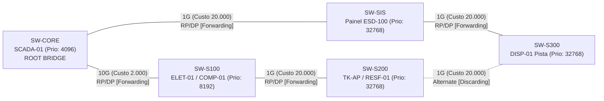

# Documentação Técnica: Aplicação de STP / RSTP na Rede SCADA-Core (Estação de Reabastecimento de Hidrogênio)

## 1. Contextualização da Planta e Criticidade de Rede

Na **Estação de Reabastecimento de Hidrogênio (HRS)**, o sistema **SCADA-Core** supervisiona e atua sobre quatro zonas operacionais interdependentes com alta criticidade de pressão e segurança atmosférica (hidrogênio gasoso até $1000\text{ bar}$, energia mínima de ignição $0{,}017\text{ mJ}$):

* **Setor 100 (Geração, Purificação e Armazenamento BP):** Eletrolisador (`ELET-01`), purificador (`PURIF-01`), tanques de baixa pressão (`TK-BP` / `TK-101`), compressor principal (`COMP-01`) e sensores de intertravamento (`PT-101`, `TT-101`, `AT-101`).
* **Setor 200 (Armazenamento AP e Condicionamento Criogênico):** Tanque de alta pressão (`TK-AP`), chiller criogênico a $-40^\circ\text{C}$ (`RESF-01`) e transmissores (`PT-201`, `TT-201`).
* **Setor 300 (Dispensação e Pista de Abastecimento):** Dispenser de hidrogênio (`DISP-01` — protocolo SAE J2601), válvulas solenoide de corte rápido (`XV-301`) e sensores (`PT-301`, `TT-301`, `AT-301`, `FT-301`).
* **Sala de Controle e Segurança (`SCADA-01` / `SIS`):** Servidor central SCADA-Core e painel de intertravamento de segurança (`ESD-100`).

Para garantir alta disponibilidade operacional e evitar perda de visibilidade ou atraso nos comandos de bloqueio (como o fechamento *fail-safe* de `XV-101` e `XV-301` em caso de sobrepressão `PT-101` $\ge 400\text{ bar}$ ou vazamento `AT-101` $\ge 40\%\text{ LFL}$), a rede Ethernet industrial (PROFINET / Modbus-TCP / OPC-UA) interliga os switches gerenciáveis de cada setor em **topologia física em anel redundante**.

---

## 2. Fundamentação em Matemática Discreta (Teoria dos Grafos)

A infraestrutura física de switches L2 da HRS é modelada como um grafo não-direcionado, conexo e ponderado $G = (V, E, w)$:

* **$V$ (Conjunto de Vértices):** Switches industriais gerenciáveis da planta:
  $$V = \{v_{\text{CORE}}, v_{\text{S100}}, v_{\text{S200}}, v_{\text{S300}}, v_{\text{SIS}}\}$$
* **$E$ (Conjunto de Arestas):** Enlaces físicos redundantes em fibra óptica ou par trançado blindado ($\vert E \vert \ge \vert V \vert$).
* **$w: E \to \mathbb{R}^+$ (Função de Peso):** **Custo de Caminho (*Path Cost*)** definido pela norma **IEEE 802.1w (RSTP)**, inversamente proporcional à largura de banda nominal:

| Velocidade do Enlace Industrial | Custo Padrão IEEE 802.1w (RSTP) | Aplicação Típica na Estação de Hidrogênio |
| --- | --- | --- |
| $100\text{ Mbps}$ (Fast Ethernet) | $200.000$ | Enlaces secundários / painéis de campo legados |
| $1\text{ Gbps}$ (Gigabit Ethernet) | $20.000$ | Anel principal em fibra óptica entre Setores 100, 200, 300 e SIS |
| $10\text{ Gbps}$ (10G Ethernet) | $2.000$ | *Backbone* principal entre Sala de Controle (`SW-CORE`) e Setor 100 (`SW-S100`) |

### O Problema dos Ciclos na Camada 2 (Ethernet)

Como a topologia física possui enlaces redundantes para tolerância a falhas, $G$ contém ciclos simples ($C_k \subseteq G$). Quadros Ethernet (Layer 2) **não possuem campo TTL (*Time-To-Live*)** no cabeçalho IEEE 802.3; logo, qualquer quadro de *broadcast* ou *multicast* (ex.: descoberta PROFINET DCP, requisições ARP) em um grafo cíclico é replicado indefinidamente, causando:

1. **Tempestade de Broadcast (*Broadcast Storm*):** Saturação imediata de $100\%$ da banda, interrompendo a telemetria determinística de `PT-101`, `TT-101` e `DISP-01`.
2. **Instabilidade da Tabela MAC (*MAC Flapping*):** O endereço MAC dos CLPs passa a oscilar entre múltiplas portas dos switches.

### Solução Formal: Árvore Geradora Mínima (MST)

O protocolo **STP / RSTP** executa um algoritmo distribuído de **Árvore Geradora Mínima**, extraindo de $G$ um subgrafo gerador $T = (V, E_T)$ tal que:
1. $T$ é conexo e acíclico ($\vert E_T \vert = \vert V \vert - 1 = 4$ enlaces ativos).
2. A soma dos custos até a raiz ($v_{\text{root}}$) é minimizada para cada switch.
3. As arestas redundantes $e \in (E \setminus E_T)$ são mantidas logicamente no estado **Discarding (Bloqueada)** em *hot standby*, assumindo o tráfego instantaneamente em caso de rompimento de fibra.

---

## 3. Comparativo Técnico: STP (802.1D) vs. RSTP (802.1w) na HRS

| Critério Técnico | STP Clássico (IEEE 802.1D) | RSTP (IEEE 802.1w) — Recomendado | Impacto Operacional no SCADA-Core da HRS |
| --- | --- | --- | --- |
| **Tempo de Convergência** | $30\text{ s}$ a $50\text{ s}$ | **$< 1\text{ s}$** ($50\text{ ms}$ a $200\text{ ms}$) | No STP, $50\text{ s}$ sem telemetria durante um abastecimento a $700\text{ bar}$ causa *trip* por *watchdog*. O RSTP converge antes do *timeout* do SCADA. |
| **Estados de Porta** | 5 estados (*Disabled, Blocking, Listening, Learning, Forwarding*) | 3 estados (*Discarding, Learning, Forwarding*) | Elimina os atrasos passivos de *Forward Delay* ($2 \times 15\text{ s}$) via *handshake* ativo (*Proposal/Agreement*). |
| **Papéis de Porta** | *Root, Designated, Non-Designated* | *Root, Designated, Alternate, Backup* | A porta *Alternate* mantém um caminho pré-calculado até o *Root Bridge*, comutando sem recálculo global. |
| **Geração de BPDUs** | Apenas o *Root Bridge* gera; demais repassam | Todos os switches geram BPDUs a cada *Hello Time* ($2\text{ s}$) | Falhas de enlace são detectadas imediatamente por perda de portadora física (*Link Down*) ou em até $3 \times \text{Hello Time}$ ($6\text{ s}$). |

---

## 4. Arquitetura Lógica e Determinismo de Papéis na Estação de Hidrogênio

### 4.1. Eleição Determinística do *Root Bridge*

* **Root Bridge Primário ($v_{\text{root}}$):** `SW-CORE` (Sala de Controle `SCADA-01`), configurado com `Bridge Priority = 4096`.
* **Root Bridge Secundário (Backup):** `SW-S100` (Setor 100 — Eletrolisador `ELET-01` e Compressor `COMP-01`), configurado com `Bridge Priority = 8192`. Em caso de falha total do switch central, a árvore se reancora no setor de maior carga energética e pressão.
* **Switches de Setor (`SW-S200`, `SW-S300`, `SW-SIS`):** Configurados com `Bridge Priority = 32768`.

### 4.2. Topologia Física vs. Árvore Geradora Lógica (Mermaid)

### 4.3. Proteções de Borda e Segurança de Rede Industrial

* **PortFast / Edge Port:** Habilitado nas portas de acesso ligadas aos CLPs, sensores Modbus-TCP e ao controlador do `DISP-01`, evitando *Topology Change Notifications* (TCNs) desnecessárias durante reinicializações de campo.
* **BPDU Guard:** Ativado em todas as *Edge Ports*; bloqueia imediatamente (*err-disabled*) qualquer porta onde um cabo seja conectado em *loop* acidental durante manutenção.
* **Root Guard:** Ativado nas portas de distribuição do `SW-CORE` e `SW-S100` para impedir que um switch não autorizado assuma o papel de *Root Bridge*.

---

## 5. Nota de Conformidade com Segurança Funcional (IEC 61508 / IEC 61511)

Embora o **RSTP** eleve a disponibilidade da rede supervisória (`SCADA-Core`) para níveis superiores a $99{,}99\%$, os intertravamentos críticos da estação de hidrogênio (`ESD-100`, detectores de fuga `AT-101` e fechamento das válvulas *fail-safe* `XV-101` e `XV-301`) operam em **malhas dedicadas *hardwired* ($4\text{–}20\text{ mA}$ / contatos secos NF)** diretamente no CLP de Segurança (SIS), mantendo independência física da camada Ethernet conforme o princípio de camadas independentes de proteção (LOPA).

---

## 6. Referências Técnicas

1. IEEE. **IEEE Std 802.1w: Rapid Reconfiguration of Spanning Tree**. New York: IEEE, 2001.
2. IEC 61511. **Functional Safety — Safety Instrumented Systems for the Process Industry Sector**. Geneva: IEC, 2016.
3. ISO 19880-1. **Gaseous Hydrogen — Fuelling Stations — Part 1: General Requirements**. Geneva: ISO, 2020.
