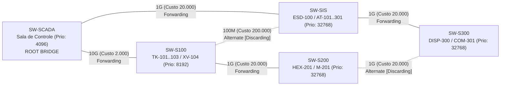

# Aula 23: Protocolo de Árvore Geradora (STP / RSTP) na Rede SCADA Core

## 1. Situação-Problema

Na **Estação de Reabastecimento de Hidrogênio — SCADA Core**, os controladores de campo dos três setores operam interligados por uma rede Ethernet industrial (Modbus TCP / OPC UA / PROFINET):
* **Setor 100 (`SW-S100`):** Manifold `SUP-100`, bancos em cascata `TK-101` ($400\text{ bar}$), `TK-102` ($700\text{ bar}$), `TK-103` ($1000\text{ bar}$) e válvula direcional `XV-104`.
* **Setor 200 (`SW-S200`):** Chiller criogênico `HEX-201` (`M-201`, `TT-201 <= -40 °C`, `PT-201`).
* **Setor 300 (`SW-S300`):** Dispensador `DISP-300` (`HS-301`, `COM-301`, `BV-301`, `PT-301`, `TT-301`, `AT-301`).
* **Painel de Segurança (`SW-SIS`) e Sala de Controle (`SW-SCADA`):** Concentração dos sinais de `ESD-100`, `ALM-101` e detectores `AT-101..301` ($> 25\%\text{ LIE}$).

Para evitar pontos únicos de falha (*Single Point of Failure*), a infraestrutura física é cabeada em **anel óptico redundante**. Contudo, enlaces físicos fechados em anel criam ciclos na Camada 2 (Ethernet), onde quadros não possuem campo TTL (*Time-To-Live*). Sem um mecanismo de quebra lógica de ciclo, qualquer pacote de *broadcast* ARP ou descoberta de dispositivo gera uma **Tempestade de Broadcast (*Broadcast Storm*)** e **MAC Flapping**, derrubando a supervisão do `SCADA-Core`.

---

## 2. Fundamentos Teóricos: Da Árvore Geradora ao RSTP (IEEE 802.1w)

### 2.1. Modelo em Grafo Ponderado
Modelamos os switches gerenciáveis como um grafo não-direcionado $G = (V, E, w)$, onde:
* $V = \{\text{SW-SCADA}, \text{SW-S100}, \text{SW-S200}, \text{SW-S300}, \text{SW-SIS}\}$ ($\vert V \vert = 5$).
* $E$ representa os enlaces físicos em fibra óptica ($10\text{ Gbps}$ / $1\text{ Gbps}$) e cobre industrial ($100\text{ Mbps}$).
* $w(e)$ é o **Custo de Caminho (*Path Cost*)** da norma **IEEE 802.1w**, inversamente proporcional à largura de banda:

| Enlace Físico | Largura de Banda | Custo IEEE 802.1w | Emprego na Estação de Hidrogênio |
| :--- | :---: | :---: | :--- |
| Fibra Óptica *Backbone* | $10\text{ Gbps}$ | $2.000$ | Ligação `SW-SCADA` $\leftrightarrow$ `SW-S100` (Setor 100) |
| Fibra Óptica Anel | $1\text{ Gbps}$ | $20.000$ | Anel entre `SW-SCADA`, `SW-S100`, `SW-S200`, `SW-S300`, `SW-SIS` |
| Par Trançado Industrial | $100\text{ Mbps}$ | $200.000$ | Enlace de contingência secundário |

### 2.2. STP Clássico (802.1D) vs. Rapid STP (802.1w)
* **STP (IEEE 802.1D):** Convergência passiva baseada em temporizadores (*Listening* + *Learning* = $30\text{ s}$ a $50\text{ s}$). Durante um abastecimento SAE J2601 a $700\text{ bar}$, ficar $50\text{ s}$ sem telemetria de `PT-301` e `TT-301` dispara *timeout* de *watchdog* e aborta a operação.
* **RSTP (IEEE 802.1w):** Convergência ativa em **$< 1\text{ s}$** ($50\text{–}200\text{ ms}$) via *handshake* *Proposal/Agreement* e papéis pré-computados (*Root Port*, *Designated Port*, *Alternate Port* em estado *Discarding* pronto para assumir como *hot standby*).

---

## 3. Eleição Determinística e Topologia Lógica na HRS

Configuramos manualmente o *Bridge Priority* para ancorar a árvore na Sala de Controle (`SW-SCADA`, prioridade `4096`) e definir o Setor 100 (`SW-S100`, prioridade `8192`) como backup imediato:

### Proteções de Borda e Independência do SIS
* **PortFast / Edge Port + BPDU Guard:** Ativados nas portas conectadas aos CLPs e ao `DISP-300`, impedindo *loops* acidentais em campo.
* **Independência Física (LOPA / IEC 61511):** O botão físico `ESD-100` e as válvulas *fail-safe* `XV-101..103` e `XV-301` possuem fiação *hardwired* ($4\text{–}20\text{ mA}$ / contatos NF) independente da rede Ethernet.

---

## 4. Exemplo Resolvido

**Pergunta:** Se a fibra de $10\text{ Gbps}$ entre `SW-SCADA` e `SW-S100` for rompida durante manutenção, como o RSTP restaura a comunicação com o Setor 100 (`TK-101..103`)?

**Resolução:** O enlace físico `SW-S200` $\leftrightarrow$ `SW-S300` (que estava bloqueado como *Alternate Port* no estado *Discarding*) transita imediatamente para *Forwarding* via *Proposal/Agreement* em menos de $200\text{ ms}$. O novo caminho até `SW-S100` passa a ser `SW-SCADA` $\to$ `SW-SIS` $\to$ `SW-S300` $\to$ `SW-S200` $\to$ `SW-S100` (custo acumulado $80.000$), preservando a árvore geradora acíclica com $\vert E_T \vert = 4$ arestas ativas.

---

## 5. Atividades de Investigação

1. Execute o notebook e compare a tabela de papéis das portas antes e depois do rompimento de `SW-SCADA` $\leftrightarrow$ `SW-S100`.
2. Verifique na auditoria matemática que o subgrafo após o *failover* continua sendo uma árvore geradora ($\vert E_T \vert = \vert V \vert - 1$, conexo e acíclico).
3. O que aconteceria com a eleição do *Root Bridge* se todos os switches fossem deixados com prioridade padrão `32768` e um switch antigo de `SW-S300` tivesse o menor endereço MAC?

---

## 6. Entregável da Aula 23

* **Simulador `executar_rstp` em Python:** Eleição de *Root Bridge*, cálculo de papéis de porta, simulação de *failover* no *backbone* e auditoria formal de árvore geradora.
