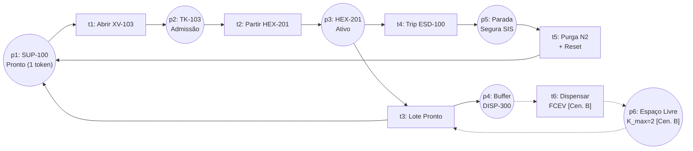
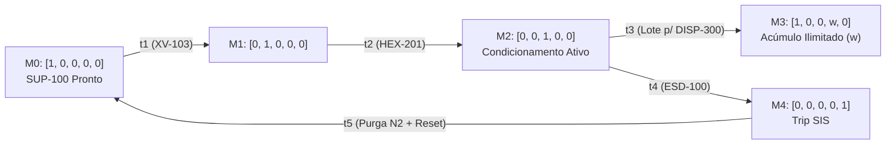

# Aula 24: Árvore de Atingibilidade e Cobertura em Redes de Petri

## 1. Situação-Problema

Na **Estação de Reabastecimento de Hidrogênio — SCADA Core**, o ciclo de carregamento em cascata (`SUP-100` $\to$ `TK-101/102/103` $\to$ `XV-104` $\to$ `HEX-201` $\to$ `DISP-300`) envolve eventos concorrentes e assíncronos sob restrições físicas rígidas (`PT-103 <= 1000 bar`, `AT-101..301 <= 25% LIE`, `ESD-100 = 0`).

Precisamos comprovar formalmente, antes da programação do CLP, que:
1. O banco de alta pressão `TK-103` não sofre **acúmulo ilimitado** de lotes sem drenagem pelo `DISP-300` (**Limitação / *Boundedness***);
2. O ciclo não entra em travamento mútuo (**Ausência de *Deadlock***);
3. O estado de operação ativa e o estado de parada de emergência (`ESD-100`) são **mutuamente exclusivos** (**Segurança / *Safety***).

---

## 2. Fundamentos Teóricos: Redes de Petri e Algoritmo de Karp-Miller

Uma Rede de Petri marcada é dada pela quíntupla $N = (P, T, Pre, Post, M_0)$, onde:
* **$P$** é o conjunto de **Lugares** (condições ou buffers de $\text{H}_2$);
* **$T$** é o conjunto de **Transições** (eventos e comandos SCADA);
* **$Pre, Post \in \mathbb{N}^{|P| \times |T|}$** definem os arcos de pré e pós-condição;
* **$M_0 \in \mathbb{N}^{|P|}$** é a marcação inicial.

Uma transição $t_j$ está habilitada em $M$ se $M \ge Pre(:, j)$. Ao disparar, gera $M' = M + (Post - Pre) \cdot \vec{e}_j$.

### Árvore de Atingibilidade vs. Árvore de Cobertura ($\omega$)
* Se o conjunto de marcações atingíveis $R(N, M_0)$ é finito, construímos a **Árvore de Atingibilidade** completa.
* Se algum lugar cresce indefinidamente, aplicamos o **Algoritmo de Karp-Miller (1969)**: sempre que uma nova marcação $M'$ domina um ancestral $M$ ($M' \ge M$ e $M' \neq M$), substituímos as coordenadas estritamente maiores por **$\omega$** ($\omega \pm k = \omega$), tornando a **Árvore de Cobertura** finita e decidindo formalmente a ilimitação da planta.

---

## 3. Modelagem na Estação de Hidrogênio (HRS)

| Lugar | Significado na HRS | Transição | Evento / Comando SCADA |
| :---: | :--- | :---: | :--- |
| **$p_1$** | `SUP-100` pronto para suprimento | **$t_1$** | Abrir `XV-103` (admissão para `TK-103`) |
| **$p_2$** | Transferência para `TK-103` liberada | **$t_2$** | Iniciar condicionamento em `HEX-201` (`M-201=1`) |
| **$p_3$** | Lote em preparação térmica (`HEX-201`) | **$t_3$** | Concluir lote pronto para `DISP-300` |
| **$p_4$** | Lotes acumulados aguardando `DISP-300` | **$t_4$** | Trip `ESD-100` / fuga `AT-101 > 25% LIE` |
| **$p_5$** | Estado de Parada Segura (`ESD-100` ativo) | **$t_5$** | Purga com $\text{N}_2$ e Reset manual |

#### Estrutura da Rede de Petri Marcada (Lugares $\leftrightarrow$ Transições)

#### Árvore de Cobertura (Cenário A — Sem Limite em `DISP-300`)

### Síntese de Controle via Lugar Complementar
No **Cenário A** (sem modelar o consumo do `DISP-300`), $p_4$ cresce sem limite e gera $\omega$. No **Cenário B**, adicionamos o lugar complementar $p_6$ (`ESPACO_LIVRE_DISP`) com $M_0(p_6) = K_{\max} = 2$ lotes e a transição $t_6$ (`DISP-300` conclui abastecimento FCEV), garantindo o invariante $M(p_4) + M(p_6) = 2$ e eliminando $\omega$.

---

## 4. Exemplo Resolvido

**Pergunta:** Por que o surgimento do símbolo $\omega$ na coordenada $p_4$ no Cenário A indica uma falha de projeto no intertravamento supervisório?

**Resolução:** O símbolo $\omega$ demonstra que o ciclo $t_1 \to t_2 \to t_3$ pode ser repetido arbitrariamente sem que nenhum veículo FCEV esteja consumindo hidrogênio em `DISP-300`. Na planta física, isso corresponde a continuar injetando gás sem vazão de saída, levando à violação de `PT-103 > 1000 bar` e abertura mecânica da `PSV-103`. A introdução do lugar complementar $p_6$ garante que o CLP bloqueie novas transferências quando `TK-103` / buffer atingir $K_{\max}$.

---

## 5. Atividades de Investigação

1. Execute o notebook e compare o número de estados atingíveis entre o Cenário A ($\omega$) e o Cenário B (limitado com $K_{\max} = 2$).
2. Altere $M_0(p_6)$ para $K_{\max} = 3$ no Cenário B e verifique como o número de marcações no grafo de atingibilidade cresce.
3. Confirme na função `auditar_propriedades_rdp` que não existe nenhuma marcação onde $M(p_3) > 0$ e $M(p_5) > 0$ simultaneamente (exclusão mútua entre operação e `ESD-100`).

---

## 6. Entregável da Aula 24

* **Verificador Formal de Redes de Petri em Python:** Implementação do algoritmo de Karp-Miller ($\omega$), síntese de lugar complementar e auditoria automática de limitação, vivacidade e segurança.
