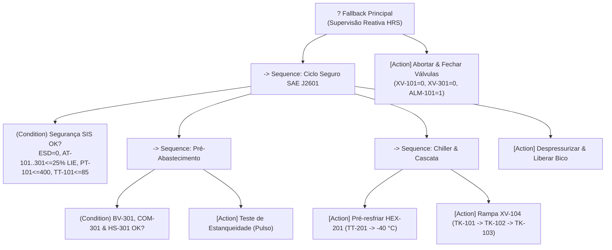

# Aula 25: Orquestração Reativa do Ciclo de Abastecimento com Árvores de Comportamento (*Behavior Trees*)

## 1. Situação-Problema

O ciclo completo de abastecimento de um veículo a célula de combustível (FCEV) a $700\text{ bar}$ exige que o controlador supervisório (`SCADA-Core` / CLP de Processo) coordene múltiplos subsistemas de forma **modular, hierárquica e reativa**:
1. **Monitoramento Contínuo de Segurança (SIS):** Checagem a cada *tick* ($100\text{ ms}$) de `ESD-100`, detectores de vazamento `AT-101..301` ($\le 25\%\text{ LIE}$), pressão `PT-101` ($\le 400\text{ bar}$) e temperatura `TT-101/301` ($\le 85^\circ\text{C}$).
2. **Pré-condições e Teste Pneumático de Estanqueidade:** Verificação de bico acoplado (`BV-301`), comunicação infravermelho SAE J2799 (`COM-301`) e comando `HS-301` no `DISP-300`, seguido de pulso de pressão inicial para detectar microvazamentos.
3. **Pré-resfriamento e Abastecimento em Cascata:** Acionamento do chiller `HEX-201` (`M-201`, mantendo `TT-201 <= -40 °C`), comutação em cascata `TK-101` $\to$ `TK-102` $\to$ `TK-103` via válvula direcional `XV-104` conforme a rampa APRR da norma **SAE J2601**.
4. **Pós-abastecimento:** Fechamento das válvulas solenoide (`XV-301`), despressurização controlada da mangueira e liberação do bico.

Em máquinas de estados finitos (FSM) tradicionais, adicionar uma nova condição de aborto ou recuperação gera crescimento quadrático de transições. **Árvores de Comportamento (*Behavior Trees* - BTs)** resolvem esse problema com **modularidade e reatividade nativa**: a cada ciclo (*tick*), a árvore é avaliada da raiz até as folhas, garantindo preempção imediata caso uma condição de segurança falhe durante o abastecimento.

---

## 2. Fundamentos Teóricos: Árvores de Comportamento

Uma Árvore de Comportamento é uma árvore enraizada direcionada $\mathcal{BT} = (V, E)$, onde cada nó retorna ao seu pai um dos três estados de execução:
$$\text{Status} \in \{\texttt{SUCCESS},\; \texttt{FAILURE},\; \texttt{RUNNING}\}$$

### Tipos de Nós Utilizados na HRS

| Nó | Símbolo | Regra de Execução (Semântica de *Tick*) | Aplicação na Estação HRS |
| :--- | :---: | :--- | :--- |
| **Sequence ($\rightarrow$)** | `->` | Executa filhos da esquerda para a direita. Retorna `FAILURE` ou `RUNNING` assim que um filho retornar esse status; retorna `SUCCESS` apenas se **todos** retornarem `SUCCESS`. | Sequência obrigatória: *Segurança OK* $\to$ *Acoplamento* $\to$ *Teste Estanqueidade* $\to$ *Abastecer*. |
| **Fallback / Selector (`?`)** | `?` | Executa filhos da esquerda para a direita. Retorna `SUCCESS` ou `RUNNING` no **primeiro** filho que não falhar; retorna `FAILURE` se todos falharem. | Estratégia de contingência: *Operar Normalmente* **ou** *Acionar Parada Segura SIS*. |
| **Condition** | `(c)` | Folha instantânea (sem efeito colateral) que testa predicados dos sensores ISA-5.1 (`PT-101`, `AT-101..301`, `ESD-100`). | Verificar `AT-101..301 <= 25% LIE` e `TT-101 <= 85 °C`. |
| **Action** | `[a]` | Folha que comanda atuadores (`HEX-201`, `XV-104`, `XV-301`, `DISP-300`) podendo permanecer `RUNNING` por múltiplos *ticks*. | Executar rampa SAE J2601 até `PT-301 >= 700 bar`. |

---

## 3. Arquitetura da Árvore de Comportamento do `SCADA-Core`

---

## 4. Exemplo Resolvido

**Pergunta:** Durante o **Tick 10**, enquanto o veículo FCEV está recebendo hidrogênio a $310\text{ bar}$ em `Rampa_Cascata_700bar` (retornando `RUNNING`), o detector `AT-101` sobe para $34\%\text{ LIE}$ ($> 25\%\text{ LIE}$). Como a Árvore de Comportamento reage no mesmo ciclo de varredura?

**Resolução:**
1. O *tick* começa na raiz `Fallback Principal`, que avalia primeiro `SeqOp` (`Sequence`).
2. O primeiro filho de `SeqOp` é `CondSafe` (`AT-101 <= 25% LIE`). Como $34 > 25$, `CondSafe` retorna imediatamente **`FAILURE`**.
3. Pela semântica de curto-circuito do nó `Sequence`, `SeqOp` **não alcança** `SeqFuel` e retorna `FAILURE` para a raiz.
4. A raiz `Fallback` avança para seu segundo filho `ActFail` (`Trip_Emergencia_SIS`), que zera `XV-101` e `XV-301` e ativa `ALM-101 = 1` no mesmo *tick* ($< 100\text{ ms}$), sem precisar de nenhuma transição explícita de cada subestado para emergência.

---

## 5. Atividades de Investigação

1. Execute o notebook e compare a coluna `Status_Raiz` / `Resultado_Ciclo` e a pressão `PT-301` entre o Cenário Nominal e o Cenário com vazamento no Tick 10.
2. Confira que `TT-201` (chiller `HEX-201`) estabiliza exatamente em $-40{,}0\,^\circ\text{C}$ (Classe T40 SAE J2601) durante o pré-resfriamento.
3. Simule um desacoplamento acidental de `BV-301` (`bico_conectado = False`) no meio do abastecimento e observe o comportamento da árvore.

---

## 6. Entregável da Aula 25

* **Motor de *Behavior Tree* em Python (`Sequence`, `Fallback`, `Condition`, `Action`):** Simulação com *blackboard* do `SCADA-Core`, preempção reativa sob falha `AT-101 > 25% LIE` e gráfico comparativo da rampa de pressão.

---

## 7. Referências Técnicas

1. COLLEDANCHISE, M.; ÖGREN, P. **Behavior Trees in Robotics and AI: An Introduction**. Boca Raton: CRC Press, 2018.
2. SAE INTERNATIONAL. **SAE J2601: Fueling Protocols for Light Duty Gaseous Hydrogen Surface Vehicles**. Warrendale: SAE, 2020.
3. IEC 61511. **Functional Safety — Safety Instrumented Systems for the Process Industry Sector**. Geneva: IEC, 2016.
