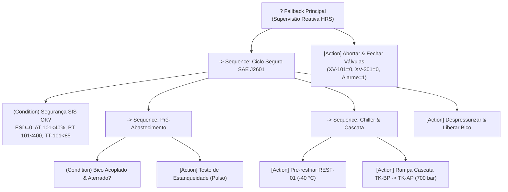

# Orquestração Reativa do Ciclo de Abastecimento com Árvores de Comportamento (*Behavior Trees*)
## Estação de Reabastecimento de Hidrogênio (HRS) • SCADA-Core (SAE J2601 / IEC 61511)

---

## 1. Contextualização na Automação da Estação de Hidrogênio

O ciclo completo de abastecimento de um veículo a célula de combustível (FCEV) a $700\text{ bar}$ exige que o controlador supervisório (`SCADA-Core` / CLP de Processo) coordene múltiplos subsistemas de forma **modular, hierárquica e reativa**:
1. **Monitoramento Contínuo de Segurança (SIS):** Checagem a cada *tick* ($100\text{ ms}$) de `ESD-100`, detector de vazamento `AT-101` ($< 40\%\text{ LFL}$), pressão `PT-101` ($< 400\text{ bar}$) e temperatura `TT-101` ($< 85^\circ\text{C}$).
2. **Pré-condições e Teste Pneumático de Estanqueidade:** Verificação de bico acoplado no `DISP-01`, aterramento eletrostático OK e pulso de pressão inicial para detectar microvazamentos antes da rampa principal.
3. **Pré-resfriamento e Abastecimento em Cascata:** Acionamento do chiller `RESF-01` ($-40^\circ\text{C}$), comutação entre banco de baixa pressão (`TK-BP`) e alta pressão (`TK-AP`) conforme a rampa APRR da norma **SAE J2601**.
4. **Pós-abastecimento:** Fechamento das válvulas solenoide (`XV-301`), despressurização controlada da mangueira e liberação do bico.

Em máquinas de estados finitos (FSM) tradicionais, adicionar uma nova condição de aborto ou recuperação gera crescimento quadrático de transições. **Árvores de Comportamento (*Behavior Trees* - BTs)** resolvem esse problema com **modularidade e reatividade nativa**: a cada ciclo (*tick*), a árvore é avaliada da raiz até as folhas, garantindo preempção imediata caso uma condição de segurança falhe durante o abastecimento.

---

## 2. Fundamentação Formal das Árvores de Comportamento

Uma Árvore de Comportamento é uma árvore enraizada direcionada $\mathcal{BT} = (V, E)$, onde cada nó retorna ao seu pai um dos três estados de execução:
$$\text{Status} \in \{\texttt{SUCCESS},\; \texttt{FAILURE},\; \texttt{RUNNING}\}$$

### Tipos de Nós Utilizados na HRS

| Nó | Símbolo | Regra de Execução (Semântica de *Tick*) | Aplicação na Estação HRS |
| :--- | :---: | :--- | :--- |
| **Sequence ($\rightarrow$)** | `->` | Executa filhos da esquerda para a direita. Retorna `FAILURE` ou `RUNNING` assim que um filho retornar esse status; retorna `SUCCESS` apenas se **todos** retornarem `SUCCESS`. | Sequência obrigatória: *Segurança OK* $\to$ *Acoplamento* $\to$ *Teste Estanqueidade* $\to$ *Abastecer*. |
| **Fallback / Selector (`?`)** | `?` | Executa filhos da esquerda para a direita. Retorna `SUCCESS` ou `RUNNING` no **primeiro** filho que não falhar; retorna `FAILURE` se todos falharem. | Estratégia de contingência: *Operar Normalmente* **ou** *Acionar Parada Segura SIS*. |
| **Condition** | `(c)` | Folha instantânea (sem efeito colateral) que testa predicados dos sensores ISA-5.1 (`PT-101`, `AT-101`, `ESD-100`). | Verificar `AT-101 < 40% LFL` e `TT-101 < 85 °C`. |
| **Action** | `[a]` | Folha que comanda atuadores (`RESF-01`, `COMP-01`, `XV-301`, `DISP-01`) podendo permanecer `RUNNING` por múltiplos *ticks*. | Executar rampa SAE J2601 até `P_veic >= 700 bar`. |

---

## 3. Arquitetura da Árvore de Comportamento do `SCADA-Core` (Mermaid)

### Propriedade Crítica de Reatividade (Preempção)
Como o nó raiz reavalia `CondSafe` no início de **todo *tick***, mesmo que `ActRamp` esteja no estado `RUNNING` (abastecendo a $450\text{ bar}$), qualquer disparo de `AT-101 >= 40% LFL` faz `CondSafe` retornar `FAILURE`. Isso interrompe instantaneamente `SeqOp` e transfere o controle no mesmo *tick* para `ActFail` via o `Fallback` raiz.

---

## 4. Referências Técnicas

1. COLLEDANCHISE, M.; ÖGREN, P. **Behavior Trees in Robotics and AI: An Introduction**. Boca Raton: CRC Press, 2018.
2. SAE INTERNATIONAL. **SAE J2601: Fueling Protocols for Light Duty Gaseous Hydrogen Surface Vehicles**. Warrendale: SAE, 2020.
3. IEC 61511. **Functional Safety — Safety Instrumented Systems for the Process Industry Sector**. Geneva: IEC, 2016.
