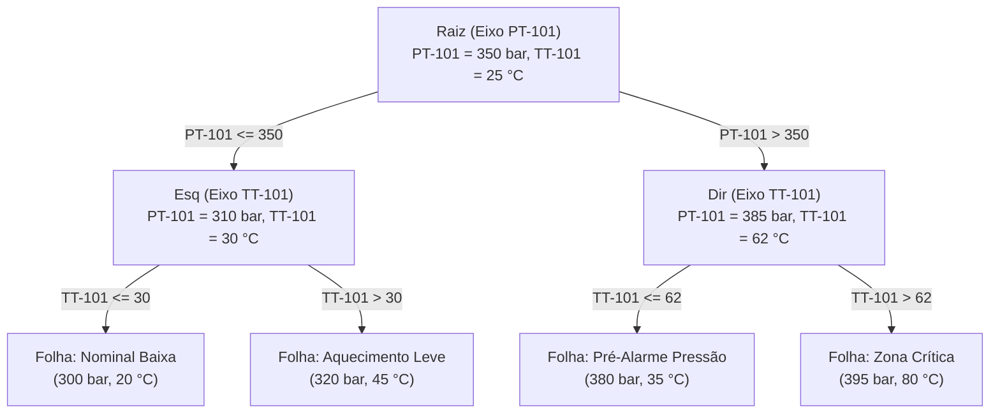

# Indexação Multidimensional e Detecção de Anomalias com KD-Trees
## Estação de Reabastecimento de Hidrogênio (HRS) • Historiador SCADA-Core

---

## 1. Contextualização no Historiador Multivariável da HRS

Na **Aula 21**, utilizamos uma árvore **AVL** unidimensional para indexar séries temporais pela chave escalar *timestamp* ($\tau$). Contudo, no diagnóstico avançado de processos da **Estação de Reabastecimento de Hidrogênio (HRS)**, o operador e os módulos de manutenção preditiva precisam consultar o historiador não apenas pelo tempo, mas **pela similaridade entre estados físicos multivariáveis**.

Cada amostra de telemetria dos Setores 100 e 200 forma um ponto no espaço euclidiano $k$-dimensional ($k = 4$):
$$\mathbf{x}_i = \begin{bmatrix} P_{\text{PT-101}} \\ T_{\text{TT-101}} \\ P_{\text{PT-201}} \\ C_{\text{AT-101}} \end{bmatrix} \in \mathbb{R}^4$$

Uma busca linear (*brute-force*) em um histórico com $N = 10^6$ amostras possui complexidade $\mathcal{O}(k \cdot N)$ por consulta, inviabilizando análises em tempo real na taxa de varredura do SCADA ($10\text{ ms}$ a $100\text{ ms}$). A estrutura **KD-Tree (*k-Dimensional Tree*)** resolve esse gargalo particionando recursivamente o espaço de estados por hiperplanos ortogonais aos eixos coordenados.

---

## 2. Definição Formal e Construção da KD-Tree

Uma **KD-Tree** é uma árvore binária de busca espacial que organiza pontos em $\mathbb{R}^k$:

1. **Eixo de Corte (*Splitting Axis*):** Na profundidade $d$, seleciona-se a dimensão:
   $$a = d \bmod k$$
   (Ex.: $d=0 \to$ `PT-101`; $d=1 \to$ `TT-101`; $d=2 \to$ `PT-201`; $d=3 \to$ `AT-101`).
2. **Pivô Mediano:** Ordenam-se os pontos do subconjunto pelo eixo $a$ e escolhe-se a **mediana** como nó raiz da subárvore, garantindo altura balanceada $h = \mathcal{O}(\log_2 N)$.
3. **Invariante Espacial:**
   * Todos os pontos na subárvore esquerda satisfazem $x[a] \le \text{pivô}[a]$.
   * Todos os pontos na subárvore direita satisfazem $x[a] > \text{pivô}[a]$.

### Exemplo de Particionamento 2D (`PT-101` $\times$ `TT-101`)

---

## 3. Algoritmos de Consulta no `SCADA-Core`

### 3.1. Busca do Vizinho Mais Próximo ($k$-NN) com Poda *Branch-and-Bound*
Dado um vetor de telemetria ao vivo $\mathbf{q} \in \mathbb{R}^4$ (normalizado por *z-score* ou escala nominal dos sensores), deseja-se encontrar o registro histórico mais próximo:
1. Desce-se na árvore comparando $\mathbf{q}[a]$ com o pivô até atingir uma folha (melhor candidato inicial com distância $d_{\text{best}}$).
2. No retorno recursivo (*backtracking*), verifica-se a distância perpendicular até o hiperplano de corte:
   $$\delta = |\mathbf{q}[a] - \text{pivô}[a]|$$
3. **Regra de Poda:** Só é necessário explorar o ramo irmão se $\delta < d_{\text{best}}$ (isto é, se a hiperesfera de raio $d_{\text{best}}$ centrada em $\mathbf{q}$ cruzar o hiperplano divisor).

**Aplicação na HRS:** Detecção de anomalias baseada em distância (*Out-of-Distribution*). Se a distância ao vizinho mais próximo nominal ultrapassar um limiar $\tau_{\text{anom}}$, o SCADA-Core emite alerta preditivo antes do disparo físico do SIS.

### 3.2. Busca por Intervalo Ortogonal (*Orthogonal Range Search*)
Dado um hiper-retângulo de operação $R = [l_1, u_1] \times \dots \times [l_k, u_k]$ (ex.: auditoria de eventos *near-miss* onde `PT-101` $\in [370, 400]\text{ bar}$ e `TT-101` $\in [60, 85]^\circ\text{C}$), a KD-Tree poda subárvores inteiras cujo intervalo no eixo $a$ não intersecta $[l_a, u_a]$.

### Complexidade Computacional

| Operação | Caso Médio (Dados Balanceados) | Pior Caso |
| :--- | :---: | :---: |
| **Construção da KD-Tree** | $\mathcal{O}(N \log N)$ | $\mathcal{O}(N \log^2 N)$ |
| **Busca Vizinho Mais Próximo ($k$-NN)** | $\mathcal{O}(\log N)$ | $\mathcal{O}(N)$ (alta dimensão) |
| **Busca por Intervalo Ortogonal ($k=4$)** | $\mathcal{O}(N^{1 - 1/k} + M)$ | $\mathcal{O}(N)$ |

*Onde $M$ é o número de pontos retornados dentro do hiper-retângulo.*

---

## 4. Referências Técnicas

1. BENTLEY, J. L. **Multidimensional Binary Search Trees Used for Associative Searching**. Communications of the ACM, v. 18, n. 9, p. 509–517, 1975.
2. DE BERG, M. et al. **Computational Geometry: Algorithms and Applications**. 3rd ed. Berlin: Springer, 2008.
3. IEC 61511. **Functional Safety — Safety Instrumented Systems for the Process Industry Sector**. Geneva: IEC, 2016.
