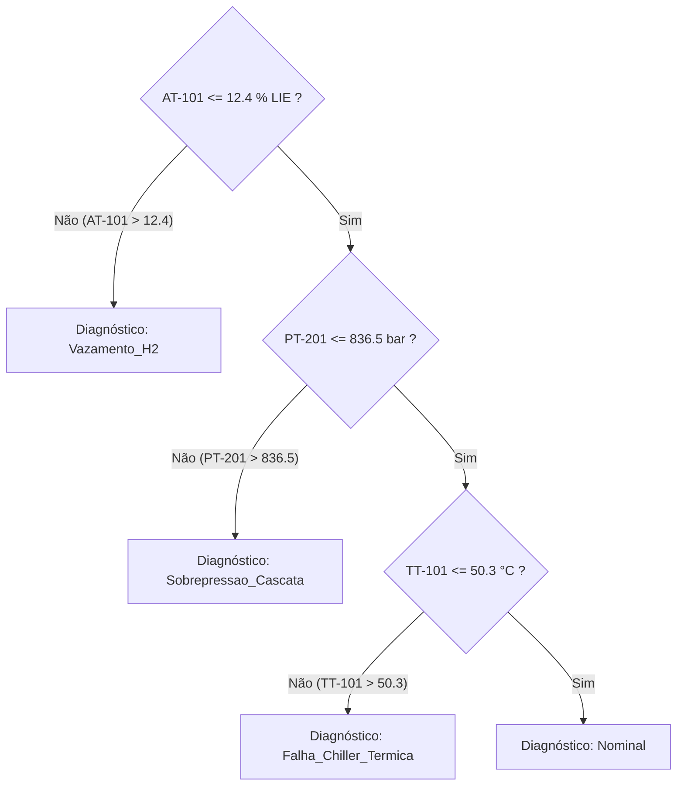

# Aula 27: Árvores de Decisão — Algoritmos Clássicos de Construção (ID3, C4.5 e CART)

## 1. Situação-Problema

Na **Aula 21**, projetamos uma Árvore Binária de Decisão (BDT) **estática**, cujas regras booleanas foram definidas manualmente pela engenharia de segurança funcional (IEC 61511). Já no módulo de **Diagnóstico Inteligente e Manutenção Preditiva do SCADA-Core**, desejamos que o sistema **aprenda automaticamente** a classificar o regime operacional e a causa raiz de falhas a partir de históricos de telemetria rotulados:

* **Atributos Contínuos de Entrada ($X$):** `PT-101` ($\text{bar}$), `TT-101` ($^\circ\text{C}$), `AT-101` ($\%\text{ LIE}$) e `PT-201` ($\text{bar}$) na saída do trocador `HEX-201`.
* **Classes de Diagnóstico ($Y$):**
  1. `Nominal`: Operação estável dentro da janela SAE J2601.
  2. `Falha_Chiller_Termica`: Degradação do trocador `HEX-201` (`M-201`) ou aquecimento em `TT-101`.
  3. `Sobrepressao_Cascata`: Excesso de pressão em `TK-101` (`PT-101`) ou na linha `PT-201`.
  4. `Vazamento_H2`: Elevação anômala em `AT-101` ($> 25\%\text{ LIE}$ ou pré-alarme) indicando microfuga ou ruptura de vedação.

Os algoritmos clássicos de construção de Árvores de Decisão — **ID3**, **C4.5** e **CART** — resolvem esse problema de forma gulosa (*top-down greedy divide-and-conquer*), escolhendo em cada nó o atributo e o limiar que maximizam a **pureza** dos subconjuntos resultantes.

---

## 2. Fundamentos Teóricos: Critérios de Seleção de Atributos

Seja $S$ um conjunto de $N$ amostras históricas distribuídas em $C$ classes com proporções empíricas $p_1, p_2, \dots, p_C$.

### 2.1. Entropia de Shannon e Ganho de Informação (ID3)
$$H(S) = -\sum_{c=1}^{C} p_c \log_2(p_c)$$
$$IG(S, A, \theta) = H(S) - \left(\frac{|S_{\text{esq}}|}{|S|} H(S_{\text{esq}}) + \frac{|S_{\text{dir}}|}{|S|} H(S_{\text{dir}})\right)$$

### 2.2. Razão de Ganho (*Gain Ratio* — C4.5)
O ID3 favorece atributos com muitas partições distintas. O algoritmo **C4.5** (Quinlan, 1993) normaliza o ganho pela **Entropia da Partição (*Split Information*)**, suporta atributos contínuos via limiar ótimo $\theta$ e emprega poda pós-construção:
$$\text{GainRatio}(S, A, \theta) = \frac{IG(S, A, \theta)}{\text{SplitInfo}(S, A, \theta)}, \qquad \text{SplitInfo} = -\sum_{v \in \{\text{esq, dir}\}} \frac{|S_v|}{|S|} \log_2\left(\frac{|S_v|}{|S|}\right)$$

### 2.3. Impureza de Gini (CART — *Classification and Regression Trees*)
O algoritmo **CART** (Breiman et al., 1984) constrói árvores estritamente **binárias** ($A \le \theta$ vs. $A > \theta$) minimizando o **Índice de Gini**, evitando logaritmos:
$$\text{Gini}(S) = 1 - \sum_{c=1}^{C} p_c^2, \qquad \text{Gini}_{\text{split}}(S, A, \theta) = \frac{|S_{\text{esq}}|}{|S|} \text{Gini}(S_{\text{esq}}) + \frac{|S_{\text{dir}}|}{|S|} \text{Gini}(S_{\text{dir}})$$

---

## 3. Comparativo dos Algoritmos Clássicos e Exemplo Induzido

| Algoritmo | Tipo de Árvore | Critério de Divisão | Atributos Contínuos (`PT-101`, `TT-101`) | Controle de *Overfitting* |
| :--- | :---: | :--- | :--- | :--- |
| **ID3** (1986) | Multi-ramo | Ganho de Informação (Entropia) | Exige discretização prévia em faixas | Sem poda nativa |
| **C4.5** (1993) | Multi-ramo / Binária | Razão de Ganho (*Gain Ratio*) | Sim (busca limiar ótimo $\theta$) | Poda baseada em erro pessimista |
| **CART** (1984) | **Estritamente Binária** | **Impureza de Gini** (ou Entropia) | Sim (limiares binários $x_j \le \theta$) | `max_depth`, `min_samples_leaf`, CCP |

---

## 4. Exemplo Resolvido

**Pergunta:** Dado um nó com $10$ amostras ($5$ `Nominal` e $5$ `Vazamento_H2`), qual é o Índice de Gini inicial do nó e o ganho de Gini caso um corte `AT-101 <= 12.4 % LIE` separe perfeitamente $5$ `Nominal` à esquerda e $5$ `Vazamento_H2` à direita?

**Resolução:**
* Impureza inicial do nó pai: $\text{Gini}(S) = 1 - (0{,}5^2 + 0{,}5^2) = 0{,}50$.
* Nos nós filhos puros: $\text{Gini}(S_{\text{esq}}) = 1 - 1^2 = 0$ e $\text{Gini}(S_{\text{dir}}) = 1 - 1^2 = 0$.
* Logo, o ganho de pureza é $\Delta \text{Gini} = 0{,}50 - 0 = 0{,}50$ (máximo possível para duas classes balanceadas), tornando `AT-101` a raiz escolhida.

---

## 5. Atividades de Investigação

1. Execute o notebook e compare a acurácia em teste e as regras extraídas usando os critérios **`gini`** (CART), **`entropy`** e **`gain_ratio`** (C4.5).
2. Observe o gráfico de fronteiras de decisão 2D extraídas diretamente do modelo treinado no plano `PT-101` $\times$ `TT-101`.
3. Varie `max_depth` de $1$ até $8$ e compare acurácia de treino vs. teste para identificar o ponto de *overfitting*.

---

## 6. Entregável da Aula 27

* **Construtor `ArvoreDecisaoClassica` em Python (`gini`, `entropy`, `gain_ratio`):** Treinamento sobre telemetria da HRS, extração de regras legíveis para auditoria IEC 61511, matriz de confusão e mapa real de fronteiras de decisão.

---

## 7. Referências Técnicas

1. QUINLAN, J. R. **Induction of Decision Trees**. Machine Learning, v. 1, p. 81–106, 1986. (ID3)
2. QUINLAN, J. R. **C4.5: Programs for Machine Learning**. San Mateo: Morgan Kaufmann, 1993.
3. BREIMAN, L. et al. **Classification and Regression Trees**. Belmont: Wadsworth, 1984. (CART)
4. CORMEN, T. H. et al. **Algoritmos: Teoria e Prática**. 3. ed. Rio de Janeiro: Elsevier, 2012.
