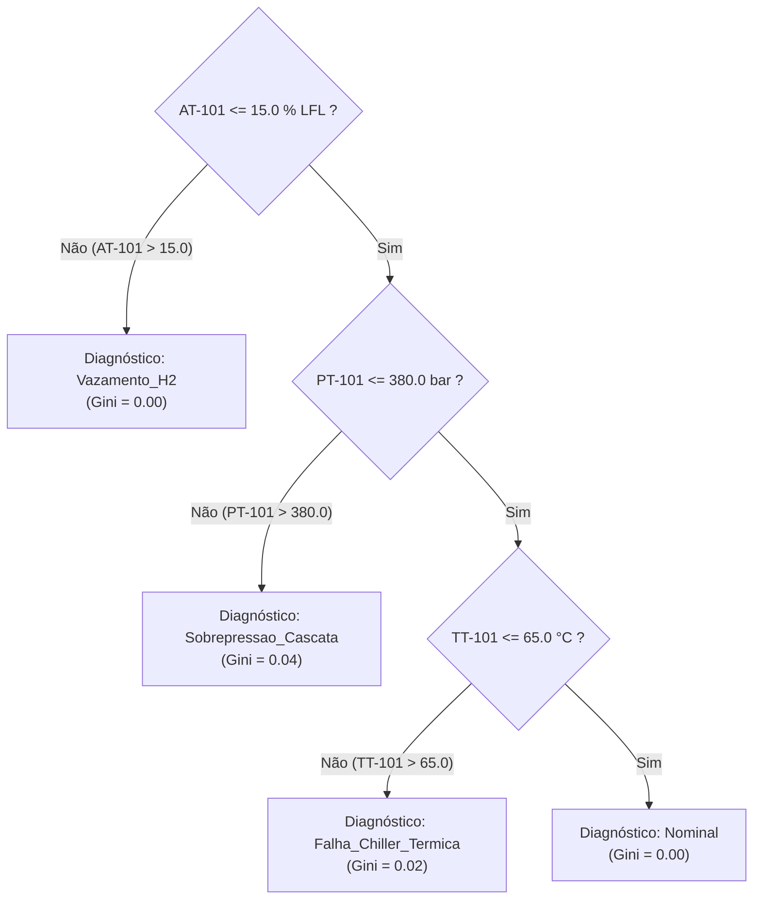

# Árvores de Decisão: Algoritmos Clássicos de Construção (ID3, C4.5 e CART)
## Diagnóstico Automático de Falhas e Regimes na Estação de Reabastecimento de Hidrogênio (HRS)

---

## 1. Contextualização: Da Árvore Estática (SIS) à Indução por Dados (SCADA-Core)

Na **Aula 21**, projetamos uma Árvore Binária de Decisão (BDT) **estática**, cujas regras booleanas foram definidas manualmente pela engenharia de segurança funcional (IEC 61511). Já no módulo de **Diagnóstico Inteligente e Manutenção Preditiva do SCADA-Core**, desejamos que o sistema **aprenda automaticamente** a classificar o regime operacional e a causa raiz de falhas a partir de históricos de telemetria rotulados:

* **Atributos Contínuos de Entrada ($X$):** `PT-101` ($\text{bar}$), `TT-101` ($^\circ\text{C}$), `AT-101` ($\%\text{ LFL}$), `PT-201` ($\text{bar}$) e temperatura do chiller `RESF-01` ($^\circ\text{C}$).
* **Classes de Diagnóstico ($Y$):**
  1. `Nominal`: Operação estável dentro da janela SAE J2601.
  2. `Falha_Chiller_Termica`: Degradação do trocador `RESF-01` ou aquecimento em `TT-101`.
  3. `Sobrepressao_Cascata`: Excesso de pressão em `TK-BP` (`PT-101`) ou na linha `PT-201`.
  4. `Vazamento_H2`: Elevação anômala em `AT-101` indicando microfuga ou ruptura de vedação.

Os algoritmos clássicos de construção de Árvores de Decisão — **ID3**, **C4.5** e **CART** — resolvem esse problema de forma gulosa (*top-down greedy divide-and-conquer*), escolhendo em cada nó o atributo e o limiar que maximizam a **pureza** dos subconjuntos resultantes.

---

## 2. Critérios Matemáticos de Seleção de Atributos

Seja $S$ um conjunto de $N$ amostras históricas distribuídas em $C$ classes com proporções empíricas $p_1, p_2, \dots, p_C$.

### 2.1. Entropia de Shannon e Ganho de Informação (ID3)
A **Entropia** mede o grau de incerteza (desordem) das classes em $S$:
$$H(S) = -\sum_{c=1}^{C} p_c \log_2(p_c)$$

Ao particionar $S$ por um atributo $A$ (ou limiar $A \le \theta$ e $A > \theta$) em subconjuntos $\{S_v\}$, o **Ganho de Informação (*Information Gain*)** é a redução esperada na entropia:
$$IG(S, A) = H(S) - \sum_{v} \frac{|S_v|}{|S|} H(S_v)$$

### 2.2. Razão de Ganho (*Gain Ratio* — C4.5)
O ID3 tende a favorecer atributos com muitos valores distintos. O algoritmo **C4.5** (Quinlan, 1993) normaliza o ganho pela **Entropia da Partição (*Split Information*)** e introduz suporte nativo a atributos contínuos (buscando o melhor limiar $\theta$) e poda pós-construção (*post-pruning*):
$$\text{GainRatio}(S, A) = \frac{IG(S, A)}{\text{SplitInfo}(S, A)}, \qquad \text{SplitInfo}(S, A) = -\sum_{v} \frac{|S_v|}{|S|} \log_2\left(\frac{|S_v|}{|S|}\right)$$

### 2.3. Impureza de Gini (CART — *Classification and Regression Trees*)
O algoritmo **CART** (Breiman et al., 1984) constrói árvores estritamente **binárias** ($A \le \theta$ vs. $A > \theta$) minimizando o **Índice de Gini**, computacionalmente mais rápido por evitar logaritmos:
$$\text{Gini}(S) = 1 - \sum_{c=1}^{C} p_c^2$$

O melhor corte $(A^*, \theta^*)$ minimiza a impureza ponderada dos dois ramos filhos:
$$\text{Gini}_{\text{split}}(S, A, \theta) = \frac{|S_{\text{esq}}|}{|S|} \text{Gini}(S_{\text{esq}}) + \frac{|S_{\text{dir}}|}{|S|} \text{Gini}(S_{\text{dir}})$$

---

## 3. Comparativo dos Algoritmos Clássicos na HRS

| Algoritmo | Tipo de Árvore | Critério de Divisão | Atributos Contínuos (`PT-101`, `TT-101`) | Controle de *Overfitting* |
| :--- | :---: | :--- | :--- | :--- |
| **ID3** (1986) | Multi-ramo | Ganho de Informação (Entropia) | Exige discretização prévia em faixas | Sem poda nativa |
| **C4.5** (1993) | Multi-ramo / Binária | Razão de Ganho (*Gain Ratio*) | Sim (busca limiar ótimo $\theta$) | Poda baseada em erro pessimista |
| **CART** (1984) | **Estritamente Binária** | **Impureza de Gini** (ou Entropia) | Sim (limiares binários $x_j \le \theta$) | `max_depth`, `min_samples_leaf`, CCP |

---

## 4. Exemplo de Árvore Induzida para Diagnóstico da HRS (Mermaid)

---

## 5. Vantagens para Sistemas SCADA Críticos (Interpretabilidade)

Diferente de modelos "caixa-preta" (*deep learning*), as Árvores de Decisão clássicas produzem **regras explícitas e auditáveis** (`SE PT-101 > 380 bar ENTÃO Sobrepressao_Cascata`), permitindo que engenheiros de automação validem o modelo contra as normas **SAE J2601**, **ISO 19880-1** e **IEC 61511** antes de integrá-lo à IHM do `SCADA-Core`.

---

## 6. Referências Técnicas

1. QUINLAN, J. R. **Induction of Decision Trees**. Machine Learning, v. 1, p. 81–106, 1986. (ID3)
2. QUINLAN, J. R. **C4.5: Programs for Machine Learning**. San Mateo: Morgan Kaufmann, 1993.
3. BREIMAN, L. et al. **Classification and Regression Trees**. Belmont: Wadsworth, 1984. (CART)
4. CORMEN, T. H. et al. **Algoritmos: Teoria e Prática**. 3. ed. Rio de Janeiro: Elsevier, 2012.
