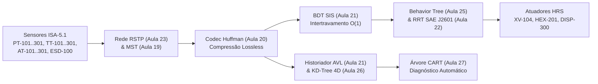

# Aula 28: Avaliação e Simulação Integrada do Módulo 3 — Arquitetura Baseada em Árvores no SCADA Core

## 1. Situação-Problema e Consolidação da Etapa 03

Assim como a [Aula 10](../etapa-01-logica/10%20-%20Avaliacao%20Modulo%201%20Motor%20de%20Intertravamento%20e%20Diagnostico.md) consolidou o motor lógico de intertravamento do Módulo 1 e a [Aula 18](../etapa-02-grafos/18%20-%20Grafos%20de%20Logistica%20de%20Insumos%20e%20Produtos%20Acabados.md) integrou os grafos de processo e logística do Módulo 2, esta **Aula 28** apresenta o **Simulador Integrado do Módulo 3 (`SCADACoreModulo3`)** para a **Estação de Reabastecimento de Hidrogênio (HRS)**.

O objetivo é demonstrar como todas as estruturas de **Árvores** desenvolvidas das Aulas 19 a 27 operam em conjunto em um ciclo completo de supervisão, controle e diagnóstico da planta:

| Camada do `SCADA-Core` | Estrutura de Árvore (Módulo 3) | Papel Operacional na Estação HRS |
| :--- | :--- | :--- |
| **Infraestrutura & Rede** | **Kruskal / Prim (Aula 19)** + **RSTP (Aula 23)** | Garante topologia acíclica mínima e *failover* $< 1\text{ s}$ entre `SW-SCADA`, `SW-S100`, `SW-S200`, `SW-S300` e `SW-SIS`. |
| **Telemetria de Campo** | **Codificação de Huffman (Aula 20)** | Comprime em até $76{,}3\%$ o vetor binário de estado `[PT-101, TT-101, AT-101, PT-201, ESD-100]` sem perda de informação. |
| **Segurança Funcional (SIS)** | **BDT (Aula 21)** + **Redes de Petri (Aula 24)** | Garante tempo de resposta $\mathcal{O}(1)$ no intertravamento e prova ausência de *deadlock* e acúmulo ilimitado ($\omega$) em `TK-103`. |
| **Orquestração & Controle** | **Behavior Tree (Aula 25)** + **RRT (Aula 22)** | Orquestra o ciclo SAE J2601 (`BV-301`, `COM-301`, `HEX-201`, `XV-104` cascata `TK-101 -> TK-102 -> TK-103`) com preempção reativa. |
| **Historiador & Diagnóstico** | **AVL (Aula 21)** + **KD-Tree (Aula 26)** + **CART (Aula 27)** | Indexa séries temporais em $\mathcal{O}(\log N)$, detecta anomalias 4D e classifica falhas (`Nominal`, `Falha_Chiller`, `Sobrepressao`, `Vazamento_H2`). |

---

## 2. Arquitetura Integrada do Módulo 3 (Mermaid)

---

## 3. Cenários de Validação e Testes de Estresse

No notebook executável desta aula, a classe `SCADACoreModulo3` é validada em **dois cenários completos** (espelhando a suíte de validação da Aula 10):

1. **Cenário A — Abastecimento Nominal SAE J2601 (700 bar):**
   * Rede RSTP convergente (`SW-SCADA` como *Root Bridge*), transmissão comprimida por Huffman, `BDT` em estado seguro, `Behavior Tree` executando teste de estanqueidade, pré-resfriamento em `HEX-201` (`TT-201 = -40 °C`) e rampa em cascata (`TK-101 -> TK-102 -> TK-103` via `XV-104`) até `PT-301 = 700 bar`, com historiador `AVL` e classificador `CART` confirmando regime `Nominal`.
2. **Cenário B — Falha Crítica por Vazamento de $\text{H}_2$ (`AT-301 = 34% LIE > 25% LIE`) + Corte de Fibra:**
   * Simula simultaneamente o rompimento do *backbone* `SW-SCADA` $\leftrightarrow$ `SW-S100` (com *failover* RSTP mantendo a supervisão ativa) e um vazamento no dispensador `DISP-300` no meio do abastecimento.
   * A `BDT` e a `Behavior Tree` executam **preempção imediata no mesmo *tick*** (`XV-101..103 = 0`, `XV-301 = 0`, `ALM-101 = 1`), enquanto a `KD-Tree` aponta distância anômala e a árvore `CART` isola a causa-raiz `Vazamento_H2`.

---

## 4. Entregável da Aula 28

* **Simulador `SCADACoreModulo3` em Python:** Integração ponta a ponta das estruturas de árvores da Etapa 03 aplicadas à Estação de Reabastecimento de Hidrogênio, com painel comparativo de métricas e gráficos de telemetria dos dois cenários.
